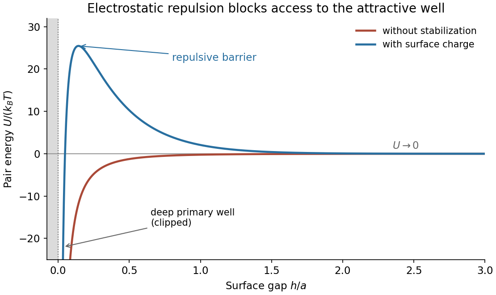

<h1 id="section-b/5/f/solution">Solution</h1>

↑ **Parent:** [F](../f.md)

Without stabilization, the [potential energy](../../../../../potential-energy.md) is predominantly attractive outside the molecular core and drops into a deep primary minimum. With the charging treatment, the [DLVO theory](../../../../../dlvo-theory.md) sum develops a positive barrier between distant particles and that primary minimum. The barrier must be large compared with $k_BT$ to inhibit aggregation on the experimental timescale. A shallow secondary minimum can remain at larger separation, depending on parameters.

**[Figure 3](#section-b/5/f/image-attractive-and-electrostatically-stabilized-colloidal-pair-potentials). Attractive and electrostatically stabilized colloidal pair potentials**. Original illustrative curves for two equal spheres. The unstabilized curve uses the nonretarded sphere–sphere attraction; the stabilized curve adds screened electrostatic repulsion. The molecular core is excluded and the deep near-contact well is clipped by the plotting range. Potential depths and screening parameters are illustrative, not data supplied by the paper.

The horizontal axis is the surface gap, so the molecular exclusion boundary is at its origin. Both interactions tend to zero at large separation. Raising salt concentration shortens the [Debye–Hückel screening length](../../../../../debye-huckel-screening-length.md) and can reduce the barrier, allowing particles to stick again.

## ↑ Ancestors (14)

1. [F](../f.md)
2. [5](../../5.md)
3. [Section B](../../../section-b.md)
4. [2021](../../../../2021-split.md)
5. [Past exam of the soft condensed matter course of the University of Cambridge](../../../../split.md)
6. [Soft Condensed Matter course of the University of Cambridge](../../../../../soft-condensed-matter-course-of-the-university-of-cambridge.md)
7. [Physics course of the year 3 of the natural sciences course of the University of Cambridge](../../../../../physics-course-of-the-year-3-of-the-natural-sciences-course-of-the-university-of-cambridge.md)
8. [Year 3 of the natural sciences course of the University of Cambridge](../../../../../year-3-of-the-natural-sciences-course-of-the-university-of-cambridge.md)
9. [Year of the natural sciences course of the University of Cambridge](../../../../../year-of-the-natural-sciences-course-of-the-university-of-cambridge.md)
10. [Natural sciences course of the University of Cambridge](../../../../../natural-sciences-course-of-the-university-of-cambridge.md)
11. [Course of the University of Cambridge](../../../../../course-of-the-university-of-cambridge.md)
12. [University of Cambridge](../../../../../university-of-cambridge-split.md)
13. [List of universities](../../../../../list-of-universities.md)
14. [Codex Wiki](../../../../../split.md)
