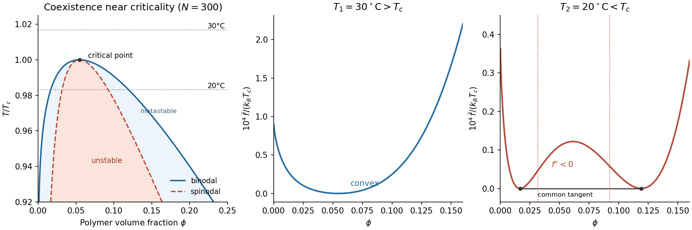

<h1 id="section-b/6/b/solution">Solution</h1>

↑ **Parent:** [B](../b.md)

Local compositional stability requires positive [curvature](../../../../../curvature.md) of the mixing [free energy](../../../../../thermodynamic-free-energy.md). Differentiating twice at fixed [temperature](../../../../../temperature-split.md), with $\chi$ independent of composition as in the given model, gives

$$
\frac1{k_BT}\frac{\partial^2f}{\partial\phi^2}
=\frac1{N\phi}+\frac1{1-\phi}-2\chi.
$$

The [spinodal](../../../../../spinodal.md) occurs where this vanishes:

$$
\boxed{\chi_s(\phi)=\frac12\left[\frac1{N\phi}+\frac1{1-\phi}\right].}
$$

Between the two spinodal compositions at sufficiently large $\chi$, $f''<0$ and a homogeneous mixture is unstable to infinitesimal composition fluctuations. The [binodal](../../../../../binodal.md) is instead fixed by the [common-tangent construction](../../../../../common-tangent-construction.md), and encloses a larger coexistence region. Between binodal and spinodal the mixture is locally stable but [metastable](../../../../../metastability.md).

A [phase diagram](../../../../../phase-diagram.md) with a conventional upper critical [temperature](../../../../../temperature-split.md) additionally assumes that $\chi$ decreases with $T$, for example $\chi=C/T$ with $C>0$. Then high [temperature](../../../../../temperature-split.md) gives a uniform mixture; cooling produces an asymmetric coexistence dome whose critical composition is on the dilute-polymer side. The spinodal lies inside the binodal dome. An arbitrary $\chi(T)$ need not give this orientation, so the free-energy formula alone does not specify a unique [temperature](../../../../../temperature-split.md) axis.

**[Figure 4](#section-b/6/b/image-flory-huggins-solution-theory-coexistence-instability-and-free-energy-curvature). Flory–Huggins solution theory: coexistence, instability and free-energy curvature**. Original calculations for $N=300$ with the illustrative law $\chi=C/T$. Left: binodal, spinodal and critical point near the critical [temperature](../../../../../temperature-split.md); horizontal dotted lines mark the two temperatures used in part (e). The other panels show free energies above and below the critical [temperature](../../../../../temperature-split.md) after subtraction of affine references: the tangent at $\phi_c$ for the upper [temperature](../../../../../temperature-split.md) and the common tangent for the lower [temperature](../../../../../temperature-split.md). These subtractions leave phase stability and coexistence unchanged. The low-temperature panel displays the common tangent and spinodal boundaries.

## ↑ Ancestors (14)

1. [B](../b.md)
2. [6](../../6.md)
3. [Section B](../../../section-b.md)
4. [2021](../../../../2021-split.md)
5. [Past exam of the soft condensed matter course of the University of Cambridge](../../../../split.md)
6. [Soft Condensed Matter course of the University of Cambridge](../../../../../soft-condensed-matter-course-of-the-university-of-cambridge.md)
7. [Physics course of the year 3 of the natural sciences course of the University of Cambridge](../../../../../physics-course-of-the-year-3-of-the-natural-sciences-course-of-the-university-of-cambridge.md)
8. [Year 3 of the natural sciences course of the University of Cambridge](../../../../../year-3-of-the-natural-sciences-course-of-the-university-of-cambridge.md)
9. [Year of the natural sciences course of the University of Cambridge](../../../../../year-of-the-natural-sciences-course-of-the-university-of-cambridge.md)
10. [Natural sciences course of the University of Cambridge](../../../../../natural-sciences-course-of-the-university-of-cambridge.md)
11. [Course of the University of Cambridge](../../../../../course-of-the-university-of-cambridge.md)
12. [University of Cambridge](../../../../../university-of-cambridge-split.md)
13. [List of universities](../../../../../list-of-universities.md)
14. [Codex Wiki](../../../../../split.md)
