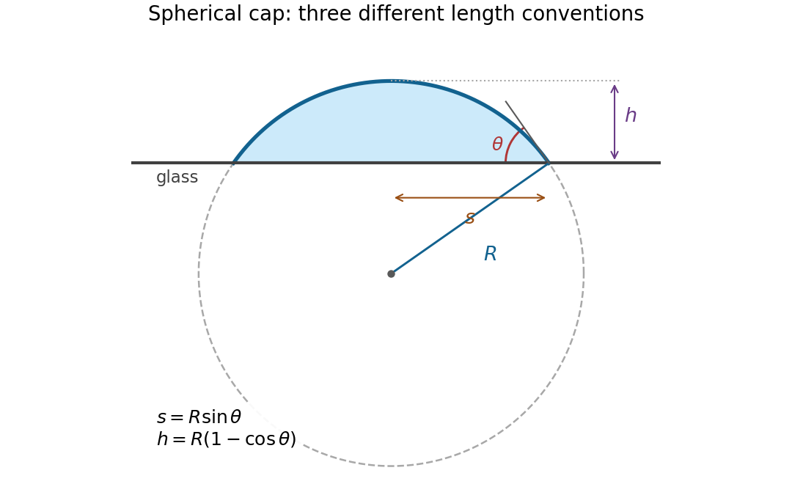
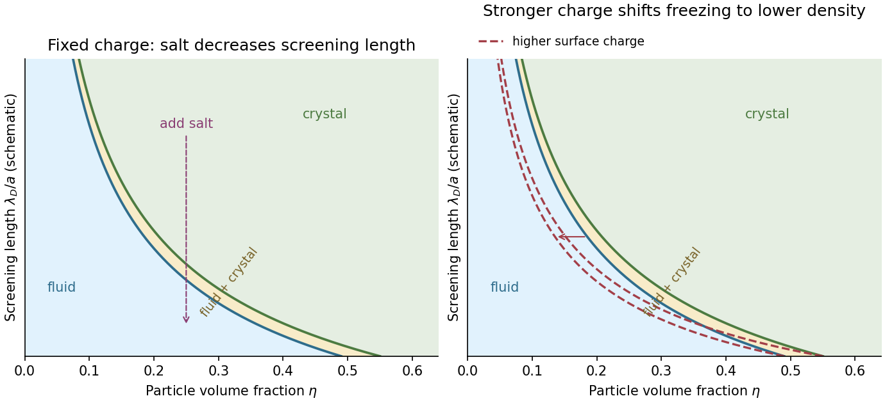

# 2022

↑ **Parent:** [Past exam of the soft condensed matter course of the University of Cambridge](../past-exam-of-the-soft-condensed-matter-course-of-the-university-of-cambridge.md)

[Original paper, released PDF pages 499–504](https://www.whatdotheyknow.com/request/natural_science_tripos_physics_e/response/2127325/attach/3/FOI%202022%20639%20Sullivan%20materials.pdf?cookie_passthrough=1#page=499)

**Table of contents**

- [Section A](#section-a)
  - [1](#section-a/1)
    - [Solution](#section-a/1/solution)
  - [2](#section-a/2)
    - [Solution](#section-a/2/solution)
  - [3](#section-a/3)
    - [Solution](#section-a/3/solution)
- [Section B](#section-b)
  - [4](#section-b/4)
    - [a](#section-b/4/a)
      - [Solution](#section-b/4/a/solution)
    - [b](#section-b/4/b)
      - [Solution](#section-b/4/b/solution)
    - [c](#section-b/4/c)
      - [Solution](#section-b/4/c/solution)
    - [d](#section-b/4/d)
      - [Solution](#section-b/4/d/solution)
    - [e](#section-b/4/e)
      - [Solution](#section-b/4/e/solution)
    - [f](#section-b/4/f)
      - [Solution](#section-b/4/f/solution)
  - [5](#section-b/5)
    - [a](#section-b/5/a)
      - [Solution](#section-b/5/a/solution)
    - [b](#section-b/5/b)
      - [Solution](#section-b/5/b/solution)
    - [c](#section-b/5/c)
      - [Solution](#section-b/5/c/solution)
    - [d](#section-b/5/d)
      - [Solution](#section-b/5/d/solution)
    - [e](#section-b/5/e)
      - [Solution](#section-b/5/e/solution)
    - [f](#section-b/5/f)
      - [Solution](#section-b/5/f/solution)
  - [6](#section-b/6)
    - [a](#section-b/6/a)
      - [Solution](#section-b/6/a/solution)
    - [b](#section-b/6/b)
      - [Solution](#section-b/6/b/solution)
    - [c](#section-b/6/c)
      - [Solution](#section-b/6/c/solution)
    - [d](#section-b/6/d)
      - [Solution](#section-b/6/d/solution)
    - [e](#section-b/6/e)
      - [Solution](#section-b/6/e/solution)
    - [f](#section-b/6/f)
      - [Solution](#section-b/6/f/solution)

## Section A

↑ **Parent:** [2022](2022.md)

<h3 id="section-a/1">1</h3>

↑ **Parent:** [Section A](#section-a)

<h4 id="section-a/1/solution">Solution</h4>

↑ **Parent:** [1](#section-a/1)

The relevant comparison is between [gravity](../physics.md#gravity) and [surface tension](../surface-tension.md). With the [mass density](../fluid-mechanics.md#density) difference $\Delta\rho\simeq10^3\,\mathrm{kg\,m^{-3}}$, the [Bond number](../surface-tension.md#bond-number) and [capillary length](../surface-tension.md#capillary-length) are

$$
\mathrm{Bo}=\frac{\Delta\rho\,g r^2}{\gamma}
=\frac{10^3(9.81)(5\times10^{-4})^2}{0.072}\simeq0.034,
\qquad
\ell_c=\sqrt{\frac{\gamma}{\Delta\rho\,g}}\simeq2.71\,\mathrm{mm}.
$$

Thus the drop is small compared with the [capillary length](../surface-tension.md#capillary-length); [hydrostatic pressure](../fluid-mechanics.md#hydrostatic-pressure) variations only weakly perturb its shape. The [Young–Laplace equation](../surface-tension.md#young-laplace-equation) then gives approximately constant interfacial [mean curvature](../second-fundamental-form.md#mean-curvature), and an axisymmetric drop on a uniform flat substrate is a [spherical cap](../euclidean-geometry.md#spherical-cap). The substrate selects the [contact angle](../surface-tension.md#contact-angle), measured through the [water](../chemical-substance.md#water).

Write $R$ for the radius of the generating [sphere](../euclidean-geometry.md#sphere), $s$ for the contact-circle radius, and $h$ for the apex height. Elementary [trigonometric identities](../geometry-and-topology.md#trigonometric-identity) give

$$
s=R\sin\theta,\qquad h=R(1-\cos\theta)=s\tan(\theta/2).
$$

Taking the stated droplet radius to mean its radius of [curvature](../differential-geometry.md#curvature), $R=r$, gives

$$
\boxed{h=0.5(1-\cos55^\circ)\,\mathrm{mm}=0.213\,\mathrm{mm}.}
$$

There is no diagram or explicit radius convention in the original PDF. If $r$ instead denotes the contact-circle radius, the answer is $h=r\tan27.5^\circ=0.260\,\mathrm{mm}$. If it denotes the radius of an equal-volume free [sphere](../euclidean-geometry.md#sphere), use the [volume of a spherical cap](../euclidean-geometry.md#volume-of-a-spherical-cap), $\pi h^2(3R-h)/3=4\pi r^3/3$, to obtain $h=r[4(1-\cos\theta)/(2+\cos\theta)]^{1/3}=0.436\,\mathrm{mm}$. The [spherical cap](../euclidean-geometry.md#spherical-cap) approximation is justified in all three conventions; a unique numerical height requires specifying which radius is meant.

**[Figure 1](#section-a/1/image-geometry-of-the-spherical-cap-and-its-contact-angle). Geometry of the spherical cap and its contact angle**. Original cross-section distinguishing the generating-sphere radius $R$, contact-circle radius $s$, and height $h$. The dashed part of the generating circle lies below the substrate.

<h3 id="section-a/2">2</h3>

↑ **Parent:** [Section A](#section-a)

<h4 id="section-a/2/solution">Solution</h4>

↑ **Parent:** [2](#section-a/2)

By definition, the [relaxation modulus](../rheology.md#relaxation-modulus) is the [stress](../continuum-mechanics.md#stress) generated by a unit step of [strain](../continuum-mechanics.md#strain) from an initially relaxed state. Set $\epsilon(t)=H(t)$, where $H$ is the [Heaviside step function](../integral-transform.md#heaviside-step-function), and write $\sigma(t)=G(t)$. Integrating the [linear ordinary differential equation](../linear-ordinary-differential-equation.md) across the step shows that neither $G$ nor $G'$ can jump: a jump would produce a [Dirac delta function](../distribution-theory.md#dirac-delta-function) or its [derivative](../calculus.md#derivative), absent from the forcing. Hence $G(0^+)=G'(0^+)=0$.

For $t>0$, a particular solution is $1$. The [characteristic equation](../linear-ordinary-differential-equation.md#characteristic-equation-of-a-constant-coefficient-differential-equation) factors as

$$
15\lambda^2+8\lambda+1=(5\lambda+1)(3\lambda+1)=0,
$$

so $G=1+A e^{-t/5}+B e^{-t/3}$. The initial conditions give $A+B=-1$ and $A/5+B/3=0$, whence

$$
\boxed{G(t)=\left(1-\frac52e^{-t/5}+\frac32e^{-t/3}\right)H(t).}
$$

The time and modulus units are those implicit in the printed coefficients. A [Laplace transform](../integral-transform.md#laplace-transform) check gives $\widehat G(s)=1/[s(5s+1)(3s+1)]$.

The original PDF really does put undifferentiated [strain](../continuum-mechanics.md#strain) on the right-hand side. The resulting response rises from zero to one, with $G'(t)=\tfrac12(e^{-t/5}-e^{-t/3})>0$, rather than exhibiting ordinary [stress relaxation](../rheology.md#stress-relaxation). There is a stronger physical problem if this is intended as a passive material law: with the convention $e^{i\omega t}$ the [stress](../continuum-mechanics.md#stress)-to-[strain](../continuum-mechanics.md#strain) amplitude ratio is

$$
G^*(\omega)=\frac1{1-15\omega^2+8i\omega},\qquad
G''(\omega)=\frac{-8\omega}{(1-15\omega^2)^2+64\omega^2}<0\quad(\omega>0).
$$

The [loss modulus](../rheology.md#loss-modulus) would give negative cycle-averaged supplied power $\langle\sigma\dot\epsilon\rangle=\omega G''|\epsilon_0|^2/2$, contrary to [passivity in linear viscoelasticity](../rheology.md#passivity-in-linear-viscoelasticity). The boxed expression is therefore the formal [relaxation modulus](../rheology.md#relaxation-modulus) of the equation as printed, not a claim that this equation describes an ordinary passive [viscoelasticity](../rheology.md#viscoelasticity) model. No derivative of the input has been silently inserted.

<h3 id="section-a/3">3</h3>

↑ **Parent:** [Section A](#section-a)

<h4 id="section-a/3/solution">Solution</h4>

↑ **Parent:** [3](#section-a/3)

Treat the [liposome](../mathematical-biology.md#liposome) using the usual incompressible-tail packing model of a [lipid bilayer](../mathematical-biology.md#lipid-bilayer): neglect the head-group thickness and let $v$ be the volume filling the hydrophobic part of the [lipid vesicle](../mathematical-biology.md#lipid-vesicle). Both [membrane leaflets](../mathematical-biology.md#membrane-leaflet) have area $a$ per head group. Put $d=v/a$, and let $R$ be the unknown outer radius. Counting [molecules](../molecule.md) from the inner and outer [surface areas](../differential-geometry.md#surface-area) gives

$$
M_i=\frac{4\pi r_i^2}{a},\qquad M_o=\frac{4\pi R^2}{a}.
$$

Equating the total molecular volume to the volume of the [spherical shell](../euclidean-geometry.md#spherical-shell) therefore gives

$$
\frac{4\pi}{3}(R^3-r_i^3)=v(M_i+M_o),\qquad
\boxed{R^3-r_i^3=3d(R^2+r_i^2).}
$$

To prove uniqueness in the physical domain $R>r_i>0$, define

$$
q(R)=\frac{R^3-r_i^3}{R^2+r_i^2}.
$$

Its [derivative](../calculus.md#derivative) is

$$
q'(R)=\frac{R^4+3R^2r_i^2+2Rr_i^3}{(R^2+r_i^2)^2}>0.
$$

Also $q(r_i)=0$ and $q(R)\to\infty$ as $R\to\infty$. By [continuity](../calculus.md#continuous-function) and strict [monotonicity](../calculus.md#monotonic-function), $q(R)=3d$ has **exactly one solution with $R>r_i$**. This proves the required uniqueness without choosing among ambiguous branches of a cubic formula.

The maximum tail length is a physical admissibility bound, not automatically the actual leaflet thickness. If $r_m$ is the radius where the two tail regions meet, separate [membrane leaflet](../mathematical-biology.md#membrane-leaflet) volume balances give

$$
r_m^3=r_i^3+3d r_i^2,\qquad
R^3-r_m^3=3d R^2.
$$

The unique candidate must satisfy

$$
\boxed{r_m-r_i\leq l,\qquad R-r_m\leq l.}
$$

In particular $R-r_i\leq2l$ is necessary. The premise that a [lipid vesicle](../mathematical-biology.md#lipid-vesicle) has assembled supplies this compatibility: arbitrary positive choices of $r_i,v,a,l$ need not allow any such [lipid bilayer](../mathematical-biology.md#lipid-bilayer). For a very large vesicle the two thicknesses tend to $d$, so $R-r_i\simeq2v/a$. Setting the thickness equal to $2l$ for every [molecule](../molecule.md) would confuse maximum extension with actual packing. The volume-balance argument and its domain are an example of [uniqueness of the packed spherical bilayer radius](../mathematical-biology.md#uniqueness-of-the-packed-spherical-bilayer-radius).

## Section B

↑ **Parent:** [2022](2022.md)

<h3 id="section-b/4">4</h3>

↑ **Parent:** [Section B](#section-b)

<h4 id="section-b/4/a">a</h4>

↑ **Parent:** [4](#section-b/4)

<h5 id="section-b/4/a/solution">Solution</h5>

↑ **Parent:** [A](#section-b/4/a)

For an [ideal chain](../mathematical-biology.md#ideal-chain), independent [Kuhn length](../mathematical-biology.md#kuhn-length) steps give the [random walk](../random-walk.md) relation

$$
\langle R_{\mathrm{sub}}^2\rangle=g b^2,\qquad \boxed{\sigma\sim b\sqrt g,\quad g\sim(\sigma/b)^2,}
$$

where $R_{\mathrm{sub}}$ denotes the end-to-end displacement of a subchain. Equivalently the mass-size [fractal](../geometry-and-topology.md#fractal) exponent is $2$. Numerical factors depend on the chosen definition of blob diameter.

A subchain smaller than the adsorption height explores three dimensions much as a free [ideal chain](../mathematical-biology.md#ideal-chain) does. At scales exceeding $\xi$, [adsorption](../physical-chemistry.md#adsorption) restricts its perpendicular extent to order $\xi$, so the coil is anisotropic. Its in-plane projection may still have a [random walk](../random-walk.md) law for an [ideal chain](../mathematical-biology.md#ideal-chain), but the isotropic three-dimensional blob construction cannot be extrapolated to $\sigma>\xi$. This is the reason to use [adsorption blobs](../polymer.md#adsorption-blob) of size $\xi$.

<h4 id="section-b/4/b">b</h4>

↑ **Parent:** [4](#section-b/4)

<h5 id="section-b/4/b/solution">Solution</h5>

↑ **Parent:** [B](#section-b/4/b)

Here $T$ is the absolute [temperature](../temperature.md) and $k_B$ the [Boltzmann constant](../thermodynamics.md#boltzmann-constant). An [adsorption blob](../polymer.md#adsorption-blob) contains $g\sim(\xi/b)^2$ [monomers](../polymer.md#monomer), so there are $N/g\sim N(b/\xi)^2$ such blobs. Confining a blob removes an amount of conformational [entropy](../entropy.md) of order $k_B$; thus the positive confinement contribution to the [Helmholtz free energy](../thermodynamic-potential.md#helmholtz-free-energy) is

$$
F_{\mathrm{conf}}\simeq k_BT\frac Ng=k_BT N\left(\frac b\xi\right)^2.
$$

The statement about one blob's [entropy](../entropy.md) is used as an [entropy](../entropy.md) _loss_ relative to the free chain, rather than as an absolute [entropy](../entropy.md).

In the assumed slab model, contacts occur within a monomer-scale distance $b$ of the substrate. The contact fraction is approximately $b/\xi$, giving $N_c\simeq Nb/\xi$. Multiplying this by the negative contact [energy](../energy.md) yields

$$
F_{\mathrm{contact}}=-\epsilon k_BT\frac{Nb}{\xi},\qquad
\boxed{F(\xi)=Nk_BT\left[\left(\frac b\xi\right)^2-\epsilon\frac b\xi\right].}
$$

The two contributions express the competition between loss of conformational [entropy](../entropy.md) and gain of [adsorption](../physical-chemistry.md#adsorption) [energy](../energy.md). The numerical coefficients are the ones stipulated by this blob approximation.

<h4 id="section-b/4/c">c</h4>

↑ **Parent:** [4](#section-b/4)

<h5 id="section-b/4/c/solution">Solution</h5>

↑ **Parent:** [C](#section-b/4/c)

Minimize the [Helmholtz free energy](../thermodynamic-potential.md#helmholtz-free-energy) at fixed $N,T$. Its [derivative](../calculus.md#derivative) is

$$
\frac{\partial F}{\partial\xi}=Nk_BT\left(-\frac{2b^2}{\xi^3}+\frac{\epsilon b}{\xi^2}\right).
$$

The physical [stationary point](../calculus-of-variations.md#stationary-point) for $\epsilon>0$ is

$$
\boxed{\xi_* =\frac{2b}{\epsilon},\qquad F_{\mathrm{ads},*}=-\frac14Nk_BT\epsilon^2.}
$$

To check the minimum directly, put $x=b/\xi$. Then $F/(Nk_BT)=(x-\epsilon/2)^2-\epsilon^2/4$, which is globally minimized at $x=\epsilon/2$. The binding [free energy](../thermodynamic-potential.md#thermodynamic-free-energy) gain per [monomer](../polymer.md#monomer) is consequently $\mu=k_BT\epsilon^2/4>0$.

The weak-[adsorption](../physical-chemistry.md#adsorption) blob picture requires $b\ll\xi_*\ll b\sqrt N$, or $2/\sqrt N\ll\epsilon\ll2$ in this model. If $\epsilon$ is too large, the layer saturates at a monomer-scale thickness; if too small, a many-blob adsorbed layer has not formed.

<h4 id="section-b/4/d">d</h4>

↑ **Parent:** [4](#section-b/4)

<h5 id="section-b/4/d/solution">Solution</h5>

↑ **Parent:** [D](#section-b/4/d)

The stretched segment is a [Gaussian chain](../mathematical-biology.md#gaussian-chain) of $n$ [Kuhn length](../mathematical-biology.md#kuhn-length) steps, with unperturbed root-mean-square end-to-end distance $l=b\sqrt n$. Its end-to-end [probability density](../wave-function.md#probability-density) is proportional to $\exp[-3z^2/(2nb^2)]$, so its leading elastic [Helmholtz free energy](../thermodynamic-potential.md#helmholtz-free-energy) is $3k_BTz^2/(2nb^2)$. Adding the remaining segment's [adsorption](../physical-chemistry.md#adsorption) [free energy](../thermodynamic-potential.md#thermodynamic-free-energy) gives

$$
\boxed{F(n,z)=k_BT(N-n)\left[\left(\frac b\xi\right)^2-\epsilon\frac b\xi\right]
+\frac{3k_BTz^2}{2nb^2}.}
$$

An additive constant independent of $n,z$ is irrelevant. At the optimal adsorption height this becomes

$$
F(n,z)=-(N-n)\mu+\frac{3k_BTz^2}{2nb^2},\qquad \mu=\frac14k_BT\epsilon^2.
$$

The original PDF's hint labels the positive quantity proportional to $k_BT R^2/l^2$ an [entropy](../entropy.md). It has units of [energy](../energy.md) and is the stretching [free energy](../thermodynamic-potential.md#thermodynamic-free-energy). The corresponding change of conformational [entropy](../entropy.md) is $\Delta S=-3k_B R^2/(2l^2)$. This dimensional and sign correction is essential to the minimization.

This is the leading extensive [Gaussian chain](../mathematical-biology.md#gaussian-chain) approximation: endpoint normalization and junction corrections give subleading terms. It requires many stretched [monomers](../polymer.md#monomer) and $z\ll nb$, rather than extension near the full contour length.

<h4 id="section-b/4/e">e</h4>

↑ **Parent:** [4](#section-b/4)

<h5 id="section-b/4/e/solution">Solution</h5>

↑ **Parent:** [E](#section-b/4/e)

During slow peeling in [atomic force microscopy](../engineering.md#atomic-force-microscopy), $n$ adjusts to minimize the [Helmholtz free energy](../thermodynamic-potential.md#helmholtz-free-energy) at each imposed height. Define the positive binding gain $\mu=k_BT[\epsilon b/\xi-(b/\xi)^2]$ for the adsorbed segment. The [stationary point](../calculus-of-variations.md#stationary-point) satisfies

$$
0=\left(\frac{\partial F}{\partial n}\right)_z
=\mu-\frac{3k_BTz^2}{2b^2n^2},\qquad
n_*(z)=\frac zb\sqrt{\frac{3k_BT}{2\mu}}.
$$

Since $\partial_n^2F=3k_BTz^2/(b^2n^3)>0$, this is a minimum while $0<n_*<N$. The upward pulling [force](../force.md) is the height [derivative](../calculus.md#derivative) of the minimized [free energy](../thermodynamic-potential.md#thermodynamic-free-energy). The implicit $n_*(z)$ term vanishes because $\partial_nF=0$, giving

$$
f=\frac{dF(n_*(z),z)}{dz}
=\frac{3k_BTz}{b^2n_*}
=\frac{\sqrt{6k_BT\mu}}b.
$$

Using $\xi=2b/\epsilon$,

$$
\boxed{f_{\mathrm{peel}}=\sqrt{\frac32}\,\frac{\epsilon k_BT}{b}.}
$$

It is independent of $z$: extra pulling height releases more [monomers](../polymer.md#monomer) while leaving the fractional extension of the stretched part unchanged. Equivalently $F_{\min}=-N\mu+f_{\mathrm{peel}}z$. This is the [equilibrium peeling force of an adsorbed Gaussian chain](../polymer.md#equilibrium-peeling-force-of-an-adsorbed-gaussian-chain).

The plateau ends when $n_*=N$, at

$$
z_{\mathrm{det}}=Nb\sqrt{\frac{2\mu}{3k_BT}}=\frac{Nb\epsilon}{\sqrt6}.
$$

Thereafter all [monomers](../polymer.md#monomer) are detached and the [Gaussian chain](../mathematical-biology.md#gaussian-chain) force is $f=3k_BTz/(Nb^2)$, agreeing continuously with the plateau at $z_{\mathrm{det}}$. Very near the start and final release, finite-chain and junction effects lie outside the blob approximation.

<h4 id="section-b/4/f">f</h4>

↑ **Parent:** [4](#section-b/4)

<h5 id="section-b/4/f/solution">Solution</h5>

↑ **Parent:** [F](#section-b/4/f)

For the usual interpretation of a real chain in a [good solvent](../mixture.md#good-solvent), the detachment [force](../force.md) is **smaller** in the weak-[adsorption](../physical-chemistry.md#adsorption) regime. [Excluded volume](../statistical-physics.md#excluded-volume) swells the chain, increasing the cost of confinement near the substrate. The adsorbed layer becomes thicker and its binding [free energy](../thermodynamic-potential.md#thermodynamic-free-energy) per [monomer](../polymer.md#monomer) decreases. The same contact [energy](../energy.md) therefore does not mean the same total binding strength.

The scaling argument can include both adsorption and stretching. Let $\xi\sim bg^\nu$, where $\nu=1/2$ for an [ideal chain](../mathematical-biology.md#ideal-chain) and approximately $3/5$ for a [self-avoiding walk](../combinatorics.md#self-avoiding-walk) in three dimensions. With the same contact-fraction approximation,

$$
\frac{F_{\mathrm{ads}}}{Nk_BT}\sim
\left(\frac b\xi\right)^{1/\nu}-\epsilon\frac b\xi.
$$

Minimization gives $\xi/b\sim\epsilon^{-\nu/(1-\nu)}$ and $\mu/(k_BT)\sim\epsilon^{1/(1-\nu)}$. At detachment, a [tensile blob](../polymer.md#tensile-blob) of size $\xi_t\sim k_BT/f$ costs approximately $k_BT$; its [monomer](../polymer.md#monomer) count is $g_t\sim(\xi_t/b)^{1/\nu}$. Equating the stretching gain per [monomer](../polymer.md#monomer) $k_BT/g_t$ to $\mu$ gives

$$
f\sim\frac{k_BT}{b}\left(\frac{\mu}{k_BT}\right)^\nu
\sim\frac{k_BT}{b}\epsilon^{\nu/(1-\nu)}.
$$

Thus $f_{\mathrm{real}}\sim(k_BT/b)\epsilon^{3/2}$, compared with $f_{\mathrm{ideal}}\sim(k_BT/b)\epsilon$, so their ratio scales as $\epsilon^{1/2}<1$ for weak attraction. These are scaling relations, not exact prefactors. The real-chain adsorption exponents here use the same simple uniform-contact model as the earlier parts; a more detailed surface theory of [critical phenomena](../critical-phenomenon.md) can refine them. The thicker, more weakly bound layer reflects the higher cost of confining a [good solvent](../mixture.md#good-solvent) chain.[Rubinstein and Colby, Polymer Physics, chapter 3, equations (3.59)–(3.66)](https://dasher.wustl.edu/bio5357/readings/rubinstein-chapter3.pdf)

“Real” alone does not specify [solvent](../mixture.md#solvent) quality: a collapsed chain in a poor [solvent](../mixture.md#solvent), strong adsorption, or substantial bending stiffness requires a different comparison. The smaller-force conclusion concerns the flexible [good solvent](../mixture.md#good-solvent) chain implicit in the excluded-volume correction.

<h3 id="section-b/5">5</h3>

↑ **Parent:** [Section B](#section-b)

<h4 id="section-b/5/a">a</h4>

↑ **Parent:** [5](#section-b/5)

<h5 id="section-b/5/a/solution">Solution</h5>

↑ **Parent:** [A](#section-b/5/a)

The gap is not a fixed mechanical separation. [Thermal fluctuations](../statistical-physics.md#thermal-fluctuation) of the wall compete with drift towards the [microtubule](../mathematical-biology.md#microtubule) under the opposing [force](../force.md). A [monomer](../polymer.md#monomer) can be incorporated only after the gap reaches its length. The [Smoluchowski equation](../probability-theory.md#smoluchowski-equation) describes this overdamped drift and [diffusion](../thermodynamics.md#diffusion) of gap [probability density](../wave-function.md#probability-density).

For gap potential [energy](../energy.md) $U(x)=Fx$, the equation and its [probability current](../wave-function.md#probability-current) are

$$
\partial_t p=-\partial_xJ,
\qquad J=-D\left(\partial_xp+\beta U'(x)p\right)
=-D(p_x+\beta Fp),\qquad \beta=(k_BT)^{-1}.
$$

The drift mobility is $D\beta$, the overdamped consequence of the [fluctuation-dissipation relation for a Langevin particle](../stochastic-thermodynamics.md#fluctuation-dissipation-relation-for-a-langevin-particle). Equivalently, this coefficient is fixed by requiring the zero-current solution to be the [Boltzmann distribution](../thermodynamics.md#boltzmann-distribution) $p\propto e^{-\beta U}$. Solve this equation with the appropriate exclusion, incorporation and probability-normalization conditions. The steady flux through the incorporation threshold gives the addition rate $j_0$; the elongation speed is $v=\delta j_0$.

There is a regime distinction in the printed problem. The absorbing boundary imposed in part (c) means instantaneous incorporation once a gap opens, and leads to the [diffusion-limited Brownian ratchet with constant load](../mathematical-biology.md#diffusion-limited-brownian-ratchet-with-constant-load). A genuinely [reaction-limited polymerization Brownian ratchet](../mathematical-biology.md#reaction-limited-polymerization-brownian-ratchet) instead assumes fast gap equilibration followed by a finite chemical addition rate, giving an exponential gating factor multiplying that chemical rate. The equations requested in the subsequent parts specify the former model, which is the one solved here.

<h4 id="section-b/5/b">b</h4>

↑ **Parent:** [5](#section-b/5)

<h5 id="section-b/5/b/solution">Solution</h5>

↑ **Parent:** [B](#section-b/5/b)

In the [steady state](../dynamical-systems.md#steady-state), conservation of [probability](../probability-theory.md#probability) requires $J_x=0$, so $J=j_0$ is constant. The sign is positive because increasing gap reaches the incorporation boundary, whereas the deterministic drift points towards smaller gap. Thus

$$
p'(x)+\beta Fp(x)=-\frac{j_0}{D}.
$$

An [integrating factor](../linear-ordinary-differential-equation.md#integrating-factor) $e^{\beta Fx}$ gives

$$
\boxed{p(x)=A e^{-\beta Fx}-\frac{j_0}{D\beta F}\quad(F>0).}
$$

Substitution makes the check particularly transparent:

$$
p'=-\beta F A e^{-\beta Fx},\qquad
-D(p'+\beta Fp)=j_0,
$$

so $\partial_t p=-J_x=0$. The constant offset is necessary for nonzero transport; a pure [Boltzmann distribution](../thermodynamics.md#boltzmann-distribution) would have $J=0$ and could not describe a steady succession of addition events. The $F=0$ limit is taken after applying the boundary conditions, avoiding the apparent singularity of the displayed parametrization.

<h4 id="section-b/5/c">c</h4>

↑ **Parent:** [5](#section-b/5)

<h5 id="section-b/5/c/solution">Solution</h5>

↑ **Parent:** [C](#section-b/5/c)

In this [polymerization Brownian ratchet](../mathematical-biology.md#polymerization-brownian-ratchet) model, a gap of width $\delta$ immediately accommodates one [monomer](../polymer.md#monomer). That event advances the tip by $\delta$ and resets the gap to zero. The threshold is therefore an [absorbing boundary condition for a diffusion](../probability-theory.md#absorbing-boundary-condition-for-a-diffusion),

$$
\boxed{p(\delta)=0.}
$$

All waiting-time [probability](../probability-theory.md#probability) lies within $0\leq x<\delta$, so the steady occupation [probability density](../wave-function.md#probability-density) satisfies

$$
\boxed{\int_0^\delta p(x)\,dx=1.}
$$

There is a reinjection flux $j_0$ at $x=0$ equal to the absorption flux at $x=\delta$. The nonpenetration constraint at zero is a [reflecting boundary condition for a diffusion](../probability-theory.md#reflecting-boundary-condition-for-a-diffusion) during each individual waiting episode. For the stationary reset process it must not be confused with setting the net current $J(0^+)$ to zero: the source at reset supplies $J(0^+)=j_0$. This is how a normalized steady density can coexist with a nonzero exit flux.

<h4 id="section-b/5/d">d</h4>

↑ **Parent:** [5](#section-b/5)

<h5 id="section-b/5/d/solution">Solution</h5>

↑ **Parent:** [D](#section-b/5/d)

Put $k=\beta F$ and $q=k\delta$. The [absorbing boundary condition for a diffusion](../probability-theory.md#absorbing-boundary-condition-for-a-diffusion) gives $A=j_0e^q/(Dk)$, hence

$$
p(x)=\frac{j_0}{Dk}\left[e^{k(\delta-x)}-1\right].
$$

This is nonnegative throughout the allowed interval. Normalizing the [probability density](../wave-function.md#probability-density) gives

$$
1=\frac{j_0}{Dk}\left[\frac{e^q-1}{k}-\delta\right]
=\frac{j_0}{Dk^2}(e^q-1-q).
$$

Therefore

$$
\boxed{j_0=\frac{D\beta^2F^2}{e^{\beta F\delta}-\beta F\delta-1},\qquad
A=\frac{\beta F\,e^{\beta F\delta}}{e^{\beta F\delta}-\beta F\delta-1}.}
$$

Equivalently the normalized density is

$$
p(x)=\frac{k[e^{k(\delta-x)}-1]}{e^q-1-q}.
$$

The denominator is positive for $q>0$, since $e^q>1+q$. The dimensions are consistent: $j_0$ has units of inverse time, $A$ and $p$ of inverse length, and $q$ is dimensionless.

<h4 id="section-b/5/e">e</h4>

↑ **Parent:** [5](#section-b/5)

<h5 id="section-b/5/e/solution">Solution</h5>

↑ **Parent:** [E](#section-b/5/e)

For a small opposing [force](../force.md), the relevant parameter is $q=\beta F\delta\ll1$. A [Taylor series](../calculus.md#taylor-series) gives

$$
e^q-1-q=\frac{q^2}{2}\left(1+\frac q3+\frac{q^2}{12}+\cdots\right),
$$

so

$$
\boxed{j_0=\frac{2D}{\delta^2}\left(1-\frac q3+\frac{q^2}{36}+O(q^3)\right)
\longrightarrow\frac{2D}{\delta^2}.}
$$

In particular the zero-force rate is finite, despite the numerator and denominator of the original expression both vanishing.

For $q\gg1$, the exponential dominates the denominator:

$$
\boxed{j_0\sim D\beta^2F^2e^{-\beta F\delta}
=\frac{D}{\delta^2}q^2e^{-q}.}
$$

Opening a monomer-sized gap is exponentially rare at high opposing [force](../force.md). The algebraic $F^2$ prefactor belongs to this first-passage model and must not be discarded when quoting the leading asymptotic rate.

<h4 id="section-b/5/f">f</h4>

↑ **Parent:** [5](#section-b/5)

<h5 id="section-b/5/f/solution">Solution</h5>

↑ **Parent:** [F](#section-b/5/f)

Each addition starts a new statistically identical waiting episode at zero gap. Thus the addition rate is the reciprocal of a [mean first-passage time](../markov-chain.md#mean-first-passage-time), not the reciprocal of the mean gap:

$$
\boxed{\tau=\frac1{j_0}=\frac{e^{\beta F\delta}-\beta F\delta-1}{D\beta^2F^2}.}
$$

This can also be derived without the steady density. If $T(x)$ is the mean time to reach $\delta$ starting at gap $x$, its backward [Smoluchowski equation](../probability-theory.md#smoluchowski-equation) is

$$
DT''-D\beta FT'=-1,\qquad T'(0)=0,\qquad T(\delta)=0.
$$

The first boundary is reflecting and the second absorbing. An [integrating factor](../linear-ordinary-differential-equation.md#integrating-factor) gives $T'(x)=[1-e^{\beta Fx}]/(D\beta F)$, whence

$$
T(0)=-\int_0^\delta T'(x)\,dx
=\frac{e^{\beta F\delta}-1-\beta F\delta}{D\beta^2F^2}=\tau.
$$

At weak [force](../force.md), $\tau\simeq\delta^2/(2D)$ is the time for a freely diffusing wall to move a [monomer](../polymer.md#monomer) length, with reflection at the tip. At strong [force](../force.md), opening the gap requires [work](../energy.md#work) $F\delta$, with [Boltzmann distribution](../thermodynamics.md#boltzmann-distribution) suppression $e^{-\beta F\delta}$. The drift establishes a near-tip thermal length $\ell_F=k_BT/F$ and a [diffusion](../thermodynamics.md#diffusion) time $\ell_F^2/D$; consequently

$$
\tau\sim\frac{\ell_F^2}{D}e^{\delta/\ell_F}.
$$

The exponentially long wait explains why the growth slows. There is no additional chemical waiting time in the imposed absorbing-threshold model; such a time would be needed to describe the separate [reaction-limited polymerization Brownian ratchet](../mathematical-biology.md#reaction-limited-polymerization-brownian-ratchet) regime.

<h3 id="section-b/6">6</h3>

↑ **Parent:** [Section B](#section-b)

<h4 id="section-b/6/a">a</h4>

↑ **Parent:** [6](#section-b/6)

<h5 id="section-b/6/a/solution">Solution</h5>

↑ **Parent:** [A](#section-b/6/a)

In a [magnesium chloride](../ionic-bonding.md#magnesium-chloride) [chemical solution](../mixture.md#solution-chemistry), the principal pair interactions are [hard sphere](../statistical-physics.md#hard-sphere) exclusion, repulsion of overlapping [electric double layers](../electrostatics.md#electric-double-layer), and attractive [Van der Waals forces](../force.md#van-der-waals-force). The positive surface attracts [chloride](../chemistry.md#chloride) [counterions](../chemistry.md#counterion) and repels [magnesium](../chemical-substance.md#magnesium) [coions](../electrostatics.md#coion); mobile [ions](../chemistry.md#ion) screen the bare [Coulomb's law](../electrostatics.md#coulomb-s-law) interaction. The competition between screened electrostatic repulsion and [Van der Waals force](../force.md#van-der-waals-force) attraction is described by [DLVO theory](../mixture.md#dlvo-theory).

For well-separated identical weakly charged spheres, the approximate repulsive pair [potential energy](../energy.md#potential-energy), at centre separation $R\geq2a$, is

$$
U_{\mathrm{el}}(R)\simeq\frac{Q^2}{4\pi\varepsilon_0\varepsilon_r}
\frac{e^{-\kappa(R-2a)}}{(1+\kappa a)^2R}.
$$

It is a [screened Coulomb pair potential](../mixture.md#screened-coulomb-pair-potential). An attractive [Hamaker constant](../mathematical-biology.md#hamaker-constant) adds a negative short-range contribution, while overlap is forbidden. Very near contact, [solvation](../ionic-bonding.md#solvation) and molecular surface structure can also matter. No polymer-induced interaction should be assumed before polymer is added in part (f).

<h4 id="section-b/6/b">b</h4>

↑ **Parent:** [6](#section-b/6)

<h5 id="section-b/6/b/solution">Solution</h5>

↑ **Parent:** [B](#section-b/6/b)

The particle carries positive [surface charge density](../electrostatics.md#surface-charge-density) $\sigma=Q/(4\pi a^2)$. Its surrounding [electric double layer](../electrostatics.md#electric-double-layer) has an excess of negative [chloride](../chemistry.md#chloride) [counterions](../chemistry.md#counterion) and a deficit of positive [magnesium](../chemical-substance.md#magnesium) [coions](../electrostatics.md#coion). Thus $\phi(r)>0$ decreases to zero, $n_{\mathrm{Cl}}(r)$ decreases towards its bulk value, and $n_{\mathrm{Mg}}(r)$ increases towards its bulk value. The diffuse [charge density](../electric-charge.md#charge-density) is negative and tends to zero.

If $c$ denotes the bulk number of dissolved salt formula units per unit volume, the far-field [number densities](../statistical-physics.md#number-density) are $n_{\mathrm{Mg},\infty}=c$ and $n_{\mathrm{Cl},\infty}=2c$. The bulk is neutral even though these number densities differ. In the dilute mean-field picture the total diffuse [electric charge](../electric-charge.md) is $-Q$, ensuring overall [electroneutrality](../electrochemistry.md#electroneutrality). A molecularly bound compact layer would require additional surface-chemistry information and is not assumed in the supplied potential.

**[Figure 2](#section-b/6/b/image-counterion-enrichment-and-coion-depletion-around-a-positive-sphere). Counterion enrichment and coion depletion around a positive sphere**. Original schematic. The left panel distinguishes the positive surface from an excess of chloride in the surrounding diffuse cloud; symbol positions are illustrative. The right panel plots the mean-field concentrations normalized separately to their bulk values, for a small illustrative positive surface potential. Both normalized curves tend to one, although bulk chloride number density is twice bulk magnesium number density.

<h4 id="section-b/6/c">c</h4>

↑ **Parent:** [6](#section-b/6)

<h5 id="section-b/6/c/solution">Solution</h5>

↑ **Parent:** [C](#section-b/6/c)

Let $\varepsilon=\varepsilon_0\varepsilon_r$ be the [permittivity](../permittivity.md), $\beta=(k_BT)^{-1}$, $e>0$ the [elementary charge](../electric-charge.md#elementary-charge), and $c$ the bulk salt formula-unit [number density](../statistical-physics.md#number-density). The [Boltzmann distribution](../thermodynamics.md#boltzmann-distribution) gives

$$
n_{\mathrm{Mg}}(r)=c\,e^{-2\beta e\phi(r)},\qquad
n_{\mathrm{Cl}}(r)=2c\,e^{\beta e\phi(r)}.
$$

Consequently the exterior [Poisson-Boltzmann equation](../electrostatics.md#poisson-boltzmann-equation) is

$$
\frac1{r^2}\frac d{dr}\left(r^2\frac{d\phi}{dr}\right)
=-\frac{2ec}{\varepsilon}\left(e^{-2\beta e\phi}-e^{\beta e\phi}\right),\qquad r>a.
$$

For small $Q$, meaning $2\beta e|\phi(a)|\ll1$, linearize the exponentials. The [Debye–Hückel approximation](../electrostatics.md#debye-huckel-approximation) gives

$$
\rho_{\mathrm{ion}}\simeq-6\beta e^2c\phi,\qquad
\frac1{r^2}(r^2\phi')'=\kappa^2\phi,\qquad
\boxed{\kappa^2=\frac{6e^2c}{\varepsilon k_BT},\quad \lambda_D=\kappa^{-1}.}
$$

This is also $\kappa^2=\beta e^2\sum_i z_i^2 n_{i,\infty}/\varepsilon$: the divalent cation contributes $4c$ and the two monovalent anions contribute $2c$. In terms of molar salt concentration $C$ in $\mathrm{mol\,m^{-3}}$, replace $c$ by $N_A C$; if $C$ is in $\mathrm{mol\,L^{-1}}$, use $c=10^3N_A C$. The molar [ionic strength](../mixture.md#ionic-strength) is $3C$ in the same concentration units.

The boundary conditions are $\phi(\infty)=0$ and, by [Gauss's law](../maxwell-equations.md#gauss-s-law),

$$
-\varepsilon\phi'(a^+)=\frac{Q}{4\pi a^2}.
$$

Here the surface charge is uniform and the spherically symmetric interior field is zero. Set $u=r\phi$; the radial equation reduces to $u''=\kappa^2u$. Decay excludes the growing exponential, so write $\phi=B e^{-\kappa(r-a)}/r$. Then $\phi'(a)=-B(1+\kappa a)/a^2$, giving

$$
\boxed{\phi(r)=\frac{Q}{4\pi\varepsilon\,r(1+\kappa a)}e^{-\kappa(r-a)}.}
$$

It solves the _linearized_ [Poisson-Boltzmann equation](../electrostatics.md#poisson-boltzmann-equation), not the full nonlinear equation at finite $Q$. The radial ion profiles, consistently to first order, are

$$
\boxed{n_{\mathrm{Mg}}(r)\simeq c[1-2\beta e\phi(r)],\qquad
n_{\mathrm{Cl}}(r)\simeq2c[1+\beta e\phi(r)].}
$$

The exponential [Boltzmann distribution](../thermodynamics.md#boltzmann-distribution) formulas above express the full mean-field relation, but substituting a linearized potential into them is accurate only to the retained order. A useful [electroneutrality](../electrochemistry.md#electroneutrality) check is

$$
4\pi\int_a^\infty\rho_{\mathrm{ion}}r^2dr
=-4\pi\varepsilon[r^2\phi']_a^\infty=-Q.
$$

The result is the [Debye-Hückel potential of a charged sphere](../electrostatics.md#debye-huckel-potential-of-a-charged-sphere).

<h4 id="section-b/6/d">d</h4>

↑ **Parent:** [6](#section-b/6)

<h5 id="section-b/6/d/solution">Solution</h5>

↑ **Parent:** [D](#section-b/6/d)

Write the particle [volume fraction](../continuum-mechanics.md#volume-fraction) as $\eta=(4\pi a^3/3)n_p$. In a stable, repulsion-dominated [colloid](../mixture.md#colloid), low $\eta$ gives a disordered fluid. Increasing $\eta$ makes the interaction between neighboring particles important and can produce an ordered [crystal](../thermodynamics.md#crystal), separated from the fluid by a [phase coexistence curve](../thermodynamic-potential.md#phase-coexistence-curve). Increasing the [Debye–Hückel screening length](../mathematical-biology.md#debye-huckel-screening-length) at fixed charge strengthens the repulsion at a given separation and allows freezing at smaller geometrical [volume fraction](../continuum-mechanics.md#volume-fraction).

The geometric intuition is that particles behave as though they occupy more than their bare diameter: roughly, an effective exclusion diameter $d_{\mathrm{eff}}$ extends out to the separation where $U_{\mathrm{el}}$ is of order $k_BT$. A [hard sphere](../statistical-physics.md#hard-sphere) comparison then uses $\eta_{\mathrm{eff}}\sim\eta[d_{\mathrm{eff}}/(2a)]^3$. This explains the trend; it is not an exact freezing criterion.

At short [Debye–Hückel screening length](../mathematical-biology.md#debye-huckel-screening-length) and negligible attraction, the diagram approaches [hard sphere](../statistical-physics.md#hard-sphere) fluid–crystal coexistence. For longer-ranged soft repulsion, [body-centered cubic lattice](../quantum-scattering.md#body-centered-cubic-lattice) and [face-centered cubic lattice](../quantum-scattering.md#face-centered-cubic-lattice) crystals can both be stable, with the former often appearing towards the softer, lower-density freezing boundary. Screened-Coulomb simulations exhibit both these crystal structures.[Kremer, Robbins and Grest, Phase Diagram of Yukawa Systems: Model for Charge-Stabilized Colloids](https://doi.org/10.1103/PhysRevLett.57.2694)

**[Figure 3](#section-b/6/d/image-schematic-phase-diagram-for-a-stable-repulsive-colloid). Schematic phase diagram for a stable repulsive colloid**. Original qualitative fluid–crystal diagram at fixed radius, [temperature](../temperature.md) and charge. The two curves bound a fluid–crystal coexistence band. Increased screening length allows freezing at smaller bare particle volume fraction. Crystal-structure boundaries and numerical coexistence positions are deliberately not assigned. The dashed arrow shows adding salt at fixed volume fraction; the second panel shows the direction of the boundary shift when surface charge increases.

No universal quantitative diagram follows from $(\eta,\lambda_D)$ alone: the charge, [Hamaker constant](../mathematical-biology.md#hamaker-constant) and surface conditions must also be fixed. If salt suppresses the stabilizing barrier enough for [Van der Waals force](../force.md#van-der-waals-force) attraction to dominate, a colloid-poor/colloid-rich separation or aggregation can replace part of this repulsive reference diagram. Dense [colloidal glasses](../mixture.md#colloidal-glass) or [colloidal gels](../mixture.md#colloidal-gel) may also be observed after kinetic arrest; they should not be mistaken for additional [thermodynamic equilibrium](../thermodynamics.md#thermodynamic-equilibrium) [thermodynamic phases](../thermodynamics.md#thermodynamic-phase).

<h4 id="section-b/6/e">e</h4>

↑ **Parent:** [6](#section-b/6)

<h5 id="section-b/6/e/solution">Solution</h5>

↑ **Parent:** [E](#section-b/6/e)

First hold the surface [electric charge](../electric-charge.md) fixed and increase the bulk salt concentration. Since $\kappa^2\propto c$, the [Debye–Hückel screening length](../mathematical-biology.md#debye-huckel-screening-length) decreases as $c^{-1/2}$. For surface gap $h=R-2a\geq0$,

$$
U_{\mathrm{el}}(R)\propto\frac{e^{-\kappa h}}{(1+\kappa a)^2},
\qquad
\frac{\partial\log U_{\mathrm{el}}}{\partial\kappa}
=-h-\frac{2a}{1+\kappa a}<0.
$$

Thus both the range and the strength of repulsion decrease. In the repulsive [phase diagram](../thermodynamic-potential.md#phase-diagram), the sample moves downwards at fixed [volume fraction](../continuum-mechanics.md#volume-fraction) and can melt from a [crystal](../thermodynamics.md#crystal) into a fluid. Because screening length is already a diagram axis, changing salt moves the state through that diagram rather than independently changing its fixed-charge coexistence curves. If [Van der Waals forces](../force.md#van-der-waals-force) become dominant, however, adding salt may instead destabilize the dispersion and cause aggregation. These are distinct physical regimes.

Second increase $\sigma$ at fixed salt concentration and particle size. The [electric charge](../electric-charge.md) is $Q=4\pi a^2\sigma$, so the pair repulsion increases approximately as $\sigma^2$ within the [Debye–Hückel approximation](../electrostatics.md#debye-huckel-approximation), while the reservoir screening length remains unchanged. Freezing then becomes possible at lower [volume fraction](../continuum-mechanics.md#volume-fraction) or shorter screening length. At fixed $\lambda_D$, the coexistence curves shift towards lower $\eta$; a previously fluid sample may crystallize.

These statements assume fixed, uniform charge and a salt reservoir dominating the screening. Strong charging requires nonlinear screening and possibly charge regulation. At very low added salt or appreciable particle concentration, particle-released [counterions](../chemistry.md#counterion) also contribute to [ionic strength](../mixture.md#ionic-strength), so the screening length is no longer independently fixed by the added salt alone.

<h4 id="section-b/6/f">f</h4>

↑ **Parent:** [6](#section-b/6)

<h5 id="section-b/6/f/solution">Solution</h5>

↑ **Parent:** [F](#section-b/6/f)

For dissolved, _nonadsorbing_ [polyethylene glycol](../polymer.md#polyethylene-glycol), the usual new interaction is a [depletion force](../mixture.md#depletion-force). Polymer centres are excluded from a layer of thickness of order their [radius of gyration](../polymer.md#radius-of-gyration) $R_g$ around each particle. When the particles approach, their exclusion layers overlap. This increases the volume accessible to polymer and its translational [entropy](../entropy.md), lowering the colloid pair [free energy](../thermodynamic-potential.md#thermodynamic-free-energy). Equivalently the surrounding polymer [osmotic pressure](../cell-membrane.md#osmotic-pressure) pushes the particles together.

In the dilute-polymer [Asakura-Oosawa model](../mixture.md#asakura-oosawa-model), let $h=R-2a$ be the surface gap and $R_e=a+R_g$. Then

$$
\boxed{U_{\mathrm{dep}}(R)=-\Pi_p V_{\mathrm{ov}}(R),\qquad
V_{\mathrm{ov}}(R)=\frac\pi{12}(4R_e+R)(2R_e-R)^2}
$$

for $2a\leq R<2R_e$, and $U_{\mathrm{dep}}=0$ for $R\geq2R_e$. Here $\Pi_p\simeq n_p^{(\mathrm{polymer})}k_BT$ is the reservoir polymer [osmotic pressure](../cell-membrane.md#osmotic-pressure). The overlap-volume formula follows by adding two equal [spherical cap](../euclidean-geometry.md#spherical-cap) volumes with height $R_e-R/2$. Thus the added attraction has range about $2R_g$ and grows with polymer concentration. The total interaction is approximately hard exclusion plus screened electrostatic repulsion plus [Van der Waals force](../force.md#van-der-waals-force) and depletion attractions.

Increasing polymer concentration therefore creates a family of [phase diagrams](../thermodynamic-potential.md#phase-diagram), rather than a unique shift determined by polymer size alone. Where the attraction overcomes repulsion, colloid-poor fluid can coexist with a colloid-rich phase, and fluid–crystal coexistence generally broadens. For sufficiently long-ranged attraction, stable fluid–fluid separation can occur. For the stipulated small polymer, the attraction is short-ranged: fluid–fluid separation can be metastable to crystallization, and a rapid attraction increase can instead produce an arrested [colloidal gel](../mixture.md#colloidal-gel). Residual long-ranged repulsion can oppose bulk separation. Simulations and free-volume calculations confirm that longer-ranged electrostatic repulsion can counteract depletion-driven separation.[Fortini, Dijkstra and Tuinier, Phase behaviour of charged colloidal sphere dispersions with added polymer chains](https://arxiv.org/abs/cond-mat/0509790)

The nonadsorption assumption matters. If the [polyethylene glycol](../polymer.md#polyethylene-glycol) adsorbs to the particles, a dense attached layer can give [steric stabilization](../mixture.md#steric-stabilization), whereas chains attaching to two particles can produce [polymer bridging](../mixture.md#polymer-bridging). The paper does not specify surface affinity or polymer concentration, so depletion is the standard conditional answer, not a prediction of an inevitable particular final phase.

## ↑ Ancestors (10)

1. [Past exam of the soft condensed matter course of the University of Cambridge](../past-exam-of-the-soft-condensed-matter-course-of-the-university-of-cambridge.md)
2. [Soft Condensed Matter course of the University of Cambridge](../university-of-cambridge.md#soft-condensed-matter-course-of-the-university-of-cambridge)
3. [Physics course of the year 3 of the natural sciences course of the University of Cambridge](../university-of-cambridge.md#physics-course-of-the-year-3-of-the-natural-sciences-course-of-the-university-of-cambridge)
4. [Year 3 of the natural sciences course of the University of Cambridge](../university-of-cambridge.md#year-3-of-the-natural-sciences-course-of-the-university-of-cambridge)
5. [Year of the natural sciences course of the University of Cambridge](../university-of-cambridge.md#year-of-the-natural-sciences-course-of-the-university-of-cambridge)
6. [Natural sciences course of the University of Cambridge](../university-of-cambridge.md#natural-sciences-course-of-the-university-of-cambridge)
7. [Course of the University of Cambridge](../university-of-cambridge.md#course-of-the-university-of-cambridge)
8. [University of Cambridge](../university-of-cambridge.md)
9. [List of universities](../README.md#list-of-universities)
10. [Codex Wiki](../README.md)
