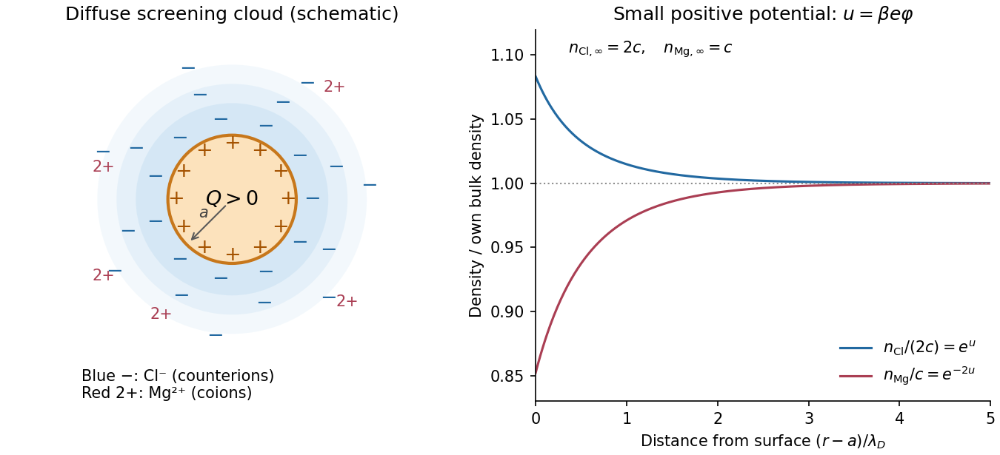

<h1 id="section-b/6/b/solution">Solution</h1>

↑ **Parent:** [B](../b.md)

The particle carries positive [surface charge density](../../../../../surface-charge-density.md) $\sigma=Q/(4\pi a^2)$. Its surrounding [electric double layer](../../../../../electric-double-layer.md) has an excess of negative [chloride](../../../../../chloride.md) [counterions](../../../../../counterion.md) and a deficit of positive [magnesium](../../../../../magnesium.md) [coions](../../../../../coion.md). Thus $\phi(r)>0$ decreases to zero, $n_{\mathrm{Cl}}(r)$ decreases towards its bulk value, and $n_{\mathrm{Mg}}(r)$ increases towards its bulk value. The diffuse [charge density](../../../../../charge-density.md) is negative and tends to zero.

If $c$ denotes the bulk number of dissolved salt formula units per unit volume, the far-field [number densities](../../../../../number-density.md) are $n_{\mathrm{Mg},\infty}=c$ and $n_{\mathrm{Cl},\infty}=2c$. The bulk is neutral even though these number densities differ. In the dilute mean-field picture the total diffuse [electric charge](../../../../../electric-charge-split.md) is $-Q$, ensuring overall [electroneutrality](../../../../../electroneutrality.md). A molecularly bound compact layer would require additional surface-chemistry information and is not assumed in the supplied potential.

**[Figure 2](#section-b/6/b/image-counterion-enrichment-and-coion-depletion-around-a-positive-sphere). Counterion enrichment and coion depletion around a positive sphere**. Original schematic. The left panel distinguishes the positive surface from an excess of chloride in the surrounding diffuse cloud; symbol positions are illustrative. The right panel plots the mean-field concentrations normalized separately to their bulk values, for a small illustrative positive surface potential. Both normalized curves tend to one, although bulk chloride number density is twice bulk magnesium number density.

## ↑ Ancestors (14)

1. [B](../b.md)
2. [6](../../6.md)
3. [Section B](../../../section-b.md)
4. [2022](../../../../2022-split.md)
5. [Past exam of the soft condensed matter course of the University of Cambridge](../../../../split.md)
6. [Soft Condensed Matter course of the University of Cambridge](../../../../../soft-condensed-matter-course-of-the-university-of-cambridge.md)
7. [Physics course of the year 3 of the natural sciences course of the University of Cambridge](../../../../../physics-course-of-the-year-3-of-the-natural-sciences-course-of-the-university-of-cambridge.md)
8. [Year 3 of the natural sciences course of the University of Cambridge](../../../../../year-3-of-the-natural-sciences-course-of-the-university-of-cambridge.md)
9. [Year of the natural sciences course of the University of Cambridge](../../../../../year-of-the-natural-sciences-course-of-the-university-of-cambridge.md)
10. [Natural sciences course of the University of Cambridge](../../../../../natural-sciences-course-of-the-university-of-cambridge.md)
11. [Course of the University of Cambridge](../../../../../course-of-the-university-of-cambridge.md)
12. [University of Cambridge](../../../../../university-of-cambridge-split.md)
13. [List of universities](../../../../../list-of-universities.md)
14. [Codex Wiki](../../../../../split.md)
