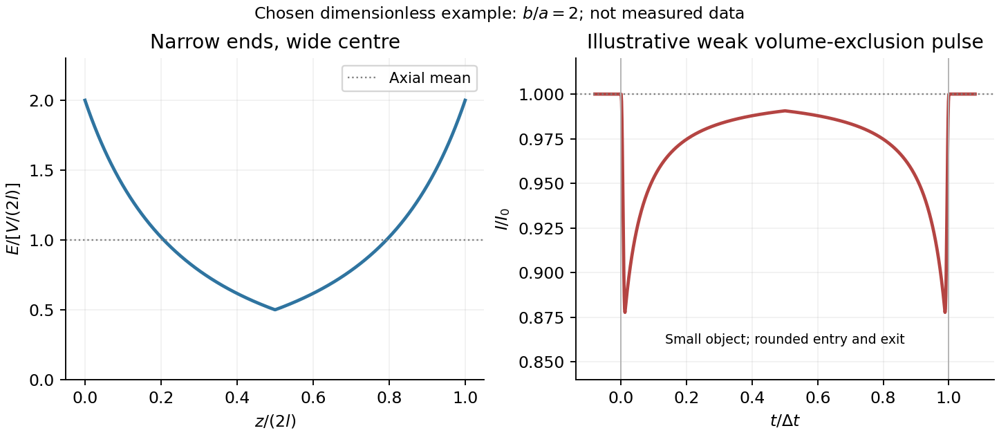
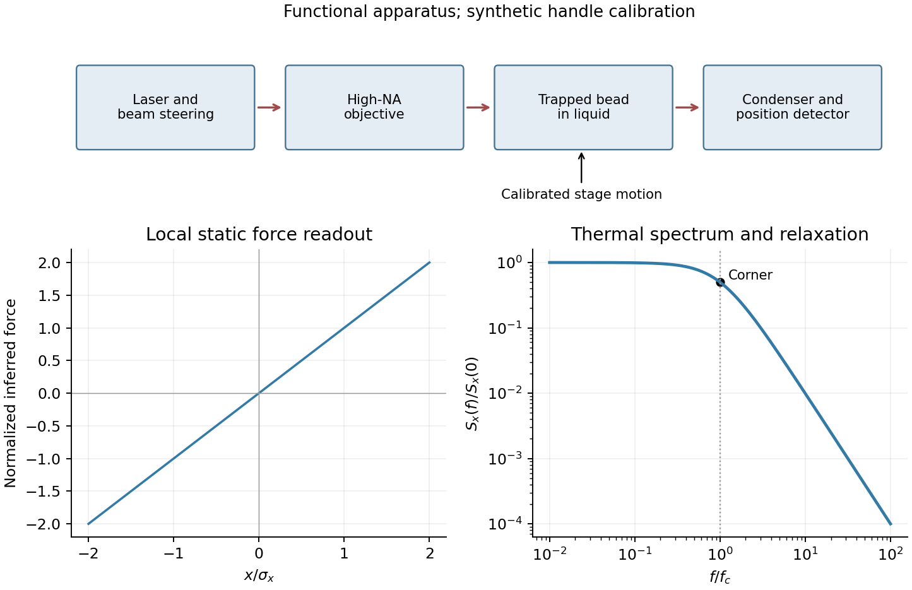

# Paper 1

↑ **Parent:** [2012](../2012.md)

Original paper: [Public original, physical PDF pages 462–464](https://www.whatdotheyknow.com/request/natural_science_tripos_physics_e_2/response/2340776/attach/2/FOI%202023%20399%20Zahid%20materials.pdf?cookie_passthrough=1#page=462).

**Table of contents**

- [1](#1)
  - [Solution](#1/solution)
- [2](#2)
  - [Solution](#2/solution)
- [3](#3)
  - [a](#3/a)
    - [Solution](#3/a/solution)
  - [b](#3/b)
    - [Solution](#3/b/solution)
  - [c](#3/c)
    - [Solution](#3/c/solution)

## 1

↑ **Parent:** [Paper 1](paper-1.md)

<h3 id="1/solution">Solution</h3>

↑ **Parent:** [1](#1)

[resistive-pulse sensing](../../fluid-mechanics.md#resistive-pulse-sensing) detects the change in a conducting aperture's [electric current](../../electric-charge.md#electric-current) as a particle crosses it. For generic synthetic analytes it offers electrical detection of individual events without a fluorescent label, small sensing [volumes](../../geometry-and-topology.md#volume), and simultaneous pulse-amplitude, shape and duration information. Event counts estimate flux, while calibrated amplitudes and durations can constrain excluded [volume](../../geometry-and-topology.md#volume) and transport. These observables are not unique molecular identifiers: shape, [electric charge](../../electric-charge.md), orientation, pore geometry, salt conditions and detector [signal bandwidth](../../electrical-engineering.md#signal-bandwidth) can all change a pulse.

TODO: biomolecular identification and biological [nanopore](../../fluid-mechanics.md#nanopore) applications are user-deferred. The calculations below concern an uncharged solid pore and generic synthetic charged [polymers](../../polymer.md).

The original cross-section has [radius](../../topology.md#radius) $a$ at both ends and [radius](../../topology.md#radius) $b$ midway through. In the intended one-dimensional series-resistance approximation, put $s=(b-a)/l$ and

$$
r(z)=\begin{cases}a+sz,&0\leq z\leq l,\\a+s(2l-z),&l\leq z\leq2l.\end{cases}
$$

For constant ionic [electrical resistivity](../../electric-charge.md#electrical-resistivity) $\rho$, a slice contributes $d\mathcal R=\rho\,dz/[\pi r(z)^2]$. The [ionic resistance of a conical pore](../../fluid-mechanics.md#ionic-resistance-of-a-conical-pore) then gives

$$
\mathcal R=\frac{2\rho}{\pi}\int_0^l\frac{dz}{(a+sz)^2}
=\frac{2\rho}{\pi s}\left(\frac1a-\frac1b\right),\qquad
\boxed{\mathcal R=\frac{2\rho l}{\pi ab}.}
$$

This assumes locally Ohmic transport with negligible surface conduction and approximately uniform axial [current density](../../electric-charge.md#current-density) over each slice. An uncharged wall alone does not make it an exact three-dimensional solution of [Laplace's equation](../../partial-differential-equation.md#laplace-equation) for a rapidly varying pore. [electrical resistance](../../electric-charge.md#electrical-resistance) outside the two end planes, including reservoir access [electrical resistance](../../electric-charge.md#electrical-resistance), is excluded.

Take $V=\Phi(0)-\Phi(2l)>0$ as the potential drop inside the pore, so positive [electric current](../../electric-charge.md#electric-current) flows along $+z$. [current conservation](../../classical-field-theory.md#conserved-current) and [Ohm's law](../../electric-charge.md#ohm-s-law) give

$$
I_0=\frac{V}{\mathcal R}=\frac{\pi abV}{2\rho l},\qquad
\boxed{E(z)=\frac{\rho I_0}{\pi r(z)^2}=\frac{Vab}{2l\,r(z)^2}.}
$$

This is the leading cross-section-averaged axial [electric field](../../electric-field.md), and the corresponding on-axis estimate in the same approximation. It is largest at the two narrow ends and smallest at the wide centre:

$$
E(0)=E(2l)=\frac{Vb}{2la},\qquad E(l)=\frac{Va}{2lb},\qquad
\frac{E(0)}{E(l)}=\left(\frac ba\right)^2.
$$

The graph is symmetric, falls on the first half and rises on the second, with a minimum at $l$. The [electric potential difference](../../electric-field.md#electric-potential-difference) check is $\int_0^{2l}E(z)\,dz=V$. A narrow waist at the centre would give the opposite [electric field](../../electric-field.md) sketch and would misread this source figure.

Under a small insulating-volume perturbation, a short particle produces a [position-dependent resistive pulse](../../fluid-mechanics.md#position-dependent-resistive-pulse) with a downward excursion. If its excluded [volume](../../geometry-and-topology.md#volume) is $\Omega$ and small compared with the local sensing [volume](../../geometry-and-topology.md#volume), a local volume-exclusion model gives $\Delta\mathcal R(z)\propto\rho\Omega/[\pi^2r(z)^4]$. Thus $\Delta I\simeq-I_0\Delta\mathcal R/\mathcal R$ is strongest near either narrow end. A sufficiently resolved event can show two deeper end features separated by a shallower middle depression, then return to baseline. Finite particle size and acquisition [signal bandwidth](../../electrical-engineering.md#signal-bandwidth) round entry and exit. The original illustration below shows this conditional small-particle mechanism, not a fitted amplitude. A charged analyte can also alter local ion density and [electrical conductance](../../electric-charge.md#electrical-conductance), so the exact sign and shape need not follow excluded [volume](../../geometry-and-topology.md#volume) alone.

**[Figure 1](#1/image-pore-field-and-pulse). Pore field and pulse**.

For positive drift in this coordinate, require $\mu V>0$. The [electrophoretic transit time in a conical pore](../../fluid-mechanics.md#electrophoretic-transit-time-in-a-conical-pore) is the integral of inverse local drift speed:

$$
\Delta t=\int_0^{2l}\frac{dz}{\mu E(z)}
=\frac{2l}{\mu Vab}\int_0^{2l}r(z)^2dz
=\frac{4l}{\mu Vab}\frac{b^3-a^3}{3s}.
$$

Therefore

$$
\boxed{\Delta t=\frac{4l^2}{3\mu Vab}\frac{b^3-a^3}{b-a}
=\frac{4l^2}{3\mu V}\left(\frac ba+1+\frac ab\right).}
$$

Reverse the polarity or use $|\mu V|$ when reporting a positive transit duration in the opposite direction. The limit $b\to a$ is regular: $\Delta t\to4l^2/(\mu V)$, equal to [length](../../physics.md#length) divided by uniform drift speed. Also $b/a+a/b\geq2$, so nonuniform [electric field](../../electric-field.md) makes this point-particle transit no faster than the uniform-field value at the same [length](../../physics.md#length) and [electric potential difference](../../electric-field.md#electric-potential-difference). The wide, weak-field interior dominates residence time.

The final length-dependent observations do not uniquely identify a microscopic mechanism. The calculation assumed a point-like object, constant bulk [electrophoretic mobility](../../physical-chemistry.md#electrophoretic-mobility), the empty-pore [electric field](../../electric-field.md), no wall residence and a drift-defined transit interval. An extended chain can sample entrance and reservoir fields simultaneously, alter its conformation and tension, and change the effective driving-to-friction ratio. These effects can make a bulk-mobility, local-field prediction underestimate the driving. For a small object, wall interactions, reversible trapping, or repeated entry excursions can add residence time that the deterministic formula omits. A length-dependent effective [electrophoretic mobility](../../physical-chemistry.md#electrophoretic-mobility) can likewise produce opposite deviations for short and long synthetic chains. Extra drag alone would slow a long chain, so it cannot explain a faster event without another changed [force](../../force.md), [electrophoretic mobility](../../physical-chemistry.md#electrophoretic-mobility) or event definition.

Discriminate these possibilities by measuring the synthetic analyte's free-solution [electrophoretic mobility](../../physical-chemistry.md#electrophoretic-mobility), reversing [electric potential difference](../../electric-field.md#electric-potential-difference), varying salt and surface passivation, and comparing pulse depth with dwell time. Resolved multiple occupancy or folds can alter amplitude as well as timing. Test detector thresholds and [signal bandwidth](../../electrical-engineering.md#signal-bandwidth): the interval between two detected [electric current](../../electric-charge.md#electric-current) features need not equal complete contour passage. A drift–[diffusion](../../thermodynamics.md#diffusion) description additionally needs entrance/exit conditions; [diffusion](../../thermodynamics.md#diffusion) by itself is not a universal reason for a longer mean transit time. No unique anomalous-duration prediction follows from the provided parameters alone.

## 2

↑ **Parent:** [Paper 1](paper-1.md)

<h3 id="2/solution">Solution</h3>

↑ **Parent:** [2](#2)

TODO: this entire question is user-deferred. Every requested calculation and measurement is framed as an organism-specific biological or biofluid application. This includes all five unlabelled requests across the two printed pages; no biological research or solving has been performed.

## 3

↑ **Parent:** [Paper 1](paper-1.md)

<h3 id="3/a">a</h3>

↑ **Parent:** [3](#3)

<h4 id="3/a/solution">Solution</h4>

↑ **Parent:** [A](#3/a)

TODO: biomolecular [force](../../force.md) assays are user-deferred. The following notes cover the generic physical apparatus, calibrated dielectric handles and synthetic attachments only.

In [optical tweezers](../../optics.md#optical-tweezers), a tightly focused [laser](../../laser.md) produces a restoring gradient [force](../../force.md) on a suitable transparent bead. Scattering also transfers [momentum](../../momentum.md) along propagation, so a stable three-dimensional trap needs axial as well as lateral restoration. An objective with high [numerical aperture](../../point-spread-function.md#numerical-aperture), correctly filled entrance pupil, controlled beam [polarization](../../wave.md#polarization-waves) and low-aberration sample chamber are practical design elements. Collect transmitted/scattered light with a condenser and measure bead [displacement](../../classical-mechanics.md#displacement) with calibrated imaging or back-focal-plane photodetection. A steerable beam or translation stage sets relative positions; the [force](../../force.md) signal comes from bead [displacement](../../classical-mechanics.md#displacement), not commanded stage [displacement](../../classical-mechanics.md#displacement) alone.

Near a stable operating point, use a [harmonic optical trap](../../optics.md#harmonic-optical-trap) with $U(x)=kx^2/2$. For a slowly changing external [force](../../force.md), $F_{\rm ext}=k\langle x\rangle$ in that coordinate; the optical [restoring force](../../force.md#restoring-force) is $-kx$. Calibrate each axis and the range over which its response is linear. Detector sensitivity must also be known: write $x=\beta(s-s_0)$, with measured detector voltage $s$, offset $s_0$ and position sensitivity $\beta$ in $\mathrm{m/V}$. A [spring constant](../../elasticity-physics.md#spring-constant) in arbitrary detector units is not a [force](../../force.md) calibration.

Three complementary physical calibrations are useful. At [thermal equilibrium](../../thermal-equilibrium.md) the [equipartition theorem](../../canonical-ensemble.md#equipartition-theorem) gives

$$
\boxed{k=\frac{k_BT}{\langle(x-\langle x\rangle)^2\rangle}.}
$$

This needs an independently calibrated position scale and a [variance](../../variance.md) corrected for drift, detector noise and exposure averaging. In an overdamped Newtonian medium, the [optical trap Langevin calibration](../../optics.md#optical-trap-langevin-calibration) obeys

$$
\zeta\dot x=-kx+\xi(t),\qquad
\langle\xi(t)\xi(t')\rangle=2k_BT\zeta\delta(t-t').
$$

Using a one-sided position [power spectral density](../../electrical-engineering.md#power-spectral-density) per hertz,

$$
\boxed{S_x(f)=\frac{k_BT}{\pi^2\zeta(f^2+f_c^2)},\qquad
f_c=\frac{k}{2\pi\zeta},\qquad\int_0^\infty S_x(f)df=\frac{k_BT}{k}.}
$$

The corner [frequency](../../wave.md#frequency) and spectral amplitude test both relaxation and fluctuation size. If drag is known, $k=2\pi\zeta f_c$. The isolated-sphere value $\zeta=6\pi\eta a$ must be corrected near boundaries; otherwise measured height dependence can be mistaken for a changed trap stiffness. An independent steady [optical trap drag calibration](../../optics.md#optical-trap-drag-calibration) moves fluid past the trapped sphere: $k\langle x\rangle=\zeta u$. Use small positive and negative speeds to verify slope, offset and [force](../../force.md) range.

One can also determine position sensitivity without assuming the bulk drag. In a low-frequency [sinusoidal-stage optical trap calibration](../../optics.md#sinusoidal-stage-optical-trap-calibration), let the known local fluid [velocity](../../classical-mechanics.md#velocity) amplitude be $u_0$ at drive [angular frequency](../../lagrangian-mechanics.md#angular-frequency) $\Omega$. The coherent bead [displacement](../../classical-mechanics.md#displacement) amplitude is

$$
A_x=\frac{\zeta u_0}{\sqrt{k^2+\Omega^2\zeta^2}}
=\frac{u_0}{\sqrt{(2\pi f_c)^2+\Omega^2}}.
$$

If the corresponding detector amplitude is $A_s$, then

$$
\boxed{\beta=\frac{u_0}{A_s\sqrt{(2\pi f_c)^2+\Omega^2}}.}
$$

After removing the coherent drive line from the thermal record, combine this sensitivity with [equipartition theorem](../../canonical-ensemble.md#equipartition-theorem) to recover $k$, and then infer $\zeta$ from $f_c$. A published calibration combines thermal spectra and stage-driven motion without taking bead drag as an input.[2006 author preprint, abstract: combined thermal/stage calibration and drag-independent sensitivity](../../physics-bibliography.md#calibration-of-optical-tweezers-with-positional-detection-in-the-back-focal-plane-by-simon-f-tolic-norrelykke-and-others)

Controls determine whether these formulas measure the apparatus rather than its noise. Record blocked-light offsets and independent fixed-bead noise; calibrate [length](../../physics.md#length) with known motion; keep sampling and electronics bandwidth adequate around $f_c$; and include exposure filtering and [aliasing](../../fourier-analysis.md#aliasing) in a spectral fit. [motion blur](../../optics.md#motion-blur) reduces measured [variance](../../variance.md) and therefore makes naive [equipartition theorem](../../canonical-ensemble.md#equipartition-theorem) overestimate stiffness; additive position noise has the opposite bias. Changing exposure time provides a direct diagnostic.[§II, equations (12)–(18): variance reduction, temporal filter and aliased spectrum](../../physics-bibliography.md#the-effect-of-integration-time-on-fluctuation-measurements-calibrating-an-optical-trap-in-the-presence-of-motion-blur-by-wesley-p-wong-and-others) Check [temperature](../../temperature.md) and [laser](../../laser.md) heating, wall separation, bead size and [refractive index](../../electromagnetic-wave.md#refractive-index), alignment and power stability. Repeat after changing power or optical geometry and compare thermal, spectral and drag estimates. For a synthetic [force](../../force.md) handle, also measure the attachment's compliance and geometry so that bead motion is not automatically identified with its extension.

**[Figure 2](#3/a/image-optical-trap-calibration). Optical trap calibration**.

<h3 id="3/b">b</h3>

↑ **Parent:** [3](#3)

<h4 id="3/b/solution">Solution</h4>

↑ **Parent:** [B](#3/b)

TODO: this topic is explicitly biomolecular and is user-deferred in full, including its first-passage-time application. No biological research or solving has been performed.

<h3 id="3/c">c</h3>

↑ **Parent:** [3](#3)

<h4 id="3/c/solution">Solution</h4>

↑ **Parent:** [C](#3/c)

TODO: biological interpretations and organism-specific propagation are user-deferred. The notes below concern only generic excitable [reaction–diffusion systems](../../diffusion-equation.md#reaction-diffusion-system).

A [front solution](../../analysis.md#front-solution) joins different asymptotic states in space. In a [reaction–diffusion system](../../diffusion-equation.md#reaction-diffusion-system), local nonlinear dynamics select possible states while [diffusion](../../thermodynamics.md#diffusion) couples neighboring points. A [travelling wave](../../analysis.md#travelling-wave) with profile $u(x,t)=U(\xi)$, $\xi=x-ct$, converts a [partial differential equation](../../partial-differential-equation.md) into a [boundary value problem](../../boundary-value-problem.md) for the shape and speed. A pulse instead returns to the same resting state on both sides and can contain leading and trailing fronts.

A useful nondimensional [cubic fast-slow reaction-diffusion model](../../diffusion-equation.md#cubic-fast-slow-reaction-diffusion-model), in a convention of the [FitzHugh-Nagumo model](../../mathematical-biology.md#fitzhugh-nagumo-model), is

$$
u_t=D u_{xx}+f(u)-w+I,\qquad
w_t=\varepsilon(u-\beta w),\qquad
f(u)=u(1-u)(u-\alpha),\quad0<\alpha<1,
$$

where $D>0$, $\varepsilon\ll1$, and $\beta>0$. Here $u$ is a fast activation variable, $w$ a slow negative-feedback variable and $I$ a generic drive; no physiological variable is assigned. Without spatial coupling, [nullclines](../../dynamical-systems.md#nullcline) are $w=f(u)+I$ and $w=u/\beta$. At $I=0$, the resting state $(0,0)$ has [Jacobian matrix](../../multivariable-calculus.md#jacobian-matrix)

$$
\mathsf J=\begin{pmatrix}-\alpha&-1\\\varepsilon&-\varepsilon\beta\end{pmatrix},\qquad
\operatorname{tr}\mathsf J=-\alpha-\varepsilon\beta<0,\quad
\det\mathsf J=\varepsilon(1+\alpha\beta)>0.
$$

It has [linear stability](../../dynamical-systems.md#linear-stability). With appropriate parameter choices a sufficiently large perturbation makes a fast excursion to the other outer branch of the cubic, followed by slow feedback and return. Thus a stable rest state can be excitable without being linearly unstable. Other parameters or applied drive can yield multiple equilibria or oscillations; these behaviours should not be asserted for every parameter set.

The fast-subsystem front can be obtained explicitly by freezing $w=I=0$. For the [bistable cubic reaction-diffusion equation](../../diffusion-equation.md#bistable-cubic-reaction-diffusion-equation), $u=0,1$ are stable and $u=\alpha$ is unstable. The decreasing [logistic front of a bistable cubic equation](../../diffusion-equation.md#logistic-front-of-a-bistable-cubic-equation) is

$$
\boxed{U(\xi)=\frac1{1+\exp[\xi/\sqrt{2D}]},\qquad
c=\sqrt{D/2}(1-2\alpha).}
$$

To check it, $U'=-U(1-U)/\sqrt{2D}$ and substitution into $DU''+cU'+f(U)=0$ cancels every term. For $\alpha<1/2$, the high state advances to the right; for $\alpha>1/2$, the direction reverses. At $\alpha=1/2$ the front is stationary. More generally, multiplying the travelling-wave equation by $U'$ and integrating yields

$$
c\int_{-\infty}^{\infty}(U')^2d\xi=\int_0^1f(u)du=\frac{1-2\alpha}{12}.
$$

This links propagation direction to the bias between the two stable states and recovers [Maxwell balance for a scalar reaction-diffusion front](../../analysis.md#maxwell-balance-for-a-scalar-reaction-diffusion-front) at zero speed. It is a bistable selected-speed problem, rather than a universal Fisher-type minimum-speed formula.

For the coupled fast-slow system, travelling profiles satisfy

$$
DU''+cU'+f(U)-W+I=0,\qquad
cW'+\varepsilon(U-\beta W)=0.
$$

A slow recovery wake can support a return front behind the advancing fast front, producing a travelling pulse for suitable parameters. Its width reflects the slow recovery time and propagation speed, while each sharp edge has the faster [diffusion](../../thermodynamics.md#diffusion)–reaction scale. The frozen-recovery speed above is a controlled subsystem result, not an exact speed for every coupled pulse. A definite pulse speed requires parameters and connecting [boundary condition](../../differential-equation.md#boundary-condition); none are specified by this brief-note question.

**[Figure 3](#3/c/image-generic-excitable-fronts). Generic excitable fronts**.

## ↑ Ancestors (11)

1. [2012](../2012.md)
2. [Past exam of the soft matter and biological physics course of the University of Cambridge](../../past-exam-of-the-soft-matter-and-biological-physics-course-of-the-university-of-cambridge.md)
3. [Soft Matter and Biological Physics course of the University of Cambridge](../../university-of-cambridge.md#soft-matter-and-biological-physics-course-of-the-university-of-cambridge)
4. [Physics course of the year 4 of the natural sciences course of the University of Cambridge](../../university-of-cambridge.md#physics-course-of-the-year-4-of-the-natural-sciences-course-of-the-university-of-cambridge)
5. [Year 4 of the natural sciences course of the University of Cambridge](../../university-of-cambridge.md#year-4-of-the-natural-sciences-course-of-the-university-of-cambridge)
6. [Year of the natural sciences course of the University of Cambridge](../../university-of-cambridge.md#year-of-the-natural-sciences-course-of-the-university-of-cambridge)
7. [Natural sciences course of the University of Cambridge](../../university-of-cambridge.md#natural-sciences-course-of-the-university-of-cambridge)
8. [Course of the University of Cambridge](../../university-of-cambridge.md#course-of-the-university-of-cambridge)
9. [University of Cambridge](../../university-of-cambridge.md)
10. [List of universities](../../README.md#list-of-universities)
11. [Codex Wiki](../../README.md)
