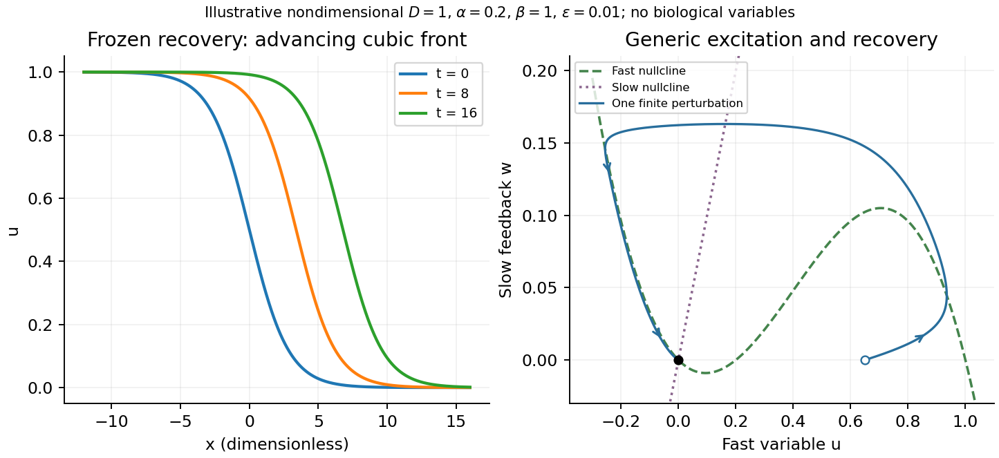

<h1 id="3/c/solution">Solution</h1>

↑ **Parent:** [C](../c.md)

TODO: biological interpretations and organism-specific propagation are user-deferred. The notes below concern only generic excitable [reaction–diffusion systems](../../../../../reaction-diffusion-system.md).

A [front solution](../../../../../front-solution.md) joins different asymptotic states in space. In a [reaction–diffusion system](../../../../../reaction-diffusion-system.md), local nonlinear dynamics select possible states while [diffusion](../../../../../diffusion.md) couples neighboring points. A [travelling wave](../../../../../travelling-wave.md) with profile $u(x,t)=U(\xi)$, $\xi=x-ct$, converts a [partial differential equation](../../../../../partial-differential-equation-split.md) into a [boundary value problem](../../../../../boundary-value-problem-split.md) for the shape and speed. A pulse instead returns to the same resting state on both sides and can contain leading and trailing fronts.

A useful nondimensional [cubic fast-slow reaction-diffusion model](../../../../../cubic-fast-slow-reaction-diffusion-model.md), in a convention of the [FitzHugh-Nagumo model](../../../../../fitzhugh-nagumo-model.md), is

$$
u_t=D u_{xx}+f(u)-w+I,\qquad
w_t=\varepsilon(u-\beta w),\qquad
f(u)=u(1-u)(u-\alpha),\quad0<\alpha<1,
$$

where $D>0$, $\varepsilon\ll1$, and $\beta>0$. Here $u$ is a fast activation variable, $w$ a slow negative-feedback variable and $I$ a generic drive; no physiological variable is assigned. Without spatial coupling, [nullclines](../../../../../nullcline.md) are $w=f(u)+I$ and $w=u/\beta$. At $I=0$, the resting state $(0,0)$ has [Jacobian matrix](../../../../../jacobian-matrix.md)

$$
\mathsf J=\begin{pmatrix}-\alpha&-1\\\varepsilon&-\varepsilon\beta\end{pmatrix},\qquad
\operatorname{tr}\mathsf J=-\alpha-\varepsilon\beta<0,\quad
\det\mathsf J=\varepsilon(1+\alpha\beta)>0.
$$

It has [linear stability](../../../../../linear-stability.md). With appropriate parameter choices a sufficiently large perturbation makes a fast excursion to the other outer branch of the cubic, followed by slow feedback and return. Thus a stable rest state can be excitable without being linearly unstable. Other parameters or applied drive can yield multiple equilibria or oscillations; these behaviours should not be asserted for every parameter set.

The fast-subsystem front can be obtained explicitly by freezing $w=I=0$. For the [bistable cubic reaction-diffusion equation](../../../../../bistable-cubic-reaction-diffusion-equation.md), $u=0,1$ are stable and $u=\alpha$ is unstable. The decreasing [logistic front of a bistable cubic equation](../../../../../logistic-front-of-a-bistable-cubic-equation.md) is

$$
\boxed{U(\xi)=\frac1{1+\exp[\xi/\sqrt{2D}]},\qquad
c=\sqrt{D/2}(1-2\alpha).}
$$

To check it, $U'=-U(1-U)/\sqrt{2D}$ and substitution into $DU''+cU'+f(U)=0$ cancels every term. For $\alpha<1/2$, the high state advances to the right; for $\alpha>1/2$, the direction reverses. At $\alpha=1/2$ the front is stationary. More generally, multiplying the travelling-wave equation by $U'$ and integrating yields

$$
c\int_{-\infty}^{\infty}(U')^2d\xi=\int_0^1f(u)du=\frac{1-2\alpha}{12}.
$$

This links propagation direction to the bias between the two stable states and recovers [Maxwell balance for a scalar reaction-diffusion front](../../../../../maxwell-balance-for-a-scalar-reaction-diffusion-front.md) at zero speed. It is a bistable selected-speed problem, rather than a universal Fisher-type minimum-speed formula.

For the coupled fast-slow system, travelling profiles satisfy

$$
DU''+cU'+f(U)-W+I=0,\qquad
cW'+\varepsilon(U-\beta W)=0.
$$

A slow recovery wake can support a return front behind the advancing fast front, producing a travelling pulse for suitable parameters. Its width reflects the slow recovery time and propagation speed, while each sharp edge has the faster [diffusion](../../../../../diffusion.md)–reaction scale. The frozen-recovery speed above is a controlled subsystem result, not an exact speed for every coupled pulse. A definite pulse speed requires parameters and connecting [boundary condition](../../../../../boundary-condition.md); none are specified by this brief-note question.

**[Figure 3](#3/c/image-generic-excitable-fronts). Generic excitable fronts**.

## ↑ Ancestors (14)

1. [C](../c.md)
2. [3](../../3.md)
3. [Paper 1](../../../paper-1-split.md)
4. [2012](../../../split.md)
5. [Past exam of the soft matter and biological physics course of the University of Cambridge](../../../../split.md)
6. [Soft Matter and Biological Physics course of the University of Cambridge](../../../../../soft-matter-and-biological-physics-course-of-the-university-of-cambridge.md)
7. [Physics course of the year 4 of the natural sciences course of the University of Cambridge](../../../../../physics-course-of-the-year-4-of-the-natural-sciences-course-of-the-university-of-cambridge.md)
8. [Year 4 of the natural sciences course of the University of Cambridge](../../../../../year-4-of-the-natural-sciences-course-of-the-university-of-cambridge.md)
9. [Year of the natural sciences course of the University of Cambridge](../../../../../year-of-the-natural-sciences-course-of-the-university-of-cambridge.md)
10. [Natural sciences course of the University of Cambridge](../../../../../natural-sciences-course-of-the-university-of-cambridge.md)
11. [Course of the University of Cambridge](../../../../../course-of-the-university-of-cambridge.md)
12. [University of Cambridge](../../../../../university-of-cambridge-split.md)
13. [List of universities](../../../../../list-of-universities.md)
14. [Codex Wiki](../../../../../split.md)
