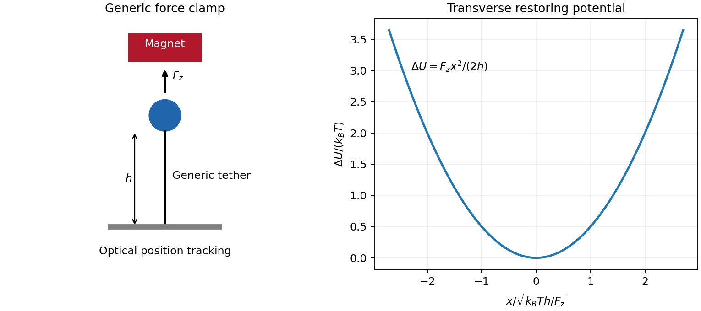

<h1 id="1/solution">Solution</h1>

↑ **Parent:** [1](../1.md)

For the generic instrument, [magnetic tweezers](../../../../magnetic-tweezers.md) combine a magnetically responsive bead, a controllable [magnetic field gradient](../../../../magnetic-field-gradient.md), a tether attached to a fixed support, and optical tracking of bead coordinates. For a fixed [magnetic dipole moment](../../../../magnetic-dipole-moment.md), the [force](../../../../force-split.md) is $\nabla(\mathbf m\cdot\mathbf B)$; an induced linear isotropic moment instead gives $\mathbf F=V\Delta\chi\nabla B^2/(2\mu_0)$. A uniform [magnetic field](../../../../magnetic-field-split.md) can orient an anisotropic bead, but a gradient is needed for translation. Magnet height sets the load, while field rotation can impose [torque](../../../../torque.md) if bead orientation is coupled to the field. Tracking uses lateral images and a calibrated axial image/defocus response; a fixed reference removes stage drift. A sufficiently slowly varying gradient approximates a [force clamp](../../../../force-clamp.md) over the bead's displacement. TODO: **user-deferred biomolecular implementation**; DNA-specific attachment, preparation and response are not treated.

For [transverse-fluctuation calibration of a tensioned tether](../../../../transverse-fluctuation-calibration-of-a-tensioned-tether.md), use an ideal tether of vertical extension $h$ whose endpoint is displaced by small $x,y$. Keeping its [length](../../../../length.md) fixed to quadratic order lowers its vertical coordinate by $(x^2+y^2)/(2h)$, increasing load potential by $F_z(x^2+y^2)/(2h)$. The [equipartition theorem](../../../../equipartition-theorem.md) therefore gives

$$
\boxed{F_z=\frac{k_BTh}{\langle\delta x^2\rangle}
=\frac{k_BTh}{\langle\delta y^2\rangle}
=\frac{2k_BTh}{\langle\delta x^2+\delta y^2\rangle}.}
$$

Here fluctuations are about the mean. The height is the effective pendulum [length](../../../../length.md) of the measured coordinate, not automatically the [polymer contour length](../../../../polymer-contour-length.md). The displayed $h$ formula uses the point-endpoint or fixed-bead-orientation idealization; freely rotating large beads can require a bead-radius correction to that lever arm. The [finite-exposure correction to fluctuation force calibration](../../../../finite-exposure-correction-to-fluctuation-force-calibration.md) restores variance lost through exposure averaging; ignoring it would overestimate [force](../../../../force-split.md); localization noise increases it and would underestimate [force](../../../../force-split.md). Drift, wall coupling, finite observation time and magnetic lateral stiffness must be checked. Vertical fluctuations measure longitudinal stiffness and do not obey the same geometrical formula.

For the [stretch and twist coefficients of an elastic filament](../../../../stretch-and-twist-coefficients-of-an-elastic-filament.md), take $s$ as reference contour [length](../../../../length.md) and $\epsilon$ as local axial [strain](../../../../strain.md). The three positive quadratic costs represent bending of the tangent, stretching of the material and excess twist about its relaxed orientation. With the paper's coefficient convention,

$$
K_b=k_BTA,\qquad S=k_BTB,\qquad K_t=k_BTC.
$$

$K_b,K_t$ are bending and torsional rigidities with units of [energy](../../../../energy-split.md) times [length](../../../../length.md); $S$ is an axial [force](../../../../force-split.md) modulus. Thus $A,C$ have units of [length](../../../../length.md) and $B$ inverse [length](../../../../length.md). Positive quadratic forms describe a stable relaxed filament; odd terms vanish when expansion is about its zero-stress, zero-torque reference configuration.

At weak and intermediate [tension](../../../../tension.md), changing thermal bending conformations can extend the filament without appreciably stretching the backbone. Axial [strain](../../../../strain.md) is $\epsilon\simeq F_z/S$, so material stretching must be included when this is no longer negligible. For a long strongly aligned but nearly inextensible three-dimensional [worm-like chain](../../../../worm-like-chain.md), the thermal extension deficit is approximately $\tfrac12\sqrt{k_BT/(AF_z)}$; stretch adds approximately $F_z/S$ to fractional extension. Twist matters whenever [torque](../../../../torque.md) or imposed end rotation is present, at any [tension](../../../../tension.md). A freely swivelling, [torque-free](../../../../torque-free.md) tether need not store excess twist. There is no universal force-only threshold for switching on torsional [energy](../../../../energy-split.md).

The [circular bending energy of an elastic filament](../../../../circular-bending-energy-of-an-elastic-filament.md) follows because curvature is $1/R$ over contour [length](../../../../length.md) $2\pi R$. Integrating the bending term gives

$$
\boxed{E_{\rm loop}=\frac{k_BTA}{2R^2}(2\pi R)=\frac{\pi k_BTA}{R}.}
$$

This is bending [energy](../../../../energy-split.md) alone: imposed [tension](../../../../tension.md), stretching and twist would add costs. The dimensionless bending action is $(A/2)\int|\partial_s\mathbf t|^2ds$. Its tangent propagator in three dimensions obeys [rotational diffusion](../../../../rotational-diffusion.md) on the unit sphere, $\partial_sP=(2A)^{-1}\nabla_{S^2}^2P$. The vector [spherical harmonic](../../../../spherical-harmonic.md) has angular [eigenvalue](../../../../eigenvalue.md) $-2$, giving

$$
\boxed{\langle\mathbf t(s)\cdot\mathbf t(0)\rangle=e^{-s/A}.}
$$

Hence $A$ is the [persistence length](../../../../persistence-length.md) in this three-dimensional convention. A strictly planar filament instead has tangent-correlation [length](../../../../length.md) $2A$; one cannot infer the factor merely by setting a loop's [energy](../../../../energy-split.md) equal to $k_BT$.

TODO: **user-deferred biomolecular applications**. Both enzyme-driven unwinding experiments, their experimental sketches, the requested numerical [force](../../../../force-split.md) and plectoneme [radius](../../../../radius.md), [energy](../../../../energy-split.md) loss per turn and enzyme-specific dissipation mechanisms remain unsolved. None of their biomolecular parameters has been used in a calculation.

**[Figure 1](#1/image-original-generic-magnetic-tether-instrument-and-its-transverse-fluctuation-calibration). Original generic magnetic-tether instrument and its transverse fluctuation calibration**.

## ↑ Ancestors (13)

1. [1](../1.md)
2. [Paper 1](../../paper-1-split.md)
3. [2013](../../split.md)
4. [Past exam of the soft matter and biological physics course of the University of Cambridge](../../../split.md)
5. [Soft Matter and Biological Physics course of the University of Cambridge](../../../../soft-matter-and-biological-physics-course-of-the-university-of-cambridge.md)
6. [Physics course of the year 4 of the natural sciences course of the University of Cambridge](../../../../physics-course-of-the-year-4-of-the-natural-sciences-course-of-the-university-of-cambridge.md)
7. [Year 4 of the natural sciences course of the University of Cambridge](../../../../year-4-of-the-natural-sciences-course-of-the-university-of-cambridge.md)
8. [Year of the natural sciences course of the University of Cambridge](../../../../year-of-the-natural-sciences-course-of-the-university-of-cambridge.md)
9. [Natural sciences course of the University of Cambridge](../../../../natural-sciences-course-of-the-university-of-cambridge.md)
10. [Course of the University of Cambridge](../../../../course-of-the-university-of-cambridge.md)
11. [University of Cambridge](../../../../university-of-cambridge-split.md)
12. [List of universities](../../../../list-of-universities.md)
13. [Codex Wiki](../../../../split.md)
