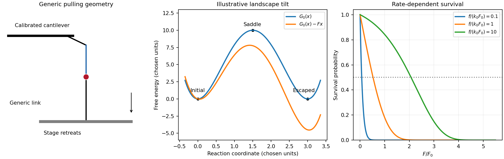

<h1 id="2/solution">Solution</h1>

↑ **Parent:** [2](../2.md)

Use a [force-tilted activation barrier](../../../../force-tilted-activation-barrier.md) for a generic one-coordinate escape model. A tensile [force](../../../../force-split.md) tilts a [free-energy landscape](../../../../free-energy-landscape.md) to $G_F(x)=G_0(x)-Fx$. If $x_b$ is the initial [minimum](../../../../minimum-of-a-subset-of-a-total-order.md) and $x_s$ the saddle, define $\Delta x=x_s-x_b>0$ and the zero-force barrier $\Delta G_0^\ddagger=G_0(x_s)-G_0(x_b)$. The relevant activation barrier is measured relative to the initial [minimum](../../../../minimum-of-a-subset-of-a-total-order.md), not an arbitrary absolute transition-state [energy](../../../../energy-split.md). To first order in [force](../../../../force-split.md),

$$
\Delta G^\ddagger(F)=\Delta G_0^\ddagger-F\Delta x,
\qquad
\boxed{k(F)=k_0e^{F/F_0},\quad F_0=\frac{k_BT}{\Delta x},\quad
k_0=\nu e^{-\Delta G_0^\ddagger/(k_BT)}.}
$$

The attempt prefactor $\nu$ is assumed [force](../../../../force-split.md) independent, and the saddle displacement is approximated as constant. This single-barrier approximation need not survive large landscape deformations or a change of escape pathway. TODO: **user-deferred biomolecular implementation**; the protein-specific shear-force arrangement and attachment chemistry are not solved.

For a generic force-ramp measurement, a calibrated [atomic force microscope](../../../../atomic-force-microscope.md) [cantilever](../../../../cantilever.md) pulls an attachment while a stage changes separation. [cantilever](../../../../cantilever.md) deflection $d$ gives [force](../../../../force-split.md) $k_cd$, and the [cantilever compliance correction](../../../../cantilever-compliance-correction.md) subtracts $d$ from imposed separation to give tether extension, with further corrections for other apparatus compliance. A prescribed stage speed does not automatically produce constant [force](../../../../force-split.md) loading rate when tether stiffness varies; the assumed $F(t)=ft$ must be measured or controlled. The original schematic below illustrates a generic nonbiological bond/tether geometry. Protein-specific construction is deferred.

The no-rebinding approximation is a physical escape assumption: after the link breaks, separation removes the partners from the capture region before appreciable reassociation. It requires the integrated return/association probability during that separation to be small. If the separated state stays nearby or the [force](../../../../force-split.md) is held without separation, setting $k_+=0$ can fail. Under the stipulated approximation, with the link initially intact,

$$
\frac{dp}{dF}=-\frac{k_0}{f}e^{F/F_0}p,
\qquad
\boxed{p(F)=\exp\left[-\frac{k_0F_0}{f}(e^{F/F_0}-1)\right],\quad F\geq0.}
$$

This [survival under a linear force ramp](../../../../survival-under-a-linear-force-ramp.md) differs from the [probability density](../../../../probability-density.md) for rupture. It starts at one, decreases to zero and shifts to larger [force](../../../../force-split.md) as the loading rate increases. For small $F/F_0$, $p\simeq e^{-k_0F/f}$; a slow ramp allows much escape before substantial [force](../../../../force-split.md) is reached.

The [median rupture force under a linear ramp](../../../../median-rupture-force-under-a-linear-ramp.md) satisfies $p=1/2$, giving

$$
\boxed{F_{1/2}=F_0\ln\left(1+\frac{f\ln2}{k_0F_0}\right).}
$$

At high loading rate, the slope of $F_{1/2}$ against $\ln f$ tends to $F_0$; it is not exactly $F_0$ for a slow ramp. Fit the full expression across loading rates to recover $F_0$ and $k_0$. The rupture-force [probability density](../../../../probability-density.md) is $\rho(F)=k(F)p(F)/f$, whose [most probable rupture force under a linear ramp](../../../../most-probable-rupture-force-under-a-linear-ramp.md) is $F_*=F_0\ln[f/(k_0F_0)]$ if $f>k_0F_0$, and zero otherwise. [median](../../../../median.md) and [mode](../../../../mode-statistics.md) are different observables and must not be interchanged when fitting.

At known [temperature](../../../../temperature-split.md), $F_0$ yields the activation distance $\Delta x=k_BT/F_0$; $1/k_0$ gives the zero-force mean lifetime in this exponential model. Absolute barrier height additionally requires the attempt prefactor, and neither equilibrium binding [free energy](../../../../thermodynamic-free-energy.md) nor an association rate follows from dissociation-only data. A loading-rate-dependent rupture [force](../../../../force-split.md) is a kinetic readout, not an intrinsic equilibrium strength. TODO: **user-deferred biological conclusions**. The protein-specific stability interpretation and cell-adhesion strategy are left unsolved.

**[Figure 2](#2/image-original-generic-pulling-arrangement-tilted-energy-landscape-and-calculated-survival-under-a-force-ramp). Original generic pulling arrangement, tilted energy landscape and calculated survival under a force ramp**.

## ↑ Ancestors (13)

1. [2](../2.md)
2. [Paper 1](../../paper-1-split.md)
3. [2013](../../split.md)
4. [Past exam of the soft matter and biological physics course of the University of Cambridge](../../../split.md)
5. [Soft Matter and Biological Physics course of the University of Cambridge](../../../../soft-matter-and-biological-physics-course-of-the-university-of-cambridge.md)
6. [Physics course of the year 4 of the natural sciences course of the University of Cambridge](../../../../physics-course-of-the-year-4-of-the-natural-sciences-course-of-the-university-of-cambridge.md)
7. [Year 4 of the natural sciences course of the University of Cambridge](../../../../year-4-of-the-natural-sciences-course-of-the-university-of-cambridge.md)
8. [Year of the natural sciences course of the University of Cambridge](../../../../year-of-the-natural-sciences-course-of-the-university-of-cambridge.md)
9. [Natural sciences course of the University of Cambridge](../../../../natural-sciences-course-of-the-university-of-cambridge.md)
10. [Course of the University of Cambridge](../../../../course-of-the-university-of-cambridge.md)
11. [University of Cambridge](../../../../university-of-cambridge-split.md)
12. [List of universities](../../../../list-of-universities.md)
13. [Codex Wiki](../../../../split.md)
