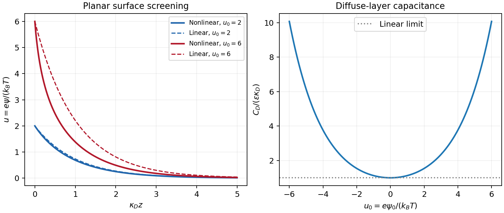

<h1 id="3/b/solution">Solution</h1>

↑ **Parent:** [B](../b.md)

Use SI units, uniform absolute [permittivity](../../../../../permittivity-split.md) $\varepsilon$ and a neutral bulk reservoir. Local equilibrium of ideal mobile [ions](../../../../../ion.md) gives $n_i=n_{i,\infty}e^{-z_ie\psi/(k_BT)}$. Combining their charge with the [Poisson equation](../../../../../poisson-s-equation.md) yields

$$
\boxed{\nabla^2\psi=-\frac1\varepsilon\left[\rho_f+\sum_i z_ie n_{i,\infty}e^{-z_ie\psi/(k_BT)}\right].}
$$

The reference is $\psi=0$ in the bulk. Boundary data specify fixed charge, fixed potential or a surface reaction/[charge regulation](../../../../../charge-regulation.md) law. These are physically different problems. The [mean-field theory](../../../../../mean-field-theory.md) assumes point [ions](../../../../../ion.md), [thermal equilibrium](../../../../../thermal-equilibrium-split.md) and a continuum [solvent](../../../../../solvent.md); ion-size packing, dielectric structure and strong electrostatic correlations can invalidate it.

For a symmetric monovalent electrolyte let $n_\infty$ count each sign and define $u=e\psi/(k_BT)$, $\kappa_D^2=2e^2n_\infty/(\varepsilon k_BT)$. Outside fixed sources,

$$
\nabla^2u=\kappa_D^2\sinh u.
$$

For $|u|\ll1$, the Debye-Hückel approximation is $\nabla^2u=\kappa_D^2u$. A planar wall bounding electrolyte in $z>0$ has $\psi=\psi_0e^{-\kappa_Dz}$; assuming zero field on the other side, its charge is $\sigma=\varepsilon\kappa_D\psi_0$. A sphere of [radius](../../../../../radius.md) $a$ and total charge $Q$ instead gives

$$
\psi(r)=\frac{Qe^{-\kappa_D(r-a)}}{4\pi\varepsilon r(1+\kappa_Da)},\qquad r\geq a.
$$

The factors arise from geometry and [boundary conditions](../../../../../boundary-condition.md); planar screening cannot be substituted unchanged for a small sphere. The weak-potential condition must hold where the potential is largest, particularly at the surface.

The [nonlinear planar Poisson-Boltzmann profile](../../../../../nonlinear-planar-poisson-boltzmann-profile.md) is also exactly integrable. Multiply $u''=\kappa_D^2\sinh u$ by $u'$ and use $u,u'\to0$ at infinity:

$$
(u')^2=2\kappa_D^2(\cosh u-1),\qquad
u'=-2\kappa_D\sinh(u/2).
$$

The sign selects a profile decaying to the bulk for either sign of surface potential. Integration gives

$$
\boxed{u(z)=4\operatorname{artanh}\left[\gamma e^{-\kappa_Dz}\right],\qquad
\gamma=\tanh(u_0/4).}
$$

For weak $u_0$ this reduces to the linear solution. Strong surface potentials have a bounded far-field amplitude $4\gamma$, while the near-wall [ion](../../../../../ion.md) [density](../../../../../density.md) still grows strongly. There is no need to permit the negative [ion](../../../../../ion.md) [densities](../../../../../density.md) produced by an invalid extrapolation of a linearized [density](../../../../../density.md) formula.

The same first integral yields the [Grahame equation](../../../../../grahame-equation.md) and its [diffuse-layer differential capacitance](../../../../../diffuse-layer-differential-capacitance.md) per unit [area](../../../../../surface-area.md):

$$
\boxed{\sigma=\frac{2\varepsilon\kappa_Dk_BT}{e}\sinh(u_0/2),\qquad
C_D=\frac{d\sigma}{d\psi_0}=\varepsilon\kappa_D\cosh(u_0/2).}
$$

These describe the [diffuse layer](../../../../../diffuse-layer.md). A compact interfacial layer adds a voltage drop and can place its [capacitance](../../../../../capacitance.md) in series with $C_D$; a measured electrode [capacitance](../../../../../capacitance.md) need not equal the ideal diffuse contribution.[section VI, printed pp. 470–474, especially equations (31)–(48); diffuse charge and differential versus integral capacitance](../../../../../the-electrical-double-layer-and-the-theory-of-electrocapillarity-by-david-c-grahame.md)

For comparison, a [planar counterion-only double layer](../../../../../planar-counterion-only-double-layer.md) next to a negative plane has positive [counterions](../../../../../counterion.md) and no salt reservoir. Its profile is algebraic:

$$
\psi(z)-\psi(0)=\frac{2k_BT}{e}\ln(1+z/b),\qquad
n(z)=\frac1{2\pi\ell_B(z+b)^2},\qquad
b=\frac{e}{2\pi\ell_B|\sigma|},\quad
\ell_B=\frac{e^2}{4\pi\varepsilon k_BT}.
$$

Integrating $en(z)$ over $z>0$ gives $|\sigma|$, checking charge neutrality. This problem cannot be obtained by putting a finite reservoir [density](../../../../../density.md) into the symmetric-electrolyte answer without changing its [boundary conditions](../../../../../boundary-condition.md).

Applications include screening around synthetic [colloids](../../../../../colloid.md), diffuse-layer electrode [capacitance](../../../../../capacitance.md) and [forces](../../../../../force-split.md) between charged plates. In planar geometry, the bulk-subtracted normal [stress](../../../../../stress.md) is constant:

$$
\Pi=k_BT(n_++n_--2n_\infty)-\frac{\varepsilon E^2}{2}.
$$

At the midpoint of identical plates, symmetry sets $E=0$, so the remaining excess ionic [osmotic pressure](../../../../../osmotic-pressure.md) determines their repulsion. A comparison with [force](../../../../../force-split.md) or [capacitance](../../../../../capacitance.md) measurements should vary salt and surface potential independently, test [charge regulation](../../../../../charge-regulation.md) and [adsorption](../../../../../adsorption.md), and distinguish compact-layer effects from failures of diffuse screening. Nonlinear Poisson-Boltzmann theory retains finite-potential Boltzmann populations, but still omits correlations and finite-ion-volume saturation.

**[Figure 3](#3/b/image-original-linear-and-nonlinear-planar-screening-profiles-and-diffuse-layer-capacitance). Original linear and nonlinear planar screening profiles and diffuse-layer capacitance**.

## ↑ Ancestors (14)

1. [B](../b.md)
2. [3](../../3.md)
3. [Paper 1](../../../paper-1-split.md)
4. [2013](../../../split.md)
5. [Past exam of the soft matter and biological physics course of the University of Cambridge](../../../../split.md)
6. [Soft Matter and Biological Physics course of the University of Cambridge](../../../../../soft-matter-and-biological-physics-course-of-the-university-of-cambridge.md)
7. [Physics course of the year 4 of the natural sciences course of the University of Cambridge](../../../../../physics-course-of-the-year-4-of-the-natural-sciences-course-of-the-university-of-cambridge.md)
8. [Year 4 of the natural sciences course of the University of Cambridge](../../../../../year-4-of-the-natural-sciences-course-of-the-university-of-cambridge.md)
9. [Year of the natural sciences course of the University of Cambridge](../../../../../year-of-the-natural-sciences-course-of-the-university-of-cambridge.md)
10. [Natural sciences course of the University of Cambridge](../../../../../natural-sciences-course-of-the-university-of-cambridge.md)
11. [Course of the University of Cambridge](../../../../../course-of-the-university-of-cambridge.md)
12. [University of Cambridge](../../../../../university-of-cambridge-split.md)
13. [List of universities](../../../../../list-of-universities.md)
14. [Codex Wiki](../../../../../split.md)
