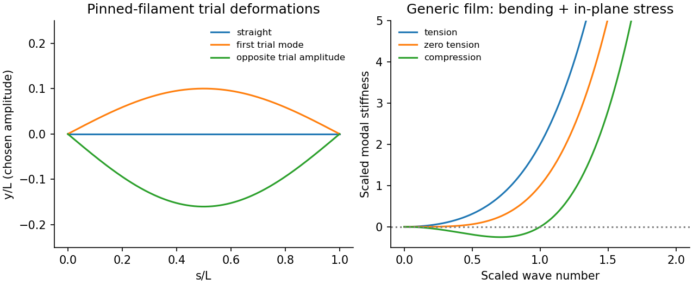

<h1 id="2/a/solution">Solution</h1>

↑ **Parent:** [A](../a.md)

Consider generic synthetic filaments and films. [buckling](../../../../../buckling.md) occurs when compression makes a transverse deformation lower the energy. For a straight filament of bending rigidity $B=EI$ under compressive [force](../../../../../force-split.md) $P$,

$$
\delta^2F=\frac12\int_0^L[B(y'')^2-P(y')^2]\,ds.
$$

Pinned ends admit $y=A\sin(\pi s/L)$, giving $\delta^2F=A^2L[B(\pi/L)^4-P(\pi/L)^2]/4$. The first instability is therefore **$P_c=\pi^2B/L^2$**. True clamping raises this to $4\pi^2B/L^2$; a clamped-free rod has $\pi^2B/(4L^2)$. [boundary conditions](../../../../../boundary-condition.md) are part of the threshold, not a minor correction. Above threshold geometric nonlinearities and end constraints determine the buckled amplitude.

For [buckling of a synthetic film](../../../../../buckling-of-a-synthetic-film.md), let the bending modulus be $\kappa$ and the isotropic in-plane [tension](../../../../../tension.md) be $\sigma$. The small-slope quadratic energy is

$$
F_2=\tfrac12\int[\kappa(\nabla^2h)^2+\sigma|\nabla h|^2]\,dA.
$$

A mode of [wave number](../../../../../wavenumber.md) $q$ has stiffness $\kappa q^4+\sigma q^2$. [tension](../../../../../tension.md) stabilizes it; compression corresponds to $\sigma<0$ and makes modes with $q^2<|\sigma|/\kappa$ unstable. A finite sheet has a smallest allowed $q$, giving a finite threshold. A supporting foundation adds positive stiffness and can select a nonzero wrinkle wavelength.

Approaching either threshold softens a fluctuation mode: its thermal variance is proportional to $k_BT$ divided by modal stiffness. The apparent quadratic-theory divergence is rounded by nonlinear geometry, finite size and imperfections. Experimentally vary end shortening or load, measure the transverse profile, and control attachment stiffness and initial curvature. Load control and displacement control need not [trace](../../../../../matrix-trace.md) the same postbuckling response. Biological applications are outside this generic mechanics note.

**[Figure 1](#2/a/image-original-pinned-filament-shapes-and-synthetic-film-modal-stiffness-under-tension-and-compression). Original pinned-filament shapes and synthetic-film modal stiffness under tension and compression**.

## ↑ Ancestors (14)

1. [A](../a.md)
2. [2](../../2.md)
3. [Paper 1](../../../paper-1-split.md)
4. [2014](../../../split.md)
5. [Past exam of the soft matter and biological physics course of the University of Cambridge](../../../../split.md)
6. [Soft Matter and Biological Physics course of the University of Cambridge](../../../../../soft-matter-and-biological-physics-course-of-the-university-of-cambridge.md)
7. [Physics course of the year 4 of the natural sciences course of the University of Cambridge](../../../../../physics-course-of-the-year-4-of-the-natural-sciences-course-of-the-university-of-cambridge.md)
8. [Year 4 of the natural sciences course of the University of Cambridge](../../../../../year-4-of-the-natural-sciences-course-of-the-university-of-cambridge.md)
9. [Year of the natural sciences course of the University of Cambridge](../../../../../year-of-the-natural-sciences-course-of-the-university-of-cambridge.md)
10. [Natural sciences course of the University of Cambridge](../../../../../natural-sciences-course-of-the-university-of-cambridge.md)
11. [Course of the University of Cambridge](../../../../../course-of-the-university-of-cambridge.md)
12. [University of Cambridge](../../../../../university-of-cambridge-split.md)
13. [List of universities](../../../../../list-of-universities.md)
14. [Codex Wiki](../../../../../split.md)
