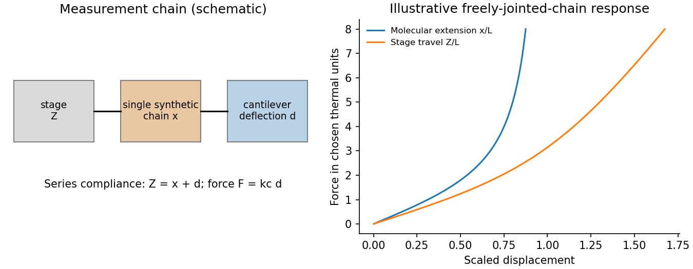

<h1 id="2/b/solution">Solution</h1>

↑ **Parent:** [B](../b.md)

[single-molecule force spectroscopy](../../../../../single-molecule-force-spectroscopy.md) measures [force](../../../../../force-split.md) and extension of an individual tether while controlling position or load. In an atomic-force arrangement, a synthetic chain connects a cantilever probe to a translated substrate. For the [cantilever compliance correction](../../../../../cantilever-compliance-correction.md), a deflection sensor gives $d$, a calibrated spring constant gives **$F=k_cd$**, and substrate displacement $Z$ gives chain extension $x=Z-d$ after geometric offsets are removed. Additional linkers and instrument compliance must be included if appreciable. Thermal deflection calibration uses $k_c\langle d^2\rangle=k_BT$ only after isolating the cantilever's calibrated thermal contribution.

An optical-tweezers implementation detects a tethered bead's displacement from a calibrated trap centre, with $F=k_{\rm trap}\Delta x$ in the harmonic regime. Detector calibration, drag and trap linearity determine the usable [force](../../../../../force-split.md) and frequency range. These instruments measure individual [force](../../../../../force-split.md)–extension curves and distributions; averaging many curves can hide multiple tether populations.

For a synthetic [freely jointed chain](../../../../../ideal-chain.md) with [Kuhn length](../../../../../kuhn-length.md) $b$,

$$
\frac{x}{L}=\coth\frac{Fb}{k_BT}-\frac{k_BT}{Fb}.
$$

A strongly stretched [worm-like chain](../../../../../worm-like-chain.md) instead has $1-x/L\simeq\sqrt{k_BT/(4F\ell_p)}$ before backbone stretching becomes important. Fits can estimate contour and [persistence lengths](../../../../../persistence-length.md) only in their appropriate regimes. Hysteresis and pulling-rate dependence test whether an apparent mechanical transition is quasistatic or activated.

Control single versus multiple attachments, subtract nonspecific adhesion, vary pulling [speed](../../../../../speed.md), calibrate [temperature](../../../../../temperature-split.md) and stiffness, and correct drift. A rupture peak is not a universal bond strength independent of loading history. A primary nonbiological example measured individual [polydimethylsiloxane](../../../../../polydimethylsiloxane.md) chains by atomic-force methods; its flexibility interpretation combines those measurements with molecular calculations.[abstract, synthetic PDMS single-chain mechanics](../../../../../understanding-the-extraordinary-flexibility-of-polydimethylsiloxane-through-single-molecule-mechanics-by-song-lu-and-others.md)

**[Figure 2](#2/b/image-original-single-tether-force-measurement-schematic-and-the-instrument-compliance-relation). Original single-tether force-measurement schematic and the instrument-compliance relation**.

## ↑ Ancestors (14)

1. [B](../b.md)
2. [2](../../2.md)
3. [Paper 1](../../../paper-1-split.md)
4. [2014](../../../split.md)
5. [Past exam of the soft matter and biological physics course of the University of Cambridge](../../../../split.md)
6. [Soft Matter and Biological Physics course of the University of Cambridge](../../../../../soft-matter-and-biological-physics-course-of-the-university-of-cambridge.md)
7. [Physics course of the year 4 of the natural sciences course of the University of Cambridge](../../../../../physics-course-of-the-year-4-of-the-natural-sciences-course-of-the-university-of-cambridge.md)
8. [Year 4 of the natural sciences course of the University of Cambridge](../../../../../year-4-of-the-natural-sciences-course-of-the-university-of-cambridge.md)
9. [Year of the natural sciences course of the University of Cambridge](../../../../../year-of-the-natural-sciences-course-of-the-university-of-cambridge.md)
10. [Natural sciences course of the University of Cambridge](../../../../../natural-sciences-course-of-the-university-of-cambridge.md)
11. [Course of the University of Cambridge](../../../../../course-of-the-university-of-cambridge.md)
12. [University of Cambridge](../../../../../university-of-cambridge-split.md)
13. [List of universities](../../../../../list-of-universities.md)
14. [Codex Wiki](../../../../../split.md)
