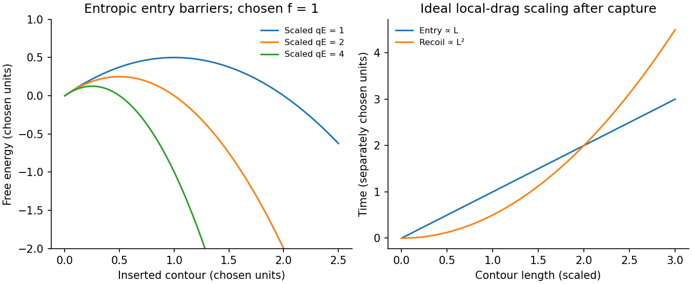

<h1 id="3/solution">Solution</h1>

↑ **Parent:** [3](../3.md)

Let the channel [length](../../../../length.md) be $\ell_c\gg R$ and assume uniform solution conductivity. Its Ohmic resistance scales as $\ell_c/(\sigma R^2)$, whereas access resistance of a reservoir mouth scales as $1/(\sigma R)$. The fraction of voltage in the entrance regions is therefore of order $R/\ell_c$. Most of the potential drop lies inside the long channel; the small entrance field region is neglected in the model, not asserted identically zero.

Write $x$ for inserted contour [length](../../../../length.md) and choose $qE>0$ to pull the chain inward. The charge already inside feels [force](../../../../force-split.md) $qEx$, giving

$$
\boxed{U_{\rm el}(x)=-\tfrac12qEx^2.}
$$

Confinement removes [polymer](../../../../polymer-split.md) configurations. In the stiff-chain regime, the [confinement deflection length](../../../../confinement-deflection-length.md) obeys $R^2\sim\lambda^3/\ell_p$, hence $\lambda\sim(R^2\ell_p)^{1/3}$. A free-energy cost of order $k_BT$ per deflection gives a roughly constant resisting [entropic force](../../../../entropic-force.md) $f\sim k_BT/\lambda$. The [insertion barrier of a charged polymer](../../../../insertion-barrier-of-a-charged-polymer.md) follows from $F(x)\simeq fx-qEx^2/2$, with an entry maximum at $x_*=f/(qE)$ when that point lies within the insertion interval. Its height is $f^2/(2qE)$. The field supplies work against this confinement [entropy](../../../../entropy-split.md).

Put $\zeta_\ell=2\pi\eta/\ln(R/a)$, so $\gamma(x)=\zeta_\ell x$. After capture, neglect the entry barrier, exterior-chain drag and thermal corrections to strong directed motion. Then

$$
\gamma(x)\dot x=qEx,\quad \dot x=\frac{qE}{\zeta_\ell},\qquad
\boxed{\tau_{\rm in}=\frac{\zeta_\ell L_0}{qE}=\frac{\gamma(L_0)}{qE}.}
$$

The [confined-polymer entry and recoil times](../../../../confined-polymer-entry-and-recoil-times.md) have different length dependence; this entry graph is linear through the origin. Charge and drag both grow with inserted [length](../../../../length.md), leaving a constant [velocity](../../../../velocity.md). The same cancellation explains length-independent mobility in an ideal free-draining [electrophoresis](../../../../electrophoresis.md) model. It does not include a capture waiting time or claim that every free-solution chain has identical hydrodynamic drag.

A measured superlinear entry time can arise when exterior-coil drag, [tension](../../../../tension.md) propagation, wall adsorption or nonuniform friction adds [length](../../../../length.md) dependence absent from this model. For example $\gamma(x)\propto x^p$ with the same $qEx$ drive gives $\tau\propto L_0^p$ for $p>0$. Under the assumptions of [uniform wall charge and polymer entry scaling](../../../../uniform-wall-charge-and-polymer-entry-scaling.md), a homogeneous thin-double-layer electro-osmotic model adds a length-independent fluid [velocity](../../../../velocity.md) $u_{\rm eo}=-\epsilon\zeta_wE/\eta$. It changes the drift coefficient, not its [length](../../../../length.md) exponent. This does not rule out charge heterogeneity, adsorption or near-cancellation followed by [diffusion](../../../../diffusion.md) in a real channel; those are additional mechanisms.

With the field off, the confinement [entropy](../../../../entropy-split.md) drives outward motion. Assuming the constant [force](../../../../force-split.md) $f$ and the same local friction,

$$
\zeta_\ell x\dot x=-f,\qquad
\boxed{\tau_{\rm out}=\int_0^{L_0}\frac{\zeta_\ell x}{f}\,dx
=\frac{\gamma(L_0)L_0}{2f}.}
$$

The small final end region lies outside the long-confined-segment approximation but gives only a small correction. Thus ideal insertion scales as $L_0$, while recoil scales as $L_0^2$.

TODO: user-deferred DNA-specific numerical stopping-voltage estimate and its biological parameter-based inference. No biological quantities are evaluated.

For [entropic-trap length separation](../../../../entropic-trap-length-separation.md), a reservoir/channel array can repeat length-dependent capture, confinement and relaxation delays, turning them into different mean residence times. The uniform inside-channel drift [speed](../../../../speed.md) derived above is itself [length](../../../../length.md) independent, so that drift alone cannot separate [lengths](../../../../length.md). Separation must retain [length](../../../../length.md) dependence of the barrier or of the capture/recoil dynamics and can be tuned with a forward-biased time-dependent field. For large bulk throughput, pressure-driven [advection](../../../../advection.md) is preferable to [diffusion](../../../../diffusion.md) alone; a [pressure](../../../../pressure-split.md) gradient can be combined with electric capture control. In the unobstructed continuum limit $Q=\pi R^4\Delta P/(8\eta\ell_c)$. Excessive driving erases trapping differences, so throughput and resolution compete; the question supplies no geometry or adsorption law selecting a unique optimal drive.

**[Figure 3](#3/image-original-dimensionless-insertion-barriers-and-the-distinct-insertion-and-recoil-length-scalings). Original dimensionless insertion barriers and the distinct insertion and recoil length scalings**.

## ↑ Ancestors (13)

1. [3](../3.md)
2. [Paper 1](../../paper-1-split.md)
3. [2014](../../split.md)
4. [Past exam of the soft matter and biological physics course of the University of Cambridge](../../../split.md)
5. [Soft Matter and Biological Physics course of the University of Cambridge](../../../../soft-matter-and-biological-physics-course-of-the-university-of-cambridge.md)
6. [Physics course of the year 4 of the natural sciences course of the University of Cambridge](../../../../physics-course-of-the-year-4-of-the-natural-sciences-course-of-the-university-of-cambridge.md)
7. [Year 4 of the natural sciences course of the University of Cambridge](../../../../year-4-of-the-natural-sciences-course-of-the-university-of-cambridge.md)
8. [Year of the natural sciences course of the University of Cambridge](../../../../year-of-the-natural-sciences-course-of-the-university-of-cambridge.md)
9. [Natural sciences course of the University of Cambridge](../../../../natural-sciences-course-of-the-university-of-cambridge.md)
10. [Course of the University of Cambridge](../../../../course-of-the-university-of-cambridge.md)
11. [University of Cambridge](../../../../university-of-cambridge-split.md)
12. [List of universities](../../../../list-of-universities.md)
13. [Codex Wiki](../../../../split.md)
