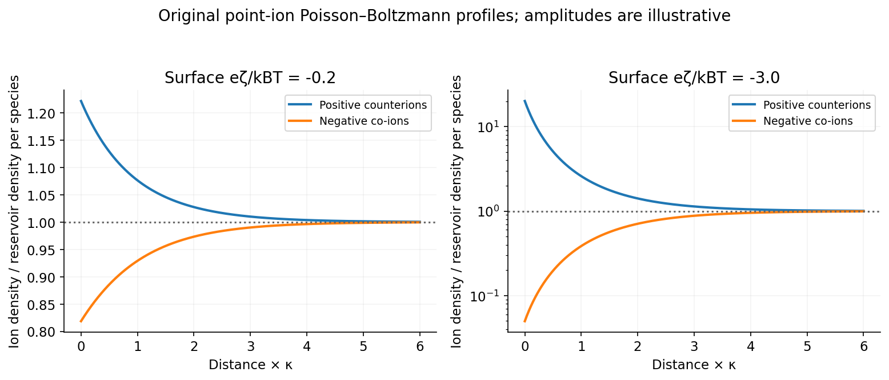
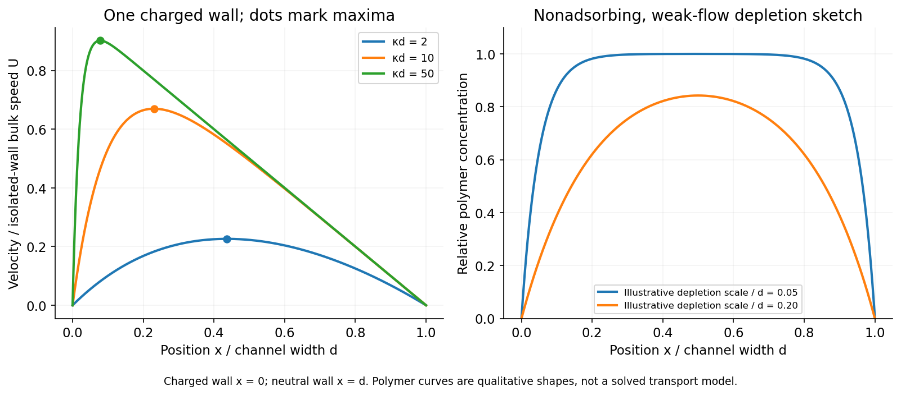

<h1 id="1/solution">Solution</h1>

↑ **Parent:** [1](../1.md)

Write $\varepsilon=\varepsilon_0\varepsilon_r$ and take $n_0$ to be the reservoir [density](../../../../density.md) of **each** monovalent ion species. Equal electrochemical potentials in equilibrium give the [Boltzmann ion densities in a symmetric electrolyte](../../../../boltzmann-ion-densities-in-a-symmetric-electrolyte.md),

$$
n_+=n_0e^{-e\psi/(k_BT)},\qquad n_-=n_0e^{e\psi/(k_BT)},\qquad\rho_e=e(n_+-n_-)=-2en_0\sinh\frac{e\psi}{k_BT}.
$$

Combining this with the electrostatic [Poisson equation](../../../../poisson-s-equation.md) gives the planar [Poisson-Boltzmann equation](../../../../poisson-boltzmann-equation.md),

$$
\psi''=\frac{2en_0}{\varepsilon}\sinh\frac{e\psi}{k_BT},\qquad\boxed{\kappa^2=\frac{2e^2n_0}{\varepsilon k_BT}.}
$$

The [Debye length](../../../../debye-length.md) is $\kappa^{-1}$. If the symbol $n_0$ instead denotes the combined [density](../../../../density.md) of both species, the factor two is absent; the per-species convention above makes the normalization explicit. At $|e\psi|\ll k_BT$, the [linearized planar screening solution](../../../../linearized-planar-screening-solution.md) obeys $\psi''=\kappa^2\psi$. With $\psi(0)=\zeta<0$ and $\psi(\infty)=0$,

$$
\boxed{\psi(x)=\zeta e^{-\kappa x}.}
$$

The positive [ions](../../../../ion.md) are [counterions](../../../../counterion.md) and the negative [ions](../../../../ion.md) are [co-ions](../../../../co-ion.md). At weak potential,

$$
n_+\simeq n_0\left(1-\frac{e\zeta}{k_BT}e^{-\kappa x}\right),\qquad n_-\simeq n_0\left(1+\frac{e\zeta}{k_BT}e^{-\kappa x}\right).
$$

They approach $n_0$ from above and below respectively, with equal first-order excess and deficit. For stronger negative potential, interpret the source's strong-potential comparison as a statement about **$|e\psi|$**, since $\psi$ itself is negative. [Counterions](../../../../counterion.md) become strongly concentrated near the wall, while [co-ions](../../../../co-ion.md) are exponentially depleted and remain nonnegative. Linearization misses this asymmetry and would eventually predict unphysical negative [co-ion](../../../../co-ion.md) [density](../../../../density.md). Point-ion [mean-field theory](../../../../mean-field-theory.md) itself eventually needs finite-size and [correlation](../../../../pearson-correlation-coefficient.md) corrections; it provides no steric cap at arbitrarily large [counterion](../../../../counterion.md) concentration.

For steady tangential [electro-osmosis](../../../../electro-osmosis.md), with no imposed [pressure](../../../../pressure-split.md) gradient and negligible inertia, the [Stokes equation](../../../../stokes-equation.md) is $\eta v''+\rho_eE=0$. Since $\rho_e=-\varepsilon\psi''$,

$$
\eta v''=\varepsilon E\psi''.
$$

The conditions $v(0)=0$ and $v'(\infty)=0$ give

$$
v(x)=\frac{\varepsilon E}{\eta}[\psi(x)-\zeta]=U(1-e^{-\kappa x}),\qquad\boxed{U=-\frac{\varepsilon\zeta E}{\eta}.}
$$

**The printed constant speed is the bulk [velocity](../../../../velocity.md) outside the double layer, not the [velocity](../../../../velocity.md) at the no-slip wall.** With negative $\zeta$ the positive [counterion](../../../../counterion.md) excess drives fluid along the applied field. The far-field value is the [Helmholtz-Smoluchowski electro-osmotic velocity](../../../../helmholtz-smoluchowski-electro-osmotic-velocity.md).[Section1,page1: diffuse charge, slip [velocity](../../../../velocity.md) and plug-flow limit](../../../../induced-charge-electro-osmosis-and-electrophoresis-by-martin-z-bazant.md)

For the finite channel, first model the added wall as an ideally uncharged insulating boundary with no normal field on its outer side: $\psi'(d)=0$, while $\psi(0)=\zeta$. The [one-charged-wall electro-osmotic channel](../../../../one-charged-wall-electro-osmotic-channel.md) then has

$$
\psi(x)=\zeta\frac{\cosh[\kappa(d-x)]}{\cosh(\kappa d)}.
$$

Integrating the same [force](../../../../force-split.md) balance and enforcing $v(0)=v(d)=0$ gives

$$
\boxed{v(x)=U\left[1-\left(1-\operatorname{sech}(\kappa d)\right)\frac xd-\frac{\cosh[\kappa(d-x)]}{\cosh(\kappa d)}\right].}
$$

For $U>0$, the maximum occurs at

$$
\boxed{x_{\max}=d-\frac1\kappa\operatorname{arsinh}\left[\frac{\cosh(\kappa d)-1}{\kappa d}\right]\simeq\frac{\log(\kappa d)}\kappa\quad(\kappa d\gg1).}
$$

In that limit $v/U\simeq1-x/d-e^{-\kappa x}$: the [velocity](../../../../velocity.md) rises rapidly from zero at the charged wall, reaches a maximum a few screening lengths away, then falls approximately linearly to zero at the neutral wall. **One charged wall does not give a symmetric plug across a channel with no-slip at the other wall.**

An alternative electrode condition $\psi(d)=0$ means a wall held at reservoir potential; it is not the same as zero surface charge. Under that convention,

$$
v(x)=U\left[1-\frac xd-\frac{\sinh[\kappa(d-x)]}{\sinh(\kappa d)}\right],
$$

with $\cosh[\kappa(d-x_{\max})]=\sinh(\kappa d)/(\kappa d)$. Both boundary conventions have the same leading thin-double-layer profile above. An externally imposed [pressure](../../../../pressure-split.md) gradient would add a [pressure](../../../../pressure-split.md)-driven profile; none is specified here.

For dilute nonadsorbing uncharged [polymers](../../../../polymer-split.md) in equilibrium or sufficiently weak flow, the [entropic polymer depletion near nonadsorbing walls](../../../../entropic-polymer-depletion-near-nonadsorbing-walls.md) suppresses chain configurations near each wall. A depletion layer of order the coil [radius of gyration](../../../../radius-of-gyration.md) is expected at both walls, with a bulk-like central region when $d$ is much larger than the coil size. Strong confinement rounds this into a central enrichment. Neutrality removes a direct electrophoretic [force](../../../../force-split.md), not excluded-volume [entropy](../../../../entropy-split.md). Adsorption, concentration and strong-flow migration were not specified, so this is a conditional equilibrium sketch rather than a universal flowing-[polymer](../../../../polymer-split.md) profile.

**[Figure 1](#1/image-weak-screening-gives-symmetric-first-order-ion-excess-and-deficit-while-stronger-potentials-separate-co-ion-depletion-from-counterion-accumulation). Weak screening gives symmetric first-order ion excess and deficit, while stronger potentials separate co-ion depletion from counterion accumulation**. [Source](paper-1-ion-distributions.py).

**[Figure 2](#1/image-a-channel-driven-at-only-one-wall-has-an-asymmetric-velocity-maximum-nonadsorbing-polymer-coils-are-depleted-near-either-wall). A channel driven at only one wall has an asymmetric velocity maximum; nonadsorbing polymer coils are depleted near either wall**. [Source](paper-1-channel-and-polymers.py).

## ↑ Ancestors (13)

1. [1](../1.md)
2. [Paper 1](../../paper-1-split.md)
3. [2015](../../split.md)
4. [Past exam of the soft matter and biological physics course of the University of Cambridge](../../../split.md)
5. [Soft Matter and Biological Physics course of the University of Cambridge](../../../../soft-matter-and-biological-physics-course-of-the-university-of-cambridge.md)
6. [Physics course of the year 4 of the natural sciences course of the University of Cambridge](../../../../physics-course-of-the-year-4-of-the-natural-sciences-course-of-the-university-of-cambridge.md)
7. [Year 4 of the natural sciences course of the University of Cambridge](../../../../year-4-of-the-natural-sciences-course-of-the-university-of-cambridge.md)
8. [Year of the natural sciences course of the University of Cambridge](../../../../year-of-the-natural-sciences-course-of-the-university-of-cambridge.md)
9. [Natural sciences course of the University of Cambridge](../../../../natural-sciences-course-of-the-university-of-cambridge.md)
10. [Course of the University of Cambridge](../../../../course-of-the-university-of-cambridge.md)
11. [University of Cambridge](../../../../university-of-cambridge-split.md)
12. [List of universities](../../../../list-of-universities.md)
13. [Codex Wiki](../../../../split.md)
