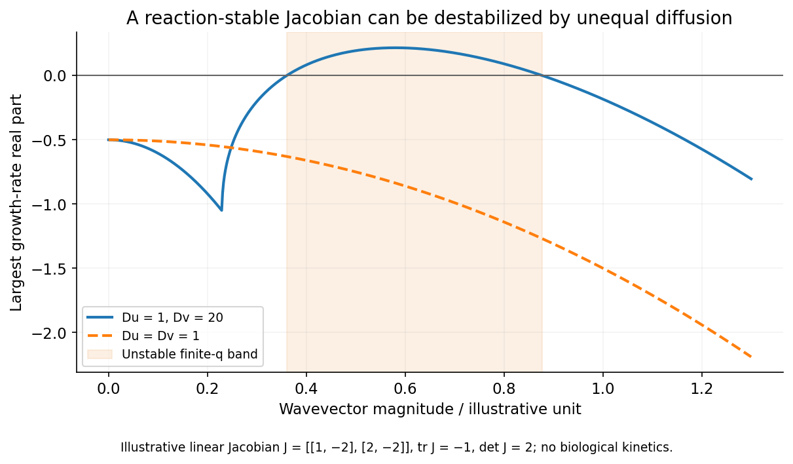

<h1 id="2/c/solution">Solution</h1>

↑ **Parent:** [C](../c.md)

A generic chemical [reaction–diffusion system](../../../../../reaction-diffusion-system.md) couples local kinetics to spatial transport:

$$
\partial_tu=f(u,v)+D_u\nabla^2u,\qquad\partial_tv=g(u,v)+D_v\nabla^2v,\qquad D_u,D_v>0.
$$

A homogeneous stationary state satisfies $f=g=0$. Let its reaction Jacobian be $J=\begin{pmatrix}a&b\\c&d\end{pmatrix}$. Local well-mixed stability requires $a+d<0$ and $ad-bc>0$. A Fourier perturbation of wavevector magnitude $q$ evolves under $J-q^2\operatorname{diag}(D_u,D_v)$, whose determinant is

$$
D_uD_vq^4-(D_va+D_ud)q^2+\det J.
$$

Since its trace remains negative, a [diffusion-driven stationary instability](../../../../../diffusion-driven-stationary-instability.md) appears if the determinant becomes negative for some allowed wavevector. In a spatially large domain the conditions are

$$
\boxed{D_va+D_ud>0,\qquad(D_va+D_ud)^2>4D_uD_v\det J.}
$$

Together with reaction-only stability, these give a finite unstable wavelength range. Equal [diffusion](../../../../../diffusion.md) coefficients cannot generate this instability: they simply shift each reaction eigenvalue by $-Dq^2$. On a finite domain, an admissible spatial eigenmode must actually lie in the unstable band. Nonlinearities then determine saturation and whether a predicted pattern is stable, so a linear unstable band alone does not calculate a final pattern.[Linear stability of two-component chemical reaction-[diffusion](../../../../../diffusion.md) equations](../../../../../notes-on-the-turing-instability-and-chemical-instabilities-by-michael-cross.md)

Other kinetics support travelling fronts or oscillatory waves rather than a stationary pattern. For instance, the scalar abstract equation $\partial_tu=D\partial_x^2u+ru(1-u/u_s)$ has a pulled-front speed $2\sqrt{Dr}$ for a sufficiently steep invading initial profile. Here it is used as an abstract kinetics-and-[diffusion](../../../../../diffusion.md) example, without a biological interpretation. The ratio of [diffusion](../../../../../diffusion.md) time $L^2/D$ to reaction time characterizes whether spatial mixing is rapid enough to justify a well-mixed model.

**[Figure 3](#2/c/image-differential-diffusion-can-destabilize-a-finite-band-even-when-the-uniform-reaction-system-is-linearly-stable). Differential diffusion can destabilize a finite band even when the uniform reaction system is linearly stable**. [Source](paper-1-reaction-diffusion-spectrum.py).

## ↑ Ancestors (14)

1. [C](../c.md)
2. [2](../../2.md)
3. [Paper 1](../../../paper-1-split.md)
4. [2015](../../../split.md)
5. [Past exam of the soft matter and biological physics course of the University of Cambridge](../../../../split.md)
6. [Soft Matter and Biological Physics course of the University of Cambridge](../../../../../soft-matter-and-biological-physics-course-of-the-university-of-cambridge.md)
7. [Physics course of the year 4 of the natural sciences course of the University of Cambridge](../../../../../physics-course-of-the-year-4-of-the-natural-sciences-course-of-the-university-of-cambridge.md)
8. [Year 4 of the natural sciences course of the University of Cambridge](../../../../../year-4-of-the-natural-sciences-course-of-the-university-of-cambridge.md)
9. [Year of the natural sciences course of the University of Cambridge](../../../../../year-of-the-natural-sciences-course-of-the-university-of-cambridge.md)
10. [Natural sciences course of the University of Cambridge](../../../../../natural-sciences-course-of-the-university-of-cambridge.md)
11. [Course of the University of Cambridge](../../../../../course-of-the-university-of-cambridge.md)
12. [University of Cambridge](../../../../../university-of-cambridge-split.md)
13. [List of universities](../../../../../list-of-universities.md)
14. [Codex Wiki](../../../../../split.md)
