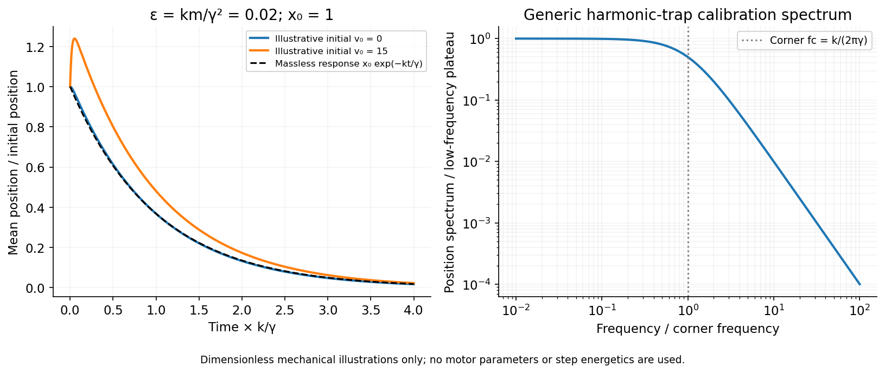

<h1 id="3/solution">Solution</h1>

↑ **Parent:** [3](../3.md)

Only the separable instrument and mechanical tasks are treated here; biological operation and stepping energetics remain deferred.

For generic [optical tweezers](../../../../optical-tweezers.md), a tightly focused laser and objective with high [numerical aperture](../../../../numerical-aperture.md) create an intensity gradient that attracts a suitable dielectric bead toward the focus. [Momentum transfer](../../../../momentum-transfer.md) also creates a scattering [force](../../../../force-split.md); stable three-dimensional trapping requires sufficient restoring gradient [force](../../../../force-split.md). A condenser and photodetector or camera track displacement. Near a stable focus, $F_x=-kx$ defines the stiffness and requires both a position calibration and a [force](../../../../force-split.md) calibration.[Single-beam gradient trapping of dielectric particles](../../../../observation-of-a-single-beam-gradient-force-optical-trap-for-dielectric-particles-by-arthur-ashkin-and-others.md)

At thermal equilibrium in a harmonic well, the [equipartition trap calibration](../../../../equipartition-trap-calibration.md) is $k\langle(x-\langle x\rangle)^2\rangle=k_BT$. Alternatively, fitting the [overdamped harmonic-trap power spectrum](../../../../overdamped-harmonic-trap-power-spectrum.md) gives $f_c=k/(2\pi\gamma)$, hence $k=2\pi\gamma f_c$. Detector noise, finite sampling and exposure time, wall corrections to drag, and drift must be controlled rather than attributed to stiffness.

For an isolated sphere in a Newtonian fluid, define $\mathrm{Re}=\rho_fv(2a)/\eta$ using its diameter. The supplied [viscosity](../../../../dynamic-viscosity-split.md) converts to $10^{-3}\,\mathrm{Pa\,s}$. The generic [Stokes drag](../../../../stokes-s-law.md) calculation gives

$$
\boxed{F_D=6\pi\eta av=1.88\times10^{-14}\,\mathrm N=0.0188\,\mathrm{pN},\qquad\gamma=6\pi\eta a=1.88\times10^{-8}\,\mathrm{N\,s\,m^{-1}}.}
$$

Here $\mathrm{Re}=2\times10^{-6}[\rho_f/(10^3\,\mathrm{kg\,m^{-3}})]$; this retains the unspecified fluid [density](../../../../density.md) as a parameter rather than treating a [density](../../../../density.md) as supplied data. [Stokes drag](../../../../stokes-s-law.md) assumes an isolated no-slip sphere; nearby surfaces change the coefficient. TODO: the requested assessment of biological motor operation is deferred.

TODO: the biological stepping-energy and step-detection estimate is deferred in its entirety; no biological energy source or motor mechanism has been researched.

Ignoring biological coupling, the mechanical thermal model is the [Langevin equation](../../../../langevin-dynamics.md) for a harmonic trap,

$$
m\ddot x+\gamma\dot x+kx=\xi(t),\qquad\langle\xi(t)\rangle=0,\qquad\langle\xi(t)\xi(t')\rangle=2\gamma k_BT\delta(t-t').
$$

For independent repeats with the specified initial conditions, the ensemble [mean](../../../../expected-value-split.md) $X=\langle x\rangle$ obeys the homogeneous damped-oscillator equation. An average over $N$ independent zero-[mean](../../../../expected-value-split.md) [force](../../../../force-split.md) samples reduces its [variance](../../../../variance-split.md) by $N$, with a finite detector bandwidth needed to define samples of white noise. **High bandwidth alone does not remove random forces; averaging independent records or sufficiently separated samples is the additional operation.** A single trajectory retains [thermal fluctuations](../../../../thermal-fluctuation.md). For stationary overdamped position fluctuations, a long time average over duration $\mathcal T\gg\tau_k=\gamma/k$ has approximately $\operatorname{Var}(\bar x)\simeq2(k_BT/k)\tau_k/\mathcal T$.

The [initial-value solution of a damped harmonic trap](../../../../initial-value-solution-of-a-damped-harmonic-trap.md) has characteristic roots $r_\pm=[-\gamma\pm\sqrt{\gamma^2-4mk}]/(2m)$. For distinct roots,

$$
\boxed{X(t)=\frac{v_0-r_-x_0}{r_+-r_-}e^{r_+t}+\frac{r_+x_0-v_0}{r_+-r_-}e^{r_-t}.}
$$

For critical damping, $\gamma^2=4mk$,

$$
X(t)=e^{-\gamma t/(2m)}\left[x_0+\left(v_0+\frac{\gamma x_0}{2m}\right)t\right].
$$

For the underdamped case the same real solution can be written $e^{-\gamma t/(2m)}[x_0\cos\omega_dt+(v_0+\gamma x_0/(2m))\sin\omega_dt/\omega_d]$, with $\omega_d^2=k/m-\gamma^2/(4m^2)$. These describe the deterministic response or conditional [mean](../../../../expected-value-split.md), not the entire noisy trajectory.

For [overdamped trap relaxation after an inertial boundary layer](../../../../overdamped-trap-relaxation-after-an-inertial-boundary-layer.md), let $\epsilon=km/\gamma^2\ll1$. The slow and fast roots are

$$
r_s=-\frac k\gamma[1+O(\epsilon)],\qquad r_f=-\frac\gamma m[1+O(\epsilon)],\qquad\tau_m=\frac m\gamma\ll\tau_k=\frac\gamma k.
$$

After $t\gg\tau_m$, the fast exponential is negligible and the surviving amplitude is $x_0+(m/\gamma)v_0+O(\epsilon x_0,\epsilon mv_0/\gamma)$. If also $|(m/\gamma)v_0|\ll|x_0|$, then to leading overdamped order

$$
\boxed{X(t)\simeq x_0e^{-kt/\gamma}.}
$$

Small [Reynolds number](../../../../reynolds-number.md) justifies the linear viscous [force](../../../../force-split.md); it does not alone prove the separate small inertial-trap parameter $\epsilon$. Neglecting $v_0$ requires both rapid [momentum](../../../../momentum-split.md) relaxation and a negligible slow-mode amplitude shift. If $x_0=0$, a nonzero initial [velocity](../../../../velocity.md) can leave a small slow displacement even after its own fast transient decays. The result concerns generic bead mechanics only.

**[Figure 4](#3/image-fast-momentum-relaxation-leaves-a-slower-trap-mode-whose-amplitude-can-still-remember-a-sufficiently-large-initial-velocity). Fast momentum relaxation leaves a slower trap mode, whose amplitude can still remember a sufficiently large initial velocity**. [Source](paper-1-trap-relaxation.py).

## ↑ Ancestors (13)

1. [3](../3.md)
2. [Paper 1](../../paper-1-split.md)
3. [2015](../../split.md)
4. [Past exam of the soft matter and biological physics course of the University of Cambridge](../../../split.md)
5. [Soft Matter and Biological Physics course of the University of Cambridge](../../../../soft-matter-and-biological-physics-course-of-the-university-of-cambridge.md)
6. [Physics course of the year 4 of the natural sciences course of the University of Cambridge](../../../../physics-course-of-the-year-4-of-the-natural-sciences-course-of-the-university-of-cambridge.md)
7. [Year 4 of the natural sciences course of the University of Cambridge](../../../../year-4-of-the-natural-sciences-course-of-the-university-of-cambridge.md)
8. [Year of the natural sciences course of the University of Cambridge](../../../../year-of-the-natural-sciences-course-of-the-university-of-cambridge.md)
9. [Natural sciences course of the University of Cambridge](../../../../natural-sciences-course-of-the-university-of-cambridge.md)
10. [Course of the University of Cambridge](../../../../course-of-the-university-of-cambridge.md)
11. [University of Cambridge](../../../../university-of-cambridge-split.md)
12. [List of universities](../../../../list-of-universities.md)
13. [Codex Wiki](../../../../split.md)
