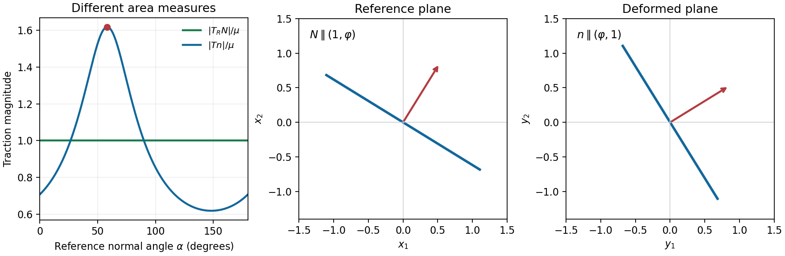
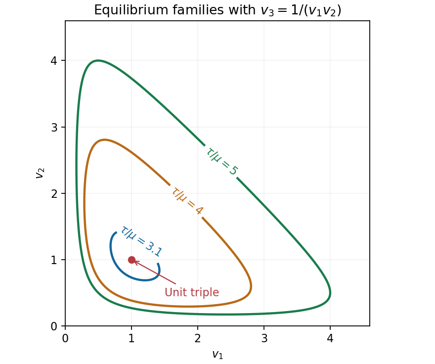
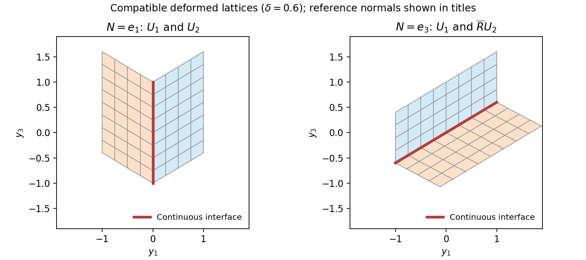

# 2007

↑ **Parent:** [Past exam of the solid mechanics course of the University of Oxford](../past-exam-of-the-solid-mechanics-course-of-the-university-of-oxford.md)

**Table of contents**

- [1](#1)
  - [i](#1/i)
    - [Solution](#1/i/solution)
  - [ii](#1/ii)
    - [Solution](#1/ii/solution)
- [2](#2)
  - [Solution](#2/solution)
- [3](#3)
  - [Solution](#3/solution)
- [4](#4)
  - [Solution](#4/solution)

## 1

↑ **Parent:** [2007](2007.md)

<h3 id="1/i">i</h3>

↑ **Parent:** [1](#1)

<h4 id="1/i/solution">Solution</h4>

↑ **Parent:** [I](#1/i)

We first derive the [stress](../continuum-mechanics.md#stress) and energy facts used in both parts. The Cauchy [traction](../continuum-mechanics.md#traction) $s=Tn$ is [force](../force.md) per unit area in the deformed configuration. The first Piola-Kirchhoff [traction](../continuum-mechanics.md#traction) $s_R=T_RN$ is [force](../force.md) per unit reference area. Their [force](../force.md) vectors are measured in the same spatial coordinates, but the area measures and the normals used to specify the surface are different.

Parametrize a reference surface by $x=x(u,v)$. Its oriented area vector is $(x_u\times x_v)\,du\,dv$. Under deformation, the two tangents become $Fx_u,Fx_v$. The cross-product identity

$$
(Fa)\times(Fb)=(\operatorname{cof}F)(a\times b)=JF^{-T}(a\times b)
$$

therefore proves [Nanson's formula](../continuum-mechanics.md#nanson-s-formula) $n\,da=JF^{-T}N\,dA$. Equality of the physical [force](../force.md) on corresponding surface patches now gives

$$
T_RN\,dA=Tn\,da=JT F^{-T}N\,dA.
$$

Since this holds for every reference [normal](../probability-distribution.md#normal-distribution),

$$
\boxed{T_R=JT F^{-T},\qquad T=J^{-1}T_RF^T.}
$$

The [first Piola-Kirchhoff stress tensor](../continuum-mechanics.md#first-piola-kirchhoff-stress-tensor) is generally not [symmetric](../set-theory.md#symmetric-relation), whereas the [Cauchy stress tensor](../continuum-mechanics.md#cauchy-stress-tensor) is [symmetric](../set-theory.md#symmetric-relation) in the absence of couple stresses.

For the stated energy on orientation-preserving gradients, [differentiation](../calculus.md#differentiation) gives

$$
T_R=DW(F)=\mu\bigl(F-J^{-2}\operatorname{cof}F\bigr)
=\mu(F-J^{-1}F^{-T}).
$$

A stress-free state satisfies $FF^T=J^{-1}I$. Taking [determinants](../multilinear-algebra.md#determinant) yields $J^2=J^{-3}$, so $J=1$ and $FF^T=I$: precisely $F\in SO(3)$. These states are also the global energy [minimizers](../analysis.md#global-minimizer). If $v_i>0$ are the [singular values](../linear-algebra.md#singular-value), the [arithmetic-geometric mean inequality](../mathematical-optimization.md#arithmetic-geometric-mean-inequality) gives $|F|^2\geq3J^{2/3}$, with equality only when the [singular values](../linear-algebra.md#singular-value) are equal. The function $3J^{2/3}/2+J^{-1}$ decreases up to $J=1$ and increases thereafter, with [minimum](../set.md#minimum-of-a-subset-of-a-total-order) $5/2$. Thus $W\geq5\mu/2$, with equality precisely at [rotations](../riemannian-geometry.md#rotation-mathematics). A constant shift of the energy can set this [minimum](../set.md#minimum-of-a-subset-of-a-total-order) to zero without changing the [stress](../continuum-mechanics.md#stress).

For the given [simple shear](../continuum-mechanics.md#simple-shear),

$$
F=\begin{pmatrix}1&1&0\\0&1&0\\0&0&1\end{pmatrix},\qquad
F^{-T}=\begin{pmatrix}1&0&0\\-1&1&0\\0&0&1\end{pmatrix},\qquad
T_R=\mu\begin{pmatrix}0&1&0\\1&0&0\\0&0&0\end{pmatrix}.
$$

For a [unit normal](../differential-geometry.md#unit-normal) $N$, $|T_RN|^2=\mu^2(N_1^2+N_2^2)=\mu^2(1-N_3^2)$. Hence **every reference [plane](../geometry-and-topology.md#plane) whose [normal](../probability-distribution.md#normal-distribution) lies in the $e_1,e_2$ [plane](../geometry-and-topology.md#plane) is maximizing**:

$$
\boxed{N=(\cos\alpha,\sin\alpha,0),\quad
x_1\cos\alpha+x_2\sin\alpha=0,\qquad\max|s_R|=\mu.}
$$

There is a family of maximizing planes, rather than one distinguished [normal](../probability-distribution.md#normal-distribution).

<h3 id="1/ii">ii</h3>

↑ **Parent:** [1](#1)

<h4 id="1/ii/solution">Solution</h4>

↑ **Parent:** [Ii](#1/ii)

Using $J=1$ and the preceding [first Piola-Kirchhoff stress tensor](../continuum-mechanics.md#first-piola-kirchhoff-stress-tensor),

$$
T=T_RF^T=\mu\begin{pmatrix}1&1&0\\1&0&0\\0&0&0\end{pmatrix}.
$$

Its [eigenvalues](../linear-operator-theory.md#eigenvalue) are $\mu(1+\sqrt5)/2$, $\mu(1-\sqrt5)/2$, and zero. Because it is [symmetric](../set-theory.md#symmetric-relation), its largest [traction](../continuum-mechanics.md#traction) magnitude on a unit spatial [normal](../probability-distribution.md#normal-distribution) is the largest absolute [eigenvalue](../linear-operator-theory.md#eigenvalue). Put $\varphi=(1+\sqrt5)/2$. The positive [eigenvalue](../linear-operator-theory.md#eigenvalue) has the strictly largest modulus, with [normal](../probability-distribution.md#normal-distribution)

$$
n=\pm\frac{(\varphi,1,0)}{\sqrt{\varphi^2+1}}.
$$

The question asks for the [plane](../geometry-and-topology.md#plane) in the [reference configuration](../continuum-mechanics.md#reference-configuration), so this spatial [normal](../probability-distribution.md#normal-distribution) must be pulled back. [Nanson's formula](../continuum-mechanics.md#nanson-s-formula) gives $N$ parallel to $F^Tn$, and

$$
F^T(\varphi,1,0)^T=(\varphi,\varphi+1,0)^T
=\varphi(1,\varphi,0)^T.
$$

Therefore the required [plane](../geometry-and-topology.md#plane) and maximum are

$$
\boxed{x_1+\varphi x_2=0,\qquad
\max|s|=\mu\varphi=\frac{\mu(1+\sqrt5)}2.}
$$

Either sign of its [unit normal](../differential-geometry.md#unit-normal) describes the same [plane](../geometry-and-topology.md#plane). Maximizing over reference normals is equivalent to maximizing over spatial normals because the map $N\mapsto F^{-T}N/|F^{-T}N|$ is a [bijection](../function.md#bijection) of unit normals.

**[Figure 1](#1/ii/image-reference-and-spatial-normals-differ-when-maximizing-the-cauchy-traction). Reference and spatial normals differ when maximizing the Cauchy traction**.

## 2

↑ **Parent:** [2007](2007.md)

<h3 id="2/solution">Solution</h3>

↑ **Parent:** [2](#2)

A [dead-load traction](../elasticity-physics.md#dead-load-traction) is prescribed [force](../force.md) per unit reference area whose vector is independent of the deformation. It is imposed through $T_RN=t_R$ on the reference boundary. It does not rotate or rescale with the current surface as a follower load would.

[Elastic incompressibility](../continuum-mechanics.md#elastic-incompressibility) imposes $\det F=1$ and adds a scalar [Lagrange multiplier](../mathematical-optimization.md#lagrange-multiplier) to the constitutive law. With the [pressure](../pressure.md) sign convention used here,

$$
T_R=DW(F)-p\,\operatorname{cof}F=DW(F)-pF^{-T},\qquad
T=DW(F)F^T-pI.
$$

The [pressure](../pressure.md) field is determined by [equilibrium](../dynamical-systems.md#equilibrium-point-of-a-dynamical-system) and [boundary conditions](../differential-equation.md#boundary-condition), rather than by the [strain energy density](../elasticity-physics.md#strain-energy-density) alone.

For the diagonal [homogeneous deformation](../continuum-mechanics.md#homogeneous-deformation), $F=\operatorname{diag}(v_1,v_2,v_3)$ and $v_1v_2v_3=1$. [Isotropy](../continuum-mechanics.md#isotropy) makes $DW(F)$ diagonal here, with entries $\Phi_i$, so

$$
(T_R)_{ii}=\Phi_i-\frac p{v_i}.
$$

The six face conditions are exactly $T_Re_i=\tau e_i$. Thus $\Phi_i-p/v_i=\tau$ for each $i$, or

$$
\boxed{v_1\Phi_1-\tau v_1=v_2\Phi_2-\tau v_2
=v_3\Phi_3-\tau v_3=p,\qquad v_1v_2v_3=1.}
$$

Necessity follows from the [boundary conditions](../differential-equation.md#boundary-condition). Conversely these equations give a constant [pressure](../pressure.md) and constant [stress](../continuum-mechanics.md#stress) satisfying those conditions, while $\operatorname{Div}T_R=0$ because the [stress](../continuum-mechanics.md#stress) is constant and there is no [body force](../fluid-mechanics.md#body-force). This proves sufficiency as well.

For the particular energy, $\Phi_i=\mu(v_i-v_i^{-2})$. Put $S=v_1+v_2+v_3$ and $Q=v_1v_2+v_1v_3+v_2v_3$. [Elastic incompressibility](../continuum-mechanics.md#elastic-incompressibility) gives $v_i^{-1}=v_jv_k$, hence

$$
v_i\Phi_i-\tau v_i
=\mu(v_i^2-v_jv_k)-\tau v_i
=(\mu S-\tau)v_i-\mu Q.
$$

Equality for every pair is therefore equivalent to $(\mu S-\tau)(v_i-v_j)=0$. If all stretches are equal, their positive product one gives $v_1=v_2=v_3=1$, with $p=-\tau$. Otherwise $S=\tau/\mu$. Conversely any positive triple with this sum and product one solves the equations, with $p=-\mu Q$. Thus **the complete solutions within the stated homogeneous diagonal ansatz are the unit triple and the stated sum-product family**.

By the [arithmetic-geometric mean inequality](../mathematical-optimization.md#arithmetic-geometric-mean-inequality), $S\geq3$, with equality only at the unit triple. Consequently $\tau\leq3\mu$ admits only that triple, including equality, when the two descriptions coincide.

To prove infinitely many for $s=\tau/\mu>3$, choose $v_1=t$ near one and set

$$
v_{2,3}=\frac{s-t\pm\sqrt{(s-t)^2-4/t}}2.
$$

At $t=1$ the discriminant is $(s-1)^2-4>0$; it stays positive on an interval about one, and both roots remain positive. Every such $t$ gives a different admissible triple. Hence

$$
\boxed{\tau\leq3\mu:\text{ one triple};\qquad
\tau>3\mu:\text{ infinitely many triples}.}
$$

The degeneracy has an energy explanation: under the product [constraint](../classical-mechanics.md#constraint-mechanics) the [strain energy density](../elasticity-physics.md#strain-energy-density) is $\mu S^2/2$, and the total potential under [dead loading](../elasticity-physics.md#dead-loading) is $\mu S^2/2-\tau S$. It depends on the three stretches only through their sum. Its [minimum](../set.md#minimum-of-a-subset-of-a-total-order) over attainable $S\geq3$ moves from $S=3$ to the whole level set $S=\tau/\mu$ when the load exceeds $3\mu$.

**[Figure 2](#2/image-the-positive-stretch-triples-form-a-continuum-above-the-critical-dead-load). The positive stretch triples form a continuum above the critical dead load**.

## 3

↑ **Parent:** [2007](2007.md)

<h3 id="3/solution">Solution</h3>

↑ **Parent:** [3](#3)

For a [hyperelastic material](../elasticity-physics.md#hyperelastic-material) $T_R(F)=DW(F)$. [Material frame indifference](../continuum-mechanics.md#material-frame-indifference) of this first Piola-Kirchhoff law means

$$
\boxed{T_R(QF)=Q\,T_R(F)\quad(Q\in SO(3)).}
$$

The spatial [force](../force.md) components rotate under a superposed rigid [rotation](../riemannian-geometry.md#rotation-mathematics), whereas the reference [normal](../probability-distribution.md#normal-distribution) does not.

If $W(QF)=W(F)$, differentiate with respect to $F$ in direction $H$ to obtain $DW(QF):(QH)=DW(F):H$, hence the displayed [stress](../continuum-mechanics.md#stress) transformation. Conversely, assume that [stress](../continuum-mechanics.md#stress) transformation. For fixed $Q$, the [derivative](../calculus.md#derivative) of $W(QF)-W(F)$ with respect to $F$ vanishes. The positive-determinant [matrix](../vector-space.md#matrix) domain is [connected](../geometry-and-topology.md#connected-space), as follows from [polar decomposition](../linear-operator-theory.md#polar-decomposition) and the [connectedness](../geometry-and-topology.md#connected-space) of $SO(3)$ and of the [positive-definite](../bilinear-form.md#positive-definite-bilinear-form) [cone](../euclidean-geometry.md#cone-geometry). Thus $W(QF)-W(F)=c(Q)$, independent of $F$. Iterating gives

$$
W(Q^nF)=W(F)+n c(Q)\qquad(n\in\mathbb Z).
$$

The assumed lower bound on $W$ forces $c(Q)=0$: either nonzero sign would tend to minus infinity for one direction of integer $n$. This proves the required equivalence and explains the use of the lower-bound hypothesis.

In the frame-indifferent setting, [isotropy](../continuum-mechanics.md#isotropy) means invariance under reference [rotations](../riemannian-geometry.md#rotation-mathematics) as well: $W(FQ)=W(F)$ for $Q\in SO(3)$. The distinction matters: left [rotations](../riemannian-geometry.md#rotation-mathematics) encode changes of observer, and right [rotations](../riemannian-geometry.md#rotation-mathematics) encode material symmetry.

An orientation-preserving [singular value decomposition](../linear-algebra.md#singular-value-decomposition) is $F=R\operatorname{diag}(v_1,v_2,v_3)S$, with $R,S\in SO(3)$ and $v_i>0$. [Material frame indifference](../continuum-mechanics.md#material-frame-indifference) and [isotropy](../continuum-mechanics.md#isotropy) remove $R,S$, leaving a function $\Phi$ of the stretches. Permuting the stretches using signed permutation [rotations](../riemannian-geometry.md#rotation-mathematics) does not change the value, so $\Phi$ is [symmetric](../set-theory.md#symmetric-relation). Conversely a [symmetric](../set-theory.md#symmetric-relation) stretch function is unchanged by both left and right [rotations](../riemannian-geometry.md#rotation-mathematics), in particular is [isotropic](../continuum-mechanics.md#isotropy).

The [eigenvalues](../linear-operator-theory.md#eigenvalue) of $B=FF^T$ are $v_i^2$. Its three principal invariants are

$$
I=\operatorname{tr}B=\sum_iv_i^2,\quad
II=\tfrac12[(\operatorname{tr}B)^2-\operatorname{tr}(B^2)]
=\sum_{i<j}v_i^2v_j^2,\quad III=\det B=\prod_iv_i^2.
$$

They determine the unordered positive [eigenvalues](../linear-operator-theory.md#eigenvalue) as the roots of $\lambda^3-I\lambda^2+II\lambda-III=0$. Therefore a [symmetric](../set-theory.md#symmetric-relation) stretch function defines a well-defined $h(I,II,III)$ on the admissible invariant triples. Conversely a function of these invariants is a [symmetric](../set-theory.md#symmetric-relation) stretch function, proving the equivalence of all three descriptions.

The printed domain of $\Phi$ must be $(0,\infty)^3$, since it takes three arguments. Also [isotropy](../continuum-mechanics.md#isotropy) alone as right invariance would not imply the spectral representation without [material frame indifference](../continuum-mechanics.md#material-frame-indifference): $\operatorname{tr}(A FF^T)$ for a fixed nonscalar [symmetric](../set-theory.md#symmetric-relation) [positive-definite](../bilinear-form.md#positive-definite-bilinear-form) $A$ is right invariant but not generally objective. The equivalence here uses the frame-indifferent constitutive setting.

For the specific energy, [Newton identities](../polynomial.md#newton-s-identities) for the three [eigenvalues](../linear-operator-theory.md#eigenvalue) gives $\sum_i v_i^6=I^3-3I\,II+3III$, while $v_1v_2v_3=J=\sqrt{III}$. Thus

$$
\boxed{W=\alpha I+\beta(I^3-3I\,II+3III)+\gamma III^{-1/2}.}
$$

To differentiate it, use

$$
D_FI=2F,\qquad D_FII=2(IF-BF),\qquad
D_FIII=2J\operatorname{cof}F.
$$

These follow from $I=|F|^2$, the displayed [trace](../linear-algebra.md#matrix-trace) formula for $II$, and $III=J^2$. The three partial derivatives of $h$ are $h_I=\alpha+3\beta I^2-3\beta II$, $h_{II}=-3\beta I$ and $h_{III}=3\beta-\gamma III^{-3/2}/2$. The [chain rule](../calculus.md#chain-rule) therefore gives

$$
T_R=(2\alpha-6\beta II)F+6\beta I\,BF
+(6\beta J-\gamma J^{-2})\operatorname{cof}F.
$$

Finally $-6\beta II=-3\beta(\operatorname{tr}B)^2+3\beta\operatorname{tr}(B^2)$, and $BF=FF^TF$. This is precisely the requested expression, with the coefficient of $F$ separated from the $BF$ and [cofactor](../linear-algebra.md#cofactor) terms. The positive sign of the $6\beta J$ term comes from the $3\beta III$ contribution in the energy.

## 4

↑ **Parent:** [2007](2007.md)

<h3 id="4/solution">Solution</h3>

↑ **Parent:** [4](#4)

Use a temperature-dependent [strain energy density](../elasticity-physics.md#strain-energy-density) $W(F,\vartheta)$ with different minimizing [deformation gradients](../continuum-mechanics.md#deformation-gradient) in the two [crystal](../thermodynamics.md#crystal) phases. Above the transition temperature its wells describe [austenite](../chemical-substance.md#austenite); below it the wells are unions $SO(3)U_i$ of [martensitic variants](../chemical-substance.md#martensitic-variant). Left rotational orbits reflect [material frame indifference](../continuum-mechanics.md#material-frame-indifference), while the [crystal](../thermodynamics.md#crystal)'s discrete material symmetries relate the variants. Minimizing the integral of this [elastic energy](../elasticity-physics.md#elastic-energy), together with loading and boundary [constraints](../classical-mechanics.md#constraint-mechanics), models the change of lattice shape. Compatibility restricts which low-energy gradients can meet continuously; fine compatible mixtures can accommodate macroscopic boundary shapes.

For the jump condition, write the two affine pieces as $Ax+c_+$ and $Bx+c_-$. [Continuity](../calculus.md#continuous-function) on the interface means

$$
(A-B)x+(c_+-c_-)=0\qquad(x\cdot N=k).
$$

Taking differences along the interface gives $(A-B)t=0$ for every [tangent vector](../tangent-vector.md) $t$ with $t\cdot N=0$. Decompose any vector $v$ as $t+(v\cdot N)N$. Then

$$
(A-B)v=(v\cdot N)(A-B)N.
$$

With $a=(A-B)N$ this proves

$$
\boxed{A-B=a\otimes N.}
$$

Conversely this [rank-one connection](../continuum-mechanics.md#rank-one-connection) permits [continuity](../calculus.md#continuous-function) by choosing $c_+-c_-=-ka$. A coherent [twin](../biology.md#twin) interface is such a compatible planar boundary between different [martensitic variants](../chemical-substance.md#martensitic-variant), possibly after a rigid [rotation](../riemannian-geometry.md#rotation-mathematics) of one variant. The rank-one condition is therefore the geometric compatibility condition for a simple [twin](../biology.md#twin).

For the unrotated pair, direct subtraction gives

$$
U_1-U_2=2\delta e_3\otimes e_1,
$$

so $R=I$ is one solution, with reference interface [normal](../probability-distribution.md#normal-distribution) $e_1$.

Put $d=1+\delta^2$, $c=(1-\delta^2)/d$ and $s=2\delta/d$. Since $c^2+s^2=1$, the stated $\overline R$ is a [proper rotation](../linear-algebra.md#proper-rotation). Multiplication gives

$$
\overline R U_2=
\begin{pmatrix}c+\delta s&0&-s\\0&1&0\\s-\delta c&0&c\end{pmatrix}
=\begin{pmatrix}1&0&-s\\0&1&0\\\delta&0&c\end{pmatrix}.
$$

Here $c+\delta s=1$ and $s-\delta c=\delta$. Consequently

$$
U_1-\overline R U_2
=\begin{pmatrix}0&0&s\\0&0&0\\0&0&1-c\end{pmatrix}
=\boxed{\frac{2\delta}{1+\delta^2}(e_1+\delta e_3)\otimes e_3.}
$$

This is the second [rank-one connection](../continuum-mechanics.md#rank-one-connection), now with [normal](../probability-distribution.md#normal-distribution) $e_3$. Because $\delta>0$, the two [rotations](../riemannian-geometry.md#rotation-mathematics) are distinct. The permitted assertion that there are at most two proves completeness.

Finally suppose $QU_1$ is rank-one [connected](../geometry-and-topology.md#connected-space) to $\overline R U_2$, with $Q\in SO(3)$. Left multiplication of their difference by $Q^T$ preserves [rank](../quadratic-form.md#rank-one-quadratic-form) and gives $U_1-Q^T\overline R U_2$. The classification just proved forces $Q^T\overline R$ to be either $I$ or $\overline R$, hence $Q=\overline R$ or $Q=I$. The two requested matrices are therefore

$$
\boxed{U_1\quad\text{and}\quad\overline R U_1.}
$$

Their connections are explicit: the first was calculated above, and $\overline R U_1-\overline R U_2=2\delta(\overline R e_3)\otimes e_1$. If desired the second [matrix](../vector-space.md#matrix) is

$$
\overline R U_1=
\begin{pmatrix}c-\delta s&0&-s\\0&1&0\\s+\delta c&0&c\end{pmatrix}.
$$

**[Figure 3](#4/image-the-two-compatible-twin-interfaces-have-reference-normals-in-different-directions). The two compatible twin interfaces have reference normals in different directions**.

## ↑ Ancestors (9)

1. [Past exam of the solid mechanics course of the University of Oxford](../past-exam-of-the-solid-mechanics-course-of-the-university-of-oxford.md)
2. [Solid mechanics course of the University of Oxford](../university-of-oxford.md#solid-mechanics-course-of-the-university-of-oxford)
3. [Year 4 of the mathematics course of the University of Oxford](../university-of-oxford.md#year-4-of-the-mathematics-course-of-the-university-of-oxford)
4. [Mathematics course of the University of Oxford](../university-of-oxford.md#mathematics-course-of-the-university-of-oxford)
5. [Undergraduate course of the University of Oxford](../university-of-oxford.md#undergraduate-course-of-the-university-of-oxford)
6. [Course of the University of Oxford](../university-of-oxford.md#course-of-the-university-of-oxford)
7. [University of Oxford](../university-of-oxford.md)
8. [List of universities](../README.md#list-of-universities)
9. [Codex Wiki](../README.md)
