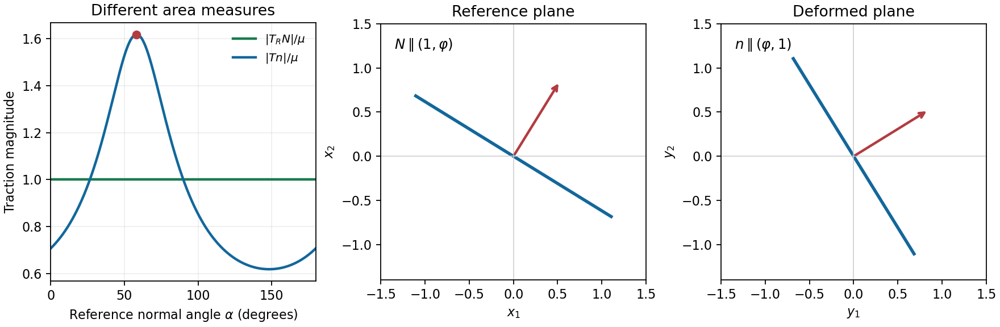

<h1 id="1/ii/solution">Solution</h1>

↑ **Parent:** [Ii](../ii.md)

Using $J=1$ and the preceding [first Piola-Kirchhoff stress tensor](../../../../first-piola-kirchhoff-stress-tensor.md),

$$
T=T_RF^T=\mu\begin{pmatrix}1&1&0\\1&0&0\\0&0&0\end{pmatrix}.
$$

Its [eigenvalues](../../../../eigenvalue.md) are $\mu(1+\sqrt5)/2$, $\mu(1-\sqrt5)/2$, and zero. Because it is [symmetric](../../../../symmetric-relation.md), its largest [traction](../../../../traction.md) magnitude on a unit spatial [normal](../../../../normal-distribution.md) is the largest absolute [eigenvalue](../../../../eigenvalue.md). Put $\varphi=(1+\sqrt5)/2$. The positive [eigenvalue](../../../../eigenvalue.md) has the strictly largest modulus, with [normal](../../../../normal-distribution.md)

$$
n=\pm\frac{(\varphi,1,0)}{\sqrt{\varphi^2+1}}.
$$

The question asks for the [plane](../../../../plane.md) in the [reference configuration](../../../../reference-configuration.md), so this spatial [normal](../../../../normal-distribution.md) must be pulled back. [Nanson's formula](../../../../nanson-s-formula.md) gives $N$ parallel to $F^Tn$, and

$$
F^T(\varphi,1,0)^T=(\varphi,\varphi+1,0)^T
=\varphi(1,\varphi,0)^T.
$$

Therefore the required [plane](../../../../plane.md) and maximum are

$$
\boxed{x_1+\varphi x_2=0,\qquad
\max|s|=\mu\varphi=\frac{\mu(1+\sqrt5)}2.}
$$

Either sign of its [unit normal](../../../../unit-normal.md) describes the same [plane](../../../../plane.md). Maximizing over reference normals is equivalent to maximizing over spatial normals because the map $N\mapsto F^{-T}N/|F^{-T}N|$ is a [bijection](../../../../bijection.md) of unit normals.

**[Figure 1](#1/ii/image-reference-and-spatial-normals-differ-when-maximizing-the-cauchy-traction). Reference and spatial normals differ when maximizing the Cauchy traction**.

## ↑ Ancestors (12)

1. [Ii](../ii.md)
2. [1](../../1.md)
3. [2007](../../../2007-split.md)
4. [Past exam of the solid mechanics course of the University of Oxford](../../../split.md)
5. [Solid mechanics course of the University of Oxford](../../../../solid-mechanics-course-of-the-university-of-oxford.md)
6. [Year 4 of the mathematics course of the University of Oxford](../../../../year-4-of-the-mathematics-course-of-the-university-of-oxford.md)
7. [Mathematics course of the University of Oxford](../../../../mathematics-course-of-the-university-of-oxford.md)
8. [Undergraduate course of the University of Oxford](../../../../undergraduate-course-of-the-university-of-oxford.md)
9. [Course of the University of Oxford](../../../../course-of-the-university-of-oxford.md)
10. [University of Oxford](../../../../university-of-oxford-split.md)
11. [List of universities](../../../../list-of-universities.md)
12. [Codex Wiki](../../../../split.md)
