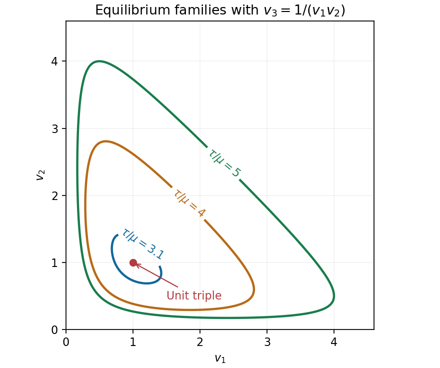

<h1 id="2/solution">Solution</h1>

↑ **Parent:** [2](../2.md)

A [dead-load traction](../../../dead-load-traction.md) is prescribed [force](../../../force-split.md) per unit reference area whose vector is independent of the deformation. It is imposed through $T_RN=t_R$ on the reference boundary. It does not rotate or rescale with the current surface as a follower load would.

[Elastic incompressibility](../../../elastic-incompressibility.md) imposes $\det F=1$ and adds a scalar [Lagrange multiplier](../../../lagrange-multiplier.md) to the constitutive law. With the [pressure](../../../pressure-split.md) sign convention used here,

$$
T_R=DW(F)-p\,\operatorname{cof}F=DW(F)-pF^{-T},\qquad
T=DW(F)F^T-pI.
$$

The [pressure](../../../pressure-split.md) field is determined by [equilibrium](../../../equilibrium-point-of-a-dynamical-system.md) and [boundary conditions](../../../boundary-condition.md), rather than by the [strain energy density](../../../strain-energy-density.md) alone.

For the diagonal [homogeneous deformation](../../../homogeneous-deformation.md), $F=\operatorname{diag}(v_1,v_2,v_3)$ and $v_1v_2v_3=1$. [Isotropy](../../../isotropy.md) makes $DW(F)$ diagonal here, with entries $\Phi_i$, so

$$
(T_R)_{ii}=\Phi_i-\frac p{v_i}.
$$

The six face conditions are exactly $T_Re_i=\tau e_i$. Thus $\Phi_i-p/v_i=\tau$ for each $i$, or

$$
\boxed{v_1\Phi_1-\tau v_1=v_2\Phi_2-\tau v_2
=v_3\Phi_3-\tau v_3=p,\qquad v_1v_2v_3=1.}
$$

Necessity follows from the [boundary conditions](../../../boundary-condition.md). Conversely these equations give a constant [pressure](../../../pressure-split.md) and constant [stress](../../../stress.md) satisfying those conditions, while $\operatorname{Div}T_R=0$ because the [stress](../../../stress.md) is constant and there is no [body force](../../../body-force.md). This proves sufficiency as well.

For the particular energy, $\Phi_i=\mu(v_i-v_i^{-2})$. Put $S=v_1+v_2+v_3$ and $Q=v_1v_2+v_1v_3+v_2v_3$. [Elastic incompressibility](../../../elastic-incompressibility.md) gives $v_i^{-1}=v_jv_k$, hence

$$
v_i\Phi_i-\tau v_i
=\mu(v_i^2-v_jv_k)-\tau v_i
=(\mu S-\tau)v_i-\mu Q.
$$

Equality for every pair is therefore equivalent to $(\mu S-\tau)(v_i-v_j)=0$. If all stretches are equal, their positive product one gives $v_1=v_2=v_3=1$, with $p=-\tau$. Otherwise $S=\tau/\mu$. Conversely any positive triple with this sum and product one solves the equations, with $p=-\mu Q$. Thus **the complete solutions within the stated homogeneous diagonal ansatz are the unit triple and the stated sum-product family**.

By the [arithmetic-geometric mean inequality](../../../arithmetic-geometric-mean-inequality.md), $S\geq3$, with equality only at the unit triple. Consequently $\tau\leq3\mu$ admits only that triple, including equality, when the two descriptions coincide.

To prove infinitely many for $s=\tau/\mu>3$, choose $v_1=t$ near one and set

$$
v_{2,3}=\frac{s-t\pm\sqrt{(s-t)^2-4/t}}2.
$$

At $t=1$ the discriminant is $(s-1)^2-4>0$; it stays positive on an interval about one, and both roots remain positive. Every such $t$ gives a different admissible triple. Hence

$$
\boxed{\tau\leq3\mu:\text{ one triple};\qquad
\tau>3\mu:\text{ infinitely many triples}.}
$$

The degeneracy has an energy explanation: under the product [constraint](../../../constraint-mechanics.md) the [strain energy density](../../../strain-energy-density.md) is $\mu S^2/2$, and the total potential under [dead loading](../../../dead-loading.md) is $\mu S^2/2-\tau S$. It depends on the three stretches only through their sum. Its [minimum](../../../minimum-of-a-subset-of-a-total-order.md) over attainable $S\geq3$ moves from $S=3$ to the whole level set $S=\tau/\mu$ when the load exceeds $3\mu$.

**[Figure 2](#2/image-the-positive-stretch-triples-form-a-continuum-above-the-critical-dead-load). The positive stretch triples form a continuum above the critical dead load**.

## ↑ Ancestors (11)

1. [2](../2.md)
2. [2007](../../2007-split.md)
3. [Past exam of the solid mechanics course of the University of Oxford](../../split.md)
4. [Solid mechanics course of the University of Oxford](../../../solid-mechanics-course-of-the-university-of-oxford.md)
5. [Year 4 of the mathematics course of the University of Oxford](../../../year-4-of-the-mathematics-course-of-the-university-of-oxford.md)
6. [Mathematics course of the University of Oxford](../../../mathematics-course-of-the-university-of-oxford.md)
7. [Undergraduate course of the University of Oxford](../../../undergraduate-course-of-the-university-of-oxford.md)
8. [Course of the University of Oxford](../../../course-of-the-university-of-oxford.md)
9. [University of Oxford](../../../university-of-oxford-split.md)
10. [List of universities](../../../list-of-universities.md)
11. [Codex Wiki](../../../split.md)
