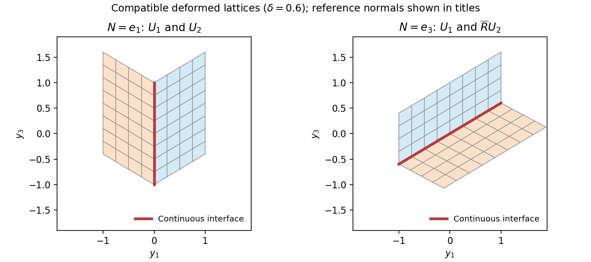

<h1 id="4/solution">Solution</h1>

↑ **Parent:** [4](../4.md)

Use a temperature-dependent [strain energy density](../../../strain-energy-density.md) $W(F,\vartheta)$ with different minimizing [deformation gradients](../../../deformation-gradient.md) in the two [crystal](../../../crystal.md) phases. Above the transition temperature its wells describe [austenite](../../../austenite.md); below it the wells are unions $SO(3)U_i$ of [martensitic variants](../../../martensitic-variant.md). Left rotational orbits reflect [material frame indifference](../../../material-frame-indifference.md), while the [crystal](../../../crystal.md)'s discrete material symmetries relate the variants. Minimizing the integral of this [elastic energy](../../../elastic-energy.md), together with loading and boundary [constraints](../../../constraint-mechanics.md), models the change of lattice shape. Compatibility restricts which low-energy gradients can meet continuously; fine compatible mixtures can accommodate macroscopic boundary shapes.

For the jump condition, write the two affine pieces as $Ax+c_+$ and $Bx+c_-$. [Continuity](../../../continuous-function.md) on the interface means

$$
(A-B)x+(c_+-c_-)=0\qquad(x\cdot N=k).
$$

Taking differences along the interface gives $(A-B)t=0$ for every [tangent vector](../../../tangent-vector-split.md) $t$ with $t\cdot N=0$. Decompose any vector $v$ as $t+(v\cdot N)N$. Then

$$
(A-B)v=(v\cdot N)(A-B)N.
$$

With $a=(A-B)N$ this proves

$$
\boxed{A-B=a\otimes N.}
$$

Conversely this [rank-one connection](../../../rank-one-connection.md) permits [continuity](../../../continuous-function.md) by choosing $c_+-c_-=-ka$. A coherent [twin](../../../twin.md) interface is such a compatible planar boundary between different [martensitic variants](../../../martensitic-variant.md), possibly after a rigid [rotation](../../../rotation-mathematics.md) of one variant. The rank-one condition is therefore the geometric compatibility condition for a simple [twin](../../../twin.md).

For the unrotated pair, direct subtraction gives

$$
U_1-U_2=2\delta e_3\otimes e_1,
$$

so $R=I$ is one solution, with reference interface [normal](../../../normal-distribution.md) $e_1$.

Put $d=1+\delta^2$, $c=(1-\delta^2)/d$ and $s=2\delta/d$. Since $c^2+s^2=1$, the stated $\overline R$ is a [proper rotation](../../../proper-rotation.md). Multiplication gives

$$
\overline R U_2=
\begin{pmatrix}c+\delta s&0&-s\\0&1&0\\s-\delta c&0&c\end{pmatrix}
=\begin{pmatrix}1&0&-s\\0&1&0\\\delta&0&c\end{pmatrix}.
$$

Here $c+\delta s=1$ and $s-\delta c=\delta$. Consequently

$$
U_1-\overline R U_2
=\begin{pmatrix}0&0&s\\0&0&0\\0&0&1-c\end{pmatrix}
=\boxed{\frac{2\delta}{1+\delta^2}(e_1+\delta e_3)\otimes e_3.}
$$

This is the second [rank-one connection](../../../rank-one-connection.md), now with [normal](../../../normal-distribution.md) $e_3$. Because $\delta>0$, the two [rotations](../../../rotation-mathematics.md) are distinct. The permitted assertion that there are at most two proves completeness.

Finally suppose $QU_1$ is rank-one [connected](../../../connected-space.md) to $\overline R U_2$, with $Q\in SO(3)$. Left multiplication of their difference by $Q^T$ preserves [rank](../../../rank-one-quadratic-form.md) and gives $U_1-Q^T\overline R U_2$. The classification just proved forces $Q^T\overline R$ to be either $I$ or $\overline R$, hence $Q=\overline R$ or $Q=I$. The two requested matrices are therefore

$$
\boxed{U_1\quad\text{and}\quad\overline R U_1.}
$$

Their connections are explicit: the first was calculated above, and $\overline R U_1-\overline R U_2=2\delta(\overline R e_3)\otimes e_1$. If desired the second [matrix](../../../matrix.md) is

$$
\overline R U_1=
\begin{pmatrix}c-\delta s&0&-s\\0&1&0\\s+\delta c&0&c\end{pmatrix}.
$$

**[Figure 3](#4/image-the-two-compatible-twin-interfaces-have-reference-normals-in-different-directions). The two compatible twin interfaces have reference normals in different directions**.

## ↑ Ancestors (11)

1. [4](../4.md)
2. [2007](../../2007-split.md)
3. [Past exam of the solid mechanics course of the University of Oxford](../../split.md)
4. [Solid mechanics course of the University of Oxford](../../../solid-mechanics-course-of-the-university-of-oxford.md)
5. [Year 4 of the mathematics course of the University of Oxford](../../../year-4-of-the-mathematics-course-of-the-university-of-oxford.md)
6. [Mathematics course of the University of Oxford](../../../mathematics-course-of-the-university-of-oxford.md)
7. [Undergraduate course of the University of Oxford](../../../undergraduate-course-of-the-university-of-oxford.md)
8. [Course of the University of Oxford](../../../course-of-the-university-of-oxford.md)
9. [University of Oxford](../../../university-of-oxford-split.md)
10. [List of universities](../../../list-of-universities.md)
11. [Codex Wiki](../../../split.md)
