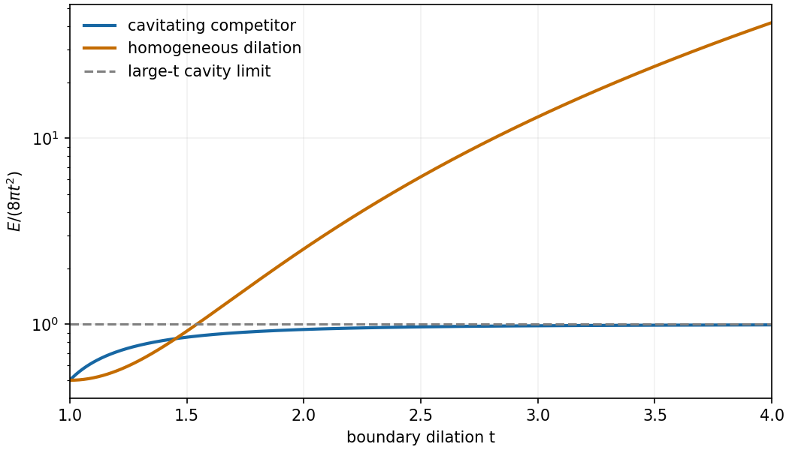

<h1 id="2/d/solution">Solution</h1>

↑ **Parent:** [D](../d.md)

Choose the homogeneous dilation $\boxed{r(R)=tR}$, which has the required endpoint values. For a radial field, put $J=r'r^2/R^2$. The radial energy density, after omitting its constant angular factor, is $R^2[r'^2+2r^2/R^2+(J-1)^2]$. Its Euler equation simplifies to

$$
R^2r''+2Rr'-2r+r^2J'=0.
$$

The chosen dilation has $r''=0$, $J=t^3$ constant, and satisfies it. More directly, the full first Piola-Kirchhoff response for the given energy is

$$
T(F)=2F+2(\det F-1)\operatorname{cof}F.
$$

At $F=tI$ this is $[2t+2(t^3-1)t^2]I$, constant throughout the body. Its [divergence](../../../../divergence.md) vanishes, so the [deformation](../../../../deformation-mechanics.md) satisfies the full force-free equilibrium equations as well.

Its energy is

$$
\boxed{E_{\mathrm{hom}}(t)=\frac{4\pi}{3}[3t^2+(t^3-1)^2].}
$$

This grows like $(4\pi/3)t^6$, whereas the same-boundary cavitating competitor has energy asymptotic to $8\pi t^2$. Therefore **for sufficiently large $t$, the homogeneous equilibrium is not a global energy minimum in the finite-energy class admitting the cavitating [deformation](../../../../deformation-mechanics.md)**.

The admissible class matters: the competitor from the preceding part is not continuous at the center. This comparison is in that Sobolev class, not a claim about minimization restricted to smooth cavity-free [deformations](../../../../deformation-mechanics.md).

**[Figure 1](#2/d/image-energy-comparison-in-the-finite-energy-class-the-homogeneous-dilation-grows-like-t-to-the-sixth-power-while-the-cavitating-competitor-grows-quadratically). Energy comparison in the finite-energy class: the homogeneous dilation grows like t to the sixth power while the cavitating competitor grows quadratically**.

## ↑ Ancestors (12)

1. [D](../d.md)
2. [2](../../2.md)
3. [2010](../../../2010-split.md)
4. [Past exam of the solid mechanics course of the University of Oxford](../../../split.md)
5. [Solid mechanics course of the University of Oxford](../../../../solid-mechanics-course-of-the-university-of-oxford.md)
6. [Year 4 of the mathematics course of the University of Oxford](../../../../year-4-of-the-mathematics-course-of-the-university-of-oxford.md)
7. [Mathematics course of the University of Oxford](../../../../mathematics-course-of-the-university-of-oxford.md)
8. [Undergraduate course of the University of Oxford](../../../../undergraduate-course-of-the-university-of-oxford.md)
9. [Course of the University of Oxford](../../../../course-of-the-university-of-oxford.md)
10. [University of Oxford](../../../../university-of-oxford-split.md)
11. [List of universities](../../../../list-of-universities.md)
12. [Codex Wiki](../../../../split.md)
