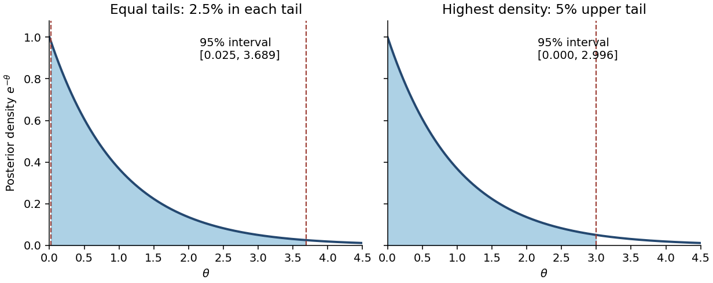

# 2014

↑ **Parent:** [Past exam of the statistics course of the University of Oxford](../past-exam-of-the-statistics-course-of-the-university-of-oxford.md)

Source: [Mathematics Part A release](https://www.whatdotheyknow.com/request/maths_papers_2/response/1850333/attach/3/FOI%2020210708%201%20Data.zip?cookie_passthrough=1), member `FOI-20210708-1 - Data/4328.pdf`, dated 25 June 2014. All twenty source leaf parts are answered below.

Bounded exact-paper checks found no matching advertisement of worked answers. The department's [release policy](https://www.maths.ox.ac.uk/members/students/undergraduate-courses/examinations-assessments) guarantees even-year releases back at least to 2016 without specifically establishing availability for 2014; the linked answer archive redirects to Oxford SSO. No source part is skipped.

**Table of contents**

- [1](#1)
  - [a](#1/a)
    - [i](#1/a/i)
      - [Solution](#1/a/i/solution)
    - [ii](#1/a/ii)
      - [Solution](#1/a/ii/solution)
    - [iii](#1/a/iii)
      - [Solution](#1/a/iii/solution)
  - [b](#1/b)
    - [i](#1/b/i)
      - [Solution](#1/b/i/solution)
    - [ii](#1/b/ii)
      - [Solution](#1/b/ii/solution)
  - [c](#1/c)
    - [i](#1/c/i)
      - [Solution](#1/c/i/solution)
    - [ii](#1/c/ii)
      - [Solution](#1/c/ii/solution)
    - [iii](#1/c/iii)
      - [Solution](#1/c/iii/solution)
- [2](#2)
  - [a](#2/a)
    - [i](#2/a/i)
      - [Solution](#2/a/i/solution)
    - [ii](#2/a/ii)
      - [Solution](#2/a/ii/solution)
    - [iii](#2/a/iii)
      - [Solution](#2/a/iii/solution)
  - [b](#2/b)
    - [i](#2/b/i)
      - [Solution](#2/b/i/solution)
    - [ii](#2/b/ii)
      - [Solution](#2/b/ii/solution)
- [3](#3)
  - [a](#3/a)
    - [i](#3/a/i)
      - [Solution](#3/a/i/solution)
    - [ii](#3/a/ii)
      - [Solution](#3/a/ii/solution)
  - [b](#3/b)
    - [i](#3/b/i)
      - [Solution](#3/b/i/solution)
    - [ii](#3/b/ii)
      - [Solution](#3/b/ii/solution)
    - [iii](#3/b/iii)
      - [Solution](#3/b/iii/solution)
    - [iv](#3/b/iv)
      - [Solution](#3/b/iv/solution)
  - [c](#3/c)
    - [Solution](#3/c/solution)

## 1

↑ **Parent:** [2014](2014.md)

<h3 id="1/a">a</h3>

↑ **Parent:** [1](#1)

<h4 id="1/a/i">i</h4>

↑ **Parent:** [A](#1/a)

<h5 id="1/a/i/solution">Solution</h5>

↑ **Parent:** [I](#1/a/i)

Write $I_1(\theta)$ for the [Fisher information](../statistical-modelling.md#fisher-information-matrix) in one observation:

$$
I_1(\theta)=\mathbb E_\theta\!\left[\left\{\frac{\partial}{\partial\theta}\log f(X;\theta)\right\}^2\right]
=-\mathbb E_\theta\!\left[\frac{\partial^2}{\partial\theta^2}\log f(X;\theta)\right].
$$

Under the stipulated regularity assumptions, the [maximum-likelihood estimator](../maximum-likelihood-estimation.md#maximum-likelihood-estimator) is [consistent](../statistical-inference.md#consistency-statistics) and has [asymptotic normality](../statistical-inference.md#asymptotic-normality):

$$
\boxed{\sqrt n(\widehat\theta-\theta)\ \xrightarrow{d}\ N\!\left(0,I_1(\theta)^{-1}\right).}
$$

Equivalently, its large-sample [normal approximation](../convergence-of-random-variables.md#normal-approximation) has [mean](../expected-value.md) $\theta$ and [variance](../variance.md) $1/[nI_1(\theta)]$. The information for the whole [random sample](../random-variable.md#independent-and-identically-distributed-random-variables) is $nI_1(\theta)$; keeping the one-observation convention explicit prevents an extra factor of $n$.

<h4 id="1/a/ii">ii</h4>

↑ **Parent:** [A](#1/a)

<h5 id="1/a/ii/solution">Solution</h5>

↑ **Parent:** [Ii](#1/a/ii)

Let $z=\Phi^{-1}(1-\alpha/2)$, where $\Phi$ is the [standard normal distribution](../probability-distribution.md#standard-normal-distribution)'s [cumulative distribution function](../probability-distribution.md#cumulative-distribution-function). [Statistical consistency](../statistical-inference.md#consistency-statistics) and [Slutsky's theorem](../statistical-inference.md#slutsky-theorem) allow replacement of $I_1(\theta)$ by $I_1(\widehat\theta)$:

$$
\sqrt{nI_1(\widehat\theta)}(\widehat\theta-\theta)\ \xrightarrow{d}\ N(0,1).
$$

Thus the probability that this standardized [estimation error](../statistical-inference.md#estimation-error) lies between $-z$ and $z$ tends to $1-\alpha$. Rearranging gives the [Wald confidence interval](../statistical-inference.md#wald-confidence-interval)

$$
\boxed{\left[\widehat\theta-\frac{z}{\sqrt{nI_1(\widehat\theta)}},\quad
\widehat\theta+\frac{z}{\sqrt{nI_1(\widehat\theta)}}\right].}
$$

The [coverage probability](../statistical-inference.md#coverage-probability) is approximate, with limiting value $1-\alpha$; it is a repeated-sampling statement about the random [confidence interval](../statistical-inference.md#confidence-interval).

<h4 id="1/a/iii">iii</h4>

↑ **Parent:** [A](#1/a)

<h5 id="1/a/iii/solution">Solution</h5>

↑ **Parent:** [Iii](#1/a/iii)

Here the [exponential distribution](../continuous-probability-distribution.md#exponential-distribution) is parametrized by its [mean](../expected-value.md), so $f(x;\theta)=\theta^{-1}e^{-x/\theta}$ for $x\geq0$ and $\theta>0$. Its [log-likelihood](../maximum-likelihood-estimation.md#log-likelihood) and [maximum-likelihood estimate](../maximum-likelihood-estimation.md#maximum-likelihood-estimator) are

$$
\ell(\theta)=-n\log\theta-\frac{\sum_iX_i}{\theta},\qquad \widehat\theta=\overline X.
$$

For one observation, $\partial_\theta\log f=-1/\theta+X/\theta^2$. Since $\operatorname{Var}(X)=\theta^2$, its [Fisher information](../statistical-modelling.md#fisher-information-matrix) is $I_1(\theta)=1/\theta^2$. Consequently the estimated [standard error](../statistical-inference.md#standard-error) is $\overline X/\sqrt n$, giving

$$
\boxed{\left[\overline X\left(1-\frac{z_{1-\alpha/2}}{\sqrt n}\right),\quad
\overline X\left(1+\frac{z_{1-\alpha/2}}{\sqrt n}\right)\right].}
$$

This is a large-sample [confidence interval](../statistical-inference.md#confidence-interval), not an exact one. If its lower endpoint is negative, intersecting with the [parameter space](../statistical-model.md#parameter-space) $(0,\infty)$ removes impossible values without excluding any possible true [statistical parameter](../statistical-model.md#statistical-parameter).

<h3 id="1/b">b</h3>

↑ **Parent:** [1](#1)

<h4 id="1/b/i">i</h4>

↑ **Parent:** [B](#1/b)

<h5 id="1/b/i/solution">Solution</h5>

↑ **Parent:** [I](#1/b/i)

Define $R=\sum_i(Y_i-\overline Y)^2$ and $s_Y^2=R/(n-1)$, with $n\geq2$. The unrestricted [maximum-likelihood estimates](../maximum-likelihood-estimation.md#maximum-likelihood-estimator) are $\widehat\mu=\overline Y$ and $\widehat\sigma^2=R/n$. Under the [null hypothesis](../statistical-hypothesis-test.md#null-hypothesis), maximizing the [normal distribution](../probability-distribution.md#normal-distribution)'s [likelihood](../maximum-likelihood-estimation.md#likelihood-function) over the remaining [variance](../variance.md) gives

$$
\widehat\sigma_0^2=\frac1n\sum_i(Y_i-\mu_0)^2
=\frac Rn+(\overline Y-\mu_0)^2,
$$

because the cross term vanishes when $\sum_i(Y_i-\overline Y)=0$. At either fitted [variance](../variance.md), the exponential factor in the [likelihood function](../maximum-likelihood-estimation.md#likelihood-function) is $e^{-n/2}$, so it cancels in the ratio:

$$
\lambda=\left(\frac{\widehat\sigma^2}{\widehat\sigma_0^2}\right)^{n/2}
=\left(1+\frac{n(\overline Y-\mu_0)^2}{R}\right)^{-n/2}.
$$

The standardized [test statistic](../statistical-hypothesis-test.md#test-statistic) is

$$
\boxed{t=\frac{\sqrt n(\overline Y-\mu_0)}{s_Y},\qquad
\lambda=\left(1+\frac{t^2}{n-1}\right)^{-n/2}.}
$$

The sample [variance](../variance.md) $s_Y^2$ uses divisor $n-1$, whereas the [maximum-likelihood estimate](../maximum-likelihood-estimation.md#maximum-likelihood-estimator) uses divisor $n$; this explains the $n-1$ in the final expression. Under a nondegenerate [normal distribution](../probability-distribution.md#normal-distribution), $R>0$ with [probability](../probability-theory.md#probability) one.

<h4 id="1/b/ii">ii</h4>

↑ **Parent:** [B](#1/b)

<h5 id="1/b/ii/solution">Solution</h5>

↑ **Parent:** [Ii](#1/b/ii)

For fixed $n$, the [likelihood ratio](../statistical-hypothesis-test.md#likelihood-ratio) is strictly decreasing as $t^2$ increases. A [likelihood-ratio test](../statistical-hypothesis-test.md#likelihood-ratio-test) rejects for small $\lambda$, so its rejection rule is equivalently large $|t|$. Under the [null hypothesis](../statistical-hypothesis-test.md#null-hypothesis), the standard [normal distribution](../probability-distribution.md#normal-distribution) and [chi-squared distribution](../probability-distribution.md#chi-squared-distribution) results give independent quantities

$$
\frac{\sqrt n(\overline Y-\mu_0)}{\sigma}\sim N(0,1),\qquad
\frac{(n-1)s_Y^2}{\sigma^2}\sim\chi^2_{n-1}.
$$

Their ratio therefore has [Student's t-distribution](../continuous-probability-distribution.md#student-s-t-distribution) with $n-1$ [statistical degrees of freedom](../statistical-inference.md#statistical-degrees-of-freedom). The exact level-$\alpha$ rule is

$$
\boxed{|t|>t_{n-1,\,1-\alpha/2}.}
$$

This is precisely the two-sided [Student's t-test](../statistical-hypothesis-test.md#student-s-t-test); choosing the corresponding cutoff for $\lambda$ yields the same rejection region and the same [p-value](../statistical-hypothesis-test.md#p-value).

<h3 id="1/c">c</h3>

↑ **Parent:** [1](#1)

<h4 id="1/c/i">i</h4>

↑ **Parent:** [C](#1/c)

<h5 id="1/c/i/solution">Solution</h5>

↑ **Parent:** [I](#1/c/i)

The equal-[variance](../variance.md) two-sample [Student's t-test](../statistical-hypothesis-test.md#student-s-t-test) pools the within-group sums of squares. If $s_A^2$ and $s_B^2$ are the two unbiased sample [variances](../variance.md), the required positive square root is

$$
\boxed{S=\sqrt{\frac{\sum_{i=1}^m(A_i-\overline A)^2+\sum_{j=1}^n(B_j-\overline B)^2}{m+n-2}}
=\sqrt{\frac{(m-1)s_A^2+(n-1)s_B^2}{m+n-2}}.}
$$

For ten observations in each group, $S^2=(s_A^2+s_B^2)/2$ and the usual unpaired reference [Student's t-distribution](../continuous-probability-distribution.md#student-s-t-distribution) has $18$ [statistical degrees of freedom](../statistical-inference.md#statistical-degrees-of-freedom), provided the assumed independence between groups is justified.

<h4 id="1/c/ii">ii</h4>

↑ **Parent:** [C](#1/c)

<h5 id="1/c/ii/solution">Solution</h5>

↑ **Parent:** [Ii](#1/c/ii)

At the conventional $5\%$ [significance level](../statistical-hypothesis-test.md#significance-level), Student 1's [p-value](../statistical-hypothesis-test.md#p-value) $0.72$ gives **no rejection of equal mean wear**, while Student 2's [p-value](../statistical-hypothesis-test.md#p-value) $0.009$ gives **rejection of equal mean wear**. The latter also rejects at the $1\%$ [significance level](../statistical-hypothesis-test.md#significance-level). More generally, compare each [p-value](../statistical-hypothesis-test.md#p-value) with the prespecified level $\alpha$; no decision threshold was fixed in the data supplied.

Failure to reject does not establish equality, and a [p-value](../statistical-hypothesis-test.md#p-value) is not the posterior [probability](../probability-theory.md#probability) that the [null hypothesis](../statistical-hypothesis-test.md#null-hypothesis) is true. These two-sided [p-values](../statistical-hypothesis-test.md#p-value) alone also do not identify which material has larger [mean](../expected-value.md) wear.

<h4 id="1/c/iii">iii</h4>

↑ **Parent:** [C](#1/c)

<h5 id="1/c/iii/solution">Solution</h5>

↑ **Parent:** [Iii](#1/c/iii)

**Prefer Student 2's paired analysis**, because the observational units are matched pairs: two shoes exposed to the same child's activity. A [paired t-test](../statistical-hypothesis-test.md#paired-t-test) uses $Y_i=A_i-B_i$, so shared child-to-child variation is removed before estimating the [standard error](../statistical-inference.md#standard-error). The independent units are the ten pairs, giving $9$ [statistical degrees of freedom](../statistical-inference.md#statistical-degrees-of-freedom) under the model of independent normally distributed pair differences.

The role of [covariance](../variance.md#covariance) is explicit:

$$
\operatorname{Var}(A_i-B_i)=\operatorname{Var}(A_i)+\operatorname{Var}(B_i)-2\operatorname{Cov}(A_i,B_i).
$$

With common marginal [variance](../variance.md) $\sigma^2$ and within-pair [correlation coefficient](../variance.md#pearson-correlation-coefficient) $\rho$, the true [variance](../variance.md) of the average difference is $2\sigma^2(1-\rho)/10$. The independent-groups calculation ignores the covariance term and uses $2\sigma^2/10$. Positive within-pair association can therefore make the paired [standard error](../statistical-inference.md#standard-error) much smaller, explaining how the reported [p-values](../statistical-hypothesis-test.md#p-value) can differ without arithmetic mistakes. The preference follows from the paired design, not from selecting the smaller [p-value](../statistical-hypothesis-test.md#p-value). Marginal normality alone need not imply normally distributed differences; exact paired inference uses the normal-difference assumption, for example justified by a joint [multivariate normal distribution](../probability-and-statistics.md#multivariate-normal-distribution).

## 2

↑ **Parent:** [2014](2014.md)

<h3 id="2/a">a</h3>

↑ **Parent:** [2](#2)

<h4 id="2/a/i">i</h4>

↑ **Parent:** [A](#2/a)

<h5 id="2/a/i/solution">Solution</h5>

↑ **Parent:** [I](#2/a/i)

For two simple [statistical hypotheses](../statistical-hypothesis-test.md#statistical-hypothesis) with joint [probability density functions](../continuous-probability-distribution.md#probability-density-function) $g_0$ and $g_1$, fix a [significance level](../statistical-hypothesis-test.md#significance-level) $\alpha$. A [randomized statistical test](../statistical-hypothesis-test.md#randomized-statistical-test) $\varphi(x)$ is the conditional [probability](../probability-theory.md#probability) of rejection given the data. Choose $k\geq0$ and, if necessary, randomization on the equality set so that

$$
\varphi_*(x)=\begin{cases}1,&g_1(x)>kg_0(x),\\0,&g_1(x)<kg_0(x),\\\gamma(x)\in[0,1],&g_1(x)=kg_0(x),\end{cases}
\qquad \mathbb E_0\varphi_*=\alpha.
$$

The [Neyman-Pearson lemma](../statistical-hypothesis-test.md#neyman-pearson-lemma) says that this is a [most powerful test](../statistical-hypothesis-test.md#most-powerful-test) among all tests with [test size](../statistical-hypothesis-test.md#size-of-a-statistical-test) at most $\alpha$:

$$
\boxed{\mathbb E_1\varphi\leq\mathbb E_1\varphi_*\quad\text{whenever}\quad\mathbb E_0\varphi\leq\alpha.}
$$

Thus the optimal ordering rejects where the alternative-to-null [likelihood ratio](../statistical-hypothesis-test.md#likelihood-ratio) is largest. On null-impossible observations with $g_1>0$, the rejection probability is one. Randomization is dispensable whenever an ordinary threshold already attains the required [test size](../statistical-hypothesis-test.md#size-of-a-statistical-test).

<h4 id="2/a/ii">ii</h4>

↑ **Parent:** [A](#2/a)

<h5 id="2/a/ii/solution">Solution</h5>

↑ **Parent:** [Ii](#2/a/ii)

For a random sample, write $g_j(x)=\prod_{i=1}^nf(x_i;\theta_j)$, $j=0,1$, for its joint [probability density functions](../continuous-probability-distribution.md#probability-density-function). Let $\varphi$ be any competing [statistical test](../statistical-hypothesis-test.md#statistical-test) of level at most $\alpha$. Pointwise,

$$
(\varphi_* -\varphi)(g_1-kg_0)\geq0.
$$

Indeed, where $g_1>kg_0$, $\varphi_*=1\geq\varphi$; where $g_1<kg_0$, $\varphi_*=0\leq\varphi$, so both factors have the same sign. On the equality set the product is zero, regardless of randomization. Integrate over the joint sample space using its ordinary volume measure:

$$
\begin{aligned}
0&\leq\int(\varphi_* -\varphi)(g_1-kg_0)\,dx\\
&=\mathbb E_1\varphi_* -\mathbb E_1\varphi-k(\mathbb E_0\varphi_* -\mathbb E_0\varphi).
\end{aligned}
$$

Since $k\geq0$ and $\mathbb E_0\varphi_* =\alpha\geq\mathbb E_0\varphi$,

$$
\boxed{\mathbb E_1\varphi_* -\mathbb E_1\varphi\geq k(\alpha-\mathbb E_0\varphi)\geq0.}
$$

This proves maximal [power](../energy.md#power). A continuous sample distribution does not itself guarantee that the equality set of the [likelihood ratio](../statistical-hypothesis-test.md#likelihood-ratio) has zero probability; allowing randomization there makes the proof valid in that case too.

<h4 id="2/a/iii">iii</h4>

↑ **Parent:** [A](#2/a)

<h5 id="2/a/iii/solution">Solution</h5>

↑ **Parent:** [Iii](#2/a/iii)

Put $T=\sum_iX_i$. For interior parameters $0<\theta_0<\theta_1<1$, the alternative-to-null [likelihood ratio](../statistical-hypothesis-test.md#likelihood-ratio) is

$$
\frac{L(\theta_1)}{L(\theta_0)}
=\left(\frac{1-\theta_1}{1-\theta_0}\right)^n
\left(\frac{\theta_1(1-\theta_0)}{\theta_0(1-\theta_1)}\right)^T.
$$

The second base is greater than one, so this is strictly increasing in $T$. The [Neyman-Pearson lemma](../statistical-hypothesis-test.md#neyman-pearson-lemma) therefore gives **an upper-tail rejection rule**. Under the [null hypothesis](../statistical-hypothesis-test.md#null-hypothesis), $T\sim\operatorname{Bin}(n,\theta_0)$, and an ordinary conservative threshold can be chosen as

$$
C=\{x:T(x)\geq c_\alpha\},\qquad
\Pr_{\theta_0}(T\geq c_\alpha)\leq\alpha.
$$

There is an important discrete qualification: an integer cutoff need not have [test size](../statistical-hypothesis-test.md#size-of-a-statistical-test) exactly $\alpha$. To obtain exact size, choose an integer $b$ with $\Pr_0(T>b)\leq\alpha\leq\Pr_0(T\geq b)$, reject certainly when $T>b$, and at $T=b$ reject with probability

$$
\boxed{\gamma=\frac{\alpha-\Pr_0(T>b)}{\Pr_0(T=b)}.}
$$

This [randomized statistical test](../statistical-hypothesis-test.md#randomized-statistical-test) is a [most powerful test](../statistical-hypothesis-test.md#most-powerful-test) at exact size $\alpha$; when a binomial upper tail equals $\alpha$, no randomization is needed and the stated region is literal. Otherwise the unrandomized upper-tail region has size at most $\alpha$, and the exact-size result includes the boundary randomization. Endpoint parameter cases retain the same upper-tail ordering by taking limits, with ties resolved on the null-supported outcomes.

<h3 id="2/b">b</h3>

↑ **Parent:** [2](#2)

<h4 id="2/b/i">i</h4>

↑ **Parent:** [B](#2/b)

<h5 id="2/b/i/solution">Solution</h5>

↑ **Parent:** [I](#2/b/i)

The [sample mean](../variance.md#sample-mean) $\overline X=T/n$ has [mean](../expected-value.md) $\theta$ and [variance](../variance.md) $\sigma(\theta)^2=\theta(1-\theta)/n$. The [central limit theorem](../convergence-of-random-variables.md#central-limit-theorem) gives a [normal approximation](../convergence-of-random-variables.md#normal-approximation) for interior $\theta$ when both expected binomial counts are sufficiently large. Under the [null hypothesis](../statistical-hypothesis-test.md#null-hypothesis), a level-$\alpha$ upper-tail cutoff is approximately

$$
\overline X>\theta_0+\sigma(\theta_0)z_\alpha,\qquad\Phi(z_\alpha)=1-\alpha.
$$

To obtain the [power function](../statistical-hypothesis-test.md#power-function-of-a-statistical-test), evaluate this same cutoff under the true [statistical parameter](../statistical-model.md#statistical-parameter) $\theta$, standardizing with $\sigma(\theta)$:

$$
\begin{aligned}
w(\theta)&\approx\Pr_\theta\!\left(\frac{\overline X-\theta}{\sigma(\theta)}>
\frac{\theta_0-\theta+\sigma(\theta_0)z_\alpha}{\sigma(\theta)}\right)\\
&=\boxed{1-\Phi\!\left(\frac{\theta_0-\theta}{\sigma(\theta)}+
\frac{\sigma(\theta_0)}{\sigma(\theta)}z_\alpha\right).}
\end{aligned}
$$

Here $\Phi$ is the [standard normal distribution](../probability-distribution.md#standard-normal-distribution)'s [cumulative distribution function](../probability-distribution.md#cumulative-distribution-function). The formula treats the binomial threshold as continuous; exact integer cutoffs and boundary randomization are finite-sample refinements.

<h4 id="2/b/ii">ii</h4>

↑ **Parent:** [B](#2/b)

<h5 id="2/b/ii/solution">Solution</h5>

↑ **Parent:** [Ii](#2/b/ii)

Here $z_\alpha=1.96$, $\sigma(1/2)=1/(2\sqrt n)$ and $\sigma(3/4)=\sqrt3/(4\sqrt n)$. The desired approximate [power](../energy.md#power) is at least $0.975=\Phi(1.96)$ exactly when the argument of the upper tail in part (i) is at most $-1.96$:

$$
-\frac{\sqrt n}{\sqrt3}+\frac{2(1.96)}{\sqrt3}\leq-1.96.
$$

Rearranging and squaring the positive quantities yields

$$
\boxed{n\geq[1.96(2+\sqrt3)]^2\approx53.5066,\qquad n=54\text{ as the approximate design}.}
$$

This is a [normal approximation](../convergence-of-random-variables.md#normal-approximation) to a [sample size](../probability-and-statistics.md#sample-size) calculation. It is not a guarantee of the exact finite-sample [power](../energy.md#power) for an arbitrary unrandomized binomial cutoff; the discrete [test size](../statistical-hypothesis-test.md#size-of-a-statistical-test) and [power](../energy.md#power) can instead be checked using binomial probabilities.

## 3

↑ **Parent:** [2014](2014.md)

<h3 id="3/a">a</h3>

↑ **Parent:** [3](#3)

<h4 id="3/a/i">i</h4>

↑ **Parent:** [A](#3/a)

<h5 id="3/a/i/solution">Solution</h5>

↑ **Parent:** [I](#3/a/i)

Given observed data $x$, a [credible interval](../bayesian-statistics.md#credible-interval) $[L(x),U(x)]$ has posterior [probability](../probability-theory.md#probability) $1-\alpha$:

$$
\boxed{\Pr\{L(x)\leq\theta\leq U(x)\mid x\}=1-\alpha.}
$$

For a continuous [posterior distribution](../bayesian-statistics.md#bayesian-posterior) with [probability density function](../continuous-probability-distribution.md#probability-density-function) $\pi(\theta\mid x)$, this is $\int_{L(x)}^{U(x)}\pi(\theta\mid x)\,d\theta=1-\alpha$. The probability is conditional on the observed data and concerns the [statistical parameter](../statistical-model.md#statistical-parameter) under its [posterior distribution](../bayesian-statistics.md#bayesian-posterior); it does not assert frequentist [coverage probability](../statistical-inference.md#coverage-probability).

<h4 id="3/a/ii">ii</h4>

↑ **Parent:** [A](#3/a)

<h5 id="3/a/ii/solution">Solution</h5>

↑ **Parent:** [Ii](#3/a/ii)

An [equal-tailed credible interval](../bayesian-statistics.md#equal-tailed-credible-interval) allocates equal posterior [probability](../probability-theory.md#probability) to its two excluded tails:

$$
\Pr(\theta<L\mid x)=\Pr(\theta>U\mid x)=\alpha/2.
$$

For a continuous strictly increasing posterior [cumulative distribution function](../probability-distribution.md#cumulative-distribution-function) $F$, the endpoints are $F^{-1}(\alpha/2)$ and $F^{-1}(1-\alpha/2)$.

A [highest posterior density interval](../bayesian-statistics.md#highest-posterior-density-interval) instead includes the parameter values of greatest posterior density: there is a cutoff $c$ such that the retained region is a superlevel set of $\pi(\theta\mid x)$, of posterior mass $1-\alpha$. Every interior retained value has density at least as large as every excluded value, apart from possible ties. For a unimodal continuous density this is an interval; when both endpoints lie inside the support they have equal posterior density. For a multimodal [posterior distribution](../bayesian-statistics.md#bayesian-posterior), a highest-density region may be a union of intervals, rather than one interval. **Equal tail probabilities and highest density are different criteria.**

<h3 id="3/b">b</h3>

↑ **Parent:** [3](#3)

<h4 id="3/b/i">i</h4>

↑ **Parent:** [B](#3/b)

<h5 id="3/b/i/solution">Solution</h5>

↑ **Parent:** [I](#3/b/i)

Let $s=\sum_ix_i$, $A=a+s$ and $B=b+n$. Conditional independence gives the [Poisson distribution](../discrete-probability-distribution.md#poisson-distribution)'s [likelihood](../maximum-likelihood-estimation.md#likelihood-function)

$$
L(\theta;x)=\frac{\theta^s e^{-n\theta}}{\prod_ix_i!}.
$$

Multiply by the prior [gamma distribution](../continuous-probability-distribution.md#gamma-distribution)'s density and discard factors independent of $\theta$:

$$
\pi(\theta\mid x)\propto\theta^{a+s-1}e^{-(b+n)\theta}.
$$

Normalizing with the [gamma function](../complex-analysis.md#gamma-function) identifies

$$
\boxed{\theta\mid x\sim\operatorname{Gamma}(A,B),\qquad
\pi(\theta\mid x)=\frac{B^A}{\Gamma(A)}\theta^{A-1}e^{-B\theta},\quad\theta>0.}
$$

Here $A=a+s$ is the shape and $B=b+n$ is the rate, not the scale. This is [conjugate prior](../exponential-family.md#conjugate-prior) updating for a [Poisson distribution](../discrete-probability-distribution.md#poisson-distribution).

<h4 id="3/b/ii">ii</h4>

↑ **Parent:** [B](#3/b)

<h5 id="3/b/ii/solution">Solution</h5>

↑ **Parent:** [Ii](#3/b/ii)

The [mean](../expected-value.md) of a shape-rate [gamma distribution](../continuous-probability-distribution.md#gamma-distribution) is shape divided by rate. Hence the [posterior mean](../bayesian-statistics.md#posterior-mean) is

$$
\mathbb E(\theta\mid x)=\frac{a+n\overline x}{b+n}
=\frac b{b+n}\frac ab+\frac n{b+n}\overline x.
$$

Both weights are positive and sum to one. This is a [convex combination](../convex-set.md#convex-combination) of the [prior mean](../bayesian-statistics.md#prior-mean) and the [sample mean](../variance.md#sample-mean), proving

$$
\boxed{\min\{a/b,\overline x\}\leq\mathbb E(\theta\mid x)\leq\max\{a/b,\overline x\}.}
$$

For $n\geq1$ it lies strictly between them if the two means differ, and equals both if they agree. The rate $b$ acts as the prior weight relative to the $n$ observed exposure units.

<h4 id="3/b/iii">iii</h4>

↑ **Parent:** [B](#3/b)

<h5 id="3/b/iii/solution">Solution</h5>

↑ **Parent:** [Iii](#3/b/iii)

Let $F$ be the [cumulative distribution function](../probability-distribution.md#cumulative-distribution-function) of a [gamma distribution](../continuous-probability-distribution.md#gamma-distribution) with shape $A=a+\sum_ix_i$ and rate $B=b+n$; explicitly,

$$
F(t)=\frac{B^A}{\Gamma(A)}\int_0^t u^{A-1}e^{-Bu}\,du\quad(t\geq0).
$$

The [posterior distribution](../bayesian-statistics.md#bayesian-posterior) is continuous and has positive density on $(0,\infty)$, so its [quantiles](../probability-distribution.md#quantile-function) give the requested [equal-tailed credible interval](../bayesian-statistics.md#equal-tailed-credible-interval):

$$
\boxed{[F^{-1}(\alpha/2),\ F^{-1}(1-\alpha/2)].}
$$

Equivalently, $2B\theta\mid x\sim\chi^2_{2A}$, so the endpoints can be written as the corresponding [chi-squared distribution](../probability-distribution.md#chi-squared-distribution) quantiles divided by $2B$. Either form excludes posterior [probability](../probability-theory.md#probability) $\alpha/2$ from each tail.

<h4 id="3/b/iv">iv</h4>

↑ **Parent:** [B](#3/b)

<h5 id="3/b/iv/solution">Solution</h5>

↑ **Parent:** [Iv](#3/b/iv)

**No.** A permitted counterexample is $a=1$ with all observed counts zero. Then $A=1$ and the [posterior distribution](../bayesian-statistics.md#bayesian-posterior) is an [exponential distribution](../continuous-probability-distribution.md#exponential-distribution) with rate $B=b+n$, whose density decreases strictly from the left boundary. Its [equal-tailed credible interval](../bayesian-statistics.md#equal-tailed-credible-interval) is

$$
[L,U]=\left[-\frac{\log(1-\alpha/2)}B,\ -\frac{\log(\alpha/2)}B\right].
$$

Here $L>0$. This excludes values just above zero whose posterior density is larger than that of retained values near $U$, violating the highest-density criterion. The actual [highest posterior density interval](../bayesian-statistics.md#highest-posterior-density-interval) starts at the support boundary and solves $1-e^{-Bh}=1-\alpha$:

$$
\boxed{[0,h],\qquad h=-\frac{\log\alpha}{B}.}
$$

Writing zero as the endpoint causes no problem because a single point has zero posterior [probability](../probability-theory.md#probability). Thus even within the gamma family the two intervals need not agree. More generally, for an interior unimodal [gamma distribution](../continuous-probability-distribution.md#gamma-distribution), highest-density endpoints have equal densities, whereas equal-tailed endpoints need not.

**[Figure 1](#3/b/iv/image-equal-tailed-and-highest-density-intervals-for-an-exponential-posterior). Equal-tailed and highest-density intervals for an exponential posterior**.

<h3 id="3/c">c</h3>

↑ **Parent:** [3](#3)

<h4 id="3/c/solution">Solution</h4>

↑ **Parent:** [C](#3/c)

Use $A=a+\sum_ix_i$ and $B=b+n$ as above. The future observation is independent of the old observations conditional on $\theta$, so the [posterior predictive probability](../bayesian-statistics.md#posterior-predictive-probability) is obtained by integrating its [Poisson distribution](../discrete-probability-distribution.md#poisson-distribution) against the [posterior distribution](../bayesian-statistics.md#bayesian-posterior) of $\theta$:

$$
\begin{aligned}
\Pr(X_{n+1}=k\mid x)
&=\int_0^\infty\frac{e^{-\theta}\theta^k}{k!}\frac{B^A}{\Gamma(A)}\theta^{A-1}e^{-B\theta}\,d\theta\\
&=\frac{B^A}{\Gamma(A)k!}\int_0^\infty\theta^{A+k-1}e^{-(B+1)\theta}\,d\theta\\
&=\boxed{\frac{\Gamma(A+k)}{\Gamma(A)k!}\left(\frac B{B+1}\right)^A
\left(\frac1{B+1}\right)^k,\quad k=0,1,\ldots.}
\end{aligned}
$$

The last integral is the normalizing [gamma function](../complex-analysis.md#gamma-function) integral, equal to $\Gamma(A+k)/(B+1)^{A+k}$. This is a [negative binomial distribution](../discrete-probability-distribution.md#negative-binomial-distribution) in the count-of-failures convention with shape $A$ and success probability $B/(B+1)$; the gamma-function expression remains valid for noninteger $A>0$. As checks, its [mean](../expected-value.md) is $A/B$, and the [law of total variance](../probability-theory.md#law-of-total-variance) gives [variance](../variance.md) $A/B+A/B^2$. The additional term is the contribution of posterior uncertainty in $\theta$.

## ↑ Ancestors (9)

1. [Past exam of the statistics course of the University of Oxford](../past-exam-of-the-statistics-course-of-the-university-of-oxford.md)
2. [Statistics course of the University of Oxford](../university-of-oxford.md#statistics-course-of-the-university-of-oxford)
3. [Year 2 of the mathematics course of the University of Oxford](../university-of-oxford.md#year-2-of-the-mathematics-course-of-the-university-of-oxford)
4. [Mathematics course of the University of Oxford](../university-of-oxford.md#mathematics-course-of-the-university-of-oxford)
5. [Undergraduate course of the University of Oxford](../university-of-oxford.md#undergraduate-course-of-the-university-of-oxford)
6. [Course of the University of Oxford](../university-of-oxford.md#course-of-the-university-of-oxford)
7. [University of Oxford](../university-of-oxford.md)
8. [List of universities](../README.md#list-of-universities)
9. [Codex Wiki](../README.md)
