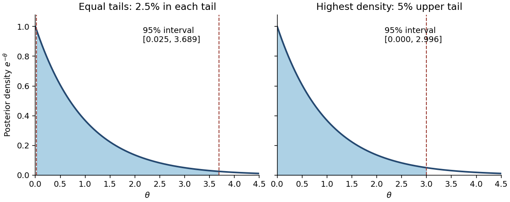

<h1 id="3/b/iv/solution">Solution</h1>

↑ **Parent:** [Iv](../iv.md)

**No.** A permitted counterexample is $a=1$ with all observed counts zero. Then $A=1$ and the [posterior distribution](../../../../../bayesian-posterior.md) is an [exponential distribution](../../../../../exponential-distribution.md) with rate $B=b+n$, whose density decreases strictly from the left boundary. Its [equal-tailed credible interval](../../../../../equal-tailed-credible-interval.md) is

$$
[L,U]=\left[-\frac{\log(1-\alpha/2)}B,\ -\frac{\log(\alpha/2)}B\right].
$$

Here $L>0$. This excludes values just above zero whose posterior density is larger than that of retained values near $U$, violating the highest-density criterion. The actual [highest posterior density interval](../../../../../highest-posterior-density-interval.md) starts at the support boundary and solves $1-e^{-Bh}=1-\alpha$:

$$
\boxed{[0,h],\qquad h=-\frac{\log\alpha}{B}.}
$$

Writing zero as the endpoint causes no problem because a single point has zero posterior [probability](../../../../../probability.md). Thus even within the gamma family the two intervals need not agree. More generally, for an interior unimodal [gamma distribution](../../../../../gamma-distribution.md), highest-density endpoints have equal densities, whereas equal-tailed endpoints need not.

**[Figure 1](#3/b/iv/image-equal-tailed-and-highest-density-intervals-for-an-exponential-posterior). Equal-tailed and highest-density intervals for an exponential posterior**.

## ↑ Ancestors (13)

1. [Iv](../iv.md)
2. [B](../../b.md)
3. [3](../../../3.md)
4. [2014](../../../../2014-split.md)
5. [Past exam of the statistics course of the University of Oxford](../../../../split.md)
6. [Statistics course of the University of Oxford](../../../../../statistics-course-of-the-university-of-oxford.md)
7. [Year 2 of the mathematics course of the University of Oxford](../../../../../year-2-of-the-mathematics-course-of-the-university-of-oxford.md)
8. [Mathematics course of the University of Oxford](../../../../../mathematics-course-of-the-university-of-oxford.md)
9. [Undergraduate course of the University of Oxford](../../../../../undergraduate-course-of-the-university-of-oxford.md)
10. [Course of the University of Oxford](../../../../../course-of-the-university-of-oxford.md)
11. [University of Oxford](../../../../../university-of-oxford-split.md)
12. [List of universities](../../../../../list-of-universities.md)
13. [Codex Wiki](../../../../../split.md)
