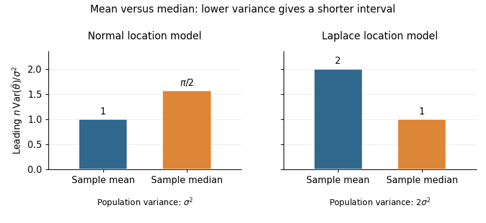

# 2015

↑ **Parent:** [Past exam of the statistics course of the University of Oxford](../past-exam-of-the-statistics-course-of-the-university-of-oxford.md)

Source: [Mathematics Part A release](https://www.whatdotheyknow.com/request/maths_papers_2/response/1850333/attach/3/FOI%2020210708%201%20Data.zip?cookie_passthrough=1), member `FOI-20210708-1 - Data/a13765w1 (4).pdf`. The complete three-page paper is dated 24 June 2015. All thirteen source leaf parts are answered below; the examination statements remain in the private archive.

The department's [solution-release policy](https://www.maths.ox.ac.uk/members/students/undergraduate-courses/examinations-assessments/overview-examinations) does not advertise ordinary odd-year solutions. Bounded exact-paper checks on the mathematics and statistics department sites found no matching advertisement of full or selected worked answers, so no source parts are skipped.

**Table of contents**

- [1](#1)
  - [a](#1/a)
    - [i](#1/a/i)
      - [Solution](#1/a/i/solution)
    - [ii](#1/a/ii)
      - [Solution](#1/a/ii/solution)
  - [b](#1/b)
    - [i](#1/b/i)
      - [Solution](#1/b/i/solution)
    - [ii](#1/b/ii)
      - [Solution](#1/b/ii/solution)
  - [c](#1/c)
    - [Solution](#1/c/solution)
- [2](#2)
  - [a](#2/a)
    - [Solution](#2/a/solution)
  - [b](#2/b)
    - [i](#2/b/i)
      - [Solution](#2/b/i/solution)
    - [ii](#2/b/ii)
      - [Solution](#2/b/ii/solution)
  - [c](#2/c)
    - [Solution](#2/c/solution)
- [3](#3)
  - [a](#3/a)
    - [Solution](#3/a/solution)
  - [b](#3/b)
    - [i](#3/b/i)
      - [Solution](#3/b/i/solution)
    - [ii](#3/b/ii)
      - [Solution](#3/b/ii/solution)
    - [iii](#3/b/iii)
      - [Solution](#3/b/iii/solution)

## 1

↑ **Parent:** [2015](2015.md)

<h3 id="1/a">a</h3>

↑ **Parent:** [1](#1)

<h4 id="1/a/i">i</h4>

↑ **Parent:** [A](#1/a)

<h5 id="1/a/i/solution">Solution</h5>

↑ **Parent:** [I](#1/a/i)

The given [probability density function](../continuous-probability-distribution.md#probability-density-function) is that of a [beta distribution](../probability-distribution.md#beta-distribution) with parameters $r$ and $n-r+1$. We can derive the required [moments](../expected-value.md#moment) directly rather than assuming the beta moment formulas. For an integer $j\geq0$, the [Euler beta function](../complex-analysis.md#beta-function) gives

$$
\begin{aligned}
\mathbb E[U_{(r)}^j]
&=\frac{n!}{(r-1)!(n-r)!}
\int_0^1u^{r+j-1}(1-u)^{n-r}\,du\\
&=\frac{n!(r+j-1)!}{(r-1)!(n+j)!}.
\end{aligned}
$$

Here $B(a,b)=(a-1)!(b-1)!/(a+b-1)!$ for positive integers $a,b$; this identity also follows by repeated [integration by parts](../calculus.md#integration-by-parts). Taking $j=1,2$ yields

$$
\mathbb E[U_{(r)}]=\frac r{n+1},\qquad
\mathbb E[U_{(r)}^2]=\frac{r(r+1)}{(n+1)(n+2)}.
$$

Subtract the square of the first [moment](../expected-value.md#moment) from the second to obtain the [variance](../variance.md):

$$
\boxed{\mathbb E[U_{(r)}]=\frac r{n+1},\qquad
\operatorname{Var}(U_{(r)})=
\frac{r(n-r+1)}{(n+1)^2(n+2)}.}
$$

These are exact finite-sample identities for each [uniform order statistic](../probability-theory.md#uniform-order-statistic).

<h4 id="1/a/ii">ii</h4>

↑ **Parent:** [A](#1/a)

<h5 id="1/a/ii/solution">Solution</h5>

↑ **Parent:** [Ii](#1/a/ii)

For odd sample size, the [sample median](../probability-distribution.md#sample-median) is the central [order statistic](../probability-theory.md#order-statistic), $M_U=U_{(m+1)}$. Since $n=2m+1$, its index is $r=(n+1)/2$ and $n-r+1=(n+1)/2$. Substitute these into the [expectation](../expected-value.md) and [variance](../variance.md) formulas from part (i):

$$
\boxed{\mathbb E[M_U]=\frac12,\qquad
\operatorname{Var}(M_U)=\frac1{4(n+2)}.}
$$

In fact $M_U$ has the symmetric [beta distribution](../probability-distribution.md#beta-distribution) $\operatorname{Beta}(m+1,m+1)$, explaining why its [expectation](../expected-value.md) is exactly the centre of the interval.

<h3 id="1/b">b</h3>

↑ **Parent:** [1](#1)

<h4 id="1/b/i">i</h4>

↑ **Parent:** [B](#1/b)

<h5 id="1/b/i/solution">Solution</h5>

↑ **Parent:** [I](#1/b/i)

Continuity and strict increase make the [quantile function](../probability-distribution.md#quantile-function) $F^{-1}$ well-defined on $(0,1)$. The endpoints of the [uniform distribution](../continuous-probability-distribution.md#continuous-uniform-distribution) occur with [probability](../probability-theory.md#probability) zero and do not affect the construction. For every real $x$,

$$
\begin{aligned}
\Pr(X_i\leq x)
&=\Pr(F^{-1}(U_i)\leq x)\\
&=\Pr(U_i\leq F(x))=F(x).
\end{aligned}
$$

Thus each $X_i$ has [cumulative distribution function](../probability-distribution.md#cumulative-distribution-function) $F$. Applying a fixed measurable function separately to [independent random variables](../random-variable.md#independent-random-variables) preserves their independence; explicitly, joint lower-tail probabilities factor as

$$
\Pr(X_1\leq x_1,\ldots,X_n\leq x_n)=\prod_{i=1}^nF(x_i).
$$

Consequently

$$
\boxed{X_1,\ldots,X_n\text{ are independent and identically distributed with CDF }F.}
$$

This is [inverse transform sampling](../probability-distribution.md#inverse-transform-sampling). Since $F^{-1}$ preserves order, it also sends the central [order statistic](../probability-theory.md#order-statistic) to the central [order statistic](../probability-theory.md#order-statistic), justifying $M_X=F^{-1}(M_U)$.

<h4 id="1/b/ii">ii</h4>

↑ **Parent:** [B](#1/b)

<h5 id="1/b/ii/solution">Solution</h5>

↑ **Parent:** [Ii](#1/b/ii)

First establish the limiting law needed by the [delta method](../statistical-inference.md#delta-method). For fixed $t$, put $u_n=1/2+t/\sqrt n$ and let $N_n$ count how many of the $U_i$ are at most $u_n$. Then $N_n$ has a [binomial distribution](../discrete-probability-distribution.md#binomial-distribution) with [expectation](../expected-value.md) $n/2+t\sqrt n$ and [variance](../variance.md) $n/4-t^2$. The event $M_U\leq u_n$ is exactly $N_n\geq(n+1)/2$. Its standardized threshold tends to $-2t$, so the [central limit theorem](../convergence-of-random-variables.md#central-limit-theorem) for these binomial counts gives

$$
\Pr\!\left(\sqrt n(M_U-1/2)\leq t\right)\longrightarrow\Phi(2t).
$$

Here $\Phi$ is the [cumulative distribution function](../probability-distribution.md#cumulative-distribution-function) of the [standard normal distribution](../probability-distribution.md#standard-normal-distribution). Equivalently,

$$
\sqrt n(M_U-1/2)\xrightarrow{d}N(0,1/4).
$$

Use the usual local regularity for the [delta method](../statistical-inference.md#delta-method): $f$ is continuous at the population [median](../probability-distribution.md#median) $\theta$ and $f(\theta)>0$. The [inverse function theorem](../multivariable-calculus.md#inverse-function-theorem), applied at $F(\theta)=1/2$, gives

$$
\left.\frac{d}{du}F^{-1}(u)\right|_{u=1/2}=\frac1{f(\theta)}.
$$

Therefore

$$
\boxed{\sqrt n(M_X-\theta)\xrightarrow{d}
N\!\left(0,\frac1{4f(\theta)^2}\right).}
$$

The [asymptotic normality](../statistical-inference.md#asymptotic-normality) gives the requested leading [variance](../variance.md) approximation

$$
\boxed{\operatorname{avar}(M_X)=\frac1{4n f(\theta)^2}.}
$$

Here the variance parameter for the rescaled limiting law is $1/(4f(\theta)^2)$, while the source states the corresponding $1/n$ approximation for the unscaled [estimator](../statistical-modelling.md#estimator). Strict increase of $F$ alone does not force $f(\theta)>0$; that local condition is needed for this form of the [asymptotic distribution of a sample median](../robust-statistics.md#asymptotic-distribution-of-a-sample-median).

<h3 id="1/c">c</h3>

↑ **Parent:** [1](#1)

<h4 id="1/c/solution">Solution</h4>

↑ **Parent:** [C](#1/c)

For the [normal distribution](../probability-distribution.md#normal-distribution), the density at its centre is $f(\theta)=1/(\sigma\sqrt{2\pi})$. The [sample mean](../variance.md#sample-mean) has exact [variance](../variance.md) $\sigma^2/n$, whereas part (b) gives the [sample median](../probability-distribution.md#sample-median) the leading [variance](../variance.md) $\pi\sigma^2/(2n)$. Thus the requested [asymptotic relative efficiency](../statistical-inference.md#asymptotic-relative-efficiency) is

$$
\boxed{\operatorname{ARE}(M_X,\overline X)=\frac2\pi\approx0.637
\quad\text{for the normal model}.}
$$

At a fixed confidence level, a [confidence interval](../statistical-inference.md#confidence-interval) based on the [sample mean](../variance.md#sample-mean) has a leading half-width smaller by the factor $\sqrt{2/\pi}$. With known $\sigma$, $\overline X\pm z_{1-\alpha/2}\sigma/\sqrt n$ also has exact normal coverage. **Prefer the sample mean under the normal model.**

For the [Laplace distribution](../continuous-probability-distribution.md#laplace-distribution), symmetry puts both the [mean](../expected-value.md) and [median](../probability-distribution.md#median) at $\theta$. Its density there is $1/(2\sigma)$, and

$$
\operatorname{Var}(X_i)=\frac1\sigma\int_0^\infty y^2e^{-y/\sigma}\,dy
=2\sigma^2.
$$

Consequently the [sample mean](../variance.md#sample-mean) has [variance](../variance.md) $2\sigma^2/n$, while the [sample median](../probability-distribution.md#sample-median) has leading [variance](../variance.md) $\sigma^2/n$. Hence

$$
\boxed{\operatorname{ARE}(M_X,\overline X)=2
\quad\text{for the Laplace model}.}
$$

A large-sample [confidence interval](../statistical-inference.md#confidence-interval) based on the [sample median](../probability-distribution.md#sample-median) has leading half-width smaller by $1/\sqrt2$; with known scale it is $M_X\pm z_{1-\alpha/2}\sigma/\sqrt n$. **Prefer the sample median under the Laplace model.** Consistent estimation of an unknown scale preserves these leading comparisons. The reason for the reversal is quantitative: the [median](../probability-distribution.md#median)'s precision depends on the central density $f(\theta)$, while the [sample mean](../variance.md#sample-mean)'s precision depends on the whole population [variance](../variance.md).

**[Figure 1](#1/c/image-asymptotic-variance-of-mean-and-median-in-normal-and-laplace-location-models). Asymptotic variance of mean and median in normal and Laplace location models**. The vertical scale is $n$ times estimator variance divided by $\sigma^2$. In the normal model $\sigma$ is the population standard deviation; in the Laplace model it is the scale parameter, with population variance $2\sigma^2$. Lower bars give shorter leading confidence intervals at the same confidence level.

## 2

↑ **Parent:** [2015](2015.md)

<h3 id="2/a">a</h3>

↑ **Parent:** [2](#2)

<h4 id="2/a/solution">Solution</h4>

↑ **Parent:** [A](#2/a)

Let $L(\vartheta;x)$ be the [likelihood function](../maximum-likelihood-estimation.md#likelihood-function), with full parameter space $\Theta$ and [null hypothesis](../statistical-hypothesis-test.md#null-hypothesis) $\vartheta\in\Theta_0\subseteq\Theta$. The [generalized likelihood-ratio test](../statistical-hypothesis-test.md#generalized-likelihood-ratio-test) compares the best null fit to the best unrestricted fit:

$$
R(x)=\frac{\sup_{\vartheta\in\Theta_0}L(\vartheta;x)}
{\sup_{\vartheta\in\Theta}L(\vartheta;x)},
\qquad \Lambda(x)=-2\log R(x).
$$

The [likelihood ratio](../statistical-hypothesis-test.md#likelihood-ratio) $R$ lies between zero and one, and small values count against the [null hypothesis](../statistical-hypothesis-test.md#null-hypothesis); equivalently, large values of the [likelihood-ratio test statistic](../statistical-hypothesis-test.md#likelihood-ratio-test-statistic) $\Lambda$ count against it.

Compute restricted and unrestricted [maximum-likelihood estimates](../maximum-likelihood-estimation.md#maximum-likelihood-estimator), evaluate their [log-likelihoods](../maximum-likelihood-estimation.md#log-likelihood), and form $\Lambda=2(\ell(\widehat\vartheta)-\ell(\widehat\vartheta_0))$. Under the regular conditions of [Wilks theorem](../statistical-inference.md#wilks-theorem), the null limit is

$$
\Lambda\xrightarrow{d}\chi_d^2,\qquad
d=\dim\Theta-\dim\Theta_0.
$$

These [statistical degrees of freedom](../statistical-inference.md#statistical-degrees-of-freedom) count independent parameter restrictions. The regularity includes a locally identifiable smooth model, nonsingular [Fisher information](../statistical-modelling.md#fisher-information-matrix), and an interior null value; parameter-dependent support can invalidate the result.

For a chosen [significance level](../statistical-hypothesis-test.md#significance-level) $\alpha$, obtain the $(1-\alpha)$ [quantile](../probability-distribution.md#quantile-function) $q_{d,1-\alpha}$ of the [chi-squared distribution](../probability-distribution.md#chi-squared-distribution) and use

$$
\boxed{\text{reject }H_0\text{ if }\Lambda_{\rm obs}>q_{d,1-\alpha}.}
$$

Equivalently, compare the asymptotic [p-value](../statistical-hypothesis-test.md#p-value) $\Pr(\chi_d^2\geq\Lambda_{\rm obs})$ to $\alpha$. This is a large-sample calibration; part (c) requires direct treatment because its support depends on a parameter.

<h3 id="2/b">b</h3>

↑ **Parent:** [2](#2)

<h4 id="2/b/i">i</h4>

↑ **Parent:** [B](#2/b)

<h5 id="2/b/i/solution">Solution</h5>

↑ **Parent:** [I](#2/b/i)

The count vector has a [multinomial distribution](../discrete-probability-distribution.md#multinomial-distribution), with [likelihood function](../maximum-likelihood-estimation.md#likelihood-function)

$$
L(\pi)=\frac{n!}{\prod_i n_i!}\prod_{i=1}^k\pi_i^{n_i},
\qquad\sum_i\pi_i=1.
$$

Maximize its [log-likelihood](../maximum-likelihood-estimation.md#log-likelihood) using a [Lagrange multiplier](../mathematical-optimization.md#lagrange-multiplier) for the sum constraint. The equations $n_i/\pi_i=\lambda$ and $\sum_i\pi_i=1$ give $\lambda=n$ and $\widehat\pi_i=n_i/n$. Since all counts are positive and the [log-likelihood](../maximum-likelihood-estimation.md#log-likelihood) is strictly concave on the interior of the probability simplex, this is the global [maximum-likelihood estimate](../maximum-likelihood-estimation.md#maximum-likelihood-estimator).

Under the uniform [null hypothesis](../statistical-hypothesis-test.md#null-hypothesis), each category has expected count

$$
\boxed{e_i=n\pi_{i,0}=\frac nk.}
$$

The common multinomial coefficient cancels from the [likelihood ratio](../statistical-hypothesis-test.md#likelihood-ratio):

$$
R=\frac{k^{-n}}{\prod_i(n_i/n)^{n_i}}
=\prod_{i=1}^k\left(\frac{e_i}{n_i}\right)^{n_i}.
$$

Taking minus twice its logarithm gives exactly

$$
\boxed{\Lambda=2\sum_{i=1}^k n_i\log\!\left(\frac{n_i}{e_i}\right).}
$$

There are $k-1$ free category probabilities, because their sum is one, and the null fixes all of them. Thus its regular asymptotic [chi-squared distribution](../probability-distribution.md#chi-squared-distribution) has $k-1$ [statistical degrees of freedom](../statistical-inference.md#statistical-degrees-of-freedom).

<h4 id="2/b/ii">ii</h4>

↑ **Parent:** [B](#2/b)

<h5 id="2/b/ii/solution">Solution</h5>

↑ **Parent:** [Ii](#2/b/ii)

For four categories the number of [statistical degrees of freedom](../statistical-inference.md#statistical-degrees-of-freedom) is $4-1=3$. The supplied 5% critical value is therefore $q_3=7.82$, and $7.3<7.82$. Hence

$$
\boxed{\text{Do not reject equal category probabilities at the 5\% level.}}
$$

The approximate [p-value](../statistical-hypothesis-test.md#p-value) is $\Pr(\chi_3^2\geq7.3)\approx0.063$. This conclusion assumes the large-sample multinomial approximation is adequate, in particular sufficiently large expected category counts. It means there is insufficient evidence against the uniform [null hypothesis](../statistical-hypothesis-test.md#null-hypothesis), rather than establishing that the probabilities are equal.

<h3 id="2/c">c</h3>

↑ **Parent:** [2](#2)

<h4 id="2/c/solution">Solution</h4>

↑ **Parent:** [C](#2/c)

Write $a=x_{(1)}=\min_i x_i$, $T=\sum_i x_i$ and $\overline x=T/n$. For nondegenerate data from the shifted [exponential distribution](../continuous-probability-distribution.md#exponential-distribution), the [likelihood function](../maximum-likelihood-estimation.md#likelihood-function) is

$$
L(\theta,\beta)=\beta^{-n}
\exp\!\left[-\frac{T-n\theta}{\beta}\right]
\mathbf1_{\{0\leq\theta\leq a\}}.
$$

For fixed feasible $\theta$, differentiating its [log-likelihood](../maximum-likelihood-estimation.md#log-likelihood) with respect to $\beta$ gives

$$
-\frac n\beta+\frac{T-n\theta}{\beta^2}=0,
\qquad \widehat\beta(\theta)=\overline x-\theta.
$$

The derivative changes from positive to negative there. Substituting gives the profile [likelihood](../maximum-likelihood-estimation.md#likelihood-function) $e^{-n}(\overline x-\theta)^{-n}$, which increases with $\theta$. Therefore the unrestricted [maximum-likelihood estimates](../maximum-likelihood-estimation.md#maximum-likelihood-estimator) are

$$
\widehat\theta=a,\qquad \widehat\beta=\overline x-a,
$$

while under the [null hypothesis](../statistical-hypothesis-test.md#null-hypothesis) $\theta=0$ the estimate is $\widetilde\beta=\overline x$. Their [likelihood ratio](../statistical-hypothesis-test.md#likelihood-ratio) is

$$
R=\frac{\overline x^{-n}e^{-n}}{(\overline x-a)^{-n}e^{-n}}
=\left(1-\frac a{\overline x}\right)^n.
$$

Since the [likelihood-ratio test](../statistical-hypothesis-test.md#likelihood-ratio-test) rejects for small $R$, the requested form is obtained with

$$
\boxed{g(x_1,\ldots,x_n)=\frac{x_{(1)}}{\overline x}
=\frac{n\min_i x_i}{\sum_i x_i},\qquad
C=\{x:(1-g(x))^n\leq k\}.}
$$

The formulas assume $\overline x>a$, which holds almost surely for a continuous sample with $n\geq2$; coincident observations give an unbounded unrestricted [likelihood](../maximum-likelihood-estimation.md#likelihood-function) and can be treated by its supremum.

An exact calibration is available and also explains why [Wilks theorem](../statistical-inference.md#wilks-theorem) should not be applied here. Under the null, the [memoryless property](../continuous-probability-distribution.md#memorylessness-of-the-exponential-distribution) makes $A=nX_{(1)}$ and $D=\sum_i(X_i-X_{(1)})$ independent [gamma distributions](../continuous-probability-distribution.md#gamma-distribution) with common scale $\beta$ and shapes $1$ and $n-1$. By [beta sampling by gamma ratios](../probability-distribution.md#beta-sampling-by-gamma-ratios),

$$
1-g=\frac{D}{A+D}\sim\operatorname{Beta}(n-1,1).
$$

Consequently, for $0\leq k\leq1$,

$$
\Pr_0(R\leq k)=k^{(n-1)/n},\qquad
\boxed{k_\alpha=\alpha^{n/(n-1)}.}
$$

This yields an exact [test size](../statistical-hypothesis-test.md#size-of-a-statistical-test) $\alpha$, independent of the unknown scale. The support endpoint and boundary null make this a [likelihood-ratio test for an exponential support endpoint](../statistical-hypothesis-test.md#likelihood-ratio-test-for-an-exponential-support-endpoint), with a different calibration from a regular one-parameter test.

## 3

↑ **Parent:** [2015](2015.md)

<h3 id="3/a">a</h3>

↑ **Parent:** [3](#3)

<h4 id="3/a/solution">Solution</h4>

↑ **Parent:** [A](#3/a)

Let $p_0=\Pr(\theta\in\Theta_0)$ and $p_1=1-p_0$, assuming both are positive. The [prior odds](../bayesian-statistics.md#prior-odds) are $\alpha=p_0/p_1$. Given data $x$, the [posterior odds](../bayesian-statistics.md#posterior-odds) are

$$
O_{01}(x)=\frac{\Pr(H_0\mid x)}{\Pr(H_1\mid x)}.
$$

With conditional joint [likelihood](../maximum-likelihood-estimation.md#likelihood-function) $L(\theta;x)=\prod_i f(x_i\mid\theta)$, define the hypothesis-conditional marginal densities

$$
m_0(x)=\frac1{p_0}\int_{\Theta_0}L(\theta;x)\,\pi(d\theta),\qquad
m_1(x)=\frac1{p_1}\int_{\Theta\setminus\Theta_0}L(\theta;x)\,\pi(d\theta).
$$

The [Bayes factor](../bayesian-statistics.md#bayes-factor) for $H_0$ relative to $H_1$ is $B=m_0(x)/m_1(x)$. The normalizations $p_0,p_1$ matter: the [prior distribution](../bayesian-statistics.md#prior-probability) within each hypothesis must have total probability one. [Bayes' theorem](../probability-theory.md#bayes-theorem) now gives

$$
O_{01}(x)=\frac{p_0m_0(x)}{p_1m_1(x)}=\alpha B.
$$

Converting [posterior odds](../bayesian-statistics.md#posterior-odds) to [posterior probability](../bayesian-statistics.md#posterior-probability) therefore gives

$$
\boxed{\Pr(H_0\mid x)=\frac{\alpha B}{1+\alpha B}.}
$$

<h3 id="3/b">b</h3>

↑ **Parent:** [3](#3)

<h4 id="3/b/i">i</h4>

↑ **Parent:** [B](#3/b)

<h5 id="3/b/i/solution">Solution</h5>

↑ **Parent:** [I](#3/b/i)

Take $\sigma,\tau>0$ to be the positive standard deviations. Multiply the normal [likelihood function](../maximum-likelihood-estimation.md#likelihood-function) by the normal [prior density](../bayesian-statistics.md#prior-density). Terms independent of $\theta$ can be absorbed into the normalizing constant:

$$
\pi(\theta\mid x)\propto
\exp\!\left[-\frac1{2\sigma^2}\sum_i(x_i-\theta)^2
-\frac{\theta^2}{2\tau^2}\right].
$$

The identity $\sum_i(x_i-\theta)^2=\sum_i(x_i-\overline x)^2+n(\theta-\overline x)^2$ makes the quadratic term explicit. Completing the square gives

$$
\pi(\theta\mid x)\propto\exp\!\left[-\frac{(\theta-\mu_n)^2}{2v_n}\right],
$$

where

$$
\boxed{v_n=\left(\frac n{\sigma^2}+\frac1{\tau^2}\right)^{-1}
=\frac{\sigma^2\tau^2}{\sigma^2+n\tau^2},\qquad
\mu_n=\frac{n\tau^2}{\sigma^2+n\tau^2}\overline x.}
$$

Thus $\theta\mid x\sim N(\mu_n,v_n)$. This is [normal-normal conjugacy](../probability-and-statistics.md#normal-normal-conjugacy-with-known-observation-variance): prior and data precisions add, and the [posterior mean](../bayesian-statistics.md#posterior-mean) shrinks the [sample mean](../variance.md#sample-mean) towards the prior mean zero.

<h4 id="3/b/ii">ii</h4>

↑ **Parent:** [B](#3/b)

<h5 id="3/b/ii/solution">Solution</h5>

↑ **Parent:** [Ii](#3/b/ii)

The symmetric continuous [prior distribution](../bayesian-statistics.md#prior-probability) gives $\Pr(\theta<0)=\Pr(\theta\geq0)=1/2$, so the [prior odds](../bayesian-statistics.md#prior-odds) are one. Therefore the [Bayes factor](../bayesian-statistics.md#bayes-factor) equals the [posterior odds](../bayesian-statistics.md#posterior-odds). Standardizing the normal [posterior distribution](../bayesian-statistics.md#bayesian-posterior), put

$$
z=\frac{\mu_n}{\sqrt{v_n}}
=\frac{n\tau\overline x}{\sigma\sqrt{\sigma^2+n\tau^2}}.
$$

Then $\Pr(H_0\mid x)=\Phi(-z)$ and $\Pr(H_1\mid x)=\Phi(z)$. The endpoint $\theta=0$ has zero posterior probability, so the strict/non-strict split causes no additional term. Hence

$$
\boxed{B=\frac{\Phi(-z)}{\Phi(z)}
=\frac{1-\Phi(z)}{\Phi(z)},\qquad
z=\frac{n\tau\overline x}{\sigma\sqrt{\sigma^2+n\tau^2}}.}
$$

In particular, positive values of the [sample mean](../variance.md#sample-mean) make this [Bayes factor](../bayesian-statistics.md#bayes-factor) smaller, favouring the positive-mean hypothesis.

<h4 id="3/b/iii">iii</h4>

↑ **Parent:** [B](#3/b)

<h5 id="3/b/iii/solution">Solution</h5>

↑ **Parent:** [Iii](#3/b/iii)

The denominator $\Phi(z)$ is positive, so

$$
B<\frac1{10}
\quad\Longleftrightarrow\quad
1-\Phi(z)<\frac1{10}\Phi(z)
\quad\Longleftrightarrow\quad
\Phi(z)>\frac{10}{11}.
$$

Strict increase of the [standard normal distribution](../probability-distribution.md#standard-normal-distribution) function turns this into $z>\Phi^{-1}(10/11)$. Since the coefficient multiplying $\overline x$ in $z$ is positive, the rejection rule is precisely $\overline x>c$, with

$$
\boxed{c=\frac{\sigma\sqrt{\sigma^2+n\tau^2}}{n\tau}
\Phi^{-1}\!\left(\frac{10}{11}\right)
=\frac\sigma{\sqrt n}\sqrt{1+\frac{\sigma^2}{n\tau^2}}
\Phi^{-1}\!\left(\frac{10}{11}\right).}
$$

The [quantile](../probability-distribution.md#quantile-function) is approximately $1.33518$. Equivalently, the rule requires [posterior probability](../bayesian-statistics.md#posterior-probability) of $H_0$ below $1/11$, because its [prior odds](../bayesian-statistics.md#prior-odds) are one. The calculation is an instance of the [Bayes factor for the sign of a normal mean](../bayesian-statistics.md#bayes-factor-for-the-sign-of-a-normal-mean).

## ↑ Ancestors (9)

1. [Past exam of the statistics course of the University of Oxford](../past-exam-of-the-statistics-course-of-the-university-of-oxford.md)
2. [Statistics course of the University of Oxford](../university-of-oxford.md#statistics-course-of-the-university-of-oxford)
3. [Year 2 of the mathematics course of the University of Oxford](../university-of-oxford.md#year-2-of-the-mathematics-course-of-the-university-of-oxford)
4. [Mathematics course of the University of Oxford](../university-of-oxford.md#mathematics-course-of-the-university-of-oxford)
5. [Undergraduate course of the University of Oxford](../university-of-oxford.md#undergraduate-course-of-the-university-of-oxford)
6. [Course of the University of Oxford](../university-of-oxford.md#course-of-the-university-of-oxford)
7. [University of Oxford](../university-of-oxford.md)
8. [List of universities](../README.md#list-of-universities)
9. [Codex Wiki](../README.md)
