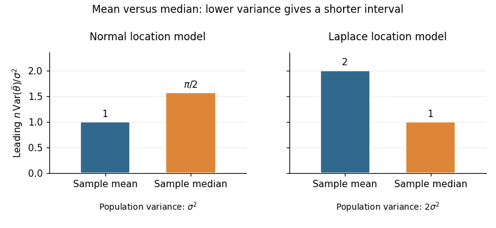

<h1 id="1/c/solution">Solution</h1>

↑ **Parent:** [C](../c.md)

For the [normal distribution](../../../../normal-distribution.md), the density at its centre is $f(\theta)=1/(\sigma\sqrt{2\pi})$. The [sample mean](../../../../sample-mean.md) has exact [variance](../../../../variance-split.md) $\sigma^2/n$, whereas part (b) gives the [sample median](../../../../sample-median.md) the leading [variance](../../../../variance-split.md) $\pi\sigma^2/(2n)$. Thus the requested [asymptotic relative efficiency](../../../../asymptotic-relative-efficiency.md) is

$$
\boxed{\operatorname{ARE}(M_X,\overline X)=\frac2\pi\approx0.637
\quad\text{for the normal model}.}
$$

At a fixed confidence level, a [confidence interval](../../../../confidence-interval.md) based on the [sample mean](../../../../sample-mean.md) has a leading half-width smaller by the factor $\sqrt{2/\pi}$. With known $\sigma$, $\overline X\pm z_{1-\alpha/2}\sigma/\sqrt n$ also has exact normal coverage. **Prefer the sample mean under the normal model.**

For the [Laplace distribution](../../../../laplace-distribution.md), symmetry puts both the [mean](../../../../expected-value-split.md) and [median](../../../../median.md) at $\theta$. Its density there is $1/(2\sigma)$, and

$$
\operatorname{Var}(X_i)=\frac1\sigma\int_0^\infty y^2e^{-y/\sigma}\,dy
=2\sigma^2.
$$

Consequently the [sample mean](../../../../sample-mean.md) has [variance](../../../../variance-split.md) $2\sigma^2/n$, while the [sample median](../../../../sample-median.md) has leading [variance](../../../../variance-split.md) $\sigma^2/n$. Hence

$$
\boxed{\operatorname{ARE}(M_X,\overline X)=2
\quad\text{for the Laplace model}.}
$$

A large-sample [confidence interval](../../../../confidence-interval.md) based on the [sample median](../../../../sample-median.md) has leading half-width smaller by $1/\sqrt2$; with known scale it is $M_X\pm z_{1-\alpha/2}\sigma/\sqrt n$. **Prefer the sample median under the Laplace model.** Consistent estimation of an unknown scale preserves these leading comparisons. The reason for the reversal is quantitative: the [median](../../../../median.md)'s precision depends on the central density $f(\theta)$, while the [sample mean](../../../../sample-mean.md)'s precision depends on the whole population [variance](../../../../variance-split.md).

**[Figure 1](#1/c/image-asymptotic-variance-of-mean-and-median-in-normal-and-laplace-location-models). Asymptotic variance of mean and median in normal and Laplace location models**. The vertical scale is $n$ times estimator variance divided by $\sigma^2$. In the normal model $\sigma$ is the population standard deviation; in the Laplace model it is the scale parameter, with population variance $2\sigma^2$. Lower bars give shorter leading confidence intervals at the same confidence level.

## ↑ Ancestors (12)

1. [C](../c.md)
2. [1](../../1.md)
3. [2015](../../../2015-split.md)
4. [Past exam of the statistics course of the University of Oxford](../../../split.md)
5. [Statistics course of the University of Oxford](../../../../statistics-course-of-the-university-of-oxford.md)
6. [Year 2 of the mathematics course of the University of Oxford](../../../../year-2-of-the-mathematics-course-of-the-university-of-oxford.md)
7. [Mathematics course of the University of Oxford](../../../../mathematics-course-of-the-university-of-oxford.md)
8. [Undergraduate course of the University of Oxford](../../../../undergraduate-course-of-the-university-of-oxford.md)
9. [Course of the University of Oxford](../../../../course-of-the-university-of-oxford.md)
10. [University of Oxford](../../../../university-of-oxford-split.md)
11. [List of universities](../../../../list-of-universities.md)
12. [Codex Wiki](../../../../split.md)
