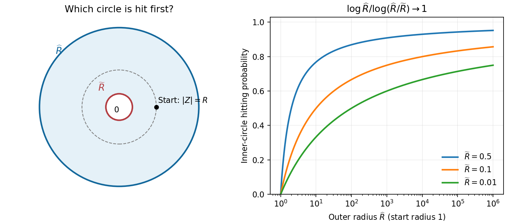
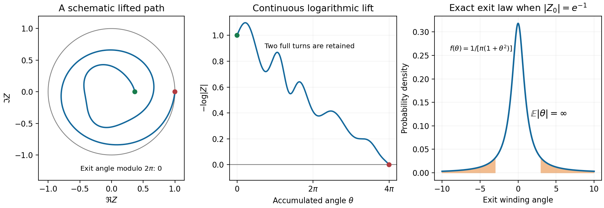

# 2007

↑ **Parent:** [Past exam of the stochastic differential equations and Brownian motion in complex analysis course of the University of Oxford](../past-exam-of-the-stochastic-differential-equations-and-brownian-motion-in-complex-analysis-course-of-the-university-of-oxford.md)

**Table of contents**

- [A](#a)
  - [1](#a/1)
    - [a](#a/1/a)
      - [Solution](#a/1/a/solution)
    - [b](#a/1/b)
      - [Solution](#a/1/b/solution)
    - [c](#a/1/c)
      - [Solution](#a/1/c/solution)
  - [2](#a/2)
    - [a](#a/2/a)
      - [Solution](#a/2/a/solution)
    - [b](#a/2/b)
      - [Solution](#a/2/b/solution)
    - [c](#a/2/c)
      - [Solution](#a/2/c/solution)
  - [3](#a/3)
    - [a](#a/3/a)
      - [Solution](#a/3/a/solution)
    - [b](#a/3/b)
      - [Solution](#a/3/b/solution)
    - [c](#a/3/c)
      - [Solution](#a/3/c/solution)
  - [4](#a/4)
    - [a](#a/4/a)
      - [Solution](#a/4/a/solution)
    - [b](#a/4/b)
      - [Solution](#a/4/b/solution)
    - [c](#a/4/c)
      - [Solution](#a/4/c/solution)
- [B](#b)
  - [5](#b/5)
    - [i](#b/5/i)
      - [Solution](#b/5/i/solution)
    - [ii](#b/5/ii)
      - [Solution](#b/5/ii/solution)
  - [6](#b/6)
    - [Solution](#b/6/solution)
  - [7](#b/7)
    - [i](#b/7/i)
      - [Solution](#b/7/i/solution)
    - [ii](#b/7/ii)
      - [Solution](#b/7/ii/solution)
  - [8](#b/8)
    - [i](#b/8/i)
      - [Solution](#b/8/i/solution)
    - [ii](#b/8/ii)
      - [Solution](#b/8/ii/solution)

## A

↑ **Parent:** [2007](2007.md)

<h3 id="a/1">1</h3>

↑ **Parent:** [A](#a)

<h4 id="a/1/a">a</h4>

↑ **Parent:** [1](#a/1)

<h5 id="a/1/a/solution">Solution</h5>

↑ **Parent:** [A](#a/1/a)

The raw [natural filtration](../stochastic-process.md#natural-filtration) is

$$
\boxed{\mathcal F_t^B=\sigma(B_u:0\leq u\leq t).}
$$

Equivalently it is the smallest [sigma-algebra](../measure-theory.md#sigma-algebra) making every observation $B_u$, $u\leq t$, [measurable](../measure-theory.md#measurability). As $s\leq t$ enlarges the set of observations, $\mathcal F_s^B\subseteq\mathcal F_t^B$. It is the smallest [filtration](../stochastic-process.md#filtration-probability-theory) to which the process is [adapted](../stochastic-process.md#adapted-process). If the [usual conditions for a filtration](../stochastic-process.md#usual-conditions-for-a-filtration) are imposed, take the completion by the probability-zero sets and its right-continuous augmentation. Brownian [independent increments](../stochastic-process.md#independent-increments) remain valid for this usual augmentation. Adding arbitrary future information is not part of the generated [filtration](../stochastic-process.md#filtration-probability-theory).

<h4 id="a/1/b">b</h4>

↑ **Parent:** [1](#a/1)

<h5 id="a/1/b/solution">Solution</h5>

↑ **Parent:** [B](#a/1/b)

[Independent increments](../stochastic-process.md#independent-increments) give $B_s\sim N(0,s)$ independent of $B_t-B_s\sim N(0,t-s)$. Their [joint probability density function](../continuous-probability-distribution.md#joint-probability-density) at $(x,v)$ is the product

$$
\boxed{\frac1{2\pi\sqrt{s(t-s)}}\exp\left(-\frac{x^2}{2s}-\frac{v^2}{2(t-s)}\right).}
$$

The [change of variables](../multivariable-calculus.md#change-of-variables-formula) $(x,v)\mapsto(x,y)=(x,x+v)$ has [Jacobian determinant](../multivariable-calculus.md#jacobian-determinant) one. Therefore the [joint probability density function](../continuous-probability-distribution.md#joint-probability-density) of $(B_s,B_t)$ is

$$
\boxed{\frac1{2\pi\sqrt{s(t-s)}}\exp\left(-\frac{x^2}{2s}-\frac{(y-x)^2}{2(t-s)}\right).}
$$

In particular these coordinates are correlated, with [covariance](../variance.md#covariance) $s$, although the first pair has independent coordinates.

<h4 id="a/1/c">c</h4>

↑ **Parent:** [1](#a/1)

<h5 id="a/1/c/solution">Solution</h5>

↑ **Parent:** [C](#a/1/c)

The increment $B_t-B_s$ is independent of $\mathcal F_s$, with [characteristic function](../characteristic-function.md) $e^{-\xi^2(t-s)/2}$. Since $B_s$ is [measurable](../measure-theory.md#measurability) at time $s$,

$$
\mathbb E(e^{i\xi B_t}\mid\mathcal F_s)
=e^{i\xi B_s}e^{-\xi^2(t-s)/2}.
$$

The [heat kernel](../diffusion-equation.md#heat-kernel) identity in the hint gives $(P_uf)(x)=e^{i\xi x}e^{-\xi^2u/2}$, so this is exactly $(P_{t-s}f)(B_s)$. Multiplying by the deterministic factor $e^{\xi^2t/2}$ gives

$$
\boxed{\mathbb E(M_t\mid\mathcal F_s)=M_s.}
$$

The process is [adapted](../stochastic-process.md#adapted-process), and $|M_t|=e^{\xi^2t/2}$ is finite at each fixed time. Thus it is a complex [martingale](../martingale.md), meaning that its real and imaginary parts are integrable [martingales](../martingale.md).

<h3 id="a/2">2</h3>

↑ **Parent:** [A](#a)

<h4 id="a/2/a">a</h4>

↑ **Parent:** [2](#a/2)

<h5 id="a/2/a/solution">Solution</h5>

↑ **Parent:** [A](#a/2/a)

Apply [Itô's lemma](../stochastic-calculus.md#ito-s-lemma) to $F(t,x)=e^{i\xi x+\xi^2t/2}$. Since $F_t=\xi^2F/2$, $F_x=i\xi F$ and $F_{xx}=-\xi^2F$, the drift terms cancel:

$$
dM_t=i\xi M_t\,dB_t,\qquad M_0=1.
$$

This is initially a [local martingale](../martingale.md#local-martingale). On every finite interval $[0,T]$,

$$
\mathbb E\int_0^T|i\xi M_s|^2ds
=\xi^2\int_0^Te^{\xi^2s}ds<\infty,
$$

so the [stochastic integral](../stochastic-calculus.md#stochastic-integral) is a true [square-integrable martingale](../martingale.md#square-integrable-martingale). [Conditional expectation](../measure-theory.md#conditional-expectation) gives $\mathbb E(M_t\mid\mathcal F_s)=M_s$; divide by the nonzero $\mathcal F_s$-measurable factor $e^{i\xi B_s+\xi^2t/2}$ to obtain

$$
\boxed{\mathbb E(e^{i\xi(B_t-B_s)}\mid\mathcal F_s)=e^{-\xi^2(t-s)/2}.}
$$

<h4 id="a/2/b">b</h4>

↑ **Parent:** [2](#a/2)

<h5 id="a/2/b/solution">Solution</h5>

↑ **Parent:** [B](#a/2/b)

If $X$ is [Brownian motion](../brownian-motion.md) with respect to the given [filtration](../stochastic-process.md#filtration-probability-theory), independent Gaussian increments give the identity immediately.

Conversely, fix $s<t$ and let $\Delta=X_t-X_s$. Taking expectations gives its [characteristic function](../characteristic-function.md) $e^{-\xi^2(t-s)/2}$, so $\Delta\sim N(0,t-s)$. To prove [independence](../random-variable.md#independent-random-variables), for any $A\in\mathcal F_s$ define the [finite measure](../measure.md#finite-measure) $\nu_A(E)=\mathbb P(A\cap\{\Delta\in E\})$. The conditional identity gives

$$
\int e^{i\xi u}\nu_A(du)
=\mathbb P(A)e^{-\xi^2(t-s)/2}.
$$

Uniqueness of [Fourier transforms](../fourier-transform.md) of [finite measures](../measure.md#finite-measure) implies $\nu_A=\mathbb P(A)N(0,t-s)$. This is [independence](../random-variable.md#independent-random-variables) of $\Delta$ from $\mathcal F_s$. Iterating over times proves [independent increments](../stochastic-process.md#independent-increments). Together with the stated [continuity](../calculus.md#continuous-function) and $X_0=0$, this gives **standard [Brownian motion](../brownian-motion.md)**.

Here a process with the stated [filtration](../stochastic-process.md#filtration-probability-theory) is understood to be [adapted](../stochastic-process.md#adapted-process), as required when saying it is Brownian with respect to that [filtration](../stochastic-process.md#filtration-probability-theory). If adaptedness is not implicit, it must be added: an ordinary [Brownian motion](../brownian-motion.md) with a trivial [filtration](../stochastic-process.md#filtration-probability-theory) satisfies the displayed [conditional characteristic function](../characteristic-function.md#conditional-characteristic-function) but is not [adapted](../stochastic-process.md#adapted-process) to that [filtration](../stochastic-process.md#filtration-probability-theory).

<h4 id="a/2/c">c</h4>

↑ **Parent:** [2](#a/2)

<h5 id="a/2/c/solution">Solution</h5>

↑ **Parent:** [C](#a/2/c)

[Lévy characterization of Brownian motion](../brownian-motion.md#levy-characterization-of-brownian-motion) says that a [continuous local martingale](../martingale.md#continuous-local-martingale) $M$ with $M_0=0$ is standard [Brownian motion](../brownian-motion.md) with respect to its [filtration](../stochastic-process.md#filtration-probability-theory) if its [quadratic variation](../stochastic-calculus.md#quadratic-variation) is $\langle M\rangle_t=t$. Equivalently one may require $M_t^2-t$ to be a [local martingale](../martingale.md#local-martingale).

Any [weak solution](../partial-differential-equation.md#weak-solution) has the [integral](../integral.md) form $Z_t=\int_0^t\operatorname{sgn}(Z_s-2)\,dW_s$. Its bounded [integrand](../integral.md#integrand) makes it a [continuous local martingale](../martingale.md#continuous-local-martingale) starting at zero, and

$$
\langle Z\rangle_t=\int_0^t\operatorname{sgn}(Z_s-2)^2ds=t.
$$

The specified value of the sign at zero has square one as well. [Lévy characterization of Brownian motion](../brownian-motion.md#levy-characterization-of-brownian-motion) therefore proves that **every such [weak solution](../partial-differential-equation.md#weak-solution) is [Brownian motion](../brownian-motion.md)**. This is a statement about its law and [filtration](../stochastic-process.md#filtration-probability-theory); it does not assert $Z=W$ or provide a strong solution as a function of a specified driver.

<h3 id="a/3">3</h3>

↑ **Parent:** [A](#a)

<h4 id="a/3/a">a</h4>

↑ **Parent:** [3](#a/3)

<h5 id="a/3/a/solution">Solution</h5>

↑ **Parent:** [A](#a/3/a)

Let $A_t=\int_0^th(s)dB_s$ and $v_t=\int_0^th(s)^2ds$. [Itô's lemma](../stochastic-calculus.md#ito-s-lemma) for the exponential gives

$$
dM(h)_t=h(t)M(h)_t\,dB_t.
$$

To justify that this [local martingale](../martingale.md#local-martingale) is true, note that a deterministic [Itô integral](../stochastic-calculus.md#ito-integral) is Gaussian: step-function approximations are centered Gaussian sums with variances tending to $v_t$, and [Itô isometry](../stochastic-calculus.md#ito-isometry) gives their convergence. Thus $A_t\sim N(0,v_t)$ and

$$
\mathbb E M(h)_t=1,\qquad
\mathbb E M(h)_t^2=e^{v_t}.
$$

[Continuity](../calculus.md#continuous-function) of $h$ on the [compact](../topology.md#compact-space) interval bounds $h$ and $v_t$, so

$$
\mathbb E\int_0^Th(t)^2M(h)_t^2dt
=\int_0^Th(t)^2e^{v_t}dt<\infty.
$$

The differential above is therefore a square-integrable [stochastic integral](../stochastic-calculus.md#stochastic-integral), proving **the [martingale](../martingale.md) property on $[0,T]$**, with initial value one.

<h4 id="a/3/b">b</h4>

↑ **Parent:** [3](#a/3)

<h5 id="a/3/b/solution">Solution</h5>

↑ **Parent:** [B](#a/3/b)

Integrating the preceding differential gives $M(h_j)_T=1+\int_0^Th_j(s)M(h_j)_s\,dB_s$. Consequently $\mathbb E F=\sum_jc_j$, and the representation is

$$
\boxed{f_s=\sum_{j=1}^Nc_jh_j(s)M(h_j)_s,\qquad
F=\sum_jc_j+\int_0^Tf_s\,dB_s.}
$$

The process is continuous and [adapted](../stochastic-process.md#adapted-process), hence [progressively measurable](../stochastic-process.md#progressive-measurability), and the finite-sum inequality together with the previous second-moment estimate gives $\mathbb E\int_0^T|f_s|^2ds<\infty$.

If $g$ is another square-integrable predictable [integrand](../integral.md#integrand) with the same representation, [Itô isometry](../stochastic-calculus.md#ito-isometry) gives

$$
0=\mathbb E\left|\int_0^T(f_s-g_s)dB_s\right|^2
=\mathbb E\int_0^T|f_s-g_s|^2ds.
$$

Thus **uniqueness is up to $ds\otimes d\mathbb P$ [null sets](../measure-theory.md#null-set) in the square-integrable [integrand](../integral.md#integrand) class**. Pointwise uniqueness is impossible: changing a value at one deterministic time changes no [Itô integral](../stochastic-calculus.md#ito-integral). Square integrability is the natural class for this $L^2$ representation and is needed for this uniqueness argument; the mere word [adapted](../stochastic-process.md#adapted-process) does not by itself specify an integrable [stochastic integral](../stochastic-calculus.md#stochastic-integral).

<h4 id="a/3/c">c</h4>

↑ **Parent:** [3](#a/3)

<h5 id="a/3/c/solution">Solution</h5>

↑ **Parent:** [C](#a/3/c)

The [semimartingale integration by parts](../stochastic-calculus.md#semimartingale-integration-by-parts) gives

$$
d(X_tM_t)=X_t\,dM_t+M_t\,dX_t+d\langle X,M\rangle_t,
\qquad M_t=M(h)_t.
$$

Here $d\langle X,M\rangle_t=h(t)M_tdt$. Substitution therefore gives cancellation of the drift:

$$
dY_t=X_th(t)M_t\,dB_t+M_t(-h(t)dt+dB_t)+h(t)M_tdt
=\boxed{M_t(1+h(t)X_t)\,dB_t.}
$$

The continuous [adapted](../stochastic-process.md#adapted-process) [integrand](../integral.md#integrand) is locally square integrable. Stopping when $|X|+M$ first exceeds an integer produces true stochastic-integral [martingales](../martingale.md), hence $Y$ is a **[local martingale](../martingale.md#local-martingale)**. No unproved global integrability of the product is needed.

<h3 id="a/4">4</h3>

↑ **Parent:** [A](#a)

<h4 id="a/4/a">a</h4>

↑ **Parent:** [4](#a/4)

<h5 id="a/4/a/solution">Solution</h5>

↑ **Parent:** [A](#a/4/a)

Put $a(t)=e^{\int_0^t\mu(s)ds}$ and $q(t)=a(t)^{-1}$. Since $q'=-\mu q$ and $q$ has [finite variation](../real-analysis.md#total-variation-of-a-function), the product rule has no quadratic-covariation contribution:

$$
d(qX)=q\,dX+X\,dq=q(t)\sigma(t)dB_t.
$$

Integrating and multiplying by $a(t)$ yields

$$
\boxed{X(t,x)=a(t)\left[x+\int_0^ta(s)^{-1}\sigma(s)dB_s\right].}
$$

The deterministic [integrand](../integral.md#integrand) is square integrable on every [compact](../topology.md#compact-space) interval. This constructs a strong solution. Two solutions driven by the same [Brownian motion](../brownian-motion.md) have difference solving $dD=\mu Ddt$, $D_0=0$, hence their difference vanishes, proving [pathwise uniqueness](../stochastic-calculus.md#pathwise-uniqueness).

<h4 id="a/4/b">b</h4>

↑ **Parent:** [4](#a/4)

<h5 id="a/4/b/solution">Solution</h5>

↑ **Parent:** [B](#a/4/b)

The deterministic [stochastic integral](../stochastic-calculus.md#stochastic-integral) in the solution is centered Gaussian with variance

$$
v(t)=\int_0^ta(s)^{-2}\sigma(s)^2ds.
$$

Therefore $X(t,x)$ has mean $a(t)x$ and variance

$$
V(t)=a(t)^2v(t)
=\int_0^t e^{2\int_s^t\mu(r)dr}\sigma(s)^2ds.
$$

For $t>0$ this is strictly positive, since $\sigma>0$. Its density at $y$ is

$$
\boxed{\frac1{\sqrt{2\pi V(t)}}
\exp\left[-\frac{(y-a(t)x)^2}{2V(t)}\right].}
$$

The boundedness assumptions on $\sigma$ and its reciprocal in particular ensure nondegeneracy; compact-interval [continuity](../calculus.md#continuous-function) is already sufficient for the displayed finite-time construction.

<h4 id="a/4/c">c</h4>

↑ **Parent:** [4](#a/4)

<h5 id="a/4/c/solution">Solution</h5>

↑ **Parent:** [C](#a/4/c)

With $G$ a standard [normal random variable](../probability-distribution.md#gaussian-random-variable),

$$
\mathbb E f(X(t,x))
=\frac1{\sqrt{2\pi}}\int_{\mathbb R}
f(a(t)x+\sqrt{V(t)}\,z)e^{-z^2/2}dz.
$$

For $f\in C_b^1$, in the usual sense that $f$ and its continuous [derivative](../calculus.md#derivative) are bounded, the [mean value theorem](../calculus.md#mean-value-theorem) bounds the difference quotient by $a(t)\|f'\|_\infty$. [Dominated convergence theorem](../measure-theory.md#dominated-convergence-theorem) therefore allows differentiation inside the [integral](../integral.md):

$$
\boxed{\frac d{dx}\mathbb E f(X(t,x))=a(t)\mathbb E f'(X(t,x))
=e^{\int_0^t\mu(s)ds}\mathbb E f'(X(t,x)).}
$$

This also follows pathwise from $X(t,x+h)-X(t,x)=a(t)h$. If the textual description were read as assuming only bounded differentiability, some control of $f'$ is needed for the displayed right side; the stated $C_b^1$ hypothesis supplies it. Gaussian smoothing itself still differentiates a bounded [measurable](../measure-theory.md#measurability) $f$, using the [derivative](../calculus.md#derivative) of the [Normal distribution](../probability-distribution.md#normal-distribution) instead.

<h2 id="b">B</h2>

↑ **Parent:** [2007](2007.md)

<h3 id="b/5">5</h3>

↑ **Parent:** [B](#b)

<h4 id="b/5/i">i</h4>

↑ **Parent:** [5](#b/5)

<h5 id="b/5/i/solution">Solution</h5>

↑ **Parent:** [I](#b/5/i)

First take the intended [annulus](../topology.md#annulus-mathematics) configuration $0<\tilde R<R<\hat R$ with $R\geq1$. The first [stopping time](../martingale.md#stopping-time) is finite by the allowed fact, and [continuity](../calculus.md#continuous-function) gives $|Z_{H_R}|=R$. After $H_R$, the [annulus](../topology.md#annulus-mathematics) exit time is bounded by the exit time of the outer [disc](../topology.md#topological-disc), which is almost surely finite; use the [Strong Markov property](../markov-chain.md#strong-markov-property) at $H_R$. Thus $H_{R,\tilde R,\hat R}<\infty$ almost surely.

The function $\log|z|$ is [harmonic](../partial-differential-equation.md#harmonic-function) on this [annulus](../topology.md#annulus-mathematics). Its stopped value is a bounded [martingale](../martingale.md), so [optional stopping theorem](../martingale.md#optional-sampling-theorem-for-a-supermartingale) and [continuity](../calculus.md#continuous-function) give, if $p$ is the probability of hitting the inner circle first,

$$
\log R=p\log\tilde R+(1-p)\log\hat R.
$$

Consequently

$$
\boxed{p=\frac{\log(\hat R/R)}{\log(\hat R/\tilde R)}.}
$$

For fixed $\tilde R<1$, one may take $R=1$ and let $\hat R\to\infty$. The probability of hitting the inner circle before the outer one tends to one. The probability of ever hitting that inner circle is at least each of these probabilities, hence is one. Taking the countable intersection for $\tilde R=1/n$, $n\geq2$, proves **visits to balls of arbitrarily small radius almost surely**.

The source permits $R<1$ as well. Then $H_R=0$ and the actual starting radius for the next exit is one, rather than $R$. More generally put $s=\max(1,R)$. If $\hat R>s$, the answer for the literal definition is $\log(\hat R/s)/\log(\hat R/\tilde R)$. If $\hat R\leq s$, the infimum defining the next exit is already $H_R$ almost surely and the inner-circle probability is zero. Positive $\tilde R$ is implicit in an [annulus](../topology.md#annulus-mathematics) and is necessary for the logarithmic calculation.

**[Figure 1](#b/5/i/image-logarithmic-annulus-hitting-probabilities-and-visits-to-arbitrarily-small-discs). Logarithmic annulus hitting probabilities and visits to arbitrarily small discs**.

<h4 id="b/5/ii">ii</h4>

↑ **Parent:** [5](#b/5)

<h5 id="b/5/ii/solution">Solution</h5>

↑ **Parent:** [Ii](#b/5/ii)

If $z\neq w$, apply translation, rotation and [Brownian scaling](../brownian-motion.md#brownian-scaling) to

$$
\widetilde Z_t=1+\frac{Z_{|z-w|^2t}-z}{z-w}
=\frac{Z_{|z-w|^2t}-w}{z-w}.
$$

This is standard [planar Brownian motion](../brownian-motion.md#planar-brownian-motion) started at one. Its almost-sure visits to arbitrarily small discs about zero translate to visits of $Z$ to discs about $w$, with radii multiplied by $|z-w|$. Therefore **the same neighborhood recurrence holds for every pair $z,w$**. If $z=w$, every such [disc](../topology.md#topological-disc) is already hit at time zero. If positive hitting times are requested, [continuity](../calculus.md#continuous-function) gives positive times within every fixed [disc](../topology.md#topological-disc) as well. A countable sequence of shrinking radii suffices to obtain one probability-one event for this assertion.

<h3 id="b/6">6</h3>

↑ **Parent:** [B](#b)

<h4 id="b/6/solution">Solution</h4>

↑ **Parent:** [6](#b/6)

For a [continuous local martingale](../martingale.md#continuous-local-martingale) $M$ starting at zero, [Burkholder-Davis-Gundy inequalities](../martingale.md#burkholder-davis-gundy-inequalities) compare its maximal size with its quadratic-variation clock:

$$
c_p\,\mathbb E\langle M\rangle_T^{p/2}
\leq\mathbb E\sup_{t\leq T}|M_t|^p
\leq C_p\,\mathbb E\langle M\rangle_T^{p/2},\qquad p>0.
$$

They remain valid with infinite values, by stopping and passage to the limit. Their significance here is that the horizontal and vertical [martingales](../martingale.md) share the same stopping-time clock, so one coordinate's maximum can determine moments of the other and of the clock. For a process started away from zero, first subtract its initial value.

Starting at $i$, the vertical coordinate starts at one and is stopped on first hitting zero. For $\lambda>1$, it reaches level $\lambda$ before zero with probability $1/\lambda$, by [optional stopping theorem](../martingale.md#optional-sampling-theorem-for-a-supermartingale) of one-dimensional [Brownian motion](../brownian-motion.md) on $[0,\lambda]$. Thus

$$
\boxed{\rho(\lambda)=
\begin{cases}1,&0<\lambda\leq1,\\1/\lambda,&\lambda>1.\end{cases}}
$$

The tail [integral](../integral.md) formula gives

$$
\mathbb E(Y^*)^p=p\int_0^\infty \lambda^{p-1}\rho(\lambda)d\lambda
=\frac1{1-p}\quad(0<p<1),
$$

and it diverges for $p\geq1$.

The stopped [martingale](../martingale.md) $Y_{t\wedge T_{\mathbb H}}-1$ has [quadratic variation](../stochastic-calculus.md#quadratic-variation) $t\wedge T_{\mathbb H}$. Its maximum in absolute value is $\max(1,Y^*-1)$, between $Y^*/2$ and $Y^*$, so it has precisely the same finite positive moments as $Y^*$. BDG therefore gives $\mathbb E T_{\mathbb H}^{p/2}<\infty$ exactly for $p<1$. Applying BDG to $X_{t\wedge T_{\mathbb H}}$, which starts at zero and has the same clock, yields

$$
\boxed{\mathbb E_i(X^*_{T_{\mathbb H}})^p<\infty\iff0<p<1,\qquad
\mathbb E_iT_{\mathbb H}^q<\infty\iff0<q<\tfrac12.}
$$

Taking the displayed $1/p$ or $1/q$ powers does not change finiteness. In particular the exit time is almost surely finite while its mean is infinite.

<h3 id="b/7">7</h3>

↑ **Parent:** [B](#b)

<h4 id="b/7/i">i</h4>

↑ **Parent:** [7](#b/7)

<h5 id="b/7/i/solution">Solution</h5>

↑ **Parent:** [I](#b/7/i)

First, [planar Brownian motion](../brownian-motion.md#planar-brownian-motion) started away from zero almost surely never hits zero. To see this without confusing it with neighborhood recurrence, stop in an [annulus](../topology.md#annulus-mathematics) with inner radius $\epsilon$ and fixed outer radius $R>|Z_0|$. The preceding logarithmic calculation gives probability $\log(R/|Z_0|)/\log(R/\epsilon)$ of reaching the inner circle first. A hit of zero before the outer exit would require all these inner hits, so its probability is zero as $\epsilon\downarrow0$. On every finite path interval the continuous path is bounded; a countable union over integer outer radii and integer times proves the all-time assertion.

Consequently the [integrand](../integral.md#integrand) $1/Z$ is locally square integrable: on every [compact](../topology.md#compact-space) time interval the nonvanishing continuous path has a positive minimum modulus. Write $Z=X+iY$ with independent standard real coordinates. Complex [quadratic covariation](../stochastic-calculus.md#quadratic-covariation) satisfies $d[Z,Z]=dt-dt+2i\,d[X,Y]=0$, so analytic [Itô's lemma](../stochastic-calculus.md#ito-s-lemma) has no second-derivative drift. For $L=\int Z^{-1}dZ$ one likewise has $d[L,L]=0$, and $d[e^{-L},Z]=0$. The product rule therefore gives

$$
d(Z_te^{-L_t})=e^{-L_t}dZ_t-Z_te^{-L_t}dL_t=0.
$$

Its initial value is $Z_0$, proving, simultaneously for all times by [continuity](../calculus.md#continuous-function),

$$
\boxed{Z_t=Z_0e^{L_t}.}
$$

Thus $\Re L_t=\log(|Z_t|/|Z_0|)$ and $\Im L_t$ is the **continuous accumulated change of [complex argument](../complex-analysis.md#argument-complex-analysis)** of the path about zero, measured in radians. It is a winding angle, without reduction modulo $2\pi$. A single-valued [logarithm](../calculus.md#logarithm) on the whole punctured plane is unnecessary; the path has a [continuous stochastic logarithm of planar Brownian motion](../brownian-motion.md#continuous-stochastic-logarithm-of-planar-brownian-motion).

<h4 id="b/7/ii">ii</h4>

↑ **Parent:** [7](#b/7)

<h5 id="b/7/ii/solution">Solution</h5>

↑ **Parent:** [Ii](#b/7/ii)

Write $Z_0=r_0e^{i\alpha_0}$ with $0<r_0<1$ and choose its initial argument once. The exponential map in the source is a covering of the punctured [disc](../topology.md#topological-disc), rather than a bijective map onto the full [disc](../topology.md#topological-disc). Its pathwise inverse is the continuous lift

$$
W_t=-i\bigl(\log r_0+i\alpha_0+L_t\bigr)
=\alpha_0+\theta_t-i\log|Z_t|.
$$

For $t<T_{\mathbb D}$ this lies in the [upper half-plane](../complex-analysis.md#upper-half-plane-complex-analysis), and at the [disc](../topology.md#topological-disc) exit it lies on the real line. Local [conformal invariance of planar Brownian motion](../brownian-motion.md#conformal-invariance-of-planar-brownian-motion), or the [quadratic variation](../stochastic-calculus.md#quadratic-variation) of its analytic [derivative](../calculus.md#derivative) $-i/Z$, shows that $W_t$ is [planar Brownian motion](../brownian-motion.md#planar-brownian-motion) run at the clock

$$
A_t=\int_0^t|Z_s|^{-2}ds.
$$

The [disc](../topology.md#topological-disc) exit time is finite almost surely. The path avoids zero on the [compact](../topology.md#compact-space) interval through its exit, so its minimum modulus there is positive and $A_{T_{\mathbb D}}<\infty$. Before this terminal clock time the lifted imaginary coordinate is positive, and at it the coordinate is zero. Hence it is exactly the upper-half-plane exit time of the time-changed [Brownian motion](../brownian-motion.md), not an additional arbitrary [stopping time](../martingale.md#stopping-time).

The starting point of the lift is $\alpha_0+ib$ with $b=-\log r_0>0$. Its real exit coordinate has [Cauchy distribution](../probability-distribution.md#cauchy-distribution) $b/[\pi((s-\alpha_0)^2+b^2)]$. Since that coordinate is $\alpha_0+\theta_{T_{\mathbb D}}$, we obtain the stronger exact law

$$
\boxed{\theta_{T_{\mathbb D}}\ \sim\ \operatorname{Cauchy}(0,-\log|Z_0|).}
$$

Its first absolute moment diverges:

$$
\mathbb E|\theta_{T_{\mathbb D}}|
=\frac{2b}{\pi}\int_0^\infty\frac{s}{s^2+b^2}ds
=\boxed{\infty}.
$$

There is no contradiction with the terminal point lying on the [compact](../topology.md#compact-space) [unit circle](../complex-analysis.md#complex-unit-circle): reducing its argument modulo $2\pi$ loses the number and direction of turns accumulated before exit.

**[Figure 2](#b/7/ii/image-the-logarithmic-lift-and-the-cauchy-tail-of-the-accumulated-winding-angle). The logarithmic lift and the Cauchy tail of the accumulated winding angle**.

<h3 id="b/8">8</h3>

↑ **Parent:** [B](#b)

<h4 id="b/8/i">i</h4>

↑ **Parent:** [8](#b/8)

<h5 id="b/8/i/solution">Solution</h5>

↑ **Parent:** [I](#b/8/i)

The printed upper-tail identity cannot be a probability formula: it vanishes at zero and increases in $x$. Its correction is

$$
\boxed{\mathbb P_i(X_{T_{\mathbb H}}>x)=\tfrac12-\frac1\pi\arctan x.}
$$

Equivalently the cumulative distribution function is $1/2+\pi^{-1}\arctan x$. Differentiating that cumulative function gives the density

$$
\frac1{\pi(1+x^2)}.
$$

The normalization and sign can also be checked directly by [conformal invariance of planar Brownian motion](../brownian-motion.md#conformal-invariance-of-planar-brownian-motion): the [Cayley transform](../group-theory.md#cayley-transform-complex-analysis) $(z-i)/(z+i)$ sends the starting point to the center of the [unit disc](../topology.md#unit-disc). Its exit angle is uniform by rotational symmetry. The inverse on the [unit circle](../complex-analysis.md#complex-unit-circle) gives $X=-\cot(\Theta/2)$, $\Theta$ uniform on $(0,2\pi)$, whose change-of-variable density is exactly the one above.

For a start $z_0=x_0+iy_0$, $y_0>0$, translation and positive scaling send it to $i$. Thus the exit coordinate has law $x_0+y_0C$, where $C$ is standard Cauchy. The corresponding formulas are

$$
\boxed{\mathbb P_{z_0}(X_{T_{\mathbb H}}\in ds)
=\frac{y_0\,ds}{\pi((s-x_0)^2+y_0^2)},\quad
\mathbb P_{z_0}(X_{T_{\mathbb H}}>a)
=\frac12-\frac1\pi\arctan\frac{a-x_0}{y_0}.}
$$

This is the upper-half-plane [Poisson kernel](../partial-differential-equation.md#poisson-kernel). The printed density is correct; it is the preceding asserted tail from which it is meant to follow that needs correction.

<h4 id="b/8/ii">ii</h4>

↑ **Parent:** [8](#b/8)

<h5 id="b/8/ii/solution">Solution</h5>

↑ **Parent:** [Ii](#b/8/ii)

Using the [Cauchy distribution](../probability-distribution.md#cauchy-distribution) from the preceding part gives one common [probability space](../probability-space.md) for all starting points:

$$
\phi(x+iy)=\mathbb E[f(x+yC)]\quad(y>0).
$$

As $(x,y)\to(0,0)$ with $y>0$, $x+yC\to0$ almost surely, since $C$ is a finite real [random variable](../random-variable.md) almost surely. [Continuity](../calculus.md#continuous-function) of $f$ at zero gives $f(x+yC)\to f(0)$ almost surely, and boundedness supplies an integrable constant bound. [Dominated convergence theorem](../measure-theory.md#dominated-convergence-theorem) therefore proves

$$
\boxed{\lim_{\substack{z\to0\\\Im z>0}}\phi(z)=f(0)=\phi(0).}
$$

The argument applies to every sequence approaching zero, including tangential approaches. Along the real boundary the extension is already $f$, which is continuous. Hence the extension is **continuous at zero in the closed half-plane**. No finite moment of the [Cauchy distribution](../probability-distribution.md#cauchy-distribution) is required.

## ↑ Ancestors (9)

1. [Past exam of the stochastic differential equations and Brownian motion in complex analysis course of the University of Oxford](../past-exam-of-the-stochastic-differential-equations-and-brownian-motion-in-complex-analysis-course-of-the-university-of-oxford.md)
2. [Stochastic differential equations and Brownian motion in complex analysis course of the University of Oxford](../university-of-oxford.md#stochastic-differential-equations-and-brownian-motion-in-complex-analysis-course-of-the-university-of-oxford)
3. [Year 4 of the mathematics course of the University of Oxford](../university-of-oxford.md#year-4-of-the-mathematics-course-of-the-university-of-oxford)
4. [Mathematics course of the University of Oxford](../university-of-oxford.md#mathematics-course-of-the-university-of-oxford)
5. [Undergraduate course of the University of Oxford](../university-of-oxford.md#undergraduate-course-of-the-university-of-oxford)
6. [Course of the University of Oxford](../university-of-oxford.md#course-of-the-university-of-oxford)
7. [University of Oxford](../university-of-oxford.md)
8. [List of universities](../README.md#list-of-universities)
9. [Codex Wiki](../README.md)
