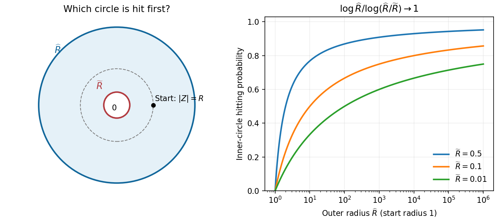

<h1 id="b/5/i/solution">Solution</h1>

↑ **Parent:** [I](../i.md)

First take the intended [annulus](../../../../../annulus-mathematics.md) configuration $0<\tilde R<R<\hat R$ with $R\geq1$. The first [stopping time](../../../../../stopping-time.md) is finite by the allowed fact, and [continuity](../../../../../continuous-function.md) gives $|Z_{H_R}|=R$. After $H_R$, the [annulus](../../../../../annulus-mathematics.md) exit time is bounded by the exit time of the outer [disc](../../../../../topological-disc.md), which is almost surely finite; use the [Strong Markov property](../../../../../strong-markov-property.md) at $H_R$. Thus $H_{R,\tilde R,\hat R}<\infty$ almost surely.

The function $\log|z|$ is [harmonic](../../../../../harmonic-function.md) on this [annulus](../../../../../annulus-mathematics.md). Its stopped value is a bounded [martingale](../../../../../martingale-split.md), so [optional stopping theorem](../../../../../optional-sampling-theorem-for-a-supermartingale.md) and [continuity](../../../../../continuous-function.md) give, if $p$ is the probability of hitting the inner circle first,

$$
\log R=p\log\tilde R+(1-p)\log\hat R.
$$

Consequently

$$
\boxed{p=\frac{\log(\hat R/R)}{\log(\hat R/\tilde R)}.}
$$

For fixed $\tilde R<1$, one may take $R=1$ and let $\hat R\to\infty$. The probability of hitting the inner circle before the outer one tends to one. The probability of ever hitting that inner circle is at least each of these probabilities, hence is one. Taking the countable intersection for $\tilde R=1/n$, $n\geq2$, proves **visits to balls of arbitrarily small radius almost surely**.

The source permits $R<1$ as well. Then $H_R=0$ and the actual starting radius for the next exit is one, rather than $R$. More generally put $s=\max(1,R)$. If $\hat R>s$, the answer for the literal definition is $\log(\hat R/s)/\log(\hat R/\tilde R)$. If $\hat R\leq s$, the infimum defining the next exit is already $H_R$ almost surely and the inner-circle probability is zero. Positive $\tilde R$ is implicit in an [annulus](../../../../../annulus-mathematics.md) and is necessary for the logarithmic calculation.

**[Figure 1](#b/5/i/image-logarithmic-annulus-hitting-probabilities-and-visits-to-arbitrarily-small-discs). Logarithmic annulus hitting probabilities and visits to arbitrarily small discs**.

## ↑ Ancestors (13)

1. [I](../i.md)
2. [5](../../5.md)
3. [B](../../../b.md)
4. [2007](../../../../2007-split.md)
5. [Past exam of the stochastic differential equations and Brownian motion in complex analysis course of the University of Oxford](../../../../split.md)
6. [Stochastic differential equations and Brownian motion in complex analysis course of the University of Oxford](../../../../../stochastic-differential-equations-and-brownian-motion-in-complex-analysis-course-of-the-university-of-oxford.md)
7. [Year 4 of the mathematics course of the University of Oxford](../../../../../year-4-of-the-mathematics-course-of-the-university-of-oxford.md)
8. [Mathematics course of the University of Oxford](../../../../../mathematics-course-of-the-university-of-oxford.md)
9. [Undergraduate course of the University of Oxford](../../../../../undergraduate-course-of-the-university-of-oxford.md)
10. [Course of the University of Oxford](../../../../../course-of-the-university-of-oxford.md)
11. [University of Oxford](../../../../../university-of-oxford-split.md)
12. [List of universities](../../../../../list-of-universities.md)
13. [Codex Wiki](../../../../../split.md)
