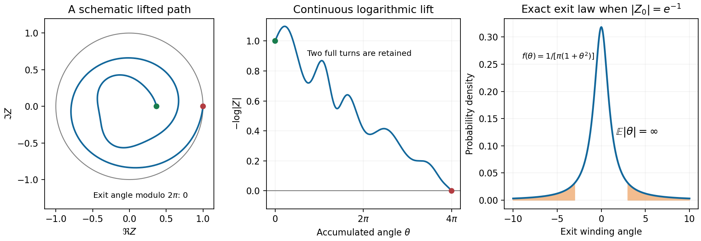

<h1 id="b/7/ii/solution">Solution</h1>

↑ **Parent:** [Ii](../ii.md)

Write $Z_0=r_0e^{i\alpha_0}$ with $0<r_0<1$ and choose its initial argument once. The exponential map in the source is a covering of the punctured [disc](../../../../../topological-disc.md), rather than a bijective map onto the full [disc](../../../../../topological-disc.md). Its pathwise inverse is the continuous lift

$$
W_t=-i\bigl(\log r_0+i\alpha_0+L_t\bigr)
=\alpha_0+\theta_t-i\log|Z_t|.
$$

For $t<T_{\mathbb D}$ this lies in the [upper half-plane](../../../../../upper-half-plane-complex-analysis.md), and at the [disc](../../../../../topological-disc.md) exit it lies on the real line. Local [conformal invariance of planar Brownian motion](../../../../../conformal-invariance-of-planar-brownian-motion.md), or the [quadratic variation](../../../../../quadratic-variation.md) of its analytic [derivative](../../../../../derivative.md) $-i/Z$, shows that $W_t$ is [planar Brownian motion](../../../../../planar-brownian-motion.md) run at the clock

$$
A_t=\int_0^t|Z_s|^{-2}ds.
$$

The [disc](../../../../../topological-disc.md) exit time is finite almost surely. The path avoids zero on the [compact](../../../../../compact-space.md) interval through its exit, so its minimum modulus there is positive and $A_{T_{\mathbb D}}<\infty$. Before this terminal clock time the lifted imaginary coordinate is positive, and at it the coordinate is zero. Hence it is exactly the upper-half-plane exit time of the time-changed [Brownian motion](../../../../../brownian-motion-split.md), not an additional arbitrary [stopping time](../../../../../stopping-time.md).

The starting point of the lift is $\alpha_0+ib$ with $b=-\log r_0>0$. Its real exit coordinate has [Cauchy distribution](../../../../../cauchy-distribution.md) $b/[\pi((s-\alpha_0)^2+b^2)]$. Since that coordinate is $\alpha_0+\theta_{T_{\mathbb D}}$, we obtain the stronger exact law

$$
\boxed{\theta_{T_{\mathbb D}}\ \sim\ \operatorname{Cauchy}(0,-\log|Z_0|).}
$$

Its first absolute moment diverges:

$$
\mathbb E|\theta_{T_{\mathbb D}}|
=\frac{2b}{\pi}\int_0^\infty\frac{s}{s^2+b^2}ds
=\boxed{\infty}.
$$

There is no contradiction with the terminal point lying on the [compact](../../../../../compact-space.md) [unit circle](../../../../../complex-unit-circle.md): reducing its argument modulo $2\pi$ loses the number and direction of turns accumulated before exit.

**[Figure 2](#b/7/ii/image-the-logarithmic-lift-and-the-cauchy-tail-of-the-accumulated-winding-angle). The logarithmic lift and the Cauchy tail of the accumulated winding angle**.

## ↑ Ancestors (13)

1. [Ii](../ii.md)
2. [7](../../7.md)
3. [B](../../../b.md)
4. [2007](../../../../2007-split.md)
5. [Past exam of the stochastic differential equations and Brownian motion in complex analysis course of the University of Oxford](../../../../split.md)
6. [Stochastic differential equations and Brownian motion in complex analysis course of the University of Oxford](../../../../../stochastic-differential-equations-and-brownian-motion-in-complex-analysis-course-of-the-university-of-oxford.md)
7. [Year 4 of the mathematics course of the University of Oxford](../../../../../year-4-of-the-mathematics-course-of-the-university-of-oxford.md)
8. [Mathematics course of the University of Oxford](../../../../../mathematics-course-of-the-university-of-oxford.md)
9. [Undergraduate course of the University of Oxford](../../../../../undergraduate-course-of-the-university-of-oxford.md)
10. [Course of the University of Oxford](../../../../../course-of-the-university-of-oxford.md)
11. [University of Oxford](../../../../../university-of-oxford-split.md)
12. [List of universities](../../../../../list-of-universities.md)
13. [Codex Wiki](../../../../../split.md)
