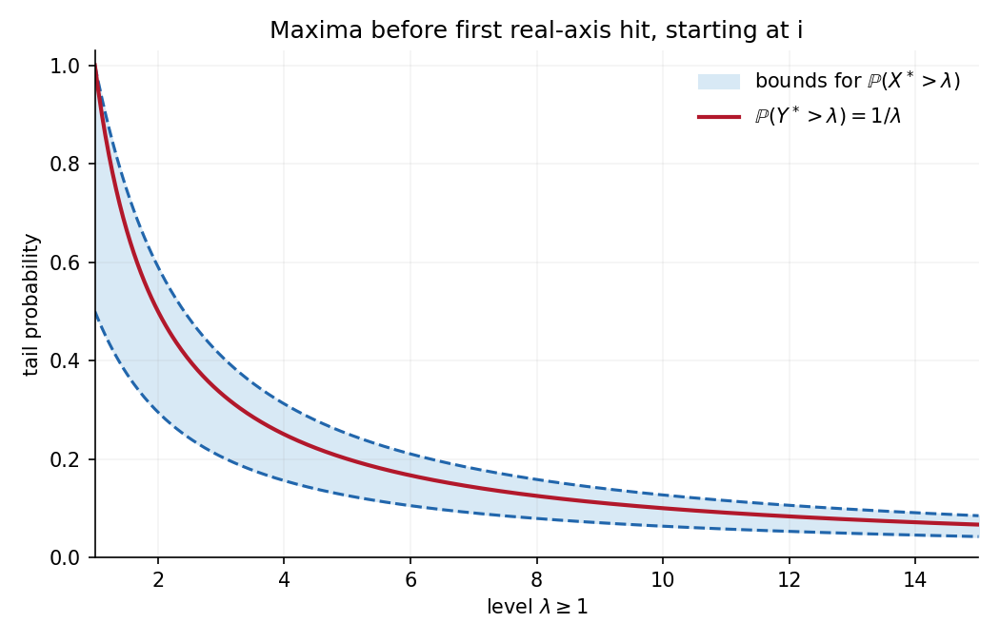
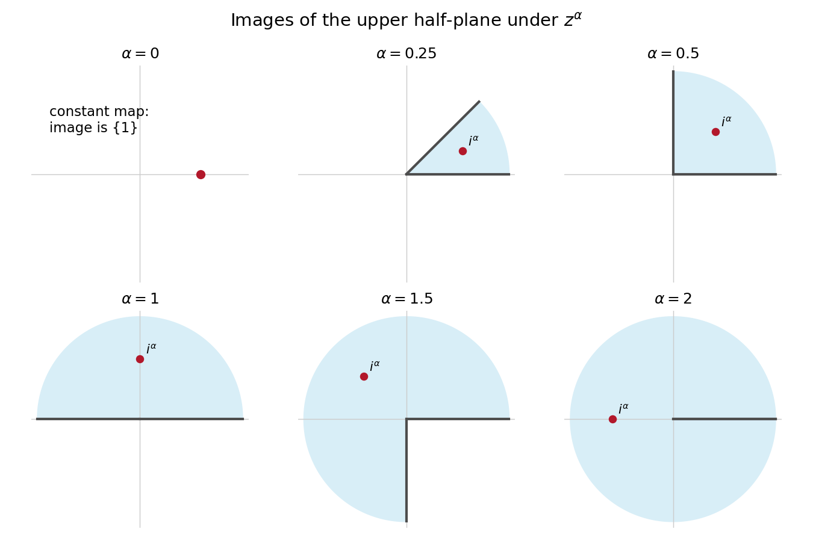

# 2008

↑ **Parent:** [Past exam of the stochastic differential equations and Brownian motion in complex analysis course of the University of Oxford](../past-exam-of-the-stochastic-differential-equations-and-brownian-motion-in-complex-analysis-course-of-the-university-of-oxford.md)

**Table of contents**

- [A](#a)
  - [1](#a/1)
    - [a](#a/1/a)
      - [Solution](#a/1/a/solution)
    - [b](#a/1/b)
      - [Solution](#a/1/b/solution)
    - [c](#a/1/c)
      - [Solution](#a/1/c/solution)
  - [2](#a/2)
    - [a](#a/2/a)
      - [Solution](#a/2/a/solution)
    - [b](#a/2/b)
      - [Solution](#a/2/b/solution)
    - [c](#a/2/c)
      - [Solution](#a/2/c/solution)
  - [3](#a/3)
    - [a](#a/3/a)
      - [Solution](#a/3/a/solution)
    - [b](#a/3/b)
      - [Solution](#a/3/b/solution)
    - [c](#a/3/c)
      - [Solution](#a/3/c/solution)
  - [4](#a/4)
    - [a](#a/4/a)
      - [Solution](#a/4/a/solution)
    - [b](#a/4/b)
      - [Solution](#a/4/b/solution)
    - [c](#a/4/c)
      - [Solution](#a/4/c/solution)
- [B](#b)
  - [5](#b/5)
    - [Solution](#b/5/solution)
  - [6](#b/6)
    - [i](#b/6/i)
      - [Solution](#b/6/i/solution)
    - [ii](#b/6/ii)
      - [Solution](#b/6/ii/solution)
  - [7](#b/7)
    - [Solution](#b/7/solution)
  - [8](#b/8)
    - [Solution](#b/8/solution)

## A

↑ **Parent:** [2008](2008.md)

<h3 id="a/1">1</h3>

↑ **Parent:** [A](#a)

<h4 id="a/1/a">a</h4>

↑ **Parent:** [1](#a/1)

<h5 id="a/1/a/solution">Solution</h5>

↑ **Parent:** [A](#a/1/a)

For a partition $0=t_0<\cdots<t_n=1$, approximate the integral by $X_\pi=\sum_jt_j(B_{t_{j+1}}-B_{t_j})$, using left endpoints. The defining independent [Brownian increment](../brownian-motion.md#brownian-increment) of [Brownian motion](../brownian-motion.md) make this a centered Gaussian variable with variance $\sum_jt_j^2(t_{j+1}-t_j)$. As the mesh tends to zero, that variance tends to $\int_0^1t^2dt=1/3$.

The [stochastic integral](../stochastic-calculus.md#stochastic-integral) is the [mean-square convergence](../convergence-of-random-variables.md#convergence-in-l2) of these sums. [mean-square convergence](../convergence-of-random-variables.md#convergence-in-l2) implies [convergence in distribution](../convergence-of-random-variables.md#convergence-in-distribution), while the [characteristic function](../characteristic-function.md) converge to $e^{-u^2/6}$. Hence

$$
\boxed{X\sim N(0,1/3),\qquad\mathbb P(X>0)=\frac12.}
$$

The [probability](../probability-theory.md#probability) is exactly one half because this centered nondegenerate [normal distribution](../probability-distribution.md#normal-distribution) is symmetric and has no atom at zero.

<h4 id="a/1/b">b</h4>

↑ **Parent:** [1](#a/1)

<h5 id="a/1/b/solution">Solution</h5>

↑ **Parent:** [B](#a/1/b)

Use a [filtration](../stochastic-process.md#filtration-probability-theory) with respect to which $B$ is Brownian. The process is adapted and continuous because it is a continuous function of $B_t$ and $t$. The [moment-generating function](../probability-distribution.md#moment-generating-function) gives

$$
\mathbb E M_t=1,\qquad
\mathbb E M_t^2
=e^{-\alpha^2t}\mathbb E e^{2\alpha B_t}
=e^{\alpha^2t}<\infty.
$$

For $0\leq s<t$, write

$$
M_t=M_s\exp\{\alpha(B_t-B_s)-\alpha^2(t-s)/2\}.
$$

The increment is independent of $\mathcal F_s$ and normal with variance $t-s$, so the [conditional expectation](../measure-theory.md#conditional-expectation) of the second factor is one. Thus

$$
\boxed{\mathbb E(M_t\mid\mathcal F_s)=M_s.}
$$

This verifies the [martingale](../martingale.md) property from the definition and proves square integrability at each finite time, as well as [continuity](../calculus.md#continuous-function). It does not assert uniform square integrability over an infinite time horizon.

<h4 id="a/1/c">c</h4>

↑ **Parent:** [1](#a/1)

<h5 id="a/1/c/solution">Solution</h5>

↑ **Parent:** [C](#a/1/c)

[Lévy's characterization of Brownian motion](../brownian-motion.md#levy-characterization-of-brownian-motion) states that a real continuous [local martingale](../martingale.md#local-martingale) $M$ with $M_0=0$ and [quadratic variation](../stochastic-calculus.md#quadratic-variation) $\langle M\rangle_t=t$ is a standard [Brownian motion](../brownian-motion.md) with respect to its [filtration](../stochastic-process.md#filtration-probability-theory). Equivalently, its increments are independent of the past and have centered [normal distribution](../probability-distribution.md#normal-distribution) with variances equal to elapsed times.

Let $H_s=\operatorname{sgn}(\sup_{r\leq s}B_r-1)$. The running maximum is continuous and adapted, so $H$ is bounded and [progressively measurable process](../stochastic-process.md#progressive-measurability). It has a predictable version for integration; changing its value at the single switching time does not change its [stochastic integral](../stochastic-calculus.md#stochastic-integral). Thus $X=\int H\,dB$ is a continuous [local martingale](../martingale.md#local-martingale) starting at zero. Since $H_s^2=1$,

$$
\langle X\rangle_t=\int_0^tH_s^2ds=t.
$$

[Lévy's characterization of Brownian motion](../brownian-motion.md#levy-characterization-of-brownian-motion) yields **$X$ is standard [Brownian motion](../brownian-motion.md)**. The sign depends on the entire past through the running maximum, but the unit quadratic-variation rate is exactly what the characterization needs.

<h3 id="a/2">2</h3>

↑ **Parent:** [A](#a)

<h4 id="a/2/a">a</h4>

↑ **Parent:** [2](#a/2)

<h5 id="a/2/a/solution">Solution</h5>

↑ **Parent:** [A](#a/2/a)

The [drift coefficient](../stochastic-calculus.md#drift-coefficient) $b(z)=rz$ and [diffusion coefficient](../brownian-motion.md#diffusion-coefficient) $a(z)=\sigma z$ are [Lipschitz continuity](../real-analysis.md#lipschitz-continuity) and have linear growth. The standard existence and [pathwise uniqueness](../stochastic-calculus.md#pathwise-uniqueness) theorem for [stochastic differential equations](../stochastic-calculus.md#stochastic-differential-equation) therefore supplies a unique global [strong solution of a stochastic differential equation](../stochastic-calculus.md#strong-solution-of-a-stochastic-differential-equation), adapted to the driving [Brownian filtration](../brownian-motion.md#brownian-filtration).

Apply [Itô's formula](../stochastic-calculus.md#ito-s-lemma) to $x\exp((r-\sigma^2/2)t+\sigma B_t)$. Its time derivative contributes $(r-\sigma^2/2)X_t$ and its Itô correction contributes $\sigma^2X_t/2$, giving the required equation and initial value. Hence

$$
\boxed{X_t=x e^{(r-\sigma^2/2)t+\sigma B_t}.}
$$

In particular the solution stays positive. For $t>s$, factor out $X_s$ and use [independence](../random-variable.md#independent-random-variables) and the normal law of $B_t-B_s$:

$$
\boxed{\mathbb E(X_t\mid\mathcal F_s^0)
=e^{r(t-s)}X_s.}
$$

The exponential moment exists, so this [conditional expectation](../measure-theory.md#conditional-expectation) is well-defined for every finite $s,t$.

<h4 id="a/2/b">b</h4>

↑ **Parent:** [2](#a/2)

<h5 id="a/2/b/solution">Solution</h5>

↑ **Parent:** [B](#a/2/b)

[Itô's formula](../stochastic-calculus.md#ito-s-lemma) identifies the [infinitesimal generator](../stochastic-process.md#infinitesimal-generator-stochastic-processes) on twice continuously differentiable functions:

$$
\boxed{(Lf)(z)=rzf'(z)+\tfrac12\sigma^2z^2f''(z).}
$$

Subtract the [drift coefficient](../stochastic-calculus.md#drift-coefficient) integral from that formula to obtain

$$
M_t^f=\int_0^t\sigma X_s f'(X_s)\,dB_s.
$$

Stopping when $|X|$ leaves a bounded interval makes the integrand bounded on each finite time interval. Therefore $M^f$ is a continuous [local martingale](../martingale.md#local-martingale). In fact $f'\in L^\infty$ and the [lognormal distribution](../probability-distribution.md#log-normal-distribution) solution has finite second moments on finite intervals, so here it is square integrable on each such interval as well.

The [quadratic covariation](../stochastic-calculus.md#quadratic-covariation) of two [stochastic integrals](../stochastic-calculus.md#stochastic-integral) against the same [Brownian motion](../brownian-motion.md) is the integral of the product of their integrands. Consequently

$$
\boxed{\langle M^f,M^g\rangle_t
=\sigma^2\int_0^tX_s^2 f'(X_s)g'(X_s)\,ds.}
$$

This is the [quadratic covariation](../stochastic-calculus.md#quadratic-covariation), which agrees with the pathwise [quadratic covariation](../stochastic-calculus.md#quadratic-covariation) for these continuous [local martingales](../martingale.md#local-martingale).

<h4 id="a/2/c">c</h4>

↑ **Parent:** [2](#a/2)

<h5 id="a/2/c/solution">Solution</h5>

↑ **Parent:** [C](#a/2/c)

Taking the logarithm of the explicit solution gives a linear function of the [normal random variable](../probability-distribution.md#gaussian-random-variable) $B_t$:

$$
\log X_t=\log x+(r-\sigma^2/2)t+\sigma B_t.
$$

Thus

$$
\boxed{X_t\sim\operatorname{Lognormal}
(\log x+(r-\sigma^2/2)t,\ \sigma^2t).}
$$

For $z>0$ its density is

$$
\frac1{z\sigma\sqrt{2\pi t}}
\exp\left[-\frac{(\log(z/x)-(r-\sigma^2/2)t)^2}
{2\sigma^2t}\right],
$$

and it is zero for $z\leq0$. The factor $1/z$ is the Jacobian of the logarithmic change of variable.

<h3 id="a/3">3</h3>

↑ **Parent:** [A](#a)

<h4 id="a/3/a">a</h4>

↑ **Parent:** [3](#a/3)

<h5 id="a/3/a/solution">Solution</h5>

↑ **Parent:** [A](#a/3/a)

Fix a finite horizon $T$ and use the completed [natural Brownian filtration](../brownian-motion.md#natural-brownian-filtration). [Martingale representation theorem](../brownian-motion.md#martingale-representation-theorem) states that every $F\in L^2(\mathcal F_T)$ can be written

$$
F=\mathbb EF+\int_0^T H_s\,dB_s,
\qquad \mathbb E\int_0^T H_s^2ds<\infty,
$$

where $H$ is predictable and is unique up to equality for $ds\,d\mathbb P$ almost every $(s,\omega)$.

The [Martingale representation theorem](../brownian-motion.md#martingale-representation-theorem) states that every [square-integrable martingale](../martingale.md#square-integrable-martingale) $M$ in this [filtration](../stochastic-process.md#filtration-probability-theory) has a continuous version of the form

$$
\boxed{M_t=M_0+\int_0^tH_s\,dB_s,\quad0\leq t\leq T,}
$$

with the same integrability and uniqueness condition. The completed natural [filtration](../stochastic-process.md#filtration-probability-theory) has only null-set randomness at time zero, so $M_0$ is almost surely constant. The first statement gives the second by representing $M_T$ and taking [conditional expectations](../measure-theory.md#conditional-expectation); the second gives the first by taking $M_t=\mathbb E(F\mid\mathcal F_t)$.

There is also the local version: every [local martingale](../martingale.md#local-martingale) in the [Brownian filtration](../brownian-motion.md#brownian-filtration) has a continuous version representable by a predictable, locally square-integrable integrand. The [filtration](../stochastic-process.md#filtration-probability-theory) restriction matters; an enlarged [filtration](../stochastic-process.md#filtration-probability-theory) with independent additional [martingales](../martingale.md) need not have representation using $B$ alone.

<h4 id="a/3/b">b</h4>

↑ **Parent:** [3](#a/3)

<h5 id="a/3/b/solution">Solution</h5>

↑ **Parent:** [B](#a/3/b)

For $f(z)=\sin z$, $f'(z)=\cos z$ and $f''(z)=-\sin z$. [Itô's formula](../stochastic-calculus.md#ito-s-lemma) gives

$$
d\sin(B_t)=\cos(B_t)\,dB_t-\tfrac12\sin(B_t)\,dt.
$$

Since $B_0=0$, this is exactly

$$
\boxed{dX_t=\cos B_t\,dB_t-\tfrac12X_t\,dt,\qquad X_0=0.}
$$

The integrand retains $\cos B_t$; replacing it by a fixed sign of $\sqrt{1-X_t^2}$ would lose information about the phase of $B_t$.

<h4 id="a/3/c">c</h4>

↑ **Parent:** [3](#a/3)

<h5 id="a/3/c/solution">Solution</h5>

↑ **Parent:** [C](#a/3/c)

Condition on the Brownian path up to $t\leq T$. The independent normal increment $B_T-B_t$ has $\mathbb E\cos(B_T-B_t)=e^{-(T-t)/2}$ and zero expected sine. Hence

$$
M_t:=\mathbb E(\sin B_T\mid\mathcal F_t)
=e^{-(T-t)/2}\sin B_t.
$$

Apply [Itô's formula](../stochastic-calculus.md#ito-s-lemma) to this expression. Its time derivative and second spatial derivative cancel, leaving

$$
dM_t=e^{-(T-t)/2}\cos B_t\,dB_t,\qquad M_0=0.
$$

Therefore the required representation is

$$
\boxed{\sin B_T=\int_0^T e^{-(T-s)/2}\cos B_s\,dB_s.}
$$

The bounded integrand is square integrable, and uniqueness follows from the [Itô isometry](../stochastic-calculus.md#ito-isometry). The drift-containing decomposition in part (b) alone would not be the required representation as a constant plus one [stochastic integral](../stochastic-calculus.md#stochastic-integral).

<h3 id="a/4">4</h3>

↑ **Parent:** [A](#a)

<h4 id="a/4/a">a</h4>

↑ **Parent:** [4](#a/4)

<h5 id="a/4/a/solution">Solution</h5>

↑ **Parent:** [A](#a/4/a)

Apply [Itô's formula](../stochastic-calculus.md#ito-s-lemma) to $M_t=e^{N_t-\langle N\rangle_t/2}$. The quadratic-variation correction cancels the finite-variation term:

$$
dM_t=M_t\,dN_t,\qquad M_0=1.
$$

Localization of the integrand proves that $M$ is a nonnegative continuous [local martingale](../martingale.md#local-martingale).

For completeness, [Conditional Fatou lemma](../measure-theory.md#conditional-fatou-lemma) says that for nonnegative [random variables](../random-variable.md) $Y_n$,

$$
\mathbb E(\liminf Y_n\mid\mathcal F_s)
\leq\liminf\mathbb E(Y_n\mid\mathcal F_s).
$$

Choose a [localizing sequence](../martingale.md#localizing-sequence) $\tau_n\uparrow\infty$ such that each stopped $M$ is a [martingale](../martingale.md). Fatou first gives $\mathbb EM_t\leq1$. For $s<t$, its conditional form then gives

$$
\mathbb E(M_t\mid\mathcal F_s)
\leq\liminf_n M_{s\wedge\tau_n}=M_s.
$$

Thus **$M$ is a [supermartingale](../martingale.md#supermartingale)**.

A sufficient condition for it to be a true [martingale](../martingale.md) on $[0,T]$ is [Novikov's condition](../stochastic-calculus.md#novikov-s-condition)

$$
\boxed{\mathbb E\exp(\tfrac12\langle N\rangle_T)<\infty.}
$$

Under this condition the [stochastic exponential](../stochastic-calculus.md#doleans-dade-exponential) is a uniformly integrable [martingale](../martingale.md) on that finite interval. Requiring it for every finite $T$ gives the [martingale](../martingale.md) property at all finite times; it does not automatically give [uniform integrability](../convergence-of-random-variables.md#uniform-integrability) as $t\to\infty$.

<h4 id="a/4/b">b</h4>

↑ **Parent:** [4](#a/4)

<h5 id="a/4/b/solution">Solution</h5>

↑ **Parent:** [B](#a/4/b)

For $s<t<1$, [independence](../random-variable.md#independent-random-variables) and the Gaussian [Brownian transition density](../brownian-motion.md#brownian-transition-density) yield the [Chapman-Kolmogorov equation](../markov-process.md#chapman-kolmogorov-equation)

$$
\mathbb E[p(1-t,B_t,y)\mid\mathcal F_s]
=\int_{\mathbb R}p(t-s,B_s,z)p(1-t,z,y)\,dz
=p(1-s,B_s,y).
$$

The numerator is positive and its expectation is $p(1,0,y)$, so

$$
\boxed{M_0=1,\quad\mathbb EM_t=1,\quad
\mathbb E(M_t\mid\mathcal F_s)=M_s.}
$$

These statements hold for every $t<1$, in particular on the specified closed interval $[0,T]$.

The function $h(t,z)=p(1-t,z,y)$ solves the [backward heat equation](../diffusion-equation.md#backward-heat-equation) $h_t+\tfrac12h_{zz}=0$. [Itô's formula](../stochastic-calculus.md#ito-s-lemma) therefore gives

$$
dM_t=M_t\theta_t\,dB_t,\qquad
\theta_t=\frac{\partial}{\partial x}\log p(1-t,B_t,y)
=\frac{y-B_t}{1-t}.
$$

On each interval ending before one this adapted continuous integrand is locally square integrable. Thus

$$
\boxed{N_t=\int_0^t\frac{y-B_s}{1-s}\,dB_s,\qquad
\langle N\rangle_t=\int_0^t\frac{(y-B_s)^2}{(1-s)^2}\,ds}
$$

gives $M_t=\exp(N_t-\langle N\rangle_t/2)$. This also follows by applying [Itô's formula](../stochastic-calculus.md#ito-s-lemma) to $\log M_t$. The source's notation $t\geq0$ for this density process is restricted by its defining formula to $t<1$.

<h4 id="a/4/c">c</h4>

↑ **Parent:** [4](#a/4)

<h5 id="a/4/c/solution">Solution</h5>

↑ **Parent:** [C](#a/4/c)

A finite-horizon form of [Girsanov theorem](../stochastic-calculus.md#girsanov-theorem) is as follows. If $\theta$ is predictable, $\int_0^T\theta_s^2ds<\infty$ almost surely, and its [stochastic exponential](../stochastic-calculus.md#doleans-dade-exponential) $M$ is a true [martingale](../martingale.md) of mean one, then under the [probability](../probability-theory.md#probability) $d\mathbb Q=M_Td\mathbb P$ the process

$$
B_t-\int_0^t\theta_sds,\qquad0\leq t\leq T,
$$

is [Brownian motion](../brownian-motion.md). The same conclusion holds on the completed natural [filtration](../stochastic-process.md#filtration-probability-theory), since a strictly positive density gives equivalent probabilities.

Part (b) establishes precisely the required density [martingale](../martingale.md) and integrand $\theta_s=\partial_x\log p(1-s,B_s,y)$. Therefore

$$
\boxed{X_t=B_t-\int_0^t\frac{y-B_s}{1-s}\,ds
\text{ is }\mathbb Q\text{-Brownian on }[0,T].}
$$

In particular it is the requested [local martingale](../martingale.md#local-martingale). Equivalently, under $\mathbb Q$, $B$ solves $dB_t=(y-B_t)(1-t)^{-1}dt+dX_t$, the [Brownian bridge](../brownian-motion.md#brownian-bridge) [drift coefficient](../stochastic-calculus.md#drift-coefficient) toward $y$ at time one. Keeping $T<1$ avoids the singular endpoint in this density change.

<h2 id="b">B</h2>

↑ **Parent:** [2008](2008.md)

<h3 id="b/5">5</h3>

↑ **Parent:** [B](#b)

<h4 id="b/5/solution">Solution</h4>

↑ **Parent:** [5](#b/5)

Write $Z=X+iY$, with $Y$ a real [Brownian motion](../brownian-motion.md) started at one. For the nontrivial strip calculation assume $r>1$, so the starting point is in its interior. The first exit time is

$$
T_S=\inf\{t\geq0:Z_t\notin S\}.
$$

For a continuous Brownian path started inside, this equals the first hitting time of $Y=0$ or $Y=r$ almost surely: [Brownian motion](../brownian-motion.md) started at a boundary immediately visits the exterior, so using the closed strip in the definition does not change the infimum.

If $T_S>n$, then $Y_n\in[0,r]$. Its normal density is bounded by $(2\pi n)^{-1/2}$, hence

$$
\mathbb P(T_S>n)\leq\mathbb P(0\leq Y_n\leq r)
\leq\frac r{\sqrt{2\pi n}}\longrightarrow0.
$$

Thus the exit time is finite almost surely.

The stopped harmonic coordinate $Y_{t\wedge T_S}$ is a [martingale](../martingale.md) bounded between zero and $r$. [bounded convergence theorem](../measure-theory.md#bounded-convergence-theorem) and [optional stopping theorem](../martingale.md#optional-sampling-theorem-for-a-supermartingale) give $\mathbb EY_{T_S}=Y_0=1$. Since the exit coordinate is zero or $r$,

$$
\boxed{\mathbb P(Y_{T_S}=r)=\frac1r,\qquad
\mathbb P(Y_{T_S}=0)=1-\frac1r.}
$$

If $T$ is the first hit of the real axis, exit through the lower boundary implies $T<\infty$, so $\mathbb P(T<\infty)\geq1-1/r$ for every $r>1$. Letting $r\to\infty$ proves

$$
\boxed{\mathbb P(T<\infty)=1.}
$$

The strip assumption is worth making explicit: at $r=1$ the initial point is the upper boundary and exit is immediate; for $0<r<1$ it starts outside the strip and the displayed interior probabilities do not apply.

<h3 id="b/6">6</h3>

↑ **Parent:** [B](#b)

<h4 id="b/6/i">i</h4>

↑ **Parent:** [6](#b/6)

<h5 id="b/6/i/solution">Solution</h5>

↑ **Parent:** [I](#b/6/i)

An analytic function is an [entire function](../holomorphic-function.md#entire-function) when it is **holomorphic on the whole complex plane**. Thus every finite complex point has a neighborhood on which the function is complex differentiable; there is no finite singularity. [polynomials](../polynomial.md) and the exponential are entire, whereas $1/z$ is not.

<h4 id="b/6/ii">ii</h4>

↑ **Parent:** [6](#b/6)

<h5 id="b/6/ii/solution">Solution</h5>

↑ **Parent:** [Ii](#b/6/ii)

[planar Brownian motion](../brownian-motion.md#planar-brownian-motion) is [recurrence of planar Brownian motion](../brownian-motion.md#recurrence-of-planar-brownian-motion) when, almost surely, it returns to every nonempty open neighborhood infinitely often, at arbitrarily large times. This does not mean that it hits each specified point; a prescribed point is polar for [planar Brownian motion](../brownian-motion.md#planar-brownian-motion).

[recurrence of planar Brownian motion](../brownian-motion.md#recurrence-of-planar-brownian-motion) and [continuity](../calculus.md#continuous-function) imply that all the circle-hitting times $S_k,T_k$ in the question are finite. Starting on radius $\epsilon$, it eventually visits the exterior of radius $2\epsilon$ and must cross that circle; it later visits the interior of radius $\epsilon$ and must cross back. Each duration $\Delta_k=T_k-S_k$ is strictly positive by path [continuity](../calculus.md#continuous-function), because the two radii are separated.

At $S_k$, the [Strong Markov property](../markov-chain.md#strong-markov-property) restarts [Brownian motion](../brownian-motion.md) at its current point on the inner circle. [rotational invariance of Brownian motion](../brownian-motion.md#rotational-invariance-of-brownian-motion) makes the law of the subsequent first exit time from the radius-$2\epsilon$ disk independent of that starting angle. Its conditional distribution given the past is therefore the same fixed law at every cycle, proving that the $\Delta_k$ are independent and identically distributed.

To prove divergence of the conformal clock for any nonconstant entire $f$, choose a point $z_0$ with $f'(z_0)\neq0$. By [continuity](../calculus.md#continuous-function), there exist $\rho,c>0$ such that $|f'(z)|^2\geq c$ throughout the closed disk $|z-z_0|\leq2\rho$. Use the same [recurrence of planar Brownian motion](../brownian-motion.md#recurrence-of-planar-brownian-motion) circle cycles centered at $z_0$, with radii $\rho,2\rho$. On each segment from the inner circle to the outer circle, the path remains in that disk, giving

$$
\int_0^\infty|f'(Z_s)|^2ds
\geq c\sum_{k\geq0}(T_k-S_k).
$$

The durations are positive iid variables. If their mean has not been computed, apply the [strong law of large numbers](../convergence-of-random-variables.md#strong-law-of-large-numbers) to the bounded iid variables $\min(\Delta_k,1)$: their mean is strictly positive, so their sum, and hence $\sum\Delta_k$, diverges almost surely. Therefore

$$
\boxed{\int_0^\infty|f'(Z_s)|^2ds=\infty\quad\text{almost surely}.}
$$

Centering the disks at a noncritical point avoids an unjustified positive lower bound on $|f'|$ around the original origin.

Write $f=u+iv$. Harmonicity and [Itô's formula](../stochastic-calculus.md#ito-s-lemma) make $u(Z_t),v(Z_t)$ continuous [local martingales](../martingale.md#local-martingale). The [Cauchy-Riemann equations](../analysis.md#cauchy-riemann-equations) give equal brackets $\int_0^t|f'(Z_s)|^2ds$ and zero mutual bracket. Consequently [Lévy's characterization of Brownian motion](../brownian-motion.md#levy-characterization-of-brownian-motion) after [time change of a continuous process](../stochastic-process.md#time-change-of-a-continuous-process) makes $W$ a [planar Brownian motion](../brownian-motion.md#planar-brownian-motion) started at $f(Z_0)$, with no finite clock lifetime because the clock just proved is unbounded. The clock is strictly increasing: otherwise $f'$ would vanish along a nonconstant path interval, contradicting its isolated zeros.

For the notation in the source, $|\nabla f|^2$ is interpreted as the conformal scale $|f'|^2=|\nabla u|^2=|\nabla v|^2$. If it instead means the sum of the squared magnitudes of both complex coordinate derivatives, it is $2|f'|^2$, and the resulting $W$ runs at half the usual Brownian speed. This convention does not change divergence of the integral. The mechanism is [recurrent disk occupation makes an entire conformal clock infinite](../brownian-motion.md#recurrent-disk-occupation-makes-an-entire-conformal-clock-infinite).

<h3 id="b/7">7</h3>

↑ **Parent:** [B](#b)

<h4 id="b/7/solution">Solution</h4>

↑ **Parent:** [7](#b/7)

Take $\lambda>0$ and let $\sigma_\lambda$ be the first time $X$ hits $\lambda$. Reflect the horizontal coordinate after $\sigma_\lambda$, leaving the vertical coordinate unchanged. The [Strong Markov property](../markov-chain.md#strong-markov-property) and symmetry preserve the law of [planar Brownian motion](../brownian-motion.md#planar-brownian-motion) and leave its real-axis exit time unchanged. On paths with $\sigma_\lambda<\tau$, the reflection swaps the two terminal events $X_\tau<\lambda$ and $X_\tau>\lambda$. There is no terminal atom at $\lambda$. Hence the [Brownian reflection principle](../brownian-motion.md#reflection-principle-wiener-process) gives

$$
\mathbb P_i\!\left(\sup_{t\leq\tau}X_t>\lambda\right)
=2\mathbb P_i(X_\tau>\lambda)
=\boxed{\frac2\pi\int_\lambda^\infty\frac{dx}{1+x^2}.}
$$

Horizontal symmetry gives the same [probability](../probability-theory.md#probability) for $-\inf X>\lambda$. A union bound therefore yields

$$
\boxed{\mathbb P_i(X^*>\lambda)
\leq\frac4\pi\int_\lambda^\infty\frac{dx}{1+x^2}.}
$$

Also $X^*\geq|X_\tau|$, whose [Cauchy distribution](../probability-distribution.md#cauchy-distribution) is $2\pi^{-1}\int_\lambda^\infty(1+x^2)^{-1}dx$. Thus the maximum tail is bounded above and below by positive constants times $\lambda^{-1}$ for large $\lambda$. The [tail integral formula for moments](../expected-value.md#tail-integral-formula-for-moments) for positive moments gives

$$
\mathbb E(X^*)^p=p\int_0^\infty
\lambda^{p-1}\mathbb P(X^*>\lambda)d\lambda.
$$

The large-$\lambda$ integral is finite exactly when $0<p<1$; it diverges for $p\geq1$. Near zero its upper bound by $\int_0^1p\lambda^{p-1}d\lambda$ is finite.

The vertical coordinate remains nonnegative up to exit and starts at one. The strip calculation, now with upper boundary $\lambda\geq1$, gives

$$
\mathbb P(Y^*>\lambda)=\frac1\lambda.
$$

Thus $Y^*$ has density $\lambda^{-2}$ on $[1,\infty)$, and in fact

$$
\boxed{\mathbb E(Y^*)^p=\frac1{1-p}\ (p<1),\qquad
\mathbb E(Y^*)^p=\infty\ (p\geq1).}
$$

For completeness, if the source's $p<1$ includes negative powers, $X^*$ also has all negative moments. Let $\sigma_\eta$ be the first horizontal exit from $(-\eta,\eta)$. Then

$$
\mathbb P(X^*\leq\eta)
\leq\mathbb P(\tau\leq\eta)+\mathbb P(\sigma_\eta\geq\eta)
\leq C e^{-c/\eta}\quad(0<\eta\ll1).
$$

The first bound follows from the Gaussian reflection bound for the vertical hit of zero; the second follows by splitting time into blocks of length $\eta^2$, each having a fixed positive chance of exiting the horizontal interval. This small-value estimate integrates against every negative power. At $p=0$ both moments equal one.

**[Figure 1](#b/7/image-the-vertical-maximum-has-an-exact-inverse-height-tail-while-the-horizontal-maximum-has-comparable-cauchy-tails). The vertical maximum has an exact inverse-height tail while the horizontal maximum has comparable Cauchy tails**.

<h3 id="b/8">8</h3>

↑ **Parent:** [B](#b)

<h4 id="b/8/solution">Solution</h4>

↑ **Parent:** [8](#b/8)

For $0<\alpha<2$, write $z=re^{i\theta}$ with $0<\theta<\pi$. The chosen power map sends this to $r^\alpha e^{i\alpha\theta}$, so

$$
\boxed{D=\{re^{i\theta}:r>0,\ 0<\theta<\alpha\pi\}.}
$$

At $\alpha=2$ this is the plane slit along the nonnegative real axis. For every $0<\alpha\leq2$, the map is conformal on the upper half-plane.

To check finiteness of the physical exit time, start a [Brownian motion](../brownian-motion.md) $B$ at $i$ and let $T$ be its real-axis exit. The [time change of a continuous process](../stochastic-process.md#time-change-of-a-continuous-process) in [conformal invariance of planar Brownian motion](../brownian-motion.md#conformal-invariance-of-planar-brownian-motion) is

$$
A_T=\int_0^T\alpha^2|B_s|^{2\alpha-2}ds.
$$

We know $T<\infty$ almost surely. The [Cauchy exit law from a Brownian half-plane](../brownian-motion.md#cauchy-exit-law-from-a-brownian-half-plane) assigns [probability](../probability-theory.md#probability) zero to $B_T=0$. On such a path, $B_s\neq0$ throughout the compact interval $[0,T]$, because it is in the open upper half-plane before exit and has nonzero endpoint. Its modulus therefore has a positive minimum and finite maximum. The displayed integrand is bounded on that interval, proving $A_T<\infty$. The image [Brownian motion](../brownian-motion.md) exits $D$ at this finite changed time.

The endpoint $\alpha=0$ printed in the source is degenerate: $z^0=1$, so its image is the singleton $\{1\}$, not an open domain, and the map is not conformal. If exit from that set is defined for [Brownian motion](../brownian-motion.md) started at one, its exit infimum is zero. It cannot be included in a nondegenerate conformal-domain argument.

Here is the [martingale](../martingale.md) argument for maximal comparisons, including the starting-value issue. For $P=f+ig$, the [Cauchy-Riemann equations](../analysis.md#cauchy-riemann-equations) and [Itô's formula](../stochastic-calculus.md#ito-s-lemma) show that

$$
F_t=f(Z_{t\wedge\tau})-f(i^\alpha),\qquad
G_t=g(Z_{t\wedge\tau})-g(i^\alpha)
$$

are orthogonal continuous [local martingales](../martingale.md#local-martingale) with the same [quadratic variation](../stochastic-calculus.md#quadratic-variation). Localize before large disks and before exit. The [Burkholder-Davis-Gundy inequalities](../martingale.md#burkholder-davis-gundy-inequalities) then give

$$
\mathbb E(G^*)^p\leq C_p\mathbb E(F^*)^p,\qquad p>1,
$$

with a constant depending only on $p$; [Fatou's lemma](../measure-theory.md#fatou-s-lemma) removes the localization. These are centered [martingales](../martingale.md). For the uncentered processes this implies

$$
\mathbb E\sup|g(Z_t)|^p
\leq C_p'\bigl(\mathbb E\sup|f(Z_t)|^p+|g(i^\alpha)|^p\bigr),
$$

since $|f(i^\alpha)|\leq\sup|f(Z_t)|$.

The source normalizes $P(0)=0$ at a boundary point, rather than the value of $g$ at the starting point. Consequently its displayed constant cannot be uniform in $\alpha$ with only $p$ dependence. To see this, take $P(z)=iz$ and $0<\alpha<\min(1/2,1/p)$. Then $f=-\operatorname{Im}z$ and $g=\operatorname{Re}z$. Inside this narrow wedge,

$$
\sup|f(Z_t)|\leq\tan(\alpha\pi)\sup|g(Z_t)|.
$$

Both $p$th moments are finite and the right one is positive; finiteness follows from the wedge radial-maximum tail of order $R^{-1/\alpha}$, justified below. The source inequality would force $C_p\geq\cot^p(\alpha\pi)$, unbounded as $\alpha\downarrow0$. At $\alpha=0$, the immediate-exit interpretation gives the direct contradiction $1\leq C_p\,0$ for the same [polynomial](../polynomial.md).

For a fixed nondegenerate wedge, an uncentered inequality does hold with a constant allowed to depend on $\alpha$ as well as $p$. One rigorous outline for the [polynomial](../polynomial.md) class in this question is as follows. Separation of variables in a sector of radius $R$ gives, for exit through its circular arc, the expansion

$$
\mathbb P_{re^{i\theta}}(\text{hit radius }R\text{ before the sides})
=\frac4\pi\sum_{\substack{n\geq1\\n\ {\rm odd}}}
\frac1n(r/R)^{n/\alpha}\sin(n\theta/\alpha).
$$

Thus at the specified starting point the radial-maximum tail is comparable to $R^{-1/\alpha}$. Hitting any fixed interior subarc has that same power, with positive leading coefficient. If a nonzero [polynomial](../polynomial.md) has degree $d$, its [real part](../complex-analysis.md#real-part) has magnitude at least $cR^d$ on some fixed interior subarc for sufficiently large $R$. Therefore its maximal real-part $p$th moment is infinite whenever $dp\geq1/\alpha$. In that case the desired extended-real inequality is automatic.

The remaining [polynomials](../polynomial.md) have $d<1/(\alpha p)$, so belong to a [finite-dimensional vector space](../vector-space.md#finite-dimensional-vector-space) space. On that space

$$
P\longmapsto\left(\mathbb E\sup|f(Z_t)|^p\right)^{1/p}
$$

is a genuine [norm](../normed-vector-space.md#norm): if it is zero, [Brownian motion](../brownian-motion.md)'s positive [probability](../probability-theory.md#probability) of reaching any interior neighborhood forces $\operatorname{Re}P=0$ throughout $D$, so analyticity makes $P$ a purely imaginary constant, and $P(0)=0$ makes it zero. The corresponding imaginary-part functional is bounded on this [finite-dimensional vector space](../vector-space.md#finite-dimensional-vector-space) normed space; its finiteness follows from $dp<1/\alpha$ and the radial tail bound. [equivalence of norms in finite dimensions](../topological-vector-space.md#equivalence-of-norms-in-finite-dimensions) gives

$$
\boxed{\mathbb E\sup|g(Z_t)|^p
\leq C_{p,\alpha}\mathbb E\sup|f(Z_t)|^p
\quad(0<\alpha\leq2).}
$$

This establishes the fixed-domain interpretation and identifies exactly why the universal centered [martingale](../martingale.md) inequality cannot silently be applied to the printed uncentered boundary normalization. It is the distinction in [starting-value obstruction in wedge conjugate maximal inequalities](../martingale.md#starting-value-obstruction-in-wedge-conjugate-maximal-inequalities).

**[Figure 2](#b/8/image-the-power-map-changes-the-wedge-angle-and-degenerates-to-a-constant-at-zero-exponent). The power map changes the wedge angle and degenerates to a constant at zero exponent**.

## ↑ Ancestors (9)

1. [Past exam of the stochastic differential equations and Brownian motion in complex analysis course of the University of Oxford](../past-exam-of-the-stochastic-differential-equations-and-brownian-motion-in-complex-analysis-course-of-the-university-of-oxford.md)
2. [Stochastic differential equations and Brownian motion in complex analysis course of the University of Oxford](../university-of-oxford.md#stochastic-differential-equations-and-brownian-motion-in-complex-analysis-course-of-the-university-of-oxford)
3. [Year 4 of the mathematics course of the University of Oxford](../university-of-oxford.md#year-4-of-the-mathematics-course-of-the-university-of-oxford)
4. [Mathematics course of the University of Oxford](../university-of-oxford.md#mathematics-course-of-the-university-of-oxford)
5. [Undergraduate course of the University of Oxford](../university-of-oxford.md#undergraduate-course-of-the-university-of-oxford)
6. [Course of the University of Oxford](../university-of-oxford.md#course-of-the-university-of-oxford)
7. [University of Oxford](../university-of-oxford.md)
8. [List of universities](../README.md#list-of-universities)
9. [Codex Wiki](../README.md)
