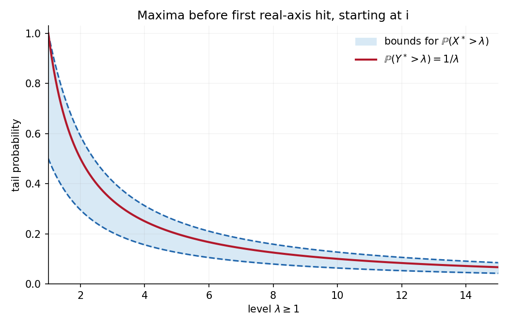

<h1 id="b/7/solution">Solution</h1>

↑ **Parent:** [7](../7.md)

Take $\lambda>0$ and let $\sigma_\lambda$ be the first time $X$ hits $\lambda$. Reflect the horizontal coordinate after $\sigma_\lambda$, leaving the vertical coordinate unchanged. The [Strong Markov property](../../../../strong-markov-property.md) and symmetry preserve the law of [planar Brownian motion](../../../../planar-brownian-motion.md) and leave its real-axis exit time unchanged. On paths with $\sigma_\lambda<\tau$, the reflection swaps the two terminal events $X_\tau<\lambda$ and $X_\tau>\lambda$. There is no terminal atom at $\lambda$. Hence the [Brownian reflection principle](../../../../reflection-principle-wiener-process.md) gives

$$
\mathbb P_i\!\left(\sup_{t\leq\tau}X_t>\lambda\right)
=2\mathbb P_i(X_\tau>\lambda)
=\boxed{\frac2\pi\int_\lambda^\infty\frac{dx}{1+x^2}.}
$$

Horizontal symmetry gives the same [probability](../../../../probability.md) for $-\inf X>\lambda$. A union bound therefore yields

$$
\boxed{\mathbb P_i(X^*>\lambda)
\leq\frac4\pi\int_\lambda^\infty\frac{dx}{1+x^2}.}
$$

Also $X^*\geq|X_\tau|$, whose [Cauchy distribution](../../../../cauchy-distribution.md) is $2\pi^{-1}\int_\lambda^\infty(1+x^2)^{-1}dx$. Thus the maximum tail is bounded above and below by positive constants times $\lambda^{-1}$ for large $\lambda$. The [tail integral formula for moments](../../../../tail-integral-formula-for-moments.md) for positive moments gives

$$
\mathbb E(X^*)^p=p\int_0^\infty
\lambda^{p-1}\mathbb P(X^*>\lambda)d\lambda.
$$

The large-$\lambda$ integral is finite exactly when $0<p<1$; it diverges for $p\geq1$. Near zero its upper bound by $\int_0^1p\lambda^{p-1}d\lambda$ is finite.

The vertical coordinate remains nonnegative up to exit and starts at one. The strip calculation, now with upper boundary $\lambda\geq1$, gives

$$
\mathbb P(Y^*>\lambda)=\frac1\lambda.
$$

Thus $Y^*$ has density $\lambda^{-2}$ on $[1,\infty)$, and in fact

$$
\boxed{\mathbb E(Y^*)^p=\frac1{1-p}\ (p<1),\qquad
\mathbb E(Y^*)^p=\infty\ (p\geq1).}
$$

For completeness, if the source's $p<1$ includes negative powers, $X^*$ also has all negative moments. Let $\sigma_\eta$ be the first horizontal exit from $(-\eta,\eta)$. Then

$$
\mathbb P(X^*\leq\eta)
\leq\mathbb P(\tau\leq\eta)+\mathbb P(\sigma_\eta\geq\eta)
\leq C e^{-c/\eta}\quad(0<\eta\ll1).
$$

The first bound follows from the Gaussian reflection bound for the vertical hit of zero; the second follows by splitting time into blocks of length $\eta^2$, each having a fixed positive chance of exiting the horizontal interval. This small-value estimate integrates against every negative power. At $p=0$ both moments equal one.

**[Figure 1](#b/7/image-the-vertical-maximum-has-an-exact-inverse-height-tail-while-the-horizontal-maximum-has-comparable-cauchy-tails). The vertical maximum has an exact inverse-height tail while the horizontal maximum has comparable Cauchy tails**.

## ↑ Ancestors (12)

1. [7](../7.md)
2. [B](../../b.md)
3. [2008](../../../2008-split.md)
4. [Past exam of the stochastic differential equations and Brownian motion in complex analysis course of the University of Oxford](../../../split.md)
5. [Stochastic differential equations and Brownian motion in complex analysis course of the University of Oxford](../../../../stochastic-differential-equations-and-brownian-motion-in-complex-analysis-course-of-the-university-of-oxford.md)
6. [Year 4 of the mathematics course of the University of Oxford](../../../../year-4-of-the-mathematics-course-of-the-university-of-oxford.md)
7. [Mathematics course of the University of Oxford](../../../../mathematics-course-of-the-university-of-oxford.md)
8. [Undergraduate course of the University of Oxford](../../../../undergraduate-course-of-the-university-of-oxford.md)
9. [Course of the University of Oxford](../../../../course-of-the-university-of-oxford.md)
10. [University of Oxford](../../../../university-of-oxford-split.md)
11. [List of universities](../../../../list-of-universities.md)
12. [Codex Wiki](../../../../split.md)
