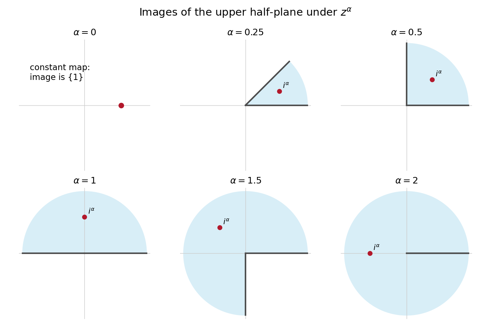

<h1 id="b/8/solution">Solution</h1>

↑ **Parent:** [8](../8.md)

For $0<\alpha<2$, write $z=re^{i\theta}$ with $0<\theta<\pi$. The chosen power map sends this to $r^\alpha e^{i\alpha\theta}$, so

$$
\boxed{D=\{re^{i\theta}:r>0,\ 0<\theta<\alpha\pi\}.}
$$

At $\alpha=2$ this is the plane slit along the nonnegative real axis. For every $0<\alpha\leq2$, the map is conformal on the upper half-plane.

To check finiteness of the physical exit time, start a [Brownian motion](../../../../brownian-motion-split.md) $B$ at $i$ and let $T$ be its real-axis exit. The [time change of a continuous process](../../../../time-change-of-a-continuous-process.md) in [conformal invariance of planar Brownian motion](../../../../conformal-invariance-of-planar-brownian-motion.md) is

$$
A_T=\int_0^T\alpha^2|B_s|^{2\alpha-2}ds.
$$

We know $T<\infty$ almost surely. The [Cauchy exit law from a Brownian half-plane](../../../../cauchy-exit-law-from-a-brownian-half-plane.md) assigns [probability](../../../../probability.md) zero to $B_T=0$. On such a path, $B_s\neq0$ throughout the compact interval $[0,T]$, because it is in the open upper half-plane before exit and has nonzero endpoint. Its modulus therefore has a positive minimum and finite maximum. The displayed integrand is bounded on that interval, proving $A_T<\infty$. The image [Brownian motion](../../../../brownian-motion-split.md) exits $D$ at this finite changed time.

The endpoint $\alpha=0$ printed in the source is degenerate: $z^0=1$, so its image is the singleton $\{1\}$, not an open domain, and the map is not conformal. If exit from that set is defined for [Brownian motion](../../../../brownian-motion-split.md) started at one, its exit infimum is zero. It cannot be included in a nondegenerate conformal-domain argument.

Here is the [martingale](../../../../martingale-split.md) argument for maximal comparisons, including the starting-value issue. For $P=f+ig$, the [Cauchy-Riemann equations](../../../../cauchy-riemann-equations.md) and [Itô's formula](../../../../ito-s-lemma.md) show that

$$
F_t=f(Z_{t\wedge\tau})-f(i^\alpha),\qquad
G_t=g(Z_{t\wedge\tau})-g(i^\alpha)
$$

are orthogonal continuous [local martingales](../../../../local-martingale.md) with the same [quadratic variation](../../../../quadratic-variation.md). Localize before large disks and before exit. The [Burkholder-Davis-Gundy inequalities](../../../../burkholder-davis-gundy-inequalities.md) then give

$$
\mathbb E(G^*)^p\leq C_p\mathbb E(F^*)^p,\qquad p>1,
$$

with a constant depending only on $p$; [Fatou's lemma](../../../../fatou-s-lemma.md) removes the localization. These are centered [martingales](../../../../martingale-split.md). For the uncentered processes this implies

$$
\mathbb E\sup|g(Z_t)|^p
\leq C_p'\bigl(\mathbb E\sup|f(Z_t)|^p+|g(i^\alpha)|^p\bigr),
$$

since $|f(i^\alpha)|\leq\sup|f(Z_t)|$.

The source normalizes $P(0)=0$ at a boundary point, rather than the value of $g$ at the starting point. Consequently its displayed constant cannot be uniform in $\alpha$ with only $p$ dependence. To see this, take $P(z)=iz$ and $0<\alpha<\min(1/2,1/p)$. Then $f=-\operatorname{Im}z$ and $g=\operatorname{Re}z$. Inside this narrow wedge,

$$
\sup|f(Z_t)|\leq\tan(\alpha\pi)\sup|g(Z_t)|.
$$

Both $p$th moments are finite and the right one is positive; finiteness follows from the wedge radial-maximum tail of order $R^{-1/\alpha}$, justified below. The source inequality would force $C_p\geq\cot^p(\alpha\pi)$, unbounded as $\alpha\downarrow0$. At $\alpha=0$, the immediate-exit interpretation gives the direct contradiction $1\leq C_p\,0$ for the same [polynomial](../../../../polynomial-split.md).

For a fixed nondegenerate wedge, an uncentered inequality does hold with a constant allowed to depend on $\alpha$ as well as $p$. One rigorous outline for the [polynomial](../../../../polynomial-split.md) class in this question is as follows. Separation of variables in a sector of radius $R$ gives, for exit through its circular arc, the expansion

$$
\mathbb P_{re^{i\theta}}(\text{hit radius }R\text{ before the sides})
=\frac4\pi\sum_{\substack{n\geq1\\n\ {\rm odd}}}
\frac1n(r/R)^{n/\alpha}\sin(n\theta/\alpha).
$$

Thus at the specified starting point the radial-maximum tail is comparable to $R^{-1/\alpha}$. Hitting any fixed interior subarc has that same power, with positive leading coefficient. If a nonzero [polynomial](../../../../polynomial-split.md) has degree $d$, its [real part](../../../../real-part.md) has magnitude at least $cR^d$ on some fixed interior subarc for sufficiently large $R$. Therefore its maximal real-part $p$th moment is infinite whenever $dp\geq1/\alpha$. In that case the desired extended-real inequality is automatic.

The remaining [polynomials](../../../../polynomial-split.md) have $d<1/(\alpha p)$, so belong to a [finite-dimensional vector space](../../../../finite-dimensional-vector-space.md) space. On that space

$$
P\longmapsto\left(\mathbb E\sup|f(Z_t)|^p\right)^{1/p}
$$

is a genuine [norm](../../../../norm.md): if it is zero, [Brownian motion](../../../../brownian-motion-split.md)'s positive [probability](../../../../probability.md) of reaching any interior neighborhood forces $\operatorname{Re}P=0$ throughout $D$, so analyticity makes $P$ a purely imaginary constant, and $P(0)=0$ makes it zero. The corresponding imaginary-part functional is bounded on this [finite-dimensional vector space](../../../../finite-dimensional-vector-space.md) normed space; its finiteness follows from $dp<1/\alpha$ and the radial tail bound. [equivalence of norms in finite dimensions](../../../../equivalence-of-norms-in-finite-dimensions.md) gives

$$
\boxed{\mathbb E\sup|g(Z_t)|^p
\leq C_{p,\alpha}\mathbb E\sup|f(Z_t)|^p
\quad(0<\alpha\leq2).}
$$

This establishes the fixed-domain interpretation and identifies exactly why the universal centered [martingale](../../../../martingale-split.md) inequality cannot silently be applied to the printed uncentered boundary normalization. It is the distinction in [starting-value obstruction in wedge conjugate maximal inequalities](../../../../starting-value-obstruction-in-wedge-conjugate-maximal-inequalities.md).

**[Figure 2](#b/8/image-the-power-map-changes-the-wedge-angle-and-degenerates-to-a-constant-at-zero-exponent). The power map changes the wedge angle and degenerates to a constant at zero exponent**.

## ↑ Ancestors (12)

1. [8](../8.md)
2. [B](../../b.md)
3. [2008](../../../2008-split.md)
4. [Past exam of the stochastic differential equations and Brownian motion in complex analysis course of the University of Oxford](../../../split.md)
5. [Stochastic differential equations and Brownian motion in complex analysis course of the University of Oxford](../../../../stochastic-differential-equations-and-brownian-motion-in-complex-analysis-course-of-the-university-of-oxford.md)
6. [Year 4 of the mathematics course of the University of Oxford](../../../../year-4-of-the-mathematics-course-of-the-university-of-oxford.md)
7. [Mathematics course of the University of Oxford](../../../../mathematics-course-of-the-university-of-oxford.md)
8. [Undergraduate course of the University of Oxford](../../../../undergraduate-course-of-the-university-of-oxford.md)
9. [Course of the University of Oxford](../../../../course-of-the-university-of-oxford.md)
10. [University of Oxford](../../../../university-of-oxford-split.md)
11. [List of universities](../../../../list-of-universities.md)
12. [Codex Wiki](../../../../split.md)
