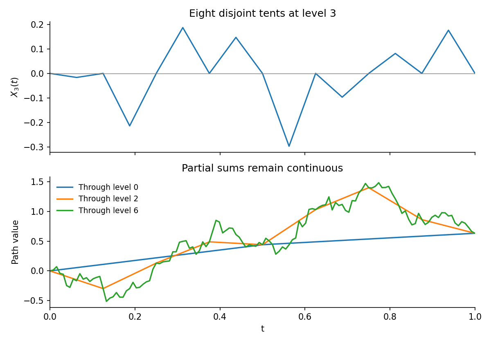

<h1 id="a/1/d/solution">Solution</h1>

↑ **Parent:** [D](../d.md)

In the [Lévy construction of Brownian motion](../../../../../levy-construction-of-brownian-motion.md), each level is a continuous piecewise linear sum of tents with disjoint interiors. Its supremum norm is therefore the largest absolute tent height, not the sum of the heights. With the standard construction's height standard deviation $2^{-(n+2)/2}$,

$$
\|X_n\|_\infty=2^{-(n+2)/2}M_n=\tfrac12\,2^{-n/2}M_n.
$$

Part (c) makes $\mathbb E\sum_n\|X_n\|_\infty$ finite, and part (a) proves almost sure uniform convergence to a continuous path on $[0,1]$. The separately chosen linear endpoint term completes the construction; its Gaussian finite-dimensional distributions and covariance must also be checked to identify the limit as [Brownian motion](../../../../../brownian-motion-split.md). Independent copies on successive unit intervals extend it to the half-line.

**[Figure 1](#a/1/d/image-disjoint-dyadic-tents-and-successive-continuous-levy-approximations). Disjoint dyadic tents and successive continuous Lévy approximations**.

The source calls $2^{-(n+2)/2}$ a variance. Literally using that variance would give height standard deviation $2^{-(n+2)/4}$ instead. The same $O(\sqrt n)$ maximum estimate still proves uniform convergence, since $\sum_n2^{-n/4}\sqrt n<\infty$, but the resulting covariance is not that of the standard Lévy construction. The standard midpoint [Brownian bridge](../../../../../brownian-bridge.md) variance on an interval of length $2^{-n}$ is $2^{-n}/4=2^{-(n+2)}$. Thus **continuity follows under either summable scaling, while Brownian covariance requires the correct variance**.

## ↑ Ancestors (13)

1. [D](../d.md)
2. [1](../../1.md)
3. [A](../../../a.md)
4. [2009](../../../../2009-split.md)
5. [Past exam of the stochastic differential equations and Brownian motion in complex analysis course of the University of Oxford](../../../../split.md)
6. [Stochastic differential equations and Brownian motion in complex analysis course of the University of Oxford](../../../../../stochastic-differential-equations-and-brownian-motion-in-complex-analysis-course-of-the-university-of-oxford.md)
7. [Year 4 of the mathematics course of the University of Oxford](../../../../../year-4-of-the-mathematics-course-of-the-university-of-oxford.md)
8. [Mathematics course of the University of Oxford](../../../../../mathematics-course-of-the-university-of-oxford.md)
9. [Undergraduate course of the University of Oxford](../../../../../undergraduate-course-of-the-university-of-oxford.md)
10. [Course of the University of Oxford](../../../../../course-of-the-university-of-oxford.md)
11. [University of Oxford](../../../../../university-of-oxford-split.md)
12. [List of universities](../../../../../list-of-universities.md)
13. [Codex Wiki](../../../../../split.md)
