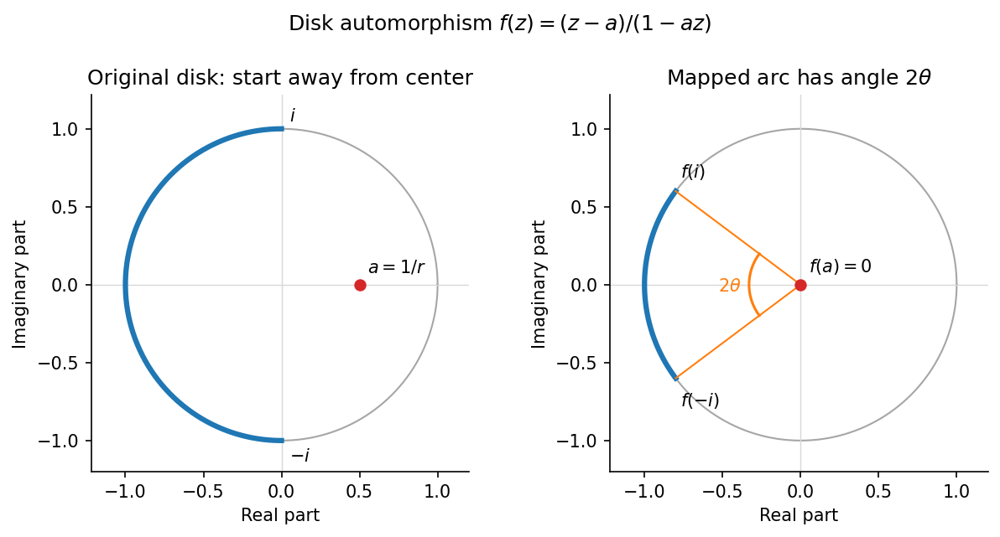

<h1 id="b/4/b/solution">Solution</h1>

↑ **Parent:** [B](../b.md)

Let $a=1/r\in(0,1)$ and $\theta=\tan^{-1}((1-a^2)/(2a))\in(0,\pi/2)$. The [Möbius transformation](../../../../../mobius-transformation.md) sends the semicircle endpoints to

$$
f(i)=\frac{-2a+i(1-a^2)}{1+a^2}=e^{i(\pi-\theta)},\qquad
f(-i)=e^{i(\pi+\theta)}.
$$

Also $f(-1)=-1$. Therefore the left semicircle maps to the unit-circle arc centered at $-1$ with angular width $2\theta$.

**[Figure 2](#b/4/b/image-the-left-semicircle-becomes-a-shorter-arc-viewed-from-the-mapped-starting-point). The left semicircle becomes a shorter arc viewed from the mapped starting point**.

By [conformal invariance of harmonic measure](../../../../../conformal-invariance-of-harmonic-measure.md), its exit probability from the starting point $a$ equals the probability of this image arc for Brownian motion started at zero. Rotational symmetry makes the latter exit angle uniform. Thus

$$
\boxed{\mathbb P_a(\operatorname{Re}Z_{T_{D_1}}<0)
=\frac\theta\pi=\frac1\pi\tan^{-1}\left(\frac{r^2-1}{2r}\right).}
$$

For scaling, if $Z$ starts at $1/r$, then $\widehat Z_t=rZ_{t/r^2}$ is planar Brownian motion started at one. Its unit-disk exit becomes radius-$r$ exit, and multiplication by the positive number $r$ preserves the sign of the real part. This proves exactly the same formula for $\mathbb P_1(\operatorname{Re}\widehat Z_{T_{D_r}}<0)$.

## ↑ Ancestors (13)

1. [B](../b.md)
2. [4](../../4.md)
3. [B](../../../b.md)
4. [2009](../../../../2009-split.md)
5. [Past exam of the stochastic differential equations and Brownian motion in complex analysis course of the University of Oxford](../../../../split.md)
6. [Stochastic differential equations and Brownian motion in complex analysis course of the University of Oxford](../../../../../stochastic-differential-equations-and-brownian-motion-in-complex-analysis-course-of-the-university-of-oxford.md)
7. [Year 4 of the mathematics course of the University of Oxford](../../../../../year-4-of-the-mathematics-course-of-the-university-of-oxford.md)
8. [Mathematics course of the University of Oxford](../../../../../mathematics-course-of-the-university-of-oxford.md)
9. [Undergraduate course of the University of Oxford](../../../../../undergraduate-course-of-the-university-of-oxford.md)
10. [Course of the University of Oxford](../../../../../course-of-the-university-of-oxford.md)
11. [University of Oxford](../../../../../university-of-oxford-split.md)
12. [List of universities](../../../../../list-of-universities.md)
13. [Codex Wiki](../../../../../split.md)
