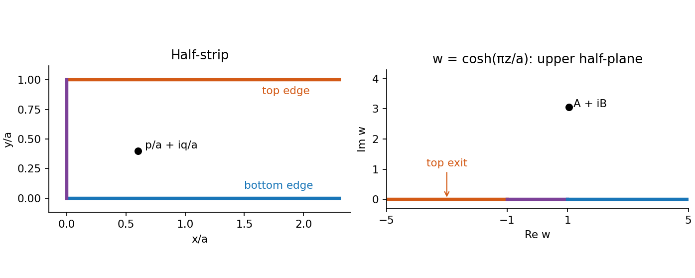

# 2010

↑ **Parent:** [Past exam of the stochastic differential equations and Brownian motion in complex analysis course of the University of Oxford](../past-exam-of-the-stochastic-differential-equations-and-brownian-motion-in-complex-analysis-course-of-the-university-of-oxford.md)

Source: [released examination bundle](https://www.whatdotheyknow.com/request/maths_past_papers_3), `Part C 2007 11.pdf`, pages 372–377. All six questions in both halves are covered. No mark allocations are printed.

**Table of contents**

- [A](#a)
  - [1](#a/1)
    - [a](#a/1/a)
      - [Solution](#a/1/a/solution)
    - [b](#a/1/b)
      - [Solution](#a/1/b/solution)
    - [c](#a/1/c)
      - [Solution](#a/1/c/solution)
    - [d](#a/1/d)
      - [Solution](#a/1/d/solution)
  - [2](#a/2)
    - [a](#a/2/a)
      - [Solution](#a/2/a/solution)
    - [b](#a/2/b)
      - [Solution](#a/2/b/solution)
    - [c](#a/2/c)
      - [Solution](#a/2/c/solution)
  - [3](#a/3)
    - [Solution](#a/3/solution)
- [B](#b)
  - [4](#b/4)
    - [a](#b/4/a)
      - [Solution](#b/4/a/solution)
    - [b](#b/4/b)
      - [i](#b/4/b/i)
        - [Solution](#b/4/b/i/solution)
      - [ii](#b/4/b/ii)
        - [Solution](#b/4/b/ii/solution)
      - [iii](#b/4/b/iii)
        - [Solution](#b/4/b/iii/solution)
  - [5](#b/5)
    - [a](#b/5/a)
      - [Solution](#b/5/a/solution)
    - [b](#b/5/b)
      - [i](#b/5/b/i)
        - [Solution](#b/5/b/i/solution)
      - [ii](#b/5/b/ii)
        - [Solution](#b/5/b/ii/solution)
      - [iii](#b/5/b/iii)
        - [Solution](#b/5/b/iii/solution)
  - [6](#b/6)
    - [a](#b/6/a)
      - [Solution](#b/6/a/solution)
    - [b](#b/6/b)
      - [Solution](#b/6/b/solution)
    - [c](#b/6/c)
      - [Solution](#b/6/c/solution)
    - [d](#b/6/d)
      - [Solution](#b/6/d/solution)

## A

↑ **Parent:** [2010](2010.md)

<h3 id="a/1">1</h3>

↑ **Parent:** [A](#a)

<h4 id="a/1/a">a</h4>

↑ **Parent:** [1](#a/1)

<h5 id="a/1/a/solution">Solution</h5>

↑ **Parent:** [A](#a/1/a)

Write the [stochastic differential equation](../stochastic-calculus.md#stochastic-differential-equation) in integral form and replace the unknown integrand by the preceding [Picard iterate](../differential-equation.md#picard-iterate). With the deterministic initial vector $a$, the recursion is

$$
\boxed{y_t^{(0)}=a,\qquad y_t^{(m+1)}=a+\sum_{i=1}^d\int_0^t A^iy_s^{(m)}\,dB_s^i\quad(m\geq0).}
$$

Each iterate is a continuous adapted process. The [Itô isometry](../stochastic-calculus.md#ito-isometry) inductively gives its square integrability on every bounded time interval, so all these [Itô integrals](../stochastic-calculus.md#ito-integral) are well defined.

<h4 id="a/1/b">b</h4>

↑ **Parent:** [1](#a/1)

<h5 id="a/1/b/solution">Solution</h5>

↑ **Parent:** [B](#a/1/b)

Use $s$ for the dummy integration variable in the printed integral. The [Itô isometry](../stochastic-calculus.md#ito-isometry) gives

$$
\mathbb E|z_t^{(n+1)}|^2=C\int_0^t\mathbb E|z_s^{(n)}|^2\,ds
\leq\frac{C^{n+1}}{n!}\int_0^t s^n\,ds
=\boxed{\frac{C^{n+1}t^{n+1}}{(n+1)!}.}
$$

The assumed second-moment bound also proves the integrability needed to apply the [Itô isometry](../stochastic-calculus.md#ito-isometry). The extra time integration is the source of the factorial improvement.

<h4 id="a/1/c">c</h4>

↑ **Parent:** [1](#a/1)

<h5 id="a/1/c/solution">Solution</h5>

↑ **Parent:** [C](#a/1/c)

Set $K=\sum_i\|A^i\|_{\mathrm{op}}^2$, where the norms are [operator norms](../continuous-dual-space.md#operator-norm), and $D_m=y^{(m+1)}-y^{(m)}$. Independence of the Brownian coordinates and the vector [Itô isometry](../stochastic-calculus.md#ito-isometry) give

$$
\mathbb E|D_0(t)|^2\leq |a|^2Kt,\qquad
\mathbb E|D_m(t)|^2\leq K\int_0^t\mathbb E|D_{m-1}(s)|^2ds.
$$

Induction, as in part (b), yields the [Factorial Picard estimate for a linear stochastic differential equation](../stochastic-calculus.md#factorial-picard-estimate-for-a-linear-stochastic-differential-equation)

$$
\mathbb E|D_m(t)|^2\leq |a|^2\frac{(Kt)^{m+1}}{(m+1)!}.
$$

For $t\leq T$, the [triangle inequality](../topological-analysis.md#triangle-inequality) in $L^2$ therefore bounds any tail of the iterates by the corresponding tail of

$$
|a|\sum_{m\geq0}\frac{(KT)^{(m+1)/2}}{\sqrt{(m+1)!}}.
$$

This numerical series converges by the [ratio test](../sequence-and-series.md#ratio-test): successive terms have ratio $\sqrt{KT/(m+2)}\to0$. Thus the iterates are Cauchy in $L^2$, uniformly in the deterministic time parameter on each bounded interval. [Completeness of Lp spaces](../measure-theory.md#completeness-of-lp-spaces) gives a limit $y_t$. Once its continuous adapted version is chosen in part (d), the [Itô isometry](../stochastic-calculus.md#ito-isometry) permits passage to the limit in the integral equation: the squared norm of each integral difference is bounded by $K\int_0^T\mathbb E|y_s^{(m)}-y_s|^2ds\to0$. Consequently **the Picard limit solves the stochastic differential equation**.

<h4 id="a/1/d">d</h4>

↑ **Parent:** [1](#a/1)

<h5 id="a/1/d/solution">Solution</h5>

↑ **Parent:** [D](#a/1/d)

For every $m$, $D_m$ is a continuous square-integrable vector [martingale](../martingale.md). Its norm is a [submartingale](../martingale.md#submartingale), so the [Doob L2 maximal inequality](../martingale.md#doob-l2-maximal-inequality) and the estimate from part (c) give

$$
\mathbb E\sup_{t\leq T}|D_m(t)|^2\leq4|a|^2\frac{(KT)^{m+1}}{(m+1)!}.
$$

The [Cauchy-Schwarz inequality](../probability-and-statistics.md#cauchy-schwarz-inequality) now shows

$$
\sum_m\mathbb E\sup_{t\leq T}|D_m(t)|
\leq2|a|\sum_m\frac{(KT)^{(m+1)/2}}{\sqrt{(m+1)!}}<\infty.
$$

By [Tonelli's theorem](../measure-theory.md#tonelli-theorem), the random sum of these suprema is finite almost surely. Therefore the telescoping series $a+\sum_mD_m(t)$ converges absolutely and uniformly on $[0,T]$ outside one null event. Its limit is continuous and agrees at each fixed time with the $L^2$ limit from part (c). Taking the intersection of the probability-one events for integer $T$ provides a single version on the whole half-line. Hence

$$
\boxed{\sup_{t\leq T}|y_t^{(n)}-y_t^{(\infty)}|\longrightarrow0\quad\text{almost surely for every finite }T.}
$$

This also gives the requested pointwise almost-sure convergence of the full sequence.

<h3 id="a/2">2</h3>

↑ **Parent:** [A](#a)

<h4 id="a/2/a">a</h4>

↑ **Parent:** [2](#a/2)

<h5 id="a/2/a/solution">Solution</h5>

↑ **Parent:** [A](#a/2/a)

Standard [Brownian motion](../brownian-motion.md) is centered, so $m_t=0$. If $s\leq t$, write $B_t=B_s+(B_t-B_s)$; the final increment is independent of $B_s$ and has mean zero. Thus

$$
\boxed{m_t=0,\qquad\phi_{st}=\mathbb E(B_sB_t)=\min(s,t).}
$$

This is the [Brownian covariance kernel](../random-variable.md#brownian-covariance-kernel). Together with joint Gaussianity and continuous paths, it gives the [Gaussian-process characterization of Brownian motion](../brownian-motion.md#gaussian-process-characterization-of-brownian-motion).

<h4 id="a/2/b">b</h4>

↑ **Parent:** [2](#a/2)

<h5 id="a/2/b/solution">Solution</h5>

↑ **Parent:** [B](#a/2/b)

For positive times the transformed process is centered and jointly Gaussian, and

$$
\mathbb E(X_sX_t)=st\min(1/s,1/t)=\min(s,t).
$$

Its paths are continuous away from zero. To verify continuity at zero, we need $B_u/u\to0$ almost surely as $u\to\infty$. The [strong law of large numbers](../convergence-of-random-variables.md#strong-law-of-large-numbers) applied to the independent increments $B_{n+1}-B_n$ gives $B_n/n\to0$. On the unit interval after $n$, the [Doob L2 maximal inequality](../martingale.md#doob-l2-maximal-inequality) gives

$$
\mathbb P\left(\sup_{0\leq v\leq1}|B_{n+v}-B_n|>\varepsilon n\right)\leq\frac4{\varepsilon^2n^2}.
$$

The [Borel-Cantelli first lemma](../probability-theory.md#borel-cantelli-first-lemma), first for each positive rational $\varepsilon$, shows that these between-integer fluctuations divided by $n$ tend to zero. Hence $B_u/u\to0$ for all real $u\to\infty$, and $tB_{1/t}\to0$ as $t\downarrow0$.

The [Gaussian-process characterization of Brownian motion](../brownian-motion.md#gaussian-process-characterization-of-brownian-motion) now proves **$X$ is standard Brownian motion**, with respect to its natural filtration. This is [time inversion of Brownian motion](../brownian-motion.md#time-inversion-of-brownian-motion); the transformed process need not be adapted to the original forward filtration.

<h4 id="a/2/c">c</h4>

↑ **Parent:** [2](#a/2)

<h5 id="a/2/c/solution">Solution</h5>

↑ **Parent:** [C](#a/2/c)

The [Itô formula](../stochastic-calculus.md#ito-s-lemma) for $f(x)=x^4$ gives

$$
d(B_t^4)=4B_t^3dB_t+6B_t^2dt.
$$

The stochastic integral has expectation zero: its square integrability on a finite horizon follows from the finite sixth moments of a [normal distribution](../probability-distribution.md#normal-distribution). Since $\mathbb EB_s^2=s$, integration and expectation yield

$$
\boxed{\mathbb EB_t^4=6\int_0^t s\,ds=3t^2.}
$$

<h3 id="a/3">3</h3>

↑ **Parent:** [A](#a)

<h4 id="a/3/solution">Solution</h4>

↑ **Parent:** [3](#a/3)

Put $Q_t=\langle M,M\rangle_t$ and $F(x,q)=e^{\sigma x-\sigma^2q/2}$. In the two-variable [Itô formula](../stochastic-calculus.md#ito-s-lemma), $Q$ has finite variation, while the only nonzero quadratic term is $d\langle M\rangle=dQ$. Therefore

$$
dF(M_t,Q_t)=\sigma F\,dM_t-\tfrac12\sigma^2F\,dQ_t
+\tfrac12\sigma^2F\,dQ_t=\sigma F\,dM_t.
$$

This proves the [stochastic exponential](../stochastic-calculus.md#doleans-dade-exponential) solves the equation. Its initial value is $e^{\sigma M_0}$; no normalization $M_0=0$ was stipulated.

The resulting process is initially a [continuous local martingale](../martingale.md#continuous-local-martingale). Since $Q_t\geq0$ and $|M_t|<C$,

$$
0<Z_t=e^{\sigma M_t-\sigma^2Q_t/2}\leq e^{|\sigma|C}.
$$

A bounded local martingale is a true [martingale](../martingale.md): apply the martingale identity to a localizing sequence and use [dominated convergence](../measure-theory.md#dominated-convergence-theorem) in conditional expectations. The deterministic bound works on every finite horizon, proving **$Z$ is a martingale on every $[0,T]$**. The bound on $Q$ also gives a positive deterministic lower bound $e^{-|\sigma|C-\sigma^2C/2}$, although the upper bound already proves the martingale assertion.

<h2 id="b">B</h2>

↑ **Parent:** [2010](2010.md)

<h3 id="b/4">4</h3>

↑ **Parent:** [B](#b)

<h4 id="b/4/a">a</h4>

↑ **Parent:** [4](#b/4)

<h5 id="b/4/a/solution">Solution</h5>

↑ **Parent:** [A](#b/4/a)

There is a printed domain error: $\operatorname{Re}z>0$ defines the right half-plane. Taken literally, continuity forces $\operatorname{Re}Z_{T_H}=0$ almost surely, so its law is a point mass at zero. The displayed density belongs to the intended upper half-plane $\operatorname{Im}z>0$, with $b>0$. We prove that intended assertion explicitly.

Write $Z_t=a+X_t+i(b+Y_t)$ for independent standard [Brownian motions](../brownian-motion.md). The exit time $T$ is the first time $Y$ hits $-b$, and depends only on $Y$. Its density, by the supplied [Brownian first-passage time](../markov-chain.md#brownian-first-passage-time) law, is $b(2\pi t^3)^{-1/2}e^{-b^2/(2t)}$. Conditional on $T=t$, the real exit coordinate is [normally distributed](../probability-distribution.md#normal-distribution) with mean $a$ and variance $t$. Independence therefore gives

$$
h(x)=\frac b{2\pi}\int_0^\infty t^{-2}
\exp\left(-\frac{b^2+(x-a)^2}{2t}\right)dt.
$$

With $u=[b^2+(x-a)^2]/(2t)$, the integral is $2/[b^2+(x-a)^2]$. Thus the [Cauchy exit law from a Brownian half-plane](../brownian-motion.md#cauchy-exit-law-from-a-brownian-half-plane) is

$$
\boxed{h(x)=\frac b{\pi[b^2+(x-a)^2]}.}
$$

For the literal right half-plane, the corresponding nondegenerate coordinate is $\operatorname{Im}Z_{T_H}$, whose density is $a/\{\pi[a^2+(y-b)^2]\}$ for $a>0$.

<h4 id="b/4/b">b</h4>

↑ **Parent:** [4](#b/4)

<h5 id="b/4/b/i">i</h5>

↑ **Parent:** [B](#b/4/b)

<h6 id="b/4/b/i/solution">Solution</h6>

↑ **Parent:** [I](#b/4/b/i)

If $f:D\to D'$ is a [conformal map](../geometry-and-topology.md#conformal-map), the image of planar [Brownian motion](../brownian-motion.md) in $D$ is Brownian motion in $D'$ after the increasing clock change

$$
A_t=\int_0^t|f'(Z_s)|^2ds.
$$

More precisely, $f(Z_{A^{-1}(u)})$ is planar Brownian motion, starting at $f(Z_0)$ and run up to the relevant exit time. The [Itô formula](../stochastic-calculus.md#ito-s-lemma) and the [Cauchy-Riemann equations](../analysis.md#cauchy-riemann-equations) give image-coordinate local martingales with common bracket $A$ and zero cross bracket; the [Lévy characterization of multidimensional Brownian motion](../brownian-motion.md#levy-characterization-of-multidimensional-brownian-motion) identifies the time-changed process. In particular, [conformal invariance of planar Brownian motion](../brownian-motion.md#conformal-invariance-of-planar-brownian-motion) transports exit locations and [harmonic measure](../brownian-motion.md#harmonic-measure), while changing traversal speed.

<h5 id="b/4/b/ii">ii</h5>

↑ **Parent:** [B](#b/4/b)

<h6 id="b/4/b/ii/solution">Solution</h6>

↑ **Parent:** [Ii](#b/4/b/ii)

For $z=x+iy$ in the strip,

$$
f(z)=\cosh(\pi x/a)\cos(\pi y/a)
+i\sinh(\pi x/a)\sin(\pi y/a),
$$

so $\operatorname{Im}f(z)>0$. This is a bijective [conformal map](../geometry-and-topology.md#conformal-map) onto the upper half-plane. One way to verify bijectivity is to factor it as $w=e^{\pi z/a}$, followed by $(w+w^{-1})/2$. The first map gives $\operatorname{Im}w>0$, $|w|>1$. The two inverse roots of the second map have product one; for any point in the upper half-plane exactly one root has modulus greater than one, and its imaginary part is positive because $\operatorname{Im}[(w+w^{-1})/2]=(1-|w|^{-2})\operatorname{Im}w/2$.

The three boundary pieces map as follows: the lower edge goes to $(1,\infty)$, the upper edge to $(-\infty,-1)$, and the vertical edge to $(-1,1)$. Thus the desired exit event becomes exit from the upper half-plane to the left of $-1$. Write

$$
A=\cosh(\pi p/a)\cos(\pi q/a),\qquad
B=\sinh(\pi p/a)\sin(\pi q/a)>0.
$$

By [conformal invariance of harmonic measure](../brownian-motion.md#conformal-invariance-of-harmonic-measure) and the [Cauchy exit law from a Brownian half-plane](../brownian-motion.md#cauchy-exit-law-from-a-brownian-half-plane),

$$
\boxed{\mathbb P(\operatorname{Im}Z_{T_S}=a)
=\int_{-\infty}^{-1}\frac B{\pi[B^2+(x-A)^2]}dx
=\frac12-\frac1\pi\arctan\frac{1+A}{B}.}
$$

The strip exit is finite almost surely, since its imaginary coordinate exits $(0,a)$ in finite time; corners have probability zero because individual points are [polar points for planar Brownian motion](../brownian-motion.md#polar-point-for-planar-brownian-motion). This is the [Top-edge exit probability of a Brownian half-strip](../brownian-motion.md#top-edge-exit-probability-of-a-brownian-half-strip).

**[Figure 1](#b/4/b/ii/image-boundary-pieces-of-the-half-strip-under-the-hyperbolic-cosine-map). Boundary pieces of the half-strip under the hyperbolic-cosine map**.

<h5 id="b/4/b/iii">iii</h5>

↑ **Parent:** [B](#b/4/b)

<h6 id="b/4/b/iii/solution">Solution</h6>

↑ **Parent:** [Iii](#b/4/b/iii)

Let $\alpha=\pi q/a\in(0,\pi)$. With $q$ and $a$ fixed,

$$
\frac{1+A}{B}\longrightarrow\frac{\cos\alpha}{\sin\alpha}=\cot\alpha.
$$

The principal [arctangent](../geometry-and-topology.md#inverse-tangent) satisfies $\arctan(\cot\alpha)=\pi/2-\alpha$ throughout this interval. Substitution gives

$$
\boxed{\lim_{p\to\infty}\mathbb P(\operatorname{Im}Z_{T_S}=a)=q/a.}
$$

Far from the vertical boundary, the limit agrees with the one-dimensional [Brownian motion](../brownian-motion.md) probability of reaching height $a$ before zero.

<h3 id="b/5">5</h3>

↑ **Parent:** [B](#b)

<h4 id="b/5/a">a</h4>

↑ **Parent:** [5](#b/5)

<h5 id="b/5/a/solution">Solution</h5>

↑ **Parent:** [A](#b/5/a)

The disk exit time is finite almost surely; for example, either coordinate of the planar [Brownian motion](../brownian-motion.md) eventually leaves $(-1,1)$. By path continuity, the exit lies on the unit circle. Starting at the origin, rotational invariance of [planar Brownian motion](../brownian-motion.md#planar-brownian-motion) makes the exit law invariant under every circle rotation. The unique rotation-invariant probability measure is normalized [arc length](../riemannian-geometry.md#arc-length). Consequently **$Z_{T_D}$ is uniform on the unit circle**, or equivalently its angle has density $1/(2\pi)$ on $[0,2\pi)$.

<h4 id="b/5/b">b</h4>

↑ **Parent:** [5](#b/5)

<h5 id="b/5/b/i">i</h5>

↑ **Parent:** [B](#b/5/b)

<h6 id="b/5/b/i/solution">Solution</h6>

↑ **Parent:** [I](#b/5/b/i)

By [conformal invariance of planar Brownian motion](../brownian-motion.md#conformal-invariance-of-planar-brownian-motion), $w(Z_{T_D})$ has the uniform boundary law from part (a), because the image process starts at zero. A [disk automorphism](../topology.md#automorphism-of-the-unit-disk) extends to an orientation-preserving boundary diffeomorphism. Choose a continuous angular lift $\phi:\mathbb R\to\mathbb R$ satisfying

$$
w(e^{i\theta})=e^{i\phi(\theta)},\qquad
\phi(\theta+2\pi)=\phi(\theta)+2\pi,\qquad\phi'(\theta)>0.
$$

The principal-angle version may have a branch jump, which is harmless for the density. The [change of variables for probability densities](../continuous-probability-distribution.md#change-of-variables-for-probability-densities) yields the exit-angle density $\phi'(\theta)/(2\pi)$. Differentiating the boundary relation gives

$$
i e^{i\theta}w'(e^{i\theta})=i\phi'(\theta)e^{i\phi(\theta)}.
$$

Taking absolute values proves $\phi'(\theta)=|w'(e^{i\theta})|$. Therefore

$$
\boxed{P^{z_0}(\theta_{T_D}\in d\theta)=\frac{|w'(e^{i\theta})|}{2\pi}\,d\theta.}
$$

The angular lift explains rigorously the derivative appearing in the printed hint despite the principal-angle branch cut.

<h5 id="b/5/b/ii">ii</h5>

↑ **Parent:** [B](#b/5/b)

<h6 id="b/5/b/ii/solution">Solution</h6>

↑ **Parent:** [Ii](#b/5/b/ii)

By [Brownian scaling](../brownian-motion.md#brownian-scaling), $r^{-1}Z_{r^2t}$ is planar Brownian motion started at $w_0/r$. Its unit-disk exit angle is exactly the original radius-$r$ exit angle. Substitute $z_0=w_0/r$ into the supplied [Poisson kernel for the unit disk](../partial-differential-equation.md#poisson-kernel-for-the-unit-disk):

$$
\boxed{P^{w_0}(\theta_{T_{D_r}}\in d\theta)
=\frac{r^2-|w_0|^2}{2\pi|w_0-r e^{i\theta}|^2}\,d\theta.}
$$

This density is with respect to angle $d\theta$. Its density with respect to [arc length](../riemannian-geometry.md#arc-length) would be smaller by a factor $r$.

<h5 id="b/5/b/iii">iii</h5>

↑ **Parent:** [B](#b/5/b)

<h6 id="b/5/b/iii/solution">Solution</h6>

↑ **Parent:** [Iii](#b/5/b/iii)

Put $\rho=|z|$. The [triangle inequality](../topological-analysis.md#triangle-inequality) gives $1-\rho\leq|z-e^{i\theta}|\leq1+\rho$, so the [Poisson kernel for the unit disk](../partial-differential-equation.md#poisson-kernel-for-the-unit-disk) obeys

$$
\frac{1-\rho}{1+\rho}\leq
\frac{1-|z|^2}{|z-e^{i\theta}|^2}
\leq\frac{1+\rho}{1-\rho}.
$$

If $\rho\leq r$, replace the lower bound by $(1-r)/(1+r)$ and the upper bound by $(1+r)/(1-r)$. Integrating against the positive measure $h(e^{i\theta})d\theta/(2\pi)$ gives

$$
\boxed{\frac{1-r}{1+r}u(0)\leq u(z)\leq\frac{1+r}{1-r}u(0).}
$$

Here $u(0)$ is exactly the uniform boundary average from part (a). Positivity permits multiplication of the pointwise kernel bounds; continuity on the compact circle ensures all integrals are finite. This is the [Harnack inequality on the unit disk](../partial-differential-equation.md#harnack-inequality-on-the-unit-disk).

<h3 id="b/6">6</h3>

↑ **Parent:** [B](#b)

<h4 id="b/6/a">a</h4>

↑ **Parent:** [6](#b/6)

<h5 id="b/6/a/solution">Solution</h5>

↑ **Parent:** [A](#b/6/a)

Use first that [planar Brownian motion avoids a fixed point](../brownian-motion.md#planar-brownian-motion-avoids-a-fixed-point), so the path starting at $1$ never reaches zero. Its continuous logarithmic lift, initialized at zero, has real part $U_t=\log|Z_t|$ and imaginary part the continuous unwrapped angle $\Theta_t$. Local branches of the complex logarithm, patched along the path, and the [Itô formula](../stochastic-calculus.md#ito-s-lemma) show that both coordinates are [continuous local martingales](../martingale.md#continuous-local-martingale) with

$$
\langle U\rangle_t=\langle\Theta\rangle_t=\int_0^t\frac{ds}{|Z_s|^2}=:\tau(t),\qquad
\langle U,\Theta\rangle_t=0.
$$

The clock is finite on every compact time interval, since a continuous nonvanishing path stays a positive distance from zero there. It is continuous and strictly increasing. Moreover $\tau(\infty)=\infty$: by recurrence, planar Brownian motion spends infinite total time in a fixed disk, and inside the unit disk the clock integrand is at least one. This is the [divergence of a positive planar Brownian occupation integral](../brownian-motion.md#divergence-of-a-positive-planar-brownian-occupation-integral).

The [common-clock time change of orthogonal local martingales](../martingale.md#common-clock-time-change-of-orthogonal-local-martingales), using the [Lévy characterization of multidimensional Brownian motion](../brownian-motion.md#levy-characterization-of-multidimensional-brownian-motion), supplies independent Brownian coordinates $\zeta^1,\zeta^2$ such that $U_t+i\Theta_t=\zeta_{\tau(t)}$. Exponentiating gives

$$
\boxed{Z_t=\exp(\zeta_{\tau(t)}),\qquad\zeta_0=0.}
$$

To identify the inverse clock, write $A=\tau^{-1}$. The derivative of an inverse function and the representation just obtained give

$$
A'(s)=|Z_{A(s)}|^2=e^{2\zeta_s^1},\qquad
A(s)=\int_0^s e^{2\zeta_u^1}du.
$$

Consequently

$$
\boxed{\tau(t)=\int_0^t|Z_s|^{-2}ds
=\inf\left\{s\geq0:\int_0^s e^{2\zeta_u^1}du>t\right\}.}
$$

The strict inequality in this generalized inverse has the same infimum as the unique inverse value, since $A$ is continuous and strictly increasing onto the half-line.

<h4 id="b/6/b">b</h4>

↑ **Parent:** [6](#b/6)

<h5 id="b/6/b/solution">Solution</h5>

↑ **Parent:** [B](#b/6/b)

Assume $0<r<1<R$, as required for the annulus and logarithms. The [logarithmic radius of planar Brownian motion](../brownian-motion.md#logarithmic-radius-of-planar-brownian-motion) is a local martingale. Stopping at $T=T_{r,R}$ keeps it between the constants $\log r$ and $\log R$, so the stopped process is a bounded [martingale](../martingale.md). The exit time is finite almost surely because the annulus is bounded and Brownian motion eventually exits its containing disk.

The [optional stopping theorem](../martingale.md#optional-sampling-theorem-for-a-supermartingale) followed by [dominated convergence](../measure-theory.md#dominated-convergence-theorem) gives $\mathbb E\log|Z_T|=\log|Z_0|=0$. Continuity puts the exit radius at either $r$ or $R$. If $p$ is the inner-exit probability, then $p\log r+(1-p)\log R=0$. Hence

$$
\boxed{p=\frac{\log R}{\log R-\log r}.}
$$

Stopping before taking expectations matters: the unstopped logarithmic-radius process is a [strict local martingale](../martingale.md#strict-local-martingale), so one cannot assume its unrestricted expectation is constant.

<h4 id="b/6/c">c</h4>

↑ **Parent:** [6](#b/6)

<h5 id="b/6/c/solution">Solution</h5>

↑ **Parent:** [C](#b/6/c)

The second coordinate $\zeta^2$ is one-dimensional [Brownian motion](../brownian-motion.md), whose zero set is unbounded almost surely by recurrence. The clock $\tau$ and its inverse are continuous, increasing, and unbounded, so the unwrapped angle $\Theta_t=\zeta^2_{\tau(t)}$ has zeros at arbitrarily large original times.

To ensure the times are [stopping times](../martingale.md#stopping-time) for the original Brownian filtration, define directly

$$
T_0=0,\qquad T_n=\inf\{t\geq T_{n-1}+1:\Theta_t=0\}.
$$

The logarithmic lift makes $\Theta$ a continuous adapted process. Hitting a closed set after a stopping time is a stopping time under the usual filtration conditions, and the unbounded zero set proves inductively that each $T_n$ is finite almost surely. Since $T_n\geq T_{n-1}+1$, the sequence tends to infinity, and continuity gives

$$
\boxed{\zeta^2_{\tau(T_n)}=\Theta_{T_n}=0\quad\text{for every }n.}
$$

Geometrically, the Brownian path returns to the positive real ray at arbitrarily late times with **zero net unwrapped winding angle** about the origin. The assertion is stronger than principal argument zero, which also allows any integer number of completed turns.

<h4 id="b/6/d">d</h4>

↑ **Parent:** [6](#b/6)

<h5 id="b/6/d/solution">Solution</h5>

↑ **Parent:** [D](#b/6/d)

The long-time [Spitzer winding theorem](../brownian-motion.md#spitzer-winding-theorem) states that, for the continuous unwrapped angle $\Theta_t$ of planar [Brownian motion](../brownian-motion.md) started at $1$,

$$
\boxed{\frac{2\Theta_t}{\log t}\ \xrightarrow[t\to\infty]{\mathrm d}\ C,\qquad
f_C(x)=\frac1{\pi(1+x^2)}.}
$$

Here $C$ has the standard symmetric [Cauchy distribution](../probability-distribution.md#cauchy-distribution). The notation means [convergence in distribution](../convergence-of-random-variables.md#convergence-in-distribution): for every real $x$,

$$
\lim_{t\to\infty}\mathbb P\left(\frac{2\Theta_t}{\log t}\leq x\right)
=\frac12+\frac1\pi\arctan x.
$$

Equivalently, expectations converge for every bounded continuous test function. This is a statement about the laws at large deterministic times, without asserting almost-sure convergence of sample paths. The angle is unwrapped; a principal argument is bounded and would instead give zero after division by $\log t$.

## ↑ Ancestors (9)

1. [Past exam of the stochastic differential equations and Brownian motion in complex analysis course of the University of Oxford](../past-exam-of-the-stochastic-differential-equations-and-brownian-motion-in-complex-analysis-course-of-the-university-of-oxford.md)
2. [Stochastic differential equations and Brownian motion in complex analysis course of the University of Oxford](../university-of-oxford.md#stochastic-differential-equations-and-brownian-motion-in-complex-analysis-course-of-the-university-of-oxford)
3. [Year 4 of the mathematics course of the University of Oxford](../university-of-oxford.md#year-4-of-the-mathematics-course-of-the-university-of-oxford)
4. [Mathematics course of the University of Oxford](../university-of-oxford.md#mathematics-course-of-the-university-of-oxford)
5. [Undergraduate course of the University of Oxford](../university-of-oxford.md#undergraduate-course-of-the-university-of-oxford)
6. [Course of the University of Oxford](../university-of-oxford.md#course-of-the-university-of-oxford)
7. [University of Oxford](../university-of-oxford.md)
8. [List of universities](../README.md#list-of-universities)
9. [Codex Wiki](../README.md)
