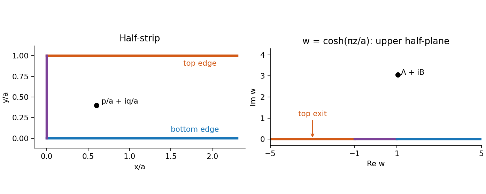

<h1 id="b/4/b/ii/solution">Solution</h1>

↑ **Parent:** [Ii](../ii.md)

For $z=x+iy$ in the strip,

$$
f(z)=\cosh(\pi x/a)\cos(\pi y/a)
+i\sinh(\pi x/a)\sin(\pi y/a),
$$

so $\operatorname{Im}f(z)>0$. This is a bijective [conformal map](../../../../../../conformal-map.md) onto the upper half-plane. One way to verify bijectivity is to factor it as $w=e^{\pi z/a}$, followed by $(w+w^{-1})/2$. The first map gives $\operatorname{Im}w>0$, $|w|>1$. The two inverse roots of the second map have product one; for any point in the upper half-plane exactly one root has modulus greater than one, and its imaginary part is positive because $\operatorname{Im}[(w+w^{-1})/2]=(1-|w|^{-2})\operatorname{Im}w/2$.

The three boundary pieces map as follows: the lower edge goes to $(1,\infty)$, the upper edge to $(-\infty,-1)$, and the vertical edge to $(-1,1)$. Thus the desired exit event becomes exit from the upper half-plane to the left of $-1$. Write

$$
A=\cosh(\pi p/a)\cos(\pi q/a),\qquad
B=\sinh(\pi p/a)\sin(\pi q/a)>0.
$$

By [conformal invariance of harmonic measure](../../../../../../conformal-invariance-of-harmonic-measure.md) and the [Cauchy exit law from a Brownian half-plane](../../../../../../cauchy-exit-law-from-a-brownian-half-plane.md),

$$
\boxed{\mathbb P(\operatorname{Im}Z_{T_S}=a)
=\int_{-\infty}^{-1}\frac B{\pi[B^2+(x-A)^2]}dx
=\frac12-\frac1\pi\arctan\frac{1+A}{B}.}
$$

The strip exit is finite almost surely, since its imaginary coordinate exits $(0,a)$ in finite time; corners have probability zero because individual points are [polar points for planar Brownian motion](../../../../../../polar-point-for-planar-brownian-motion.md). This is the [Top-edge exit probability of a Brownian half-strip](../../../../../../top-edge-exit-probability-of-a-brownian-half-strip.md).

**[Figure 1](#b/4/b/ii/image-boundary-pieces-of-the-half-strip-under-the-hyperbolic-cosine-map). Boundary pieces of the half-strip under the hyperbolic-cosine map**.

## ↑ Ancestors (14)

1. [Ii](../ii.md)
2. [B](../../b.md)
3. [4](../../../4.md)
4. [B](../../../../b.md)
5. [2010](../../../../../2010-split.md)
6. [Past exam of the stochastic differential equations and Brownian motion in complex analysis course of the University of Oxford](../../../../../split.md)
7. [Stochastic differential equations and Brownian motion in complex analysis course of the University of Oxford](../../../../../../stochastic-differential-equations-and-brownian-motion-in-complex-analysis-course-of-the-university-of-oxford.md)
8. [Year 4 of the mathematics course of the University of Oxford](../../../../../../year-4-of-the-mathematics-course-of-the-university-of-oxford.md)
9. [Mathematics course of the University of Oxford](../../../../../../mathematics-course-of-the-university-of-oxford.md)
10. [Undergraduate course of the University of Oxford](../../../../../../undergraduate-course-of-the-university-of-oxford.md)
11. [Course of the University of Oxford](../../../../../../course-of-the-university-of-oxford.md)
12. [University of Oxford](../../../../../../university-of-oxford-split.md)
13. [List of universities](../../../../../../list-of-universities.md)
14. [Codex Wiki](../../../../../../split.md)
