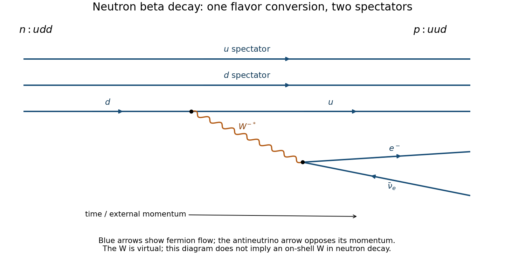

<h1 id="1/c/solution">Solution</h1>

↑ **Parent:** [C](../c.md)

The charged weak current changes one [neutron](../../../../neutron-split.md) [down quark](../../../../down-quark.md) into an [up quark](../../../../up-quark.md):

$$
d\to u+W^{-*},\qquad W^{-*}\to e^-+\bar\nu_e,
\qquad\boxed{n(udd)\to p(uud)+e^-+\bar\nu_e.}
$$

The other two valence [quarks](../../../../quark.md) are spectators in this tree-level [Feynman diagram](../../../../feynman-diagram.md). The intermediate [W boson](../../../../w-boson.md) is highly virtual; the available [neutron](../../../../neutron-split.md) decay energy is far below its on-shell rest energy. Charge is conserved at each vertex, and the [electron](../../../../electron.md)'s lepton number is balanced by the [electron antineutrino](../../../../electron-antineutrino.md).

The reversed quark-level charged current is allowed as an interaction, but a **free** [proton](../../../../proton.md) cannot decay as $p\to n+e^++\nu_e$ because $m_p<m_n+m_e$. [Four-momentum conservation](../../../../four-momentum-conservation.md) leaves no accessible final-state [Lorentz-invariant phase space](../../../../lorentz-invariant-phase-space.md). The absence of this free-proton beta-plus decay is therefore kinematic, not an absence of a $u\to d$ weak vertex. Binding-energy differences in a nucleus, or incoming energy in a collision, can change whether the corresponding conversion is possible. Exotic baryon-number-violating [proton](../../../../proton.md) decay is a separate question and is not generated by this ordinary charged-current diagram.

**[Figure 1](#1/c/image-neutron-beta-decay-with-two-spectator-quarks-and-a-virtual-w-boson). Neutron beta decay with two spectator quarks and a virtual W boson**. Original tree-level quark diagram. Fermion-flow arrows distinguish the emitted electron from the electron antineutrino; the W is off shell.

## ↑ Ancestors (12)

1. [C](../c.md)
2. [1](../../1.md)
3. [2016](../../../2016-split.md)
4. [Past exam of the sub-atomic physics course of the University of Oxford](../../../split.md)
5. [Sub-atomic physics course of the University of Oxford](../../../../sub-atomic-physics-course-of-the-university-of-oxford.md)
6. [Year 3 of the physics course of the University of Oxford](../../../../year-3-of-the-physics-course-of-the-university-of-oxford.md)
7. [Physics course of the University of Oxford](../../../../physics-course-of-the-university-of-oxford.md)
8. [Undergraduate course of the University of Oxford](../../../../undergraduate-course-of-the-university-of-oxford.md)
9. [Course of the University of Oxford](../../../../course-of-the-university-of-oxford.md)
10. [University of Oxford](../../../../university-of-oxford-split.md)
11. [List of universities](../../../../list-of-universities.md)
12. [Codex Wiki](../../../../split.md)
