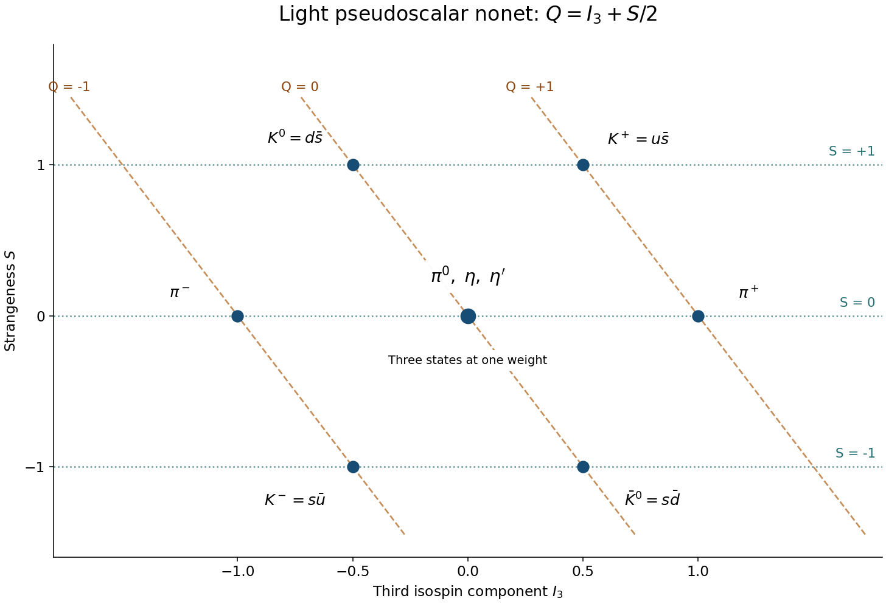

<h1 id="2/a/solution">Solution</h1>

↑ **Parent:** [A](../a.md)

The light [pseudoscalar meson nonet](../../../../pseudoscalar-meson-nonet.md) has $J^P=0^-$ and flavor structure $3\otimes\bar3=8\oplus1$. Its members are the three [pions](../../../../pion.md), four [kaons](../../../../kaon.md), and the two neutral isospin-zero states [eta meson](../../../../eta-meson.md) and [eta prime meson](../../../../eta-prime-meson.md). For mesons the [baryon number](../../../../baryon-number.md) is zero, so the [Gell-Mann--Nishijima formula](../../../../gell-mann-nishijima-formula.md) reduces to

$$
\boxed{Q=I_3+S/2.}
$$

Here $S$ is [strangeness](../../../../strangeness.md), with an $s$ [quark](../../../../quark.md) carrying $-1$ and an [antiquark](../../../../antiquark.md) $\bar s$ carrying $+1$. Thus the upper row is $K^0=d\bar s$ at $(I_3,S)=(-1/2,1)$ and $K^+=u\bar s$ at $(1/2,1)$. The lower row is $K^-=s\bar u$ at $(-1/2,-1)$ and $\bar K^0=s\bar d$ at $(1/2,-1)$. The charged [pions](../../../../pion.md) lie at $(\pm1,0)$, while $\pi^0,\eta,\eta'$ share $(0,0)$ as flavor-weight coordinates.

The neutral [pion](../../../../pion.md) direction is $(u\bar u-d\bar d)/\sqrt2$. The octet and singlet isoscalar directions mix to make the physical eta and eta-prime states; counting three central states is essential to obtaining nine rather than seven particles. Horizontal lines in the diagram have constant $S$, while lines $I_3+S/2=Q$ mark constant charge. Meson exchange describes part of the residual nuclear force; the underlying quark-level [strong interaction](../../../../strong-interaction.md) is mediated by [gluons](../../../../gluon.md), not by treating [pions](../../../../pion.md) as elementary gauge bosons.

**[Figure 2](#2/a/image-light-pseudoscalar-meson-nonet-with-charge-and-strangeness-lines). Light pseudoscalar meson nonet with charge and strangeness lines**. Original flavor-weight diagram. Three neutral states share the central weight; diagonal guides show constant charge and horizontal guides constant strangeness.

## ↑ Ancestors (12)

1. [A](../a.md)
2. [2](../../2.md)
3. [2016](../../../2016-split.md)
4. [Past exam of the sub-atomic physics course of the University of Oxford](../../../split.md)
5. [Sub-atomic physics course of the University of Oxford](../../../../sub-atomic-physics-course-of-the-university-of-oxford.md)
6. [Year 3 of the physics course of the University of Oxford](../../../../year-3-of-the-physics-course-of-the-university-of-oxford.md)
7. [Physics course of the University of Oxford](../../../../physics-course-of-the-university-of-oxford.md)
8. [Undergraduate course of the University of Oxford](../../../../undergraduate-course-of-the-university-of-oxford.md)
9. [Course of the University of Oxford](../../../../course-of-the-university-of-oxford.md)
10. [University of Oxford](../../../../university-of-oxford-split.md)
11. [List of universities](../../../../list-of-universities.md)
12. [Codex Wiki](../../../../split.md)
