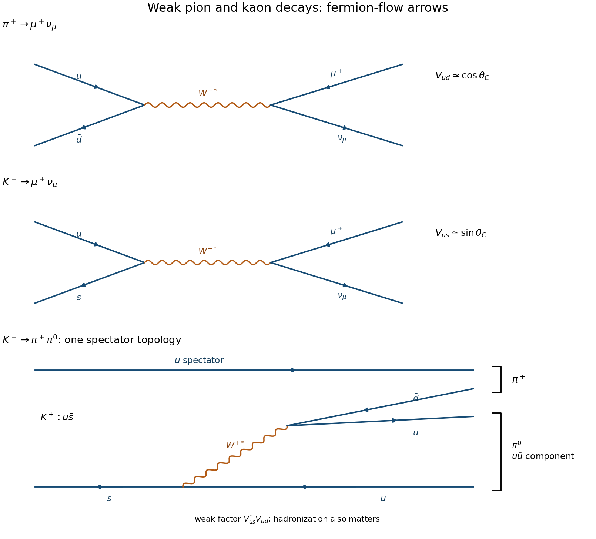

<h1 id="2/b/solution">Solution</h1>

↑ **Parent:** [B](../b.md)

The charged meson decays proceed through a virtual $W^+$:

$$
\pi^+(u\bar d)\to W^{+*}\to\mu^+\nu_\mu,\qquad
K^+(u\bar s)\to W^{+*}\to\mu^+\nu_\mu.
$$

The first [quark](../../../../quark.md) vertex has CKM factor $V_{ud}$, while the second has $V_{us}$. In the simple Cabibbo description these are approximately $\cos\theta_C$ and $\sin\theta_C$, so the strange amplitude carries a suppression $\tan\theta_C$ relative to the nonstrange one, or $\tan^2\theta_C\simeq0.053$ in their corresponding squared weak-coupling factors.

For a charged pseudoscalar and a negligibly massive [neutrino](../../../../neutrino.md), the leading leptonic energy width has the form

$$
\Gamma(P^+\to\mu^+\nu_\mu)=
\frac{G_F^2f_P^2|V_{qq'}|^2}{8\pi}m_\mu^2m_P
\left(1-\frac{m_\mu^2}{m_P^2}\right)^2
$$

in natural units. The helicity factor $m_\mu^2$ is common to these two [muon](../../../../muon.md) channels, while the threshold factor is much less favorable for the [pion](../../../../pion.md). Using the usual masses, its value is about $0.182$ for the [pion](../../../../pion.md) and $0.910$ for the charged [kaon](../../../../kaon.md): the [pion](../../../../pion.md)'s threshold factor alone is only about one fifth as large. Including the explicit $m_P$ factor gives a kinematic ratio about $0.0564$. The [pseudoscalar decay constants](../../../../pseudoscalar-decay-constant.md) $f_P$ also matter, so [Lorentz-invariant phase space](../../../../lorentz-invariant-phase-space.md) and CKM factors alone do not determine the full lifetime ratio.[leading pseudoscalar leptonic-width formula and [pion](../../../../pion.md)/[kaon](../../../../kaon.md) discussion](../../../../leptonic-decays-of-charged-pseudoscalar-mesons-by-particle-data-group.md)

For $K^+\to\pi^+\pi^0$, one tree topology has the spectator $u$ unchanged and $\bar s\to\bar u+W^{+*}$ followed by $W^{+*}\to u\bar d$. The spectator $u$ can combine with $\bar d$ to form $\pi^+$, and the $u\bar u$ component supplies $\pi^0$. This carries the strangeness-changing weak factor $V_{us}^*V_{ud}$. [Hadronization](../../../../hadronization.md), other [quark](../../../../quark.md) rearrangements and strong final-state interactions determine the hadronic amplitude; the diagram is not a complete precision width calculation. The small [pion](../../../../pion.md)–[muon](../../../../muon.md) energy release suppresses the [pion](../../../../pion.md) leptonic channel kinematically, whereas the strange weak vertex suppresses the [kaon](../../../../kaon.md) channels through [Cabibbo suppression](../../../../cabibbo-suppression.md).

**[Figure 3](#2/b/image-charged-pion-and-charged-kaon-weak-decay-tree-diagrams). Charged-pion and charged-kaon weak-decay tree diagrams**. Original quark-level diagrams for the two leptonic channels and one spectator topology for the two-pion kaon channel. Antifermion arrows follow fermion flow, opposite their external momentum direction.

## ↑ Ancestors (12)

1. [B](../b.md)
2. [2](../../2.md)
3. [2016](../../../2016-split.md)
4. [Past exam of the sub-atomic physics course of the University of Oxford](../../../split.md)
5. [Sub-atomic physics course of the University of Oxford](../../../../sub-atomic-physics-course-of-the-university-of-oxford.md)
6. [Year 3 of the physics course of the University of Oxford](../../../../year-3-of-the-physics-course-of-the-university-of-oxford.md)
7. [Physics course of the University of Oxford](../../../../physics-course-of-the-university-of-oxford.md)
8. [Undergraduate course of the University of Oxford](../../../../undergraduate-course-of-the-university-of-oxford.md)
9. [Course of the University of Oxford](../../../../course-of-the-university-of-oxford.md)
10. [University of Oxford](../../../../university-of-oxford-split.md)
11. [List of universities](../../../../list-of-universities.md)
12. [Codex Wiki](../../../../split.md)
