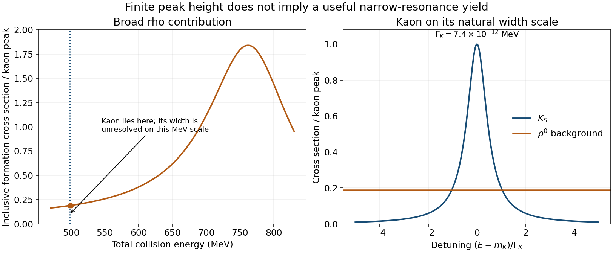

<h1 id="2/c/b/solution">Solution</h1>

↑ **Parent:** [B](../b.md)

Raising each beam energy to 250 MeV makes $E=500$ MeV. The [kaon](../../../../../kaon.md) denominator is now dominated by

$$
(E^2-m_K^2)^2=(500^2-498^2)^2=(1996\ \mathrm{MeV^2})^2,
$$

rather than by $E^2\Gamma_K^2$. Substituting into [a](../a.md) gives

$$
\boxed{\mathcal R_{\rm inclusive}(500)=5.606\times10^{22},\qquad
\mathcal R_{\pi\pi}(500)=8.125\times10^{22}.}
$$

The enormous change is a tiny-width effect, not a comparably abrupt change in the broad rho contribution. The center-of-momentum energy has moved about $2/(7.4\times10^{-12})\simeq2.7\times10^{11}$ [kaon](../../../../../kaon.md) widths from the peak. A width of $7.4\times10^{-12}$ MeV is only $7.4\times10^{-6}$ eV, requiring an energy-selection scale of order $10^{-14}$ relative to the several-hundred-MeV beam energy.

Real beams have vastly broader energy distributions. Averaging over such a distribution suppresses the useful narrow-resonance contribution: the finite peak value does not imply a large energy-integrated formation rate, whose resonant area shrinks with the width at fixed [branching fractions](../../../../../branching-fraction.md). The weak inverse-decay entrance coupling and the broad strong-interaction rho background therefore make this a poor way to study [kaon](../../../../../kaon.md) resonant formation. The supplied broad-resonance formula is used algebraically as requested; a practical calculation would convolve an appropriate narrow line shape with the actual beam distribution.

**[Figure 4](#2/c/b/image-a-broad-rho-background-and-an-extremely-narrow-kaon-resonance). A broad rho background and an extremely narrow kaon resonance**. Original evaluation of the stipulated line shapes. The kaon inset uses its own width-scale horizontal axis; drawing it visibly broad on a MeV axis would misrepresent the given width.

## ↑ Ancestors (13)

1. [B](../b.md)
2. [C](../../c.md)
3. [2](../../../2.md)
4. [2016](../../../../2016-split.md)
5. [Past exam of the sub-atomic physics course of the University of Oxford](../../../../split.md)
6. [Sub-atomic physics course of the University of Oxford](../../../../../sub-atomic-physics-course-of-the-university-of-oxford.md)
7. [Year 3 of the physics course of the University of Oxford](../../../../../year-3-of-the-physics-course-of-the-university-of-oxford.md)
8. [Physics course of the University of Oxford](../../../../../physics-course-of-the-university-of-oxford.md)
9. [Undergraduate course of the University of Oxford](../../../../../undergraduate-course-of-the-university-of-oxford.md)
10. [Course of the University of Oxford](../../../../../course-of-the-university-of-oxford.md)
11. [University of Oxford](../../../../../university-of-oxford-split.md)
12. [List of universities](../../../../../list-of-universities.md)
13. [Codex Wiki](../../../../../split.md)
