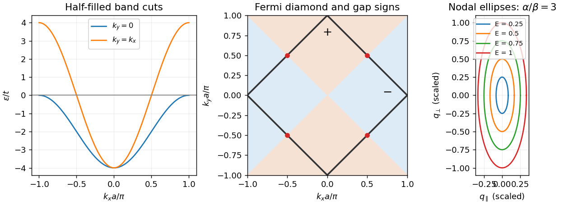

<h1 id="2/solution">Solution</h1>

↑ **Parent:** [2](../2.md)

Momentum-resolved photoemission and directional tunneling can map the magnitude and nodes of the cuprate gap. Low-temperature [heat capacity](../../../../heat-capacity.md), thermal transport and penetration-depth measurements constrain the low-energy [quasiparticle](../../../../quasiparticle.md) spectrum. These probes do not all determine the relative sign of the gap. A [phase-sensitive test of d-wave pairing](../../../../phase-sensitive-test-of-d-wave-pairing.md) uses Josephson [interference](../../../../interference-wave-propagation.md) between differently oriented crystal regions. In the [tricrystal half-flux experiment](../../../../tricrystal-half-flux-experiment.md), a superconducting film crosses three designed grain boundaries; a frustrated ring can produce a half-flux signal detected with a scanning [SQUID](../../../../squid.md). Unfrustrated geometries supply controls. This probes phase structure beyond merely finding a V-shaped tunneling spectrum.[1994, tricrystal geometry and flux measurement](../../../../pairing-symmetry-and-flux-quantization-in-a-tricrystal-superconducting-ring-by-c-c-tsuei-and-others.md)

For the ideal nearest-neighbor [square lattice](../../../../square-lattice.md) at one [electron](../../../../electron.md) per site including both spins, particle-hole symmetry puts the [chemical potential](../../../../chemical-potential-split.md) at zero. The two requested cuts are

$$
\varepsilon(k_x,0)=-2t(1+\cos k_xa),\qquad
\varepsilon(k_x,k_x)=-4t\cos k_xa.
$$

The first runs from $-4t$ at the zone center to zero at $k_xa=\pm\pi$; the diagonal cut crosses zero at $k_xa=\pm\pi/2$. The [Fermi surface](../../../../fermi-surface.md) obeys $\cos k_xa+\cos k_ya=0$, giving the diamond $|k_x|+|k_y|=\pi/a$ in the [first Brillouin zone](../../../../first-brillouin-zone.md).

**[Figure 1](#2/image-half-filled-square-lattice-band-cuts-diamond-fermi-surface-and-anisotropic-nodal-quasiparticle-contours). Half-filled square-lattice band cuts, diamond Fermi surface and anisotropic nodal quasiparticle contours**.

Near the specified node define $\delta\mathbf k=\mathbf k-\mathbf k_0$ and

$$
q_\parallel=(\delta k_x+\delta k_y)/\sqrt2,\qquad
q_\perp=(\delta k_y-\delta k_x)/\sqrt2.
$$

Expanding $\cos(\pi/2+\delta k a)=-a\delta k+O((a\delta k)^3)$ gives

$$
\varepsilon_{\mathbf k}\simeq2ta(\delta k_x+\delta k_y)=\alpha q_\parallel,\qquad
\Delta_{\mathbf k}\simeq\Delta_0a(\delta k_y-\delta k_x)=\beta q_\perp,
$$

where $\alpha=2\sqrt2ta$ and $\beta=\sqrt2\Delta_0a$. Therefore

$$
\boxed{E^2\simeq\alpha^2q_\parallel^2+\beta^2q_\perp^2.}
$$

There are four such nodes. An [energy](../../../../energy-split.md) contour about one node encloses [momentum](../../../../momentum-split.md) area $\pi E^2/(\alpha\beta)$. Counting all four nodes and two independent spin [quasiparticles](../../../../quasiparticle.md), with one state per $(2\pi)^2$ of [momentum](../../../../momentum-split.md) area per unit real-space area, gives the positive-excitation count and [nodal quasiparticle density of states in a two-dimensional d-wave superconductor](../../../../nodal-quasiparticle-density-of-states-in-a-two-dimensional-d-wave-superconductor.md)

$$
\frac{\mathcal N(E)}{\mathcal A}=\frac{2E^2}{\pi\alpha\beta},\qquad
\boxed{\frac{g_{\rm qp}(E)}{\mathcal A}=\frac{4E}{\pi\alpha\beta}\quad(E>0).}
$$

This counts thermally excitable Bogoliubov modes, including particle-like and hole-like excitations, not the electron-addition spectral density alone. That distinction prevents a factor-of-two ambiguity. It is a per-layer result; dividing by the layer spacing gives the corresponding [volume](../../../../volume.md) density in the independent-layer approximation.

The thermal [energy](../../../../energy-split.md) density above its zero-temperature value follows from Fermi occupation:

$$
\frac{U(T)-U(0)}{\mathcal A}
=\frac4{\pi\alpha\beta}\int_0^\infty\frac{E^2\,dE}{e^{E/(k_BT)}+1}
=\frac{4I_2}{\pi\alpha\beta}(k_BT)^3,
\qquad I_2=\frac32\zeta(3)\simeq1.80.
$$

Thus

$$
\boxed{\frac C{\mathcal A}=\frac{12I_2}{\pi\alpha\beta}k_B^3T^2
\simeq\frac{21.6}{\pi\alpha\beta}k_B^3T^2.}
$$

This clean nodal contribution assumes $k_BT$ small compared with the scale over which [linearization](../../../../linearization.md) fails; impurity states and other excitations can add further terms.

In the [vortex](../../../../phase-vortex.md) state, each flux quantum occupies area of order $\pi R^2=\Phi_0/B$, so $R\propto B^{-1/2}$. Outside a core of radius $\xi$, the phase flow has magnitude $v_s(r)\simeq\kappa/(2\pi r)$ in the simple circular-cell estimate, with $\kappa=h/M_{\rm pair}$ and condensed-pair [mass](../../../../mass.md) $M_{\rm pair}$. Its cell average is

$$
\langle|v_s|\rangle\simeq\frac1{\pi R^2}\int_\xi^R\frac\kappa{2\pi r}\,2\pi r\,dr
=\frac{\kappa(R-\xi)}{\pi R^2}\propto\sqrt B.
$$

The **signed vector average can vanish** around a [vortex](../../../../phase-vortex.md); the relevant quantity is a typical magnitude or Doppler shift, not a net transport velocity. Flow shifts nodal energies by order $\hbar\mathbf v_s\cdot\mathbf k_F$. Because the zero-field nodal [density of states](../../../../density-of-states.md) is linear in [energy](../../../../energy-split.md), averaging the magnitude of these shifts produces a residual [density of states](../../../../density-of-states.md) proportional to $\sqrt B$. The resulting [Volovik effect](../../../../volovik-effect.md) gives

$$
\boxed{C(T,B)=\gamma(B)T+\cdots,\qquad \gamma(B)\propto\sqrt B.}
$$

This is the clean semiclassical nodal regime, at [temperatures](../../../../temperature-split.md) below the field-induced Doppler scale and in an appropriate mixed-state field range. Core states, disorder, [Zeeman splitting](../../../../zeeman-splitting.md) and screening can modify it. Its replacement by a square root of applied field additionally assumes the mean induction tracks that field away from the lower-critical-field onset; it is not an exact all-field law.

## ↑ Ancestors (13)

1. [2](../2.md)
2. [Paper 1](../../paper-1-split.md)
3. [2012](../../split.md)
4. [Past exam of the superconductivity and Quantum Coherence course of the University of Cambridge](../../../split.md)
5. [Superconductivity and Quantum Coherence course of the University of Cambridge](../../../../superconductivity-and-quantum-coherence-course-of-the-university-of-cambridge.md)
6. [Physics course of the year 4 of the natural sciences course of the University of Cambridge](../../../../physics-course-of-the-year-4-of-the-natural-sciences-course-of-the-university-of-cambridge.md)
7. [Year 4 of the natural sciences course of the University of Cambridge](../../../../year-4-of-the-natural-sciences-course-of-the-university-of-cambridge.md)
8. [Year of the natural sciences course of the University of Cambridge](../../../../year-of-the-natural-sciences-course-of-the-university-of-cambridge.md)
9. [Natural sciences course of the University of Cambridge](../../../../natural-sciences-course-of-the-university-of-cambridge.md)
10. [Course of the University of Cambridge](../../../../course-of-the-university-of-cambridge.md)
11. [University of Cambridge](../../../../university-of-cambridge-split.md)
12. [List of universities](../../../../list-of-universities.md)
13. [Codex Wiki](../../../../split.md)
