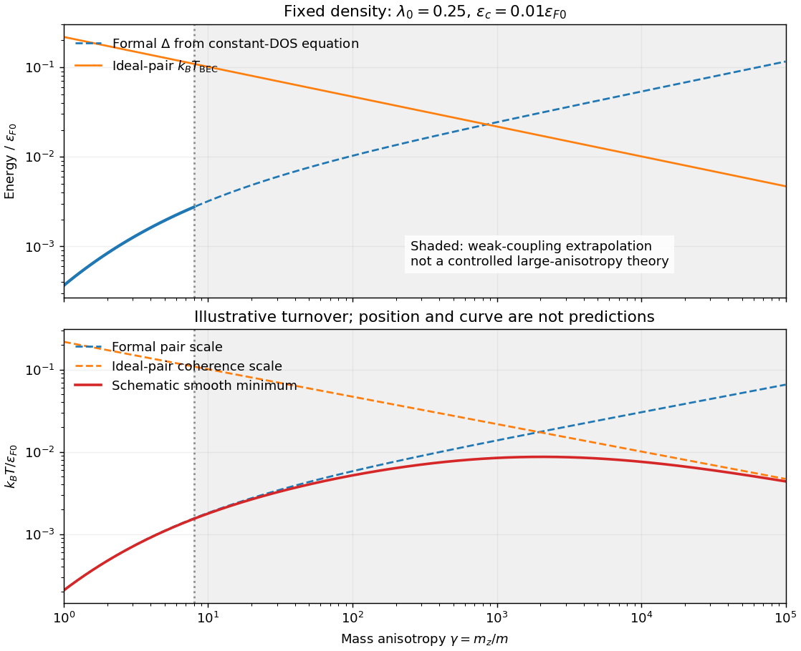

<h1 id="2/solution">Solution</h1>

↑ **Parent:** [2](../2.md)

In three dimensions an ideal Bose gas can saturate its excited-state population at [chemical potential](../../../../chemical-potential-split.md) zero, with the remaining particles forming a [Bose-Einstein condensate](../../../../bose-einstein-condensate.md). The transition follows from the [Bose-Einstein distribution](../../../../bose-einstein-distribution.md) integrated against its [density of states](../../../../density-of-states.md); below the ideal-gas transition, $n_0/n=1-(T/T_c)^{3/2}$. Condensation alone does not supply the finite [Landau critical velocity](../../../../landau-critical-velocity.md) of an interacting superfluid: the ideal quadratic spectrum has $\inf_pE(p)/p=0$.

By contrast, a weak attractive interaction near a [Fermi surface](../../../../fermi-surface.md) produces the Cooper instability and the [BCS gap equation](../../../../bcs-gap-equation.md). Its logarithmic enhancement permits pairing at arbitrarily weak attraction in the ideal model. The low-temperature excitations have $E=\sqrt{\xi^2+\Delta^2}$, and in weak coupling $k_BT_c=(e^{\gamma_E}/\pi)\Delta(0)\simeq0.567\Delta(0)$. This transition is controlled by pair formation when phase fluctuations are small; deeply bound pairs instead motivate a Bose-condensation description with their own density and effective [mass](../../../../mass.md).

For the given ellipsoidal dispersion, set $q_x=k_x$, $q_y=k_y$ and $q_z=k_z/\sqrt\gamma$. Then $\varepsilon=\hbar^2q^2/(2m)$ while the integration measure is $d^3k=\sqrt\gamma\,d^3q$. Thus the [anisotropic ideal-gas density of states](../../../../anisotropic-ideal-gas-density-of-states.md) per unit [volume](../../../../volume.md) and per internal state is

$$
\boxed{N(\varepsilon,\gamma)=\sqrt\gamma\,N(\varepsilon)
=\frac{\sqrt\gamma}{4\pi^2}\left(\frac{2m}{\hbar^2}\right)^{3/2}\sqrt\varepsilon.}
$$

The full continuum [momentum](../../../../momentum-split.md) range is assumed; this is an anisotropic three-dimensional gas, not yet a discrete stack of two-dimensional bands.

At the Bose transition, substitute $x=\varepsilon/(k_BT)$:

$$
n_B=\frac{\sqrt\gamma}{4\pi^2}\left(\frac{2m}{\hbar^2}\right)^{3/2}(k_BT)^{3/2}
\int_0^\infty\frac{x^{1/2}\,dx}{e^x-1}.
$$

The integral is $\Gamma(3/2)\zeta(3/2)\simeq2.315$. Solving for the [Bose-Einstein condensation temperature for an anisotropic effective mass](../../../../bose-einstein-condensation-temperature-for-an-anisotropic-effective-mass.md) gives

$$
\boxed{k_BT^{\rm BEC}=\frac{2\pi\hbar^2}{m}\left[\frac{n_B}{\sqrt\gamma\,\zeta(3/2)}\right]^{2/3}
\simeq\frac{3.31\hbar^2n_B^{2/3}}{m\gamma^{1/3}}.}
$$

The heavier $z$-direction effective [mass](../../../../mass.md) increases the available excited-state count and lowers the condensation [temperature](../../../../temperature-split.md) at fixed number density.

For a balanced two-spin Fermi gas, let $n_F$ denote total [fermion](../../../../fermion.md) number density and take $N_s$ to be the [single-spin density of states](../../../../single-spin-density-of-states.md) used in the conventional gap equation. Counting the filled ellipsoid gives

$$
\varepsilon_F(\gamma)=\frac{\hbar^2}{2m}(3\pi^2n_F)^{2/3}\gamma^{-1/3}
\equiv\varepsilon_{F0}\gamma^{-1/3},
$$

$$
N_s(\varepsilon_F,\gamma)=\frac{m(3\pi^2n_F)^{1/3}}{2\pi^2\hbar^2}\gamma^{1/3}
\equiv N_{s0}\gamma^{1/3}.
$$

If a spin-summed [density of states](../../../../density-of-states.md) is used instead, the coupling convention in the supplied integral must change accordingly; inserting a factor two into only one side would change the exponent incorrectly.

For $\varepsilon_c\ll\varepsilon_F$, replace the [density of states](../../../../density-of-states.md) across the interaction window by $N_s(\varepsilon_F,\gamma)$. Writing $\lambda_0=|g|N_{s0}$, the zero-temperature integral becomes

$$
1=\lambda_0\gamma^{1/3}\operatorname{arsinh}\left(\frac{\varepsilon_c}{\Delta}\right),
$$

and therefore

$$
\boxed{\Delta(\gamma)=\frac{\varepsilon_c}{\sinh[1/(\lambda_0\gamma^{1/3})]}
\simeq2\varepsilon_c\exp\left[-\frac1{\lambda_0\gamma^{1/3}}\right].}
$$

The second expression additionally requires $\lambda_0\gamma^{1/3}\ll1$. The explicit density dependence is $\lambda_0=|g|m(3\pi^2n_F)^{1/3}/(2\pi^2\hbar^2)$. This [mass-anisotropy enhancement of a weak-coupling BCS gap](../../../../mass-anisotropy-enhancement-of-a-weak-coupling-bcs-gap.md) initially raises the pairing scale, while the ideal Bose condensation scale decreases as $\gamma^{-1/3}$.

**[Figure 1](#2/image-formal-anisotropy-dependent-gap-and-bose-scales-with-a-schematic-coherence-limited-transition). Formal anisotropy-dependent gap and Bose scales, with a schematic coherence-limited transition**.

Large anisotropy weakens transport and coherence in the heavy direction. The separation of [pair formation and phase ordering](../../../../pair-formation-and-phase-ordering.md) then matters, so a large mean-field gap need not imply a large actual $T_c$. A qualitative sketch has $T_c$ initially rising with the pairing scale and eventually turning down when coherence is the smaller scale. If preformed [fermion](../../../../fermion.md) pairs behave as [bosons](../../../../boson.md), use $n_B=n_F/2$ and pair [mass](../../../../mass.md) about $2m$; in this continuum model this gives $k_BT^{\rm BEC}\simeq0.218\varepsilon_{F0}\gamma^{-1/3}$.

The turnover cannot be located reliably by taking the weak-coupling formulas to $\gamma\to\infty$: $\varepsilon_F$ falls, $\lambda_0\gamma^{1/3}$ grows, the narrow-window assumption fails and the pair [chemical potential](../../../../chemical-potential-split.md) and [mass](../../../../mass.md) require a self-consistent treatment. The smooth curve in the figure is explicitly an illustrative interpolation of two extrapolated scales, not such a calculation. If actual decoupled two-dimensional layers are approached, ordinary ideal-gas finite-temperature condensation is absent and interacting phase order requires a different analysis, including the [Berezinskii–Kosterlitz–Thouless transition](../../../../berezinskii-kosterlitz-thouless-transition.md) when appropriate.

The cuprates make the distinction between pairing and phase coherence relevant: they are layered and have anisotropic motion, but their strong correlations, lattice band structure and predominantly [d-wave superconductivity](../../../../d-wave-superconductivity.md) are outside this attractive continuum $s$-wave model. Anisotropy by itself is therefore not an explanation or quantitative fit of cuprate transition [temperatures](../../../../temperature-split.md).

## ↑ Ancestors (13)

1. [2](../2.md)
2. [Paper 1](../../paper-1-split.md)
3. [2013](../../split.md)
4. [Past exam of the superconductivity and Quantum Coherence course of the University of Cambridge](../../../split.md)
5. [Superconductivity and Quantum Coherence course of the University of Cambridge](../../../../superconductivity-and-quantum-coherence-course-of-the-university-of-cambridge.md)
6. [Physics course of the year 4 of the natural sciences course of the University of Cambridge](../../../../physics-course-of-the-year-4-of-the-natural-sciences-course-of-the-university-of-cambridge.md)
7. [Year 4 of the natural sciences course of the University of Cambridge](../../../../year-4-of-the-natural-sciences-course-of-the-university-of-cambridge.md)
8. [Year of the natural sciences course of the University of Cambridge](../../../../year-of-the-natural-sciences-course-of-the-university-of-cambridge.md)
9. [Natural sciences course of the University of Cambridge](../../../../natural-sciences-course-of-the-university-of-cambridge.md)
10. [Course of the University of Cambridge](../../../../course-of-the-university-of-cambridge.md)
11. [University of Cambridge](../../../../university-of-cambridge-split.md)
12. [List of universities](../../../../list-of-universities.md)
13. [Codex Wiki](../../../../split.md)
