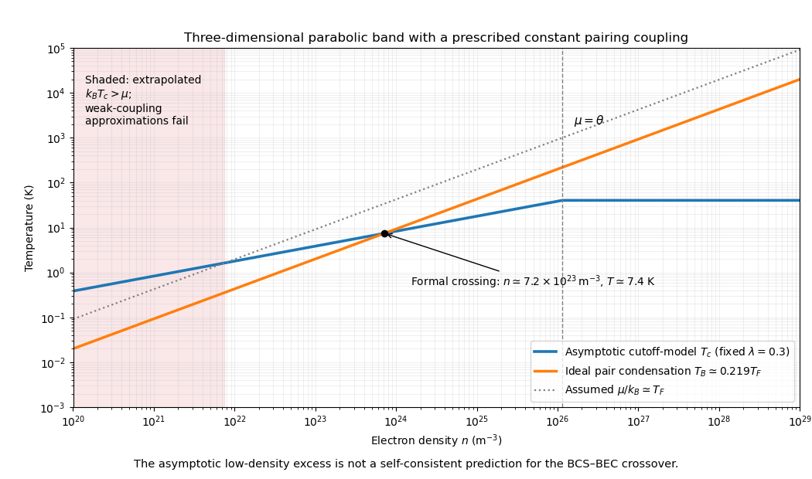

<h1 id="2/solution">Solution</h1>

↑ **Parent:** [2](../2.md)

The [electron-phonon interaction](../../../../electron-phonon-interaction.md) lets one [electron](../../../../electron.md) polarize the ionic lattice and another interact with that delayed deformation. [Phonon-mediated electron attraction](../../../../phonon-mediated-electron-attraction.md) acts over [energy](../../../../energy-split.md) transfers below a characteristic phonon scale. Pairing additionally requires a net attractive interaction in some allowed pairing channel after screened Coulomb repulsion is included. In the conventional weak-coupling situation, retardation separates the low phonon scale from the much larger electronic scale, reducing the effective repulsion. The [Cooper instability](../../../../cooper-instability.md) then makes a [Fermi surface](../../../../fermi-surface.md) unstable to an arbitrarily weak net attraction in the idealized channel; finite [temperature](../../../../temperature-split.md) cuts off its logarithmic enhancement.

In [BCS theory](../../../../bcs-theory.md), a momentum-independent pairing amplitude within the cutoff obeys a self-consistency equation containing $\tanh(E/2k_BT)/(2E)$, with [quasiparticle](../../../../quasiparticle.md) [energy](../../../../energy-split.md) $E=\sqrt{\xi^2+|\Delta|^2}$. At a continuous transition, take $\Delta\to0$. A constant effective [density of states](../../../../density-of-states.md) and coupling combine into $\lambda$, while the band bottom truncates the negative-energy side at $-\sigma$, with $\sigma=\min(\mu,\theta)$. This gives the supplied linearized gap equation. Its integrand is even, so with

$$
I(a,T)=\int_0^a\frac{d\xi}{\xi}\tanh\frac{\xi}{2k_BT},
$$

it becomes $1/\lambda=[I(\theta,T_c)+I(\sigma,T_c)]/2$. If both cutoffs are much larger than $k_BT_c$, the given large-cutoff integral gives $I(a,T_c)\simeq\ln(1.13a/(k_BT_c))$. Consequently the [asymmetric-cutoff BCS transition temperature](../../../../asymmetric-cutoff-bcs-transition-temperature.md) is

$$
\frac1\lambda\simeq\ln\frac{1.13\sqrt{\theta\sigma}}{k_BT_c},\qquad
\boxed{k_BT_c\simeq1.13\sqrt{\theta\sigma}\,e^{-1/\lambda}.}
$$

For $\mu>\theta$, this reduces to $1.13\theta e^{-1/\lambda}$; for $0<\mu<\theta$, it is $1.13\sqrt{\theta\mu}\,e^{-1/\lambda}$. The second limit requires $k_BT_c\ll\mu$ as well as $k_BT_c\ll\theta$. Weak $\lambda$ at fixed nonzero $\mu/\theta$ supplies that limit, but taking $\mu\to0$ afterward need not preserve it.

For a three-dimensional spin-degenerate parabolic [electron](../../../../electron.md) band in the degenerate regime,

$$
\mu\simeq E_F=\frac{\hbar^2}{2m}(3\pi^2n)^{2/3}.
$$

Define

$$
n_\theta=\frac1{3\pi^2}\left(\frac{2m\theta}{\hbar^2}\right)^{3/2},\qquad
T_0=\frac{1.13\theta}{k_B}e^{-1/\lambda},\qquad u=\frac n{n_\theta}.
$$

Holding the other model parameters fixed gives

$$
\boxed{T_c(n)\simeq
\begin{cases}
T_0u^{1/3},&0<u<1,\\
T_0,&u\ge1.
\end{cases}}
$$

Thus the log-log slope is $1/3$ below the cutoff-density scale and zero above it. For the specified parameters,

$$
\boxed{n_\theta\simeq1.15\times10^{26}\,\mathrm{m^{-3}},\qquad T_0\simeq40.3\,\mathrm K.}
$$

This [density crossover of a fixed-coupling BCS cutoff model](../../../../density-crossover-of-a-fixed-coupling-bcs-cutoff-model.md) is the requested prescribed model. A real three-dimensional parabolic band also has a changing [density of states](../../../../density-of-states.md), so keeping $\lambda$ constant as density varies is an additional imposed assumption, not a consequence of that dispersion.

For noninteracting spinless bosonic pairs, [mass](../../../../mass.md) $m_B=2m$ and density $n_B=n/2$, [homogeneous ideal Bose gas condensation](../../../../homogeneous-ideal-bose-gas-condensation.md) gives

$$
T_B=\frac{2\pi\hbar^2}{2mk_B}
\left[\frac{n/2}{\zeta(3/2)}\right]^{2/3}
=C_BT_F,\qquad T_F=E_F/k_B.
$$

Using the supplied integral $I_B=\int_0^\infty x^{1/2}/(e^x-1)\,dx\simeq2.3$ gives $C_B=\frac12[2/(3I_B)]^{2/3}\simeq0.219$. Its slight difference from the more precise $0.218$ is consistent with the rounded integral. Write $a=T_0/(\theta/k_B)=1.13e^{-1/\lambda}\simeq0.0403$. On the low-density branch,

$$
\frac{T_c}{T_B}=\frac{a}{C_B}u^{-1/3}.
$$

Since $a/C_B<1$, no part of the high-density plateau exceeds $T_B$. The formal crossing condition is

$$
\boxed{u<\left(\frac{a}{C_B}\right)^3\simeq0.00624,
\qquad n\lesssim7.2\times10^{23}\,\mathrm{m^{-3}}.}
$$

The crossing occurs near $T_c\simeq7.4\,\mathrm K$ and $T_F\simeq34\,\mathrm K$.

**[Figure 1](#2/image-fixed-coupling-bcs-cutoff-prediction-compared-with-ideal-condensation-of-bosonic-pairs). Fixed-coupling BCS cutoff prediction compared with ideal condensation of bosonic pairs**.

The apparent low-density excess should not be read as a reliable transition above the ideal condensation scale of preformed pairs. On this extrapolation $k_BT_c/\mu=a u^{-1/3}$ grows without bound, violating the degenerate-gas and large-lower-cutoff approximations. It reaches one already near $7.5\times10^{21}\,\mathrm{m^{-3}}$; well before using an arbitrarily small density, the [chemical potential](../../../../chemical-potential-split.md), pairing, [density of states](../../../../density-of-states.md) and pair fluctuations need a self-consistent treatment. The asymptotic formula and ideal-boson curve compare two stipulated models, rather than solving the full [BCS-BEC crossover](../../../../bcs-bec-crossover.md).

## ↑ Ancestors (13)

1. [2](../2.md)
2. [Paper 1](../../paper-1-split.md)
3. [2014](../../split.md)
4. [Past exam of the superconductivity and Quantum Coherence course of the University of Cambridge](../../../split.md)
5. [Superconductivity and Quantum Coherence course of the University of Cambridge](../../../../superconductivity-and-quantum-coherence-course-of-the-university-of-cambridge.md)
6. [Physics course of the year 4 of the natural sciences course of the University of Cambridge](../../../../physics-course-of-the-year-4-of-the-natural-sciences-course-of-the-university-of-cambridge.md)
7. [Year 4 of the natural sciences course of the University of Cambridge](../../../../year-4-of-the-natural-sciences-course-of-the-university-of-cambridge.md)
8. [Year of the natural sciences course of the University of Cambridge](../../../../year-of-the-natural-sciences-course-of-the-university-of-cambridge.md)
9. [Natural sciences course of the University of Cambridge](../../../../natural-sciences-course-of-the-university-of-cambridge.md)
10. [Course of the University of Cambridge](../../../../course-of-the-university-of-cambridge.md)
11. [University of Cambridge](../../../../university-of-cambridge-split.md)
12. [List of universities](../../../../list-of-universities.md)
13. [Codex Wiki](../../../../split.md)
