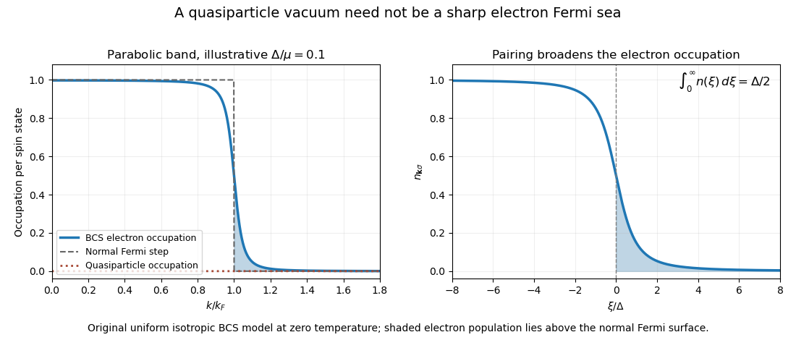

# Paper 1

↑ **Parent:** [2015](../2015.md)

Original public paper: [Physical PDF pages 765–767](https://www.whatdotheyknow.com/request/natural_science_tripos_physics_e_2/response/2340776/attach/2/FOI%202023%20399%20Zahid%20materials.pdf?cookie_passthrough=1#page=765). All questions and all optional notes are answered. The population above a normal-state [Fermi surface](../../fermi-liquid.md#fermi-surface) is distinguished from a bosonic condensate depletion and from a [quasiparticle](../../quantum-mechanics.md#quasiparticle) population.

**Table of contents**

- [1](#1)
  - [a](#1/a)
    - [Solution](#1/a/solution)
  - [b](#1/b)
    - [Solution](#1/b/solution)
  - [c](#1/c)
    - [Solution](#1/c/solution)
  - [d](#1/d)
    - [Solution](#1/d/solution)
- [2](#2)
  - [Solution](#2/solution)
- [3](#3)
  - [Solution](#3/solution)

## 1

↑ **Parent:** [Paper 1](paper-1.md)

<h3 id="1/a">a</h3>

↑ **Parent:** [1](#1)

<h4 id="1/a/solution">Solution</h4>

↑ **Parent:** [A](#1/a)

A [Josephson junction](../../superconductivity.md#josephson-junction) converts a relative condensate phase into a measurable current. For superconductors the relevant coherent object is a [Cooper pair](../../fermi-liquid.md#cooper-pair), with electric charge $q=-2e$. Its [Gauge-invariant Josephson phase](../../superconductivity.md#gauge-invariant-josephson-phase) is

$$
\delta=\phi_2-\phi_1-\frac q\hbar\int_1^2\mathbf A\cdot d\mathbf l.
$$

With a consistent directed-current convention, the weak-link relation is $I_s=I_c\sin\delta$. A voltage $V=U_2-U_1$ gives $\dot\delta=2eV/\hbar$, so a constant voltage produces the [AC Josephson effect](../../superconductivity.md#ac-josephson-effect) at [frequency](../../wave.md#frequency) $2e|V|/h$. For neutral atom reservoirs the phase evolution instead follows their chemical-potential difference, $\hbar\dot\delta=\mu_1-\mu_2$ with the displayed phase labeling. The current transfers atoms rather than electric charge, but still probes coherent matter-wave amplitudes.

A [DC SQUID](../../superconductivity.md#dc-squid) provides two coherent paths around a superconducting loop. Neglect loop self-inductance, take equal junction critical currents $I_0$, and let $\Phi$ be the enclosed flux. The relative junction phase differs by $2\pi\Phi/\Phi_0$, with [superconducting flux quantum](../../quantum-theory.md#superconducting-flux-quantum) $\Phi_0=h/(2e)$. Adding the two sinusoidal currents and maximizing over their common phase gives

$$
\boxed{I_{c,\rm loop}(\Phi)=2I_0\left|\cos\frac{\pi\Phi}{\Phi_0}\right|.}
$$

For unequal junctions the corresponding result is $\sqrt{I_1^2+I_2^2+2I_1I_2\cos(2\pi\Phi/\Phi_0)}$. Finite inductance and junction asymmetry alter the ideal modulation, so a measured minimum need not be zero. Flux changes a phase difference between the paths; the detector reads the resulting critical-current or voltage modulation. The [Jaklevic Josephson interference experiment](../../superconductivity.md#jaklevic-josephson-interference-experiment) established superconducting [interference](../../physical-optics.md#interference-wave-propagation) experimentally.[1964 primary report](../../physics-bibliography.md#quantum-interference-effects-in-josephson-tunneling-by-r-c-jaklevic-and-others)

A [bosonic Josephson junction](../../statistical-physics.md#bosonic-josephson-junction) uses two weakly linked Bose-Einstein condensates. In the [Albiez double-well Josephson experiment](../../statistical-physics.md#albiez-double-well-josephson-experiment), the population distribution was measured in situ and the relative phase inferred from [interference](../../physical-optics.md#interference-wave-propagation) fringes. The apparatus therefore tests both number transfer and phase coherence, rather than interpreting a density oscillation alone as a phase measurement. Interactions make the dynamics nonlinear: large imbalance can produce self-trapping instead of simple tunneling oscillations.[2005 abstract: double-well implementation, density measurement, phase from fringes and nonlinear self-trapping](../../physics-bibliography.md#direct-observation-of-tunneling-and-nonlinear-self-trapping-in-a-single-bosonic-josephson-junction-by-michael-albiez-and-others)

The usefulness is interferometric sensitivity: a small phase perturbation can change a measurable current. It requires a coherent weak link, controlled phase noise and the appropriate particle's phase evolution; a generic insulating barrier between incoherent reservoirs is not already a matter-wave interferometer.

<h3 id="1/b">b</h3>

↑ **Parent:** [1](#1)

<h4 id="1/b/solution">Solution</h4>

↑ **Parent:** [B](#1/b)

The [superconducting critical current](../../superconductivity.md#superconducting-critical-current) depends on [temperature](../../temperature.md), [magnetic field](../../magnetic-field.md), sample geometry and the chosen dissipation criterion. For a magnet, a large [superconducting critical current density](../../superconductivity.md#superconducting-critical-current-density) matters because it permits a useful winding current with manageable conductor [volume](../../geometry-and-topology.md#volume). The intrinsic depairing limit is an upper bound, but many practical type-II conductors become dissipative first through vortex motion.

A current exerts a transverse [force](../../force.md) per unit vortex length $\mathbf f_L=\mathbf J\times\boldsymbol\Phi_0$. Moving flux produces an [electric field](../../electric-field.md) and dissipation. [Flux pinning](../../superconductivity.md#flux-pinning) holds vortices at energetically favorable defects, allowing a larger transport current before motion. Useful conductors therefore need pinning as well as a sufficiently high transition [temperature](../../temperature.md) and upper critical field. Simply increasing disorder indefinitely is not a prescription: it can damage connectivity or superconductivity. High-angle grain boundaries in some copper-oxide materials also act as weak links, motivating controlled texture and connected current paths.

Conventional magnet conductors include [niobium-titanium](../../superconductivity.md#niobium-titanium) and [niobium-tin](../../superconductivity.md#niobium-tin); high-temperature coated conductors offer other operating regimes. Their performance must be compared on a [superconducting critical surface](../../superconductivity.md#superconducting-critical-surface) in [temperature](../../temperature.md), field and current density, with strain and thermal constraints also relevant. A high self-field current measured in a short sample does not by itself establish the current available throughout a high-field coil.

A [superconducting magnet](../../superconductivity.md#superconducting-magnet) produces a strong, stable field without the normal winding's steady resistive power loss. Applications include [magnetic resonance imaging](../../nuclear-magnetic-resonance.md#magnetic-resonance-imaging), [nuclear magnetic resonance](../../nuclear-magnetic-resonance.md) and charged-particle beam steering or focusing in accelerators. A persistent-current loop is valuable when field stability matters. Refrigeration still requires power, and the magnet stores magnetic [energy](../../energy.md), approximately $LI^2/2$ in a linear inductance model. A local transition to a resistive state can release that stored [energy](../../energy.md) as heat, so [superconducting quench](../../superconductivity.md#superconducting-quench) detection and protection are essential to operation. These requirements connect the microscopic vortex physics with useful engineering performance.

<h3 id="1/c">c</h3>

↑ **Parent:** [1](#1)

<h4 id="1/c/solution">Solution</h4>

↑ **Parent:** [C](#1/c)

The superconducting order is a coherent pair amplitude, schematically $\Delta\propto\langle c_\downarrow c_\uparrow\rangle=|\Delta|e^{i\phi}$. Under a global [fermion](../../tensor-product-of-quantum-systems.md#fermion) phase change $c\mapsto e^{i\alpha}c$, it acquires phase $2\alpha$. A symmetry-broken thermodynamic description selects a pair phase. This must be distinguished from electromagnetic gauge freedom: a local gauge transformation changes the phase and potentials together and is a redundancy of the description, not an observable symmetry that the material literally violates.

A conventional centrosymmetric [s-wave superconductor](../../superconductivity.md#s-wave-superconductor) usually has an even-parity orbital pair state and a [spin singlet state](../../bell-state.md#spin-singlet-state), consistent with the antisymmetry of two [fermions](../../tensor-product-of-quantum-systems.md#fermion). Its ordinary zero-field equilibrium state preserves time reversal. The electromagnetic coupling makes phase dynamics and screening part of the [Anderson-Higgs mechanism in a superconductor](../../superconductivity.md#anderson-higgs-mechanism-in-a-superconductor); the [Meissner effect](../../magnetic-field.md#meissner-effect) is a measurable consequence. The condensate phase description does not imply that electric charge is no longer conserved.

In an [unconventional superconductor](../../superconductivity.md#unconventional-superconductor), the gap can transform nontrivially under the crystal point group or have other nonstandard pairing structure. A common example is [d-wave superconductivity](../../superconductivity.md#d-wave-superconductivity), with sign changes and possible nodes in the gap. This does not automatically imply an additional observable fourfold-rotation breaking: a rotation that reverses the gap's sign can be accompanied by a gauge phase change. A nematic superconducting state instead breaks an actual crystal rotation symmetry in its gauge-invariant responses.

A chiral combination such as $p_x+ip_y$ can break time reversal, while a spin-triplet [order parameter](../../critical-phenomenon.md#order-parameter) can also distinguish spin directions when the applicable spin-rotation and spin-orbit constraints permit it. [Helium-3 superfluidity](../../statistical-physics.md#helium-3-superfluidity) illustrates paired-fermion order with richer spin and orbital structure. These possibilities must be tested rather than equated: **unconventional pairing does not by itself mean spin-triplet pairing, time-reversal breaking, or nematicity**. Gap angular dependence, phase-sensitive [interference](../../physical-optics.md#interference-wave-propagation), spin response and spontaneous magnetic signatures probe different symmetry questions. The [phase-sensitive test of d-wave pairing](../../fermi-liquid.md#phase-sensitive-test-of-d-wave-pairing) is more specific than inferring a gap sign merely from its magnitude.

<h3 id="1/d">d</h3>

↑ **Parent:** [1](#1)

<h4 id="1/d/solution">Solution</h4>

↑ **Parent:** [D](#1/d)

For a neutral condensate with [order parameter](../../critical-phenomenon.md#order-parameter) $\psi=\sqrt{n_s}e^{i\phi}$, the [superfluid velocity](../../statistical-physics.md#superfluid-velocity) away from singularities is $\mathbf v_s=\hbar\nabla\phi/m$. Single-valuedness around a closed contour gives $\oint\nabla\phi\cdot d\mathbf l=2\pi n$, hence [quantization of circulation](../../critical-phenomenon.md#quantized-circulation):

$$
\boxed{\oint\mathbf v_s\cdot d\mathbf l=n\frac hm.}
$$

The [mass](../../classical-mechanics.md#mass) is that of the condensed object: an atom for a bosonic atomic superfluid, or a pair for a paired-fermion condensate. A nonzero winding cannot be continuously removed while the [order parameter](../../critical-phenomenon.md#order-parameter) remains nonzero throughout a spanning region. A vortex allows its phase to wind while its amplitude vanishes in a core.

For a charged condensate, minimal coupling gives $m\mathbf v_s+q\mathbf A=\hbar\nabla\phi$. Thus

$$
\boxed{\Phi+\frac mq\oint\mathbf v_s\cdot d\mathbf l=n\frac hq.}
$$

Using $\mathbf j_s=n_sq\mathbf v_s$ and $\lambda_L^2=m/(\mu_0n_sq^2)$ gives the [fluxoid and flux quantization in a superconductor](../../quantum-theory.md#fluxoid-and-flux-quantization-in-a-superconductor) relation $\Phi+\mu_0\lambda_L^2\oint\mathbf j_s\cdot d\mathbf l=nh/q$. The signs of oriented flux and winding depend on the signed pair charge; the magnitude of the elementary superconducting flux quantum is **$\Phi_0=h/(2e)$**. Flux alone is quantized when the current term is negligible on a contour deep in the bulk. A thin ring or a contour near a core can instead require the full fluxoid.

In a neutral superfluid, vortex flow carries [kinetic energy](../../energy.md#kinetic-energy) and [angular momentum](../../momentum.md#angular-momentum). Rotation can favor vortices because equilibrium minimizes the rotating-frame quantity $E-\boldsymbol\Omega\cdot\mathbf L$. The core size is set by a coherence or healing scale. In a type-II superconductor, an [Abrikosov vortex](../../superconductivity.md#abrikosov-vortex) carries quantized [magnetic flux](../../magnetic-field.md#magnetic-flux) and circulating supercurrent; its core scale is the [coherence length](../../physical-optics.md#optical-coherence-length) and its magnetic screening scale is the penetration depth. Between the lower and upper critical fields, a vortex lattice can be favored. [Flux pinning](../../superconductivity.md#flux-pinning) affects how that structure responds to current. Type-I bulk superconductors instead favor macroscopic normal/superconducting separation rather than the usual stable dilute Abrikosov-vortex regime.

## 2

↑ **Parent:** [Paper 1](paper-1.md)

<h3 id="2/solution">Solution</h3>

↑ **Parent:** [2](#2)

[Condensate depletion](../../quantum-ideal-gas-statistics.md#condensate-depletion) means particles outside a macroscopically occupied bosonic single-particle mode. Interactions can deplete that mode even at zero [temperature](../../temperature.md): the [Bogoliubov transformation](../../quantum-field-theory.md#bogoliubov-transformation) mixes creation and [annihilation operators](../../quantum-harmonic-oscillator.md#annihilation-operator), so its [quasiparticle](../../quantum-mechanics.md#quasiparticle) vacuum contains particles at nonzero [momentum](../../momentum.md). A weak homogeneous three-dimensional gas with repulsive scattering length $a_s$ has leading [quantum depletion of a Bose condensate](../../quantum-ideal-gas-statistics.md#quantum-depletion-of-a-bose-condensate)

$$
\frac{n-n_0}{n}=\frac8{3\sqrt\pi}\sqrt{na_s^3},\qquad na_s^3\ll1.
$$

Thermal [quasiparticles](../../quantum-mechanics.md#quasiparticle) add another contribution. Depletion and normal-fluid density are distinct: a Galilean-invariant fluid can have quantum depletion while retaining its full superfluid [mass](../../classical-mechanics.md#mass) response at zero [temperature](../../temperature.md).

For the fermionic pairing problem, mean-field decoupling of the [reduced BCS pairing Hamiltonian](../../fermi-liquid.md#reduced-bcs-pairing-hamiltonian) introduces the anomalous amplitude $\Delta$. Each paired Nambu block has diagonal entries $\xi_{\mathbf k},-\xi_{\mathbf k}$ and off-diagonal pairing entries of magnitude $\Delta$. A phase convention with negative off-diagonal entries gives eigenvalues $\pm E_{\mathbf k}$, where $E_{\mathbf k}=\sqrt{\xi_{\mathbf k}^2+\Delta^2}$. Its canonical Bogoliubov rotation yields the [BCS coherence factors](../../fermi-liquid.md#bcs-coherence-factors)

$$
u_{\mathbf k}=\frac1{\sqrt{1+s_{\mathbf k}^2}},\qquad
v_{\mathbf k}=\frac{s_{\mathbf k}}{\sqrt{1+s_{\mathbf k}^2}},\qquad
\frac{v_{\mathbf k}}{u_{\mathbf k}}=\frac{E_{\mathbf k}-\xi_{\mathbf k}}\Delta.
$$

The partner transformation has the complementary sign required by fermionic anticommutation. At zero [temperature](../../temperature.md) all positive-energy [BCS quasiparticle](../../fermi-liquid.md#bcs-quasiparticle) modes are empty. Expanding the supplied [electron](../../physics.md#electron) operator therefore gives

$$
\langle a^\dagger_{\mathbf k\sigma}a_{\mathbf k\sigma}\rangle
=u_{\mathbf k}^2\langle\alpha^\dagger\alpha\rangle
+v_{\mathbf k}^2\langle\alpha\alpha^\dagger\rangle=v_{\mathbf k}^2.
$$

Since $E_{\mathbf k}^2-\xi_{\mathbf k}^2=\Delta^2$,

$$
\boxed{n_{\mathbf k\sigma}=\frac{s_{\mathbf k}^2}{1+s_{\mathbf k}^2}
=\frac12\left(1-\frac{\xi_{\mathbf k}}{\sqrt{\xi_{\mathbf k}^2+\Delta^2}}\right).}
$$

The [electron](../../physics.md#electron) occupation is close to one far below the normal-state [Fermi surface](../../fermi-liquid.md#fermi-surface), equals one half at $\xi=0$, and decays toward zero above it. Pairing smooths the Fermi step over an [energy](../../energy.md) range of order $\Delta$. The positive-energy [quasiparticle](../../quantum-mechanics.md#quasiparticle) occupation is instead zero everywhere at this [temperature](../../temperature.md); the [electron](../../physics.md#electron) sea and the [quasiparticle](../../quantum-mechanics.md#quasiparticle) vacuum are different descriptions of the same state. At finite [temperature](../../temperature.md), $n_{\mathbf k\sigma}=[1-(\xi/E)\tanh(E/(2k_BT))]/2$ in the same mean-field model.

**[Figure 1](#2/image-zero-quasiparticle-occupation-coexists-with-electron-population-above-the-normal-state-fermi-surface). Zero quasiparticle occupation coexists with electron population above the normal-state Fermi surface**. Original isotropic BCS calculation. The left panel uses an illustrative gap-to-chemical-potential ratio of 0.1; it is not measured mercury or cuprate data.

For a three-dimensional parabolic normal band, the total [density of states](../../quantum-ideal-gas-statistics.md#density-of-states) including both spins is $D(\mu)=3N/(2\mu)$. In the weak-gap limit, replace it by this constant across the narrow pairing region and use $\mu\simeq E_F$. The number of [electrons](../../physics.md#electron) above the normal-state [Fermi surface](../../fermi-liquid.md#fermi-surface) is

$$
\Delta N\simeq D(\mu)\int_0^\infty\frac12\left(1-\frac\xi{\sqrt{\xi^2+\Delta^2}}\right)d\xi.
$$

The integral is $[\xi-\sqrt{\xi^2+\Delta^2}]_0^\infty/2=\Delta/2$. Therefore the [BCS population above the normal-state Fermi surface](../../fermi-liquid.md#bcs-population-above-the-normal-state-fermi-surface) is

$$
\boxed{\frac{\Delta N}{N}\simeq\frac{3\Delta}{4\mu}.}
$$

The constant-density-of-states approximation and a small gap relative to the [chemical potential](../../chemical-potential.md) are essential. This is the question's explicitly defined fermionic population measure; it is not the fraction of [electrons](../../physics.md#electron) outside a single bosonic condensate orbital.

For an order-of-magnitude mercury estimate, use $T_c\simeq4.2\,\mathrm K$ and the weak-coupling scale $\Delta_0\simeq1.76k_BT_c\simeq0.64\,\mathrm{meV}$, with a representative metallic $\mu\simeq7\,\mathrm{eV}$. These input approximations give **$\Delta N/N\sim7\times10^{-5}$, of order $10^{-4}$**. The use of a weak-coupling gap is an estimate, not an assertion of mercury's exact measured gap.

For a copper oxide, an illustrative gap $20\,\mathrm{meV}$ and effective chemical-potential scale $0.5\,\mathrm{eV}$ give **about three per cent** in this formula. Choosing $0.2$–$1\,\mathrm{eV}$ instead gives roughly $7.5$–$1.5$ per cent. These are explicit example inputs: the paper specifies no compound, doping or band parameters from which a unique number follows. A real cuprate's anisotropic gap, quasi-two-dimensional band and strong correlations require a band-resolved occupation integral, so the reliable contrast is the much larger gap-to-electronic-energy scale, rather than a universal cuprate percentage.

## 3

↑ **Parent:** [Paper 1](paper-1.md)

<h3 id="3/solution">Solution</h3>

↑ **Parent:** [3](#3)

A bosonic [coherent state](../../quantum-theory.md#coherent-state) is an eigenstate of its annihilation operator,

$$
|\alpha\rangle=e^{-|\alpha|^2/2}e^{\alpha a^\dagger}|0\rangle
=e^{-|\alpha|^2/2}\sum_{n=0}^\infty\frac{\alpha^n}{\sqrt{n!}}|n\rangle,
\qquad a|\alpha\rangle=\alpha|\alpha\rangle.
$$

Its mean occupation is $|\alpha|^2$ and its number variance is also $|\alpha|^2$, giving a Poisson number distribution. It has a well-defined complex mean field but fluctuating particle number. Its overlap with another coherent state is $\exp[-(|\alpha|^2+|\beta|^2)/2+\alpha^*\beta]$, so distinct amplitudes need not be orthogonal. For large occupation, a phase-space wave packet has small relative number fluctuations; this does not require an exact self-adjoint phase operator conjugate to a number bounded below.

For a bosonic field, a useful [coherent-field condensate variational state](../../quantum-theory.md#coherent-field-condensate-variational-state) is

$$
|\psi\rangle=e^{-\bar N/2}\exp\left[\int d^3r\,\psi(\mathbf r)\widehat\Psi^\dagger(\mathbf r)\right]|0\rangle,
\qquad \bar N=\int d^3r\,|\psi|^2.
$$

It obeys $\langle\widehat\Psi(\mathbf r)\rangle=\psi(\mathbf r)$. For a contact-interacting dilute Bose gas, its normal-ordered [energy](../../energy.md) expectation is

$$
E[\psi]=\int d^3r\left[\frac{\hbar^2}{2m}|\nabla\psi|^2+V|\psi|^2+\frac g2|\psi|^4\right].
$$

Minimizing $E-\mu\bar N$ gives the stationary [Gross–Pitaevskii equation](../../quantum-ideal-gas-statistics.md#gross-pitaevskii-equation), $[-\hbar^2\nabla^2/(2m)+V+g|\psi|^2]\psi=\mu\psi$. Its phase gradient determines superfluid flow, while weak-link phase differences give Josephson currents. The complex microscopic expectation supplies the order field used by a mean-field description of a bosonic superfluid.

An exactly fixed-number condensate can instead use the [Hartree product state](../../quantum-mechanics.md#hartree-product-state) $(a^\dagger_\varphi)^N|0\rangle/\sqrt{N!}$. Its one-point field expectation vanishes by number conservation, but its one-body [density matrix](../../density-matrix.md) has a macroscopic eigenvalue. [Off-diagonal long-range order](../../critical-phenomenon.md#off-diagonal-long-range-order) expresses that number-conserving criterion. Selecting a phase is a useful thermodynamic symmetry-broken description; it is not a claim that every finite isolated condensate literally has indefinite total number. A plain coherent product also misses interaction-induced quantum depletion, which needs correlations such as those in the Bogoliubov [quasiparticle](../../quantum-mechanics.md#quasiparticle) vacuum.

In a spin-singlet superconductor, the corresponding variational state is the [BCS ground state](../../fermi-liquid.md#bcs-ground-state)

$$
|\mathrm{BCS}\rangle=\prod_{\mathbf k}\left(u_{\mathbf k}
+v_{\mathbf k}a^\dagger_{\mathbf k\uparrow}a^\dagger_{-\mathbf k\downarrow}\right)|0\rangle,
\qquad |u_{\mathbf k}|^2+|v_{\mathbf k}|^2=1.
$$

Each block superposes an empty and an occupied pair state. Where $u_{\mathbf k}\ne0$, it can be rewritten as $(\prod u_{\mathbf k})\exp[\sum(v_{\mathbf k}/u_{\mathbf k})a^\dagger_{\mathbf k\uparrow}a^\dagger_{-\mathbf k\downarrow}]|0\rangle$, treating any fully occupied blocks separately. The exponential truncates within each block because a fermionic pair cannot be created twice in the same two modes. This is a [Cooper-pair pseudospin coherent state](../../fermi-liquid.md#cooper-pair-pseudospin-coherent-state), rather than a coherent state of unrestricted ideal [bosons](../../tensor-product-of-quantum-systems.md#boson).

The one-electron expectation remains zero in a fermion-parity-even BCS state. Its nonzero microscopic order is the [BCS anomalous average](../../fermi-liquid.md#bcs-anomalous-average) $F_{\mathbf k}=\langle a_{-\mathbf k\downarrow}a_{\mathbf k\uparrow}\rangle=u_{\mathbf k}^*v_{\mathbf k}$. For an attractive interaction written with matrix elements $V_{\mathbf k\mathbf k'}$, the gap is $\Delta_{\mathbf k}=-\sum_{\mathbf k'}V_{\mathbf k\mathbf k'}F_{\mathbf k'}$. Minimization yields the coherence factors and gap equation. [Fermionic coherent states](../../quantum-theory.md#fermionic-coherent-state) using Grassmann variables are valuable integration tools, but they are not ordinary complex-eigenvalue [electron](../../physics.md#electron) states replacing this physical paired [wavefunction](../../wave-function.md).[1957, variational paired ground state and elementary excitations](../../physics-bibliography.md#theory-of-superconductivity-by-john-bardeen-and-others)

Near the transition, a slowly varying pair field connects the microscopic anomalous average to [Ginzburg-Landau theory of superconductivity](../../superconductivity.md#ginzburg-landau-theory-of-superconductivity). The phenomenological complex field has pair charge $-2e$, a phase that controls supercurrent and a magnitude whose normalization is model dependent. It is not the expectation of a single-electron field. [Microscopic derivation of Ginzburg-Landau theory](../../superconductivity.md#microscopic-derivation-of-ginzburg-landau-theory) supplies this connection under its stated near-critical assumptions. Pair phase coherence, Josephson [interference](../../physical-optics.md#interference-wave-propagation) and flux quantization then become different manifestations of the same macroscopic paired order. Paired-fermion superfluids likewise use a pair order field, while bosonic atomic superfluids can use a one-particle condensate field.

## ↑ Ancestors (11)

1. [2015](../2015.md)
2. [Past exam of the superconductivity and Quantum Coherence course of the University of Cambridge](../../past-exam-of-the-superconductivity-and-quantum-coherence-course-of-the-university-of-cambridge.md)
3. [Superconductivity and Quantum Coherence course of the University of Cambridge](../../university-of-cambridge.md#superconductivity-and-quantum-coherence-course-of-the-university-of-cambridge)
4. [Physics course of the year 4 of the natural sciences course of the University of Cambridge](../../university-of-cambridge.md#physics-course-of-the-year-4-of-the-natural-sciences-course-of-the-university-of-cambridge)
5. [Year 4 of the natural sciences course of the University of Cambridge](../../university-of-cambridge.md#year-4-of-the-natural-sciences-course-of-the-university-of-cambridge)
6. [Year of the natural sciences course of the University of Cambridge](../../university-of-cambridge.md#year-of-the-natural-sciences-course-of-the-university-of-cambridge)
7. [Natural sciences course of the University of Cambridge](../../university-of-cambridge.md#natural-sciences-course-of-the-university-of-cambridge)
8. [Course of the University of Cambridge](../../university-of-cambridge.md#course-of-the-university-of-cambridge)
9. [University of Cambridge](../../university-of-cambridge.md)
10. [List of universities](../../README.md#list-of-universities)
11. [Codex Wiki](../../README.md)
