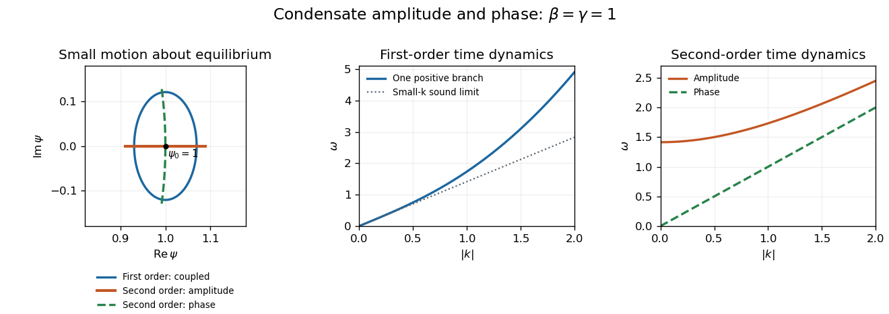

<h1 id="2/solution">Solution</h1>

↑ **Parent:** [2](../2.md)

An [elementary excitation](../../../../elementary-excitation.md) is an approximately independent low-energy normal mode above a many-body equilibrium state. A [Bogoliubov transformation](../../../../bogoliubov-transformation.md) mixes creation and annihilation operators to diagonalize a quadratic fluctuation Hamiltonian. For weakly interacting bosons,

$$
E_k=\sqrt{\varepsilon_k(\varepsilon_k+2gn_0)},\qquad \varepsilon_k=\frac{\hbar^2k^2}{2m},
$$

interpolating between sound and particle-like motion. Bosonic canonical commutators require $|u_k|^2-|v_k|^2=1$. In [BCS theory](../../../../bcs-theory.md), fermionic particle–hole mixtures instead have $|u_k|^2+|v_k|^2=1$ and excitation energies $E_k=\sqrt{\xi_k^2+|\Delta_k|^2}$. These fermionic quasiparticles must be distinguished from collective amplitude and phase oscillations of the pair field.

For the stated dimensionless first-order equation, a nonzero uniform static solution obeys $(|\psi_0|^2-1)\psi_0=0$. Thus **$\psi_0=e^{i\theta_0}$**. The zero field is also stationary, but is not the condensed minimum of the local potential $\beta(|\psi|^2-1)^2/2$.

Choose $\theta_0=0$. To linear order, $\psi=1+\rho/2+i\theta$, so $|\psi|^2-1=\rho$. Substitution and separation of real and imaginary parts give

$$
\frac i2\dot\rho-\dot\theta=-\frac12\rho''-i\theta''+\beta\rho,
\qquad
\boxed{\dot\rho=-2\theta'',\quad \dot\theta=\frac12\rho''-\beta\rho.}
$$

Differentiating the first relation and using the second yields

$$
\ddot\rho=-\rho''''+2\beta\rho''.
$$

The same elimination holds for $\theta$. A plane wave $e^{i(kx-\omega t)}$ therefore gives

$$
\boxed{\omega^2=k^4+2\beta k^2,\qquad \omega=|k|\sqrt{k^2+2\beta}.}
$$

The density and phase components share this frequency because of [density-phase conjugacy](../../../../density-phase-conjugacy.md). They are coupled components of one positive-frequency [Bogoliubov mode](../../../../bogoliubov-mode.md), not two independent excitations that happen to have equal energies. At $k=0$, a constant phase change is a zero mode; the nonzero-$k$ elimination should not be used to assign an independent oscillation to a uniform density change.

Replacing the first-order time derivative by $-\gamma\ddot\psi$ changes the number and structure of dynamical degrees of freedom. The linearized real and imaginary equations now decouple:

$$
-\frac\gamma2\ddot\rho=-\frac12\rho''+\beta\rho,\qquad
-\gamma\ddot\theta=-\theta''.
$$

The [amplitude and phase modes of a second-order complex field](../../../../amplitude-and-phase-modes-of-a-second-order-complex-field.md) consequently have

$$
\boxed{\omega_\rho^2=\frac{k^2+2\beta}{\gamma},\qquad
\omega_\theta^2=\frac{k^2}{\gamma}.}
$$

The amplitude mode has a nonzero gap $\sqrt{2\beta/\gamma}$; the phase mode is gapless with speed $1/\sqrt\gamma$. Frequencies are nonnegative, so the printed expression $k/\sqrt\gamma$ is understood for $k\ge0$ or replaced by $|k|/\sqrt\gamma$.

In the complex plane, an amplitude oscillation moves radially relative to the chosen equilibrium $\psi=1$, and a phase oscillation moves tangentially, or along a short unit-circle arc beyond linear order. A first-order coupled mode combines them in quadrature. For a fixed spatial factor and $k\ne0$, one possible parametrization is

$$
\rho=R\cos\omega t,\qquad
\theta=-\frac{\omega R}{2k^2}\sin\omega t,
$$

so $\delta\psi=\rho/2+i\theta$ traces a small ellipse about $1$. Choose $R$ small enough that both components remain within the linear approximation.

**[Figure 1](#2/image-coupled-density-phase-motion-versus-separate-amplitude-and-phase-branches). Coupled density–phase motion versus separate amplitude and phase branches**. Original linearized models with $\beta=\gamma=1$. The first-order trajectory is shown at a fixed position for $k=1$; the second-order trajectories are separate possible modes, not simultaneous motions of one excitation.

A weak neutral Bose condensate realizes the first-order structure and its sound-like [Bogoliubov spectrum](../../../../bogoliubov-quasiparticle-dispersion.md). A particle–hole-symmetric effective complex field can realize the second-order structure, with a gapless [Goldstone mode](../../../../goldstone-boson.md) and a distinct [amplitude mode](../../../../higgs-mode.md). A neutral BCS superfluid likewise has collective phase and amplitude responses, although the amplitude response near pair-breaking energy need not be a sharp undamped particle; its fermionic quasiparticles are separate excitations.

In a charged bulk superconductor, long-range Coulomb interactions and electromagnetic dynamics remove the neutral sound-like phase branch from the low-frequency spectrum. The [Anderson-Higgs mechanism in a superconductor](../../../../anderson-higgs-mechanism-in-a-superconductor.md) produces a longitudinal plasma mode, schematically $\omega^2\simeq\omega_p^2+c_s^2k^2$ in an appropriate long-wavelength model. The amplitude scale is typically associated with $2\Delta/\hbar$ in a simple BCS regime, with damping and mixing dependent on material and symmetry. One should not simply retain the neutral Goldstone dispersion after charging the field, nor identify the static Ginzburg-Landau functional alone with a complete time-dependent microscopic theory.

## ↑ Ancestors (13)

1. [2](../2.md)
2. [Paper 1](../../paper-1-split.md)
3. [2016](../../split.md)
4. [Past exam of the superconductivity and Quantum Coherence course of the University of Cambridge](../../../split.md)
5. [Superconductivity and Quantum Coherence course of the University of Cambridge](../../../../superconductivity-and-quantum-coherence-course-of-the-university-of-cambridge.md)
6. [Physics course of the year 4 of the natural sciences course of the University of Cambridge](../../../../physics-course-of-the-year-4-of-the-natural-sciences-course-of-the-university-of-cambridge.md)
7. [Year 4 of the natural sciences course of the University of Cambridge](../../../../year-4-of-the-natural-sciences-course-of-the-university-of-cambridge.md)
8. [Year of the natural sciences course of the University of Cambridge](../../../../year-of-the-natural-sciences-course-of-the-university-of-cambridge.md)
9. [Natural sciences course of the University of Cambridge](../../../../natural-sciences-course-of-the-university-of-cambridge.md)
10. [Course of the University of Cambridge](../../../../course-of-the-university-of-cambridge.md)
11. [University of Cambridge](../../../../university-of-cambridge-split.md)
12. [List of universities](../../../../list-of-universities.md)
13. [Codex Wiki](../../../../split.md)
