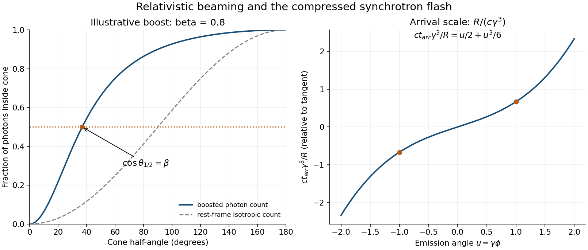
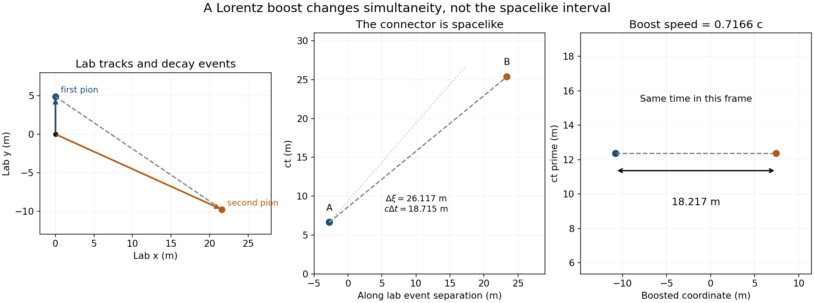
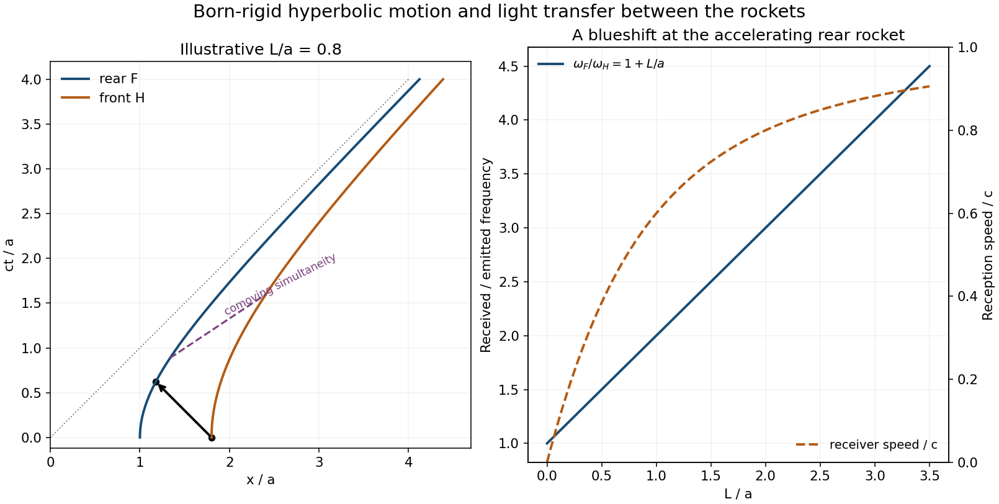

# 2015

↑ **Parent:** [Past exam of the symmetry and relativity course of the University of Oxford](../past-exam-of-the-symmetry-and-relativity-course-of-the-university-of-oxford.md)

[Public source](https://www.whatdotheyknow.com/request/oxford_physics_past_papers_2/response/2340696/attach/3/Physics%20Papers%202014.pdf?cookie_passthrough=1)

**Table of contents**

- [1](#1)
  - [a](#1/a)
    - [Solution](#1/a/solution)
  - [b](#1/b)
    - [Solution](#1/b/solution)
  - [c](#1/c)
    - [i](#1/c/i)
      - [Solution](#1/c/i/solution)
    - [ii](#1/c/ii)
      - [Solution](#1/c/ii/solution)
    - [iii](#1/c/iii)
      - [Solution](#1/c/iii/solution)
    - [iv](#1/c/iv)
      - [Solution](#1/c/iv/solution)
    - [v](#1/c/v)
      - [Solution](#1/c/v/solution)
- [2](#2)
  - [a](#2/a)
    - [Solution](#2/a/solution)
  - [b](#2/b)
    - [Solution](#2/b/solution)
  - [c](#2/c)
    - [i](#2/c/i)
      - [Solution](#2/c/i/solution)
    - [ii](#2/c/ii)
      - [Solution](#2/c/ii/solution)
    - [iii](#2/c/iii)
      - [Solution](#2/c/iii/solution)
  - [d](#2/d)
    - [Solution](#2/d/solution)
- [3](#3)
  - [a](#3/a)
    - [Solution](#3/a/solution)
  - [b](#3/b)
    - [Solution](#3/b/solution)
  - [c](#3/c)
    - [Solution](#3/c/solution)
  - [d](#3/d)
    - [Solution](#3/d/solution)
- [4](#4)
  - [a](#4/a)
    - [Solution](#4/a/solution)
  - [b](#4/b)
    - [i](#4/b/i)
      - [Solution](#4/b/i/solution)
    - [ii](#4/b/ii)
      - [Solution](#4/b/ii/solution)
    - [iii](#4/b/iii)
      - [Solution](#4/b/iii/solution)
  - [c](#4/c)
    - [Solution](#4/c/solution)
  - [d](#4/d)
    - [Solution](#4/d/solution)

## 1

↑ **Parent:** [2015](2015.md)

<h3 id="1/a">a</h3>

↑ **Parent:** [1](#1)

<h4 id="1/a/solution">Solution</h4>

↑ **Parent:** [A](#1/a)

Choose the source motion along $+x$, write $\beta=v/c$, and let primes denote its [instantaneous rest frame](../mathematical-physics.md#instantaneous-rest-frame). A [photon](../quantum-mechanics.md#photon) with rest-frame [energy](../energy.md) $E'$ and direction $\theta'$ has $p_x'=E'\cos\theta'/c$ and transverse momentum $E'\sin\theta'/c$. A [Lorentz boost](../special-relativity.md#lorentz-boost) to the laboratory gives

$$
E=\gamma E'(1+\beta\cos\theta'),\qquad
p_x=\gamma\frac{E'}c(\cos\theta'+\beta).
$$

Since $|\mathbf p|=E/c$, the [relativistic aberration](../mathematical-physics.md#relativistic-aberration) relation and its inverse are

$$
\boxed{\cos\theta=\frac{\cos\theta'+\beta}{1+\beta\cos\theta'},\qquad
\cos\theta'=\frac{\cos\theta-\beta}{1-\beta\cos\theta}.}
$$

The mapping is monotone. The boundary of the rest-frame forward hemisphere, $\cos\theta'=0$, therefore maps to $\cos\theta=\beta$. An isotropic [photon](../quantum-mechanics.md#photon) count assigns exactly half the [photons](../quantum-mechanics.md#photon) to that hemisphere, proving

$$
\boxed{\theta_{1/2}=\cos^{-1}\beta=\sin^{-1}(1/\gamma).}
$$

The [photon count inside a relativistic beaming cone](../special-relativity.md#photon-count-inside-a-relativistic-beaming-cone) concerns an emitted ensemble and counts [photons](../quantum-mechanics.md#photon), not their total [energy](../energy.md) or the arrival-time-weighted [power](../energy.md#power) at a detector. The laboratory [photon](../quantum-mechanics.md#photon) energies depend on direction, so “half the [photons](../quantum-mechanics.md#photon)” need not mean half the radiated [energy](../energy.md). At large $\gamma$ the angular scale is $\theta_{1/2}\simeq1/\gamma$.

**[Figure 1](#1/a/image-aberration-of-an-isotropic-photon-count-and-compression-of-arrival-times). Aberration of an isotropic photon count and compression of arrival times**. Original evaluation of the angle map and the ultrarelativistic tangent-view arrival-time relation. The beaming panel uses an illustrative modest boost so the half-count cone is visible; the storage-ring beam has a much larger Lorentz factor.

<h3 id="1/b">b</h3>

↑ **Parent:** [1](#1)

<h4 id="1/b/solution">Solution</h4>

↑ **Parent:** [B](#1/b)

Use the metric $\eta=\operatorname{diag}(-1,1,1,1)$ and [four-velocity](../special-relativity.md#four-velocity) $u^\mu=\gamma(c,\mathbf v)$. Its derivative with respect to [proper time](../special-relativity.md#proper-time) is the [four-acceleration](../special-relativity.md#four-acceleration). Since

$$
\frac{d\gamma}{dt}=\frac{\gamma^3}{c^2}\mathbf v\cdot\mathbf a,
$$

a purely transverse laboratory acceleration has $d\gamma/dt=0$. With $d/d\tau=\gamma d/dt$,

$$
A^\mu=\frac{du^\mu}{d\tau}=(0,\gamma^2\mathbf a).
$$

The invariant [proper acceleration](../special-relativity.md#proper-acceleration) is the magnitude measured in the [instantaneous rest frame](../mathematical-physics.md#instantaneous-rest-frame), $a_0^2=A^\mu A_\mu$. Consequently,

$$
\boxed{a_0=\gamma^2a\qquad(\mathbf a\perp\mathbf v).}
$$

For longitudinal acceleration the factor is instead $\gamma^3$ multiplying the laboratory acceleration. The distinction matters for circular storage-ring motion, where the acceleration is centripetal and transverse even though its magnitude is nonzero.

<h3 id="1/c">c</h3>

↑ **Parent:** [1](#1)

<h4 id="1/c/i">i</h4>

↑ **Parent:** [C](#1/c)

<h5 id="1/c/i/solution">Solution</h5>

↑ **Parent:** [I](#1/c/i)

Interpret $3$ GeV as the [electron](../physics.md#electron)'s total [energy](../energy.md); the alternative kinetic-energy reading changes the estimate only slightly at this scale. The [Lorentz factor](../special-relativity.md#lorentz-factor) and orbital acceleration are

$$
\gamma=\frac{3000}{0.510999}=5.871\times10^3,\qquad
a=\frac{v^2}{R},\qquad a_0=\gamma^2\frac{v^2}{R}.
$$

Using the supplied [Larmor formula](../electromagnetic-radiation.md#larmor-formula), $\mu_0=1/(\epsilon_0c^2)$ and the revolution time $2\pi R/v$,

$$
P=\frac{e^2\gamma^4v^4}{6\pi\epsilon_0c^3R^2},\qquad
\boxed{U_{\rm turn}=\frac{e^2}{3\epsilon_0R}\gamma^4\beta^3.}
$$

For $R=561$ m this gives $P=1.7405\times10^{-10}$ W per [electron](../physics.md#electron) and $T_{\rm turn}=1.17577\times10^{-5}$ s. Their product is

$$
\boxed{U_{\rm turn}=2.0464\times10^{-15}\ \mathrm J
=1.2773\times10^4\ \mathrm{eV}\simeq12.8\ \mathrm{keV}.}
$$

This is the [energy](../energy.md) loss of one [electron](../physics.md#electron) on a full circular orbit, not its [energy](../energy.md) loss per metre or the total loss of the whole bunch. The fractional loss is only about $4.26\times10^{-6}$ of the $3$ GeV [energy](../energy.md) each revolution. Maintaining a steady stored [energy](../energy.md) requires replacing that [energy](../energy.md) through the accelerator's rf system.

<h4 id="1/c/ii">ii</h4>

↑ **Parent:** [C](#1/c)

<h5 id="1/c/ii/solution">Solution</h5>

↑ **Parent:** [Ii](#1/c/ii)

Relativistic [relativistic aberration](../mathematical-physics.md#relativistic-aberration) concentrates emission into an angular scale

$$
\boxed{\Delta\theta\sim\gamma^{-1}=1.70\times10^{-4}\ \mathrm{rad}
=0.170\ \mathrm{mrad}.}
$$

This is a half-angle or characteristic divergence scale; a full cone opening is about twice it. The exact half-photon-count cone in [a](#1/a) applies to isotropic rest-frame emission. A synchrotron emitter has its own rest-frame angular radiation pattern, so that count result should not be treated as an exact median-power formula for the synchrotron beam. It nevertheless gives the correct [relativistic beaming](../special-relativity.md#relativistic-beaming) scale. Electron-beam emittance, vertical angular spread and the detector's acceptance can broaden the experimentally observed divergence beyond this intrinsic estimate.

<h4 id="1/c/iii">iii</h4>

↑ **Parent:** [C](#1/c)

<h5 id="1/c/iii/solution">Solution</h5>

↑ **Parent:** [Iii](#1/c/iii)

A fixed distant observer receives appreciable radiation while the velocity points within an angle of order $1/\gamma$ of the line of sight. The corresponding emission interval is $\Delta t_{\rm em}\sim R/(\gamma v)$. The source moves toward the detector during that interval, shortening the light-travel distance. In the far-field limit,

$$
\frac{dt_{\rm arr}}{dt_{\rm em}}=1-\beta\cos\phi,
$$

where $\phi$ is the angle between velocity and the detector direction. Near the tangent, $1-\beta\cos\phi\sim\gamma^{-2}$, so

$$
\boxed{\Delta t_{\rm arr}\sim\frac{R}{c\gamma^3}
=9.25\times10^{-18}\ \mathrm s.}
$$

The emission interval itself is of order $3.2\times10^{-10}$ s. Omitting the arrival-time compression would therefore miss many orders of magnitude.

For a definite angular window $-1/\gamma\leq\phi\leq1/\gamma$, integrating the arrival-time relation gives

$$
\Delta t_{\rm arr}=\frac Rv\left[\frac2\gamma-2\beta\sin(1/\gamma)\right]
\simeq\frac{4R}{3c\gamma^3}=1.23\times10^{-17}\ \mathrm s.
$$

The order-one coefficient depends on how the beam window or pulse width is defined. These are intrinsic single-electron radiation-flash scales. For [bunch-length broadening of synchrotron radiation](../electromagnetic-radiation.md#bunch-length-broadening-of-synchrotron-radiation), a finite bunch moving through the same tangent point contributes an arrival-time spread of order its length divided by $v$; the longitudinal bunch profile and instrumental response must be convolved with the intrinsic flash. “Short bunch” alone does not specify an experimental bunch pulse duration at the attosecond scale, because no bunch length has been supplied.[§12.22, equations (1974)–(1981), beaming and arrival-time compression](../physics-bibliography.md#synchrotron-radiation-by-richard-fitzpatrick)

<h4 id="1/c/iv">iv</h4>

↑ **Parent:** [C](#1/c)

<h5 id="1/c/iv/solution">Solution</h5>

↑ **Parent:** [Iv](#1/c/iv)

A shorter radiation flash has a broader [Fourier transform](../fourier-transform.md). From [iii](#1/c/iii), its characteristic angular-frequency bandwidth is

$$
\boxed{\Delta\omega\sim\Delta t_{\rm arr}^{-1}\sim\frac{c}{R}\gamma^3.}
$$

At fixed bending radius this scales as $\gamma^3$ as $v\to c$. The standard synchrotron critical angular [frequency](../wave.md#frequency) makes the same scaling explicit:

$$
\boxed{\omega_c=\frac{3c}{2R}\gamma^3.}
$$

A periodically circulating [electron](../physics.md#electron) produces harmonics of its revolution [frequency](../wave.md#frequency). The very large harmonic range, of order $\gamma^3$, forms the familiar effectively continuous broad synchrotron spectrum at ordinary detector resolution. The result concerns the intrinsic spectrum of the radiation, not merely the slow envelope imposed by a long incoherent bunch. Ordinary [frequency](../wave.md#frequency) is $\nu=\omega/(2\pi)$; mixing cycles per second with radians per second would introduce a spurious factor of $2\pi$ into photon-energy estimates.[critical-energy formula and validity discussion, critical harmonic number $3\gamma^3/2$](../physics-bibliography.md#synchrotron-radiation-in-the-geant4-physics-reference-manual-by-geant4-collaboration)

<h4 id="1/c/v">v</h4>

↑ **Parent:** [C](#1/c)

<h5 id="1/c/v/solution">Solution</h5>

↑ **Parent:** [V](#1/c/v)

Using the conventional critical scale rather than guessing a precise Fourier-width coefficient,

$$
\boxed{E_c=\hbar\omega_c=\frac{3\hbar c\gamma^3}{2R}
=1.07\times10^2\ \mathrm{eV},\qquad
\lambda_c=\frac{hc}{E_c}\simeq11.6\ \mathrm{nm}.}
$$

This is extreme ultraviolet and the very soft X-ray boundary, with a broad spectrum extending on either side; it is not a hard, multi-keV X-ray source at the stated large bending radius. The characteristic [energy](../energy.md) is not a sharp upper cutoff. For orientation, the standard angle-integrated spectral [power](../energy.md#power) per unit [frequency](../wave.md#frequency) peaks near $0.29E_c\simeq31$ eV, also in the extreme ultraviolet; a particular angular acceptance weights that spectrum differently.

The crucial scale follows from both the $3$ GeV [energy](../energy.md) and the $561$ m radius. Using only the fact that synchrotron sources can make X-rays, or replacing the bending radius by a much smaller unstated value, would misidentify the characteristic [photon](../quantum-mechanics.md#photon) energies here. The critical-energy convention and the broadband character are described by the primary radiation model.[photon-spectrum section, equation (209), and Properties of the [Power](../energy.md#power) Spectra](../physics-bibliography.md#synchrotron-radiation-in-the-geant4-physics-reference-manual-by-geant4-collaboration)

## 2

↑ **Parent:** [2015](2015.md)

<h3 id="2/a">a</h3>

↑ **Parent:** [2](#2)

<h4 id="2/a/solution">Solution</h4>

↑ **Parent:** [A](#2/a)

Regard $f$ as a [scalar field](../classical-field-theory.md#scalar-field) evaluated on a specified [worldline](../special-relativity.md#world-line) $x^\lambda(\tau)$. The ordinary multivariable [chain rule](../calculus.md#chain-rule) gives

$$
\boxed{\frac{d}{d\tau}f(x(\tau))
=\frac{dx^\lambda}{d\tau}\frac{\partial f}{\partial x^\lambda}
=u^\lambda\partial_\lambda f.}
$$

This is the [directional derivative](../multivariable-calculus.md#directional-derivative) along the [four-velocity](../special-relativity.md#four-velocity). With $x^0=ct$, it reads $df/d\tau=\gamma(\partial_tf+\mathbf v\cdot\nabla f)$. The spatial term is present because the [worldline](../special-relativity.md#world-line) moves through the field; it would be lost by identifying a [total derivative](../calculus.md#total-derivative) along the particle with a [partial derivative](../multivariable-calculus.md#partial-derivative) at a fixed spatial position. For a scalar the contracted expression has the same value in all coordinate systems. For a tensor field the analogous [covariant derivative](../general-relativity.md#covariant-derivative) also transports its indices.

<h3 id="2/b">b</h3>

↑ **Parent:** [2](#2)

<h4 id="2/b/solution">Solution</h4>

↑ **Parent:** [B](#2/b)

Use $u^\lambda u_\lambda=-c^2$ and a constant [Minkowski metric](../special-relativity.md#minkowski-metric). Vary the velocity-dependent square root **before** imposing the proper-time normalization. Equivalently, vary a reparametrization-invariant [worldline](../special-relativity.md#world-line) action first and then choose [proper time](../special-relativity.md#proper-time). Its canonical covector momentum is

$$
\frac{\partial\mathcal L}{\partial u^a}
=mc\frac{u_a}{\sqrt{-u^2}}+qA_a
\ \longrightarrow\ m u_a+qA_a.
$$

The coordinate derivative at fixed velocity is $\partial\mathcal L/\partial x^a=q u^\lambda\partial_aA_\lambda$. The [Euler-Lagrange equation](../analysis.md#euler-lagrange-equation) and the [chain rule](../calculus.md#chain-rule) from [a](#2/a) therefore give

$$
m\dot u_a+q u^\lambda\partial_\lambda A_a
=q u^\lambda\partial_a A_\lambda.
$$

Define the antisymmetric field tensor by

$$
\boxed{F_{ab}=\partial_aA_b-\partial_bA_a,\qquad
F^{ab}=\partial^aA^b-\partial^bA^a.}
$$

The particle equation becomes

$$
\boxed{m\frac{du_a}{d\tau}=qF_{a\lambda}u^\lambda.}
$$

Antisymmetry ensures $u^aF_{a\lambda}u^\lambda=0$, so the force is orthogonal to the [four-velocity](../special-relativity.md#four-velocity) and preserves $u^2=-c^2$. The [worldline variation before proper-time normalization](../special-relativity.md#worldline-variation-before-proper-time-normalization) is essential: substituting $\sqrt{-u^2}=c$ into the [Lagrangian](../calculus-of-variations.md#lagrangian) **before taking its velocity derivative** would turn the kinetic term into a constant and incorrectly remove the inertial momentum. The normalization is a property of the proper-time solution, not permission to discard the variational dependence.

<h3 id="2/c">c</h3>

↑ **Parent:** [2](#2)

<h4 id="2/c/i">i</h4>

↑ **Parent:** [C](#2/c)

<h5 id="2/c/i/solution">Solution</h5>

↑ **Parent:** [I](#2/c/i)

For the source's definition $s^\alpha=\gamma(\mathbf s\cdot\mathbf v/c,\mathbf s)$, direct contraction with $u^\alpha=\gamma(c,\mathbf v)$ gives

$$
s\cdot u=-\gamma^2\mathbf s\cdot\mathbf v+\gamma^2\mathbf s\cdot\mathbf v=0.
$$

It remains zero under the torque-free transport law. Differentiate the contraction, using the product rule and $u^2=-c^2$:

$$
\boxed{\frac d{d\tau}(s\cdot u)
=\frac{s\cdot\dot u}{c^2}u^2+s\cdot\dot u=0.}
$$

Thus an initially spatial [spin](../angular-momentum-operator.md#spin) in the [instantaneous rest frame](../mathematical-physics.md#instantaneous-rest-frame) remains orthogonal to the velocity. This is the orthogonal-spin specialization of [Fermi-Walker transport](../vector-bundle.md#fermi-walker-transport). The sign is tied to the negative timelike norm; using the opposite metric sign without changing the transport formula would spoil the cancellation.

<h4 id="2/c/ii">ii</h4>

↑ **Parent:** [C](#2/c)

<h5 id="2/c/ii/solution">Solution</h5>

↑ **Parent:** [Ii](#2/c/ii)

Take the dot here to mean $d/d\tau$, as in the source. Differentiate $u^\alpha=\gamma(c,\mathbf v)$ and the given [spin](../angular-momentum-operator.md#spin) components. Their contraction simplifies because the terms involving $\dot\gamma$ cancel:

$$
s_\lambda\dot u^\lambda
=-\gamma(\mathbf s\cdot\mathbf v)\dot\gamma
+\gamma\mathbf s\cdot(\dot\gamma\mathbf v+\gamma\dot{\mathbf v})
=\gamma^2\mathbf s\cdot\dot{\mathbf v}.
$$

The spatial part of the transport equation consequently reads

$$
\frac d{d\tau}(\gamma\mathbf s)
=\frac{\gamma^3}{c^2}(\mathbf s\cdot\dot{\mathbf v})\mathbf v.
$$

Use $\dot\gamma/\gamma=\gamma^2\mathbf v\cdot\dot{\mathbf v}/c^2$ and divide by $\gamma$. The result is

$$
\boxed{\dot{\mathbf s}=\frac{\gamma^2}{c^2}
\left[(\mathbf s\cdot\dot{\mathbf v})\mathbf v
-(\mathbf v\cdot\dot{\mathbf v})\mathbf s\right].}
$$

No assumption of acceleration perpendicular to the velocity was made. In particular the second term cannot be dropped for a particle speeding up along a straight line. This $\mathbf s$ is the three-vector in the source's particular [spin four-vector](../general-relativity.md#spin-four-vector) parametrization; its Euclidean magnitude need not be the invariant proper-spin magnitude.

<h4 id="2/c/iii">iii</h4>

↑ **Parent:** [C](#2/c)

<h5 id="2/c/iii/solution">Solution</h5>

↑ **Parent:** [Iii](#2/c/iii)

Let the fixed direction of motion be the unit vector $\mathbf n$ and decompose $\mathbf s=s_\parallel\mathbf n+\mathbf s_\perp$. In [ii](#2/c/ii) the two parallel contributions cancel, whereas the transverse equation is

$$
\dot s_\parallel=0,\qquad
\dot{\mathbf s}_\perp=-\frac{\gamma^2v\dot v}{c^2}\mathbf s_\perp
=-\frac{\dot\gamma}{\gamma}\mathbf s_\perp.
$$

For the stated speed law, $1-v^2/c^2=e^{-2\Gamma\tau}$, hence $\gamma=e^{\Gamma\tau}$. Since the particle is initially at rest, $\gamma(0)=1$, and

$$
\boxed{\mathbf s(\tau)=s_\parallel(0)\mathbf n
+e^{-\Gamma\tau}\mathbf s_\perp(0).}
$$

The corresponding [spin four-vector](../general-relativity.md#spin-four-vector) has components $s^0=\gamma\beta s_\parallel(0)$, $s^{\rm spatial}_\parallel=\gamma s_\parallel(0)$, and $\mathbf s^{\rm spatial}_\perp=\mathbf s_\perp(0)$. Its squared norm is therefore $s_\parallel(0)^2+|\mathbf s_\perp(0)|^2$, independent of time. The transverse decay of the source's laboratory three-vector is a boost-normalization effect, not a loss of proper [angular momentum](../momentum.md#angular-momentum) or a torque.

For a real increasing speed take $\Gamma>0$ and $\tau\geq0$. The prescribed profile has a singular initial acceleration: $v\sim c\sqrt{2\Gamma\tau}$ near zero. The differential transport calculation applies for $\tau>0$ and the solution has the continuous initial limit displayed above. This trajectory should not be silently described as motion at constant [proper acceleration](../special-relativity.md#proper-acceleration).

<h3 id="2/d">d</h3>

↑ **Parent:** [2](#2)

<h4 id="2/d/solution">Solution</h4>

↑ **Parent:** [D](#2/d)

First note that the supplied [spin](../angular-momentum-operator.md#spin) equation preserves $s\cdot u=0$: its electromagnetic bracket has contraction $u_aF^{a\lambda}s_\lambda+(u^2/c^2)F^{\mu\nu}u_\mu s_\nu=0$, and the remaining transport term cancels $s\cdot\dot u$ as in [i](#2/c/i).

For an explicitly electromagnetic acceleration, set $\dot u^a=(q/m)F^{a\lambda}u_\lambda$ and define $C=F^{\mu\nu}u_\mu s_\nu$. Antisymmetry gives $s\cdot\dot u=-(q/m)C$, so the [spin](../angular-momentum-operator.md#spin) equation can be written

$$
\dot s^a=\frac qm\left[\frac g2 F^{a\lambda}s_\lambda
+\left(\frac g2-1\right)\frac C{c^2}u^a\right].
$$

Contract with $2s_a$:

$$
\boxed{\frac d{d\tau}(s^as_a)
=\frac{gq}{m}s_aF^{a\lambda}s_\lambda
+\frac{2q}{mc^2}\left(\frac g2-1\right)C(s\cdot u)=0.}
$$

The first term vanishes because a symmetric product of the two [spin](../angular-momentum-operator.md#spin) covectors contracts an antisymmetric tensor; the second vanishes by [spin](../angular-momentum-operator.md#spin)–velocity orthogonality. In the [instantaneous rest frame](../mathematical-physics.md#instantaneous-rest-frame) $s^0=0$, so $s^as_a$ is precisely the squared proper spatial-spin magnitude. It remains constant for arbitrary $g$ under this transport, though its direction can precess. In this equation $g$ is the dimensionless [g-factor](../electromagnetism.md#g-factor-physics); the dimensional [gyromagnetic ratio](../electromagnetism.md#gyromagnetic-ratio) includes $gq/(2m)$.

## 3

↑ **Parent:** [2015](2015.md)

<h3 id="3/a">a</h3>

↑ **Parent:** [3](#3)

<h4 id="3/a/solution">Solution</h4>

↑ **Parent:** [A](#3/a)

Each on-shell particle satisfies $E_i^2-c^2|\mathbf p_i|^2=m_i^2c^4$. Thus for a selected subset $A$,

$$
\boxed{\sum_{i\in A}(E_i^2-c^2p_i^2)=c^4\sum_{i\in A}m_i^2.}
$$

It is Lorentz invariant when the same particle labels and physical states are compared, with each [energy](../energy.md) and momentum transformed as that particle's [four-momentum](../special-relativity.md#four-momentum). No requirement that the particles share a velocity is needed. Their energies can change under interactions while their individual fixed [rest masses](../special-relativity.md#invariant-mass) remain the same.

A frame-dependent rule for choosing “half” is more delicate: different subsets can have different sums of rest-mass squares. If every particle has the same [rest mass](../special-relativity.md#invariant-mass) and the number selected is fixed, however, the displayed sum is unchanged even if the selected identities change. In a massless plasma it is identically zero for every subset. The precise condition is constancy of the selected scalar sum, not a blanket claim that every frame-dependent selection must change it.

<h3 id="3/b">b</h3>

↑ **Parent:** [3](#3)

<h4 id="3/b/solution">Solution</h4>

↑ **Parent:** [B](#3/b)

The [covariance of a selected particle momentum sum](../special-relativity.md#covariance-of-a-selected-particle-momentum-sum) follows because, for a fixed set of particle [four-momenta](../special-relativity.md#four-momentum), their sum $P_A^\mu=\sum_{i\in A}p_i^\mu$ is a [four-vector](../special-relativity.md#four-vector) by linearity of the [Lorentz transformation](../special-relativity.md#lorentz-transformation). Therefore

$$
\boxed{\left(\sum_{i\in A}E_i\right)^2-c^2\left|\sum_{i\in A}\mathbf p_i\right|^2
=-c^2P_A^\mu P_{A\mu}}
$$

is invariant. The subset need not comprise the entire plasma, and its particles need not move together. This expression includes cross terms between different particles; it is not the sum of their individual rest-mass squares in [a](#3/a).

The comparison must use the same subset and the transformed [four-momenta](../special-relativity.md#four-momentum) at the same chosen events. Selecting “the lowest-energy half” anew in each frame need not do that. For example, take four [photons](../quantum-mechanics.md#photon) along $\pm x$, with energies $E_0,2E_0$ in each direction. The two lowest in the original frame are an opposite pair and have invariant [energy](../energy.md) squared $4E_0^2$. After a boost at $c/2$ along $+x$, both forward [photons](../quantum-mechanics.md#photon) are redshifted enough to become the lowest pair; that new collinear pair has zero [invariant mass](../special-relativity.md#invariant-mass). This does not contradict covariance, because the subset changed.

If energies are resampled on a different [simultaneity](../special-relativity.md#simultaneity) slice in an interacting plasma, they can also refer to different events. A physical conserved subsystem total must then include exchanged field [energy](../energy.md) and any boundary flux as appropriate. Such operational conservation requirements are distinct from the exact algebraic covariance of a sum of fixed [four-vectors](../special-relativity.md#four-vector).

<h3 id="3/c">c</h3>

↑ **Parent:** [3](#3)

<h4 id="3/c/solution">Solution</h4>

↑ **Parent:** [C](#3/c)

Choose the [kaon](../physics.md#kaon) momentum along $+x$ and the first [pion](../standard-model.md#pion) along $+y$. [Momentum conservation](../momentum.md#momentum-conservation) gives

$$
\mathbf p_1=(0,p_1),\qquad\mathbf p_2=(p,-p_1),
\qquad\boxed{p^2=p_2^2-p_1^2.}
$$

Both [pions](../standard-model.md#pion) have mass $m_\pi$. Apply the on-shell condition to the second [pion](../standard-model.md#pion), using $E_2=E-E_1$:

$$
(E-E_1)^2-c^2(p^2+p_1^2)=m_\pi^2c^4.
$$

Substitute $E^2-p^2c^2=M^2c^4$ and $E_1^2-p_1^2c^2=m_\pi^2c^4$. The equal daughter masses cancel, leaving

$$
\boxed{E_1=\frac{M^2c^4}{2E},\qquad E_2=E-\frac{M^2c^4}{2E}.}
$$

With the supplied rest energies and $E=600$ MeV,

$$
\boxed{\begin{aligned}
pc&=335.253\ \mathrm{MeV},& E_1&=206.338\ \mathrm{MeV},\\
p_1c&=151.945\ \mathrm{MeV},& E_2&=393.662\ \mathrm{MeV},\\
p_2c&=368.078\ \mathrm{MeV}.&&
\end{aligned}}
$$

The second [pion](../standard-model.md#pion) travels below the parent axis, at

$$
\boxed{\theta_2=-\tan^{-1}(p_1/p)=-24.381^\circ.}
$$

Reflection in the $x$ axis gives the equivalent opposite-sign configuration. The condition $E_1\geq m_\pi c^2$ requires $E\leq M^2c^2/(2m_\pi)\simeq886.84$ MeV for this perpendicular first-pion geometry. The given $600$ MeV lies within that range; the geometry cannot be extrapolated to an arbitrarily boosted [kaon](../physics.md#kaon).

**[Figure 2](#3/c/image-pion-decay-tracks-a-spacelike-event-separation-and-its-simultaneous-frame). Pion decay tracks, a spacelike event separation and its simultaneous frame**. Original calculation from the supplied masses and proper lifetimes. The laboratory separation is shown in its actual decay plane; a boost along that separation makes the two decay events simultaneous.

<h3 id="3/d">d</h3>

↑ **Parent:** [3](#3)

<h4 id="3/d/solution">Solution</h4>

↑ **Parent:** [D](#3/d)

Take the [kaon](../physics.md#kaon) decay as the common origin. A [pion](../standard-model.md#pion) traveling freely with constant momentum has lab decay time $t_i=(E_i/m_\pi c^2)\tau_i$ and position $\mathbf r_i=(\mathbf p_i/m_\pi)\tau_i$. The supplied proper survival times therefore give

$$
\boxed{t_1=22.1710\ \mathrm{ns},\quad t_2=84.5978\ \mathrm{ns},\quad
\mathbf r_1=(0,4.89455)\ \mathrm m,\quad
\mathbf r_2=(21.59875,-9.78910)\ \mathrm m.}
$$

Consequently the separation from the first decay event to the second is

$$
\boxed{\Delta t=62.4268\ \mathrm{ns},\quad
\Delta\mathbf r=(21.59875,-14.68365)\ \mathrm m,\quad
|\Delta\mathbf r|=26.1173\ \mathrm m.}
$$

The requested distance is the separation of the two events, not the sum of the two individual [pion](../standard-model.md#pion) path lengths.

Here $|\Delta\mathbf r|>c|\Delta t|$, so the separation is a [spacelike separation](../special-relativity.md#spacelike-separation). There is an [inertial frame](../mathematical-physics.md#inertial-frame) in which the events are simultaneous; in that frame their distance equals the invariant spacelike length:

$$
\boxed{d_{\rm simultaneous}=\sqrt{|\Delta\mathbf r|^2-c^2\Delta t^2}
=18.2170\ \mathrm m.}
$$

One such frame moves along $\Delta\mathbf r$ with $\mathbf V=c^2\Delta t\,\Delta\mathbf r/|\Delta\mathbf r|^2$, of speed $0.71658c$. The [simultaneity](../special-relativity.md#simultaneity) condition is then $\Delta t'=\gamma_V(\Delta t-\mathbf V\cdot\Delta\mathbf r/c^2)=0$.

The [spacelike distance between daughter decay events](../special-relativity.md#spacelike-distance-between-daughter-decay-events) provides an independent invariant check: the daughter [four-velocity](../special-relativity.md#four-velocity) contraction gives

$$
\frac{d_{\rm simultaneous}^2}{c^2}
=\frac{M^2}{m_\pi^2}\tau_1\tau_2-(\tau_1+\tau_2)^2.
$$

It produces the same distance without using the particular [kaon](../physics.md#kaon) laboratory boost. A simultaneous frame exists only when this expression is positive, as it is for these two survival times.

## 4

↑ **Parent:** [2015](2015.md)

<h3 id="4/a">a</h3>

↑ **Parent:** [4](#4)

<h4 id="4/a/solution">Solution</h4>

↑ **Parent:** [A](#4/a)

Maintaining a fixed separation in one inertial [laboratory frame](../mathematical-physics.md#laboratory-frame) is not the same as maintaining a fixed separation measured locally with the accelerating rockets. The attached string is prevented from undergoing the laboratory contraction that an unstrained comoving string would have. It is therefore stretched and develops tensile stress: this is [Bell's spaceship paradox](../special-relativity.md#bell-s-spaceship-paradox), not a failure of [Lorentz contraction](../special-relativity.md#length-contraction).

For sufficiently prolonged acceleration and a finite elastic breaking strain, the string breaks. If an acceleration history produces only a small bounded increase in speed, whether it actually breaks depends on its material strength; the kinematic conclusion is stretching, not an unconditional assertion that every arbitrarily weak acceleration must snap every string. Stress also propagates through a real string at a finite speed. The construction enforcing [Born rigidity](../special-relativity.md#born-rigidity) in the following parts is a different set of trajectories chosen to keep the comoving separation fixed.

<h3 id="4/b">b</h3>

↑ **Parent:** [4](#4)

<h4 id="4/b/i">i</h4>

↑ **Parent:** [B](#4/b)

<h5 id="4/b/i/solution">Solution</h5>

↑ **Parent:** [I](#4/b/i)

Let $A=(ct_A,f(t_A))$ on the rear rocket and $B=(ct_B,h(t_B))$ on the front rocket. The instantaneous inertial [rest frame](../mathematical-physics.md#rest-frame) of the rear rocket at $A$ moves at $v=f'(t_A)$ relative to S. Transform the time difference of these two events:

$$
\Delta t'=\gamma\left[(t_B-t_A)-\frac v{c^2}(h(t_B)-f(t_A))\right].
$$

Setting $\Delta t'=0$ gives

$$
\boxed{c^2(t_B-t_A)=v[h(t_B)-f(t_A)].}
$$

The velocity belongs to the rear event $A$. It is not to be evaluated at laboratory time $t_B$, nor does the [simultaneity](../special-relativity.md#simultaneity) condition mean $t_A=t_B$ in S. At nonzero velocity the front event on the same instantaneous-rest slice is at a different laboratory time.

<h4 id="4/b/ii">ii</h4>

↑ **Parent:** [B](#4/b)

<h5 id="4/b/ii/solution">Solution</h5>

↑ **Parent:** [Ii](#4/b/ii)

Use the same event pair already made simultaneous in the rear [instantaneous rest frame](../mathematical-physics.md#instantaneous-rest-frame). Its proper spatial separation is the [Minkowski interval](../special-relativity.md#minkowski-interval) length, so

$$
\boxed{[h(t_B)-f(t_A)]^2-c^2(t_B-t_A)^2=L^2,\qquad
h(t_B)-f(t_A)>0.}
$$

The inequality selects the front rocket rather than the equally long backward extension. Equivalently the Lorentz-transformed spatial difference obeys $\gamma[h(t_B)-f(t_A)-v(t_B-t_A)]=L$. This is not the condition $h(t)-f(t)=L$ at equal laboratory times, which would describe the stretching arrangement in [a](#4/a).

<h4 id="4/b/iii">iii</h4>

↑ **Parent:** [B](#4/b)

<h5 id="4/b/iii/solution">Solution</h5>

↑ **Parent:** [Iii](#4/b/iii)

Write $\Delta x=h(t_B)-f(t_A)$. Substituting $\Delta t=v\Delta x/c^2$ into [ii](#4/b/ii) gives $L^2=\Delta x^2(1-v^2/c^2)$. The positive-separation branch therefore has

$$
\boxed{\Delta x=\gamma L,\qquad\Delta t=\frac{\gamma Lv}{c^2}.}
$$

The [Born-rigid front trajectory from a rear worldline](../special-relativity.md#born-rigid-front-trajectory-from-a-rear-worldline) follows by setting $t_A=t$:

$$
\boxed{h\!\left(t+\frac{\gamma(t)Lv(t)}{c^2}\right)=f(t)+\gamma(t)L,
\quad v(t)=f'(t),\quad\gamma(t)=[1-v(t)^2/c^2]^{-1/2}.}
$$

Every $v$ and $\gamma$ in this formula is evaluated at the rear event with laboratory time $t$, not at the shifted argument of $h$.

For completeness, a smooth future-directed front trajectory requires this time mapping to be locally invertible. If the signed laboratory acceleration is $a_S=dv/dt$ and the rear [proper acceleration](../special-relativity.md#proper-acceleration) is $\alpha_F=\gamma^3a_S$, then

$$
\frac{dt_B}{dt}=1+\frac{L\alpha_F}{c^2},\qquad
\frac{dx_B}{dt}=v\left(1+\frac{L\alpha_F}{c^2}\right).
$$

When $1+L\alpha_F/c^2>0$, their ratio gives $dh/dt_B=v$, so the two simultaneous points indeed share their instantaneous velocity. If that factor reaches zero, an acceleration-horizon obstruction appears; an arbitrary rear trajectory cannot be extended to an arbitrary rigid length while retaining both rockets future-directed. The positive-acceleration example below satisfies the condition.

<h3 id="4/c">c</h3>

↑ **Parent:** [4](#4)

<h4 id="4/c/solution">Solution</h4>

↑ **Parent:** [C](#4/c)

Take $a>0$ as a length. For the rear hyperbola,

$$
f(t)=\sqrt{a^2+c^2t^2},\qquad
v(t)=\frac{c^2t}{f(t)},\qquad\gamma(t)=\frac{f(t)}a,
\qquad\boxed{\gamma v=\frac{c^2t}{a}.}
$$

The implicit front event from [iii](#4/b/iii) has $t_B=(1+L/a)t$ and $x_B=(1+L/a)f(t)$. Eliminate the rear time $t$ to obtain

$$
\boxed{h(t_B)=\sqrt{(a+L)^2+c^2t_B^2}.}
$$

The rear [proper acceleration](../special-relativity.md#proper-acceleration) is $c^2/a$, while the front [proper acceleration](../special-relativity.md#proper-acceleration) is $c^2/(a+L)$. Thus [Born rigidity](../special-relativity.md#born-rigidity) in the acceleration requires the front rocket to accelerate less strongly. Their constant separation $L$ is measured on the tilted instantaneous-rest slices; their equal-laboratory-time coordinate separation decreases from $L$ rather than staying constant. At $t=0$ both rockets are at rest, at $x=a$ and $x=a+L$.

**[Figure 3](#4/c/image-born-rigid-rocket-hyperbolae-a-received-light-pulse-and-the-frequency-shift). Born-rigid rocket hyperbolae, a received light pulse and the frequency shift**. Original Minkowski diagram and analytic reception quantities. The illustrative geometry uses L over a equal to 0.8; the solution formulas apply to arbitrary positive a and L. The sloping dashed segment joins simultaneous comoving events.

<h3 id="4/d">d</h3>

↑ **Parent:** [4](#4)

<h4 id="4/d/solution">Solution</h4>

↑ **Parent:** [D](#4/d)

The [photon](../quantum-mechanics.md#photon) leaves the front rocket at $(t,x)=(0,a+L)$ and moves toward decreasing $x$, so its laboratory path is $x_\gamma(t)=a+L-ct$. Intersect it with the rear hyperbola, keeping the future root. Squaring and cancelling $c^2t^2$ gives

$$
\boxed{t_R=\frac{L(2a+L)}{2c(a+L)},\qquad
x_R=\frac{(a+L)^2+a^2}{2(a+L)}.}
$$

The rear rocket's speed there is

$$
\boxed{\beta_R=\frac{v_R}{c}=\frac{ct_R}{x_R}
=\frac{(a+L)^2-a^2}{(a+L)^2+a^2}.}
$$

At emission the front rocket is instantaneously at rest in S, so the [photon](../quantum-mechanics.md#photon) laboratory [frequency](../wave.md#frequency) is $\omega_H$. At reception the rear rocket moves in $+x$ while the [photon](../quantum-mechanics.md#photon) travels in $-x$. The [Doppler factor](../special-relativity.md#doppler-factor) for this head-on reception is

$$
\frac{\omega_F}{\omega_H}=\gamma_R(1+\beta_R)
=\sqrt{\frac{1+\beta_R}{1-\beta_R}}
=\boxed{\frac{a+L}{a}.}
$$

The receiver sees a blueshift. It is essential to use the front velocity at emission and the rear velocity at reception; comparing the two velocities at one laboratory time would describe the wrong pair of measurements. The result also agrees with the [Rindler light-transfer frequency ratio](../special-relativity.md#rindler-light-transfer-frequency-ratio) for static accelerated observers at radii $a$ and $a+L$. In the weak-acceleration limit $L/a\ll1$, the shift is $1+L/a$, and the arrival time approaches $L/c$, providing useful checks.

## ↑ Ancestors (9)

1. [Past exam of the symmetry and relativity course of the University of Oxford](../past-exam-of-the-symmetry-and-relativity-course-of-the-university-of-oxford.md)
2. [Symmetry and relativity course of the University of Oxford](../university-of-oxford.md#symmetry-and-relativity-course-of-the-university-of-oxford)
3. [Year 3 of the physics course of the University of Oxford](../university-of-oxford.md#year-3-of-the-physics-course-of-the-university-of-oxford)
4. [Physics course of the University of Oxford](../university-of-oxford.md#physics-course-of-the-university-of-oxford)
5. [Undergraduate course of the University of Oxford](../university-of-oxford.md#undergraduate-course-of-the-university-of-oxford)
6. [Course of the University of Oxford](../university-of-oxford.md#course-of-the-university-of-oxford)
7. [University of Oxford](../university-of-oxford.md)
8. [List of universities](../README.md#list-of-universities)
9. [Codex Wiki](../README.md)
