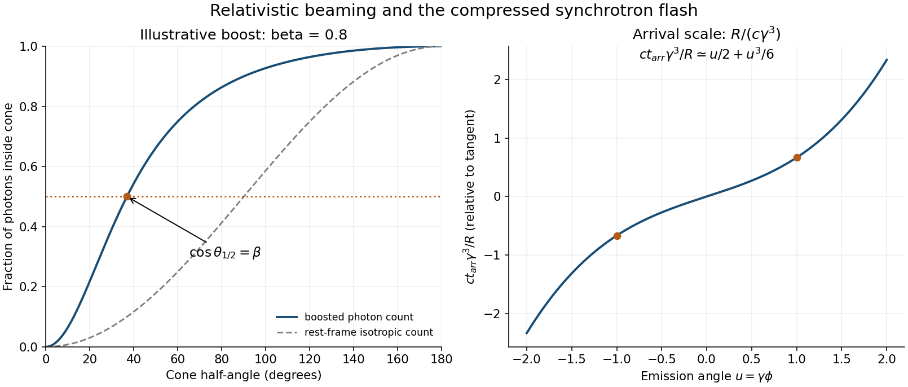

<h1 id="1/a/solution">Solution</h1>

↑ **Parent:** [A](../a.md)

Choose the source motion along $+x$, write $\beta=v/c$, and let primes denote its [instantaneous rest frame](../../../../instantaneous-rest-frame.md). A [photon](../../../../photon.md) with rest-frame [energy](../../../../energy-split.md) $E'$ and direction $\theta'$ has $p_x'=E'\cos\theta'/c$ and transverse momentum $E'\sin\theta'/c$. A [Lorentz boost](../../../../lorentz-boost.md) to the laboratory gives

$$
E=\gamma E'(1+\beta\cos\theta'),\qquad
p_x=\gamma\frac{E'}c(\cos\theta'+\beta).
$$

Since $|\mathbf p|=E/c$, the [relativistic aberration](../../../../relativistic-aberration.md) relation and its inverse are

$$
\boxed{\cos\theta=\frac{\cos\theta'+\beta}{1+\beta\cos\theta'},\qquad
\cos\theta'=\frac{\cos\theta-\beta}{1-\beta\cos\theta}.}
$$

The mapping is monotone. The boundary of the rest-frame forward hemisphere, $\cos\theta'=0$, therefore maps to $\cos\theta=\beta$. An isotropic [photon](../../../../photon.md) count assigns exactly half the [photons](../../../../photon.md) to that hemisphere, proving

$$
\boxed{\theta_{1/2}=\cos^{-1}\beta=\sin^{-1}(1/\gamma).}
$$

The [photon count inside a relativistic beaming cone](../../../../photon-count-inside-a-relativistic-beaming-cone.md) concerns an emitted ensemble and counts [photons](../../../../photon.md), not their total [energy](../../../../energy-split.md) or the arrival-time-weighted [power](../../../../power.md) at a detector. The laboratory [photon](../../../../photon.md) energies depend on direction, so “half the [photons](../../../../photon.md)” need not mean half the radiated [energy](../../../../energy-split.md). At large $\gamma$ the angular scale is $\theta_{1/2}\simeq1/\gamma$.

**[Figure 1](#1/a/image-aberration-of-an-isotropic-photon-count-and-compression-of-arrival-times). Aberration of an isotropic photon count and compression of arrival times**. Original evaluation of the angle map and the ultrarelativistic tangent-view arrival-time relation. The beaming panel uses an illustrative modest boost so the half-count cone is visible; the storage-ring beam has a much larger Lorentz factor.

## ↑ Ancestors (12)

1. [A](../a.md)
2. [1](../../1.md)
3. [2015](../../../2015-split.md)
4. [Past exam of the symmetry and relativity course of the University of Oxford](../../../split.md)
5. [Symmetry and relativity course of the University of Oxford](../../../../symmetry-and-relativity-course-of-the-university-of-oxford.md)
6. [Year 3 of the physics course of the University of Oxford](../../../../year-3-of-the-physics-course-of-the-university-of-oxford.md)
7. [Physics course of the University of Oxford](../../../../physics-course-of-the-university-of-oxford.md)
8. [Undergraduate course of the University of Oxford](../../../../undergraduate-course-of-the-university-of-oxford.md)
9. [Course of the University of Oxford](../../../../course-of-the-university-of-oxford.md)
10. [University of Oxford](../../../../university-of-oxford-split.md)
11. [List of universities](../../../../list-of-universities.md)
12. [Codex Wiki](../../../../split.md)
