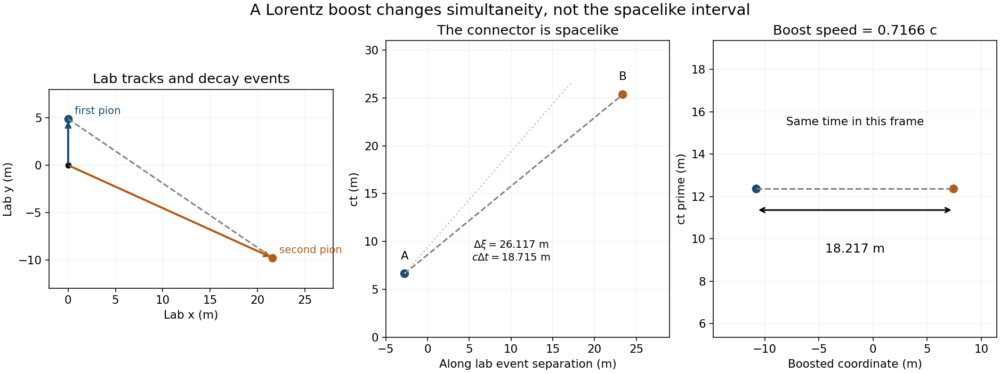

<h1 id="3/c/solution">Solution</h1>

↑ **Parent:** [C](../c.md)

Choose the [kaon](../../../../kaon.md) momentum along $+x$ and the first [pion](../../../../pion.md) along $+y$. [Momentum conservation](../../../../momentum-conservation.md) gives

$$
\mathbf p_1=(0,p_1),\qquad\mathbf p_2=(p,-p_1),
\qquad\boxed{p^2=p_2^2-p_1^2.}
$$

Both [pions](../../../../pion.md) have mass $m_\pi$. Apply the on-shell condition to the second [pion](../../../../pion.md), using $E_2=E-E_1$:

$$
(E-E_1)^2-c^2(p^2+p_1^2)=m_\pi^2c^4.
$$

Substitute $E^2-p^2c^2=M^2c^4$ and $E_1^2-p_1^2c^2=m_\pi^2c^4$. The equal daughter masses cancel, leaving

$$
\boxed{E_1=\frac{M^2c^4}{2E},\qquad E_2=E-\frac{M^2c^4}{2E}.}
$$

With the supplied rest energies and $E=600$ MeV,

$$
\boxed{\begin{aligned}
pc&=335.253\ \mathrm{MeV},& E_1&=206.338\ \mathrm{MeV},\\
p_1c&=151.945\ \mathrm{MeV},& E_2&=393.662\ \mathrm{MeV},\\
p_2c&=368.078\ \mathrm{MeV}.&&
\end{aligned}}
$$

The second [pion](../../../../pion.md) travels below the parent axis, at

$$
\boxed{\theta_2=-\tan^{-1}(p_1/p)=-24.381^\circ.}
$$

Reflection in the $x$ axis gives the equivalent opposite-sign configuration. The condition $E_1\geq m_\pi c^2$ requires $E\leq M^2c^2/(2m_\pi)\simeq886.84$ MeV for this perpendicular first-pion geometry. The given $600$ MeV lies within that range; the geometry cannot be extrapolated to an arbitrarily boosted [kaon](../../../../kaon.md).

**[Figure 2](#3/c/image-pion-decay-tracks-a-spacelike-event-separation-and-its-simultaneous-frame). Pion decay tracks, a spacelike event separation and its simultaneous frame**. Original calculation from the supplied masses and proper lifetimes. The laboratory separation is shown in its actual decay plane; a boost along that separation makes the two decay events simultaneous.

## ↑ Ancestors (12)

1. [C](../c.md)
2. [3](../../3.md)
3. [2015](../../../2015-split.md)
4. [Past exam of the symmetry and relativity course of the University of Oxford](../../../split.md)
5. [Symmetry and relativity course of the University of Oxford](../../../../symmetry-and-relativity-course-of-the-university-of-oxford.md)
6. [Year 3 of the physics course of the University of Oxford](../../../../year-3-of-the-physics-course-of-the-university-of-oxford.md)
7. [Physics course of the University of Oxford](../../../../physics-course-of-the-university-of-oxford.md)
8. [Undergraduate course of the University of Oxford](../../../../undergraduate-course-of-the-university-of-oxford.md)
9. [Course of the University of Oxford](../../../../course-of-the-university-of-oxford.md)
10. [University of Oxford](../../../../university-of-oxford-split.md)
11. [List of universities](../../../../list-of-universities.md)
12. [Codex Wiki](../../../../split.md)
