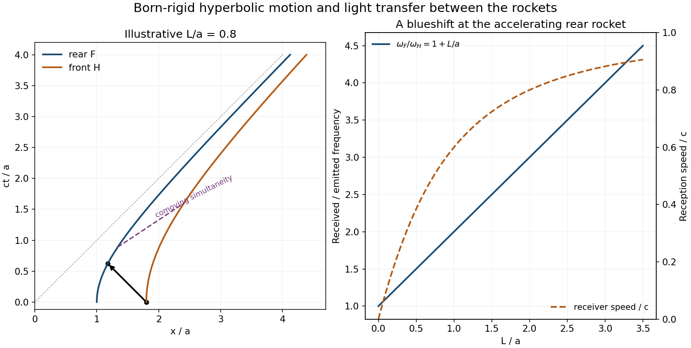

<h1 id="4/c/solution">Solution</h1>

↑ **Parent:** [C](../c.md)

Take $a>0$ as a length. For the rear hyperbola,

$$
f(t)=\sqrt{a^2+c^2t^2},\qquad
v(t)=\frac{c^2t}{f(t)},\qquad\gamma(t)=\frac{f(t)}a,
\qquad\boxed{\gamma v=\frac{c^2t}{a}.}
$$

The implicit front event from [iii](../b/iii.md) has $t_B=(1+L/a)t$ and $x_B=(1+L/a)f(t)$. Eliminate the rear time $t$ to obtain

$$
\boxed{h(t_B)=\sqrt{(a+L)^2+c^2t_B^2}.}
$$

The rear [proper acceleration](../../../../proper-acceleration.md) is $c^2/a$, while the front [proper acceleration](../../../../proper-acceleration.md) is $c^2/(a+L)$. Thus [Born rigidity](../../../../born-rigidity.md) in the acceleration requires the front rocket to accelerate less strongly. Their constant separation $L$ is measured on the tilted instantaneous-rest slices; their equal-laboratory-time coordinate separation decreases from $L$ rather than staying constant. At $t=0$ both rockets are at rest, at $x=a$ and $x=a+L$.

**[Figure 3](#4/c/image-born-rigid-rocket-hyperbolae-a-received-light-pulse-and-the-frequency-shift). Born-rigid rocket hyperbolae, a received light pulse and the frequency shift**. Original Minkowski diagram and analytic reception quantities. The illustrative geometry uses L over a equal to 0.8; the solution formulas apply to arbitrary positive a and L. The sloping dashed segment joins simultaneous comoving events.

## ↑ Ancestors (12)

1. [C](../c.md)
2. [4](../../4.md)
3. [2015](../../../2015-split.md)
4. [Past exam of the symmetry and relativity course of the University of Oxford](../../../split.md)
5. [Symmetry and relativity course of the University of Oxford](../../../../symmetry-and-relativity-course-of-the-university-of-oxford.md)
6. [Year 3 of the physics course of the University of Oxford](../../../../year-3-of-the-physics-course-of-the-university-of-oxford.md)
7. [Physics course of the University of Oxford](../../../../physics-course-of-the-university-of-oxford.md)
8. [Undergraduate course of the University of Oxford](../../../../undergraduate-course-of-the-university-of-oxford.md)
9. [Course of the University of Oxford](../../../../course-of-the-university-of-oxford.md)
10. [University of Oxford](../../../../university-of-oxford-split.md)
11. [List of universities](../../../../list-of-universities.md)
12. [Codex Wiki](../../../../split.md)
