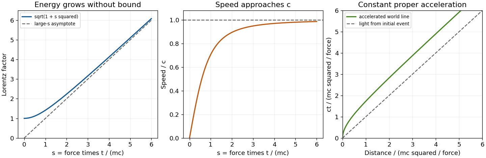

<h1 id="1/d/solution">Solution</h1>

↑ **Parent:** [D](../d.md)

Let $f=|\mathbf f|$ and $\hat{\mathbf f}=\mathbf f/f$. A constant laboratory three-force means $d\mathbf p/dt=\mathbf f$, hence $\mathbf p=\mathbf f t$ from rest. Using $E^2=m^2c^4+p^2c^2$ gives

$$
\boxed{\gamma(t)=\sqrt{1+\left(\frac{ft}{mc}\right)^2},\qquad
\boldsymbol\beta(t)=\frac{ft/(mc)}{\sqrt{1+[ft/(mc)]^2}}\,\hat{\mathbf f}.}
$$

The dimensionless time $s=ft/(mc)$ makes the shapes transparent: $\gamma=\sqrt{1+s^2}$ starts at one with zero slope and becomes asymptotically linear; $\beta=s/\sqrt{1+s^2}$ starts linearly and approaches one without reaching it at finite time. The [acceleration](../../../../acceleration.md) decreases as $f/(m\gamma^3)$.

Integrating the [velocity](../../../../velocity.md) gives the distance along the force,

$$
\ell(t)=\frac{mc^2}{f}[\gamma(t)-1].
$$

Thus a constant three-force produces [hyperbolic motion](../../../../hyperbolic-motion.md) with constant [proper acceleration](../../../../proper-acceleration.md) $f/m$, although its velocity is never Newtonian at large time. The following original curves supply the requested sketches.

**[Figure 1](#1/d/image-lorentz-factor-speed-and-world-line-for-acceleration-from-rest-under-a-constant-laboratory-three-force). Lorentz factor, speed and world line for acceleration from rest under a constant laboratory three-force**.

## ↑ Ancestors (12)

1. [D](../d.md)
2. [1](../../1.md)
3. [2016](../../../2016-split.md)
4. [Past exam of the symmetry and relativity course of the University of Oxford](../../../split.md)
5. [Symmetry and relativity course of the University of Oxford](../../../../symmetry-and-relativity-course-of-the-university-of-oxford.md)
6. [Year 3 of the physics course of the University of Oxford](../../../../year-3-of-the-physics-course-of-the-university-of-oxford.md)
7. [Physics course of the University of Oxford](../../../../physics-course-of-the-university-of-oxford.md)
8. [Undergraduate course of the University of Oxford](../../../../undergraduate-course-of-the-university-of-oxford.md)
9. [Course of the University of Oxford](../../../../course-of-the-university-of-oxford.md)
10. [University of Oxford](../../../../university-of-oxford-split.md)
11. [List of universities](../../../../list-of-universities.md)
12. [Codex Wiki](../../../../split.md)

## ← Incoming links (1)

- [Solution](../e/solution.md)
