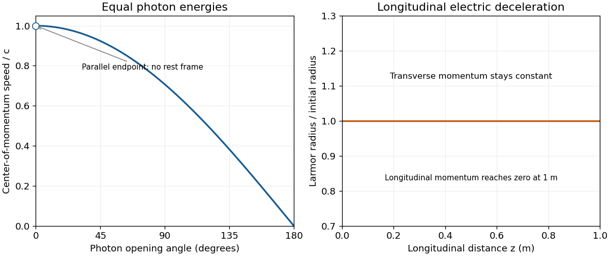

<h1 id="2/c/b/solution">Solution</h1>

↑ **Parent:** [B](../b.md)

The [center-of-momentum frame](../../../../../center-of-momentum-frame.md) moves with velocity $\mathbf V=c^2\mathbf p_{\rm tot}/E_{\rm tot}$. Using the total [four-momentum](../../../../../four-momentum.md) in [solution](../a/solution.md) gives

$$
\boxed{\mathbf V=\frac c2(1+\cos\theta,\sin\theta,0),\qquad
\frac{|\mathbf V|}{c}=\left|\cos\frac\theta2\right|.}
$$

For $0<\theta\le\pi$, its direction bisects the two photon directions, and its speed decreases from the limiting value $c$ to zero. At $\theta=\pi$, the lab already is the [center-of-momentum frame](../../../../../center-of-momentum-frame.md). At $\theta=0$, the formal speed is $c$ and no inertial rest frame exists; this endpoint is a limit, not an allowable boost.

**[Figure 2](#2/c/b/image-center-of-momentum-speed-for-equal-energy-photons-with-the-parallel-endpoint-excluded-and-the-unchanged-electron-larmor-radius-under-longitudinal-deceleration). Center-of-momentum speed for equal-energy photons, with the parallel endpoint excluded, and the unchanged electron Larmor radius under longitudinal deceleration**.

## ↑ Ancestors (13)

1. [B](../b.md)
2. [C](../../c.md)
3. [2](../../../2.md)
4. [2016](../../../../2016-split.md)
5. [Past exam of the symmetry and relativity course of the University of Oxford](../../../../split.md)
6. [Symmetry and relativity course of the University of Oxford](../../../../../symmetry-and-relativity-course-of-the-university-of-oxford.md)
7. [Year 3 of the physics course of the University of Oxford](../../../../../year-3-of-the-physics-course-of-the-university-of-oxford.md)
8. [Physics course of the University of Oxford](../../../../../physics-course-of-the-university-of-oxford.md)
9. [Undergraduate course of the University of Oxford](../../../../../undergraduate-course-of-the-university-of-oxford.md)
10. [Course of the University of Oxford](../../../../../course-of-the-university-of-oxford.md)
11. [University of Oxford](../../../../../university-of-oxford-split.md)
12. [List of universities](../../../../../list-of-universities.md)
13. [Codex Wiki](../../../../../split.md)
