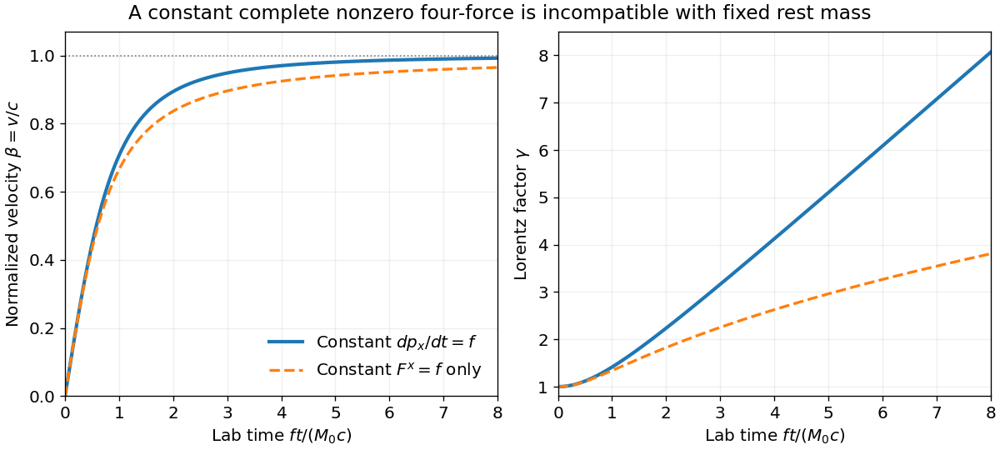
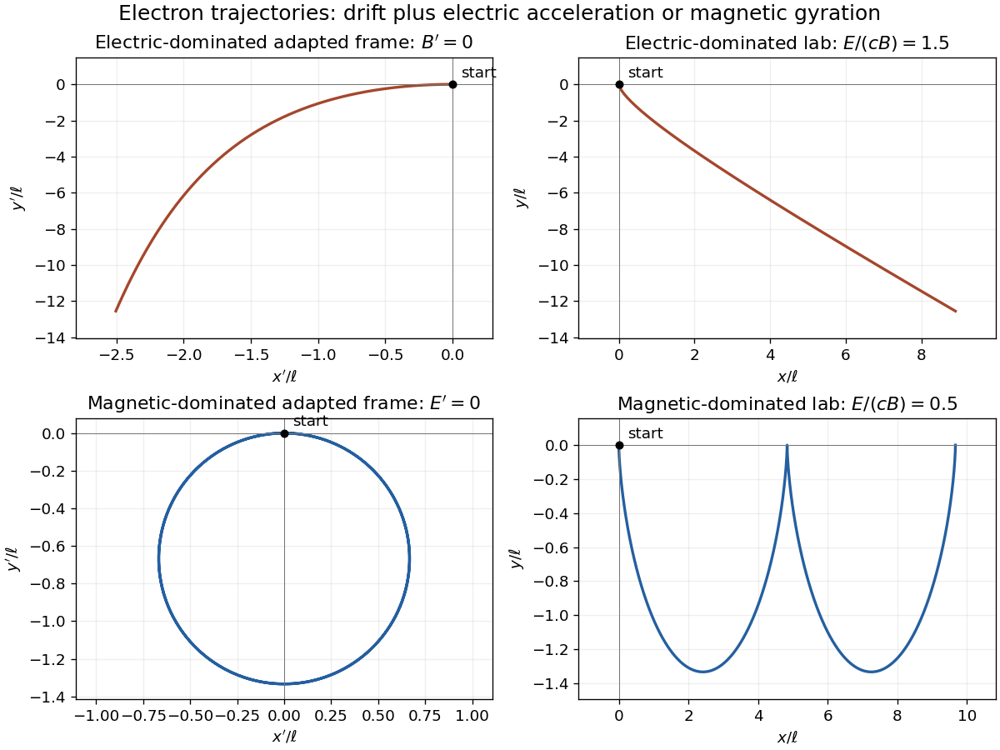

# 2017

↑ **Parent:** [Past exam of the symmetry and relativity course of the University of Oxford](../past-exam-of-the-symmetry-and-relativity-course-of-the-university-of-oxford.md)

Source paper: [Oxford public bundle, pages 67–71](https://www.whatdotheyknow.com/request/oxford_physics_past_papers_2/response/2340696/attach/5/Physics%20Papers%202016.pdf?cookie_passthrough=1). The bundle filename says 2016; the held B2 cover is dated 14 June 2017. Letters identify successive unlettered marked paragraphs; subsidiary source labels are retained. Use $X^\mu=(ct,\mathbf x)$ and the [Minkowski metric](../special-relativity.md#minkowski-metric) $\eta=\operatorname{diag}(1,-1,-1,-1)$ throughout. Official partial notes are explicitly limited to questions 1 and 2; they do not constitute answers to the whole paper.[Cover identifies the year and the restriction to problems 1 and 2; the advertising page uses the same restriction](../physics-bibliography.md#b2-symmetry-and-relativity-2017-solution-notes-problems-1-and-2-by-andrei-starinets)

**Table of contents**

- [1](#1)
  - [a](#1/a)
    - [Solution](#1/a/solution)
  - [b](#1/b)
    - [Solution](#1/b/solution)
  - [c](#1/c)
    - [Solution](#1/c/solution)
  - [d](#1/d)
    - [Solution](#1/d/solution)
  - [e](#1/e)
    - [Solution](#1/e/solution)
- [2](#2)
  - [a](#2/a)
    - [Solution](#2/a/solution)
  - [b](#2/b)
    - [Solution](#2/b/solution)
  - [c](#2/c)
    - [a](#2/c/a)
      - [Solution](#2/c/a/solution)
    - [b](#2/c/b)
      - [Solution](#2/c/b/solution)
  - [d](#2/d)
    - [a](#2/d/a)
      - [Solution](#2/d/a/solution)
    - [b](#2/d/b)
      - [Solution](#2/d/b/solution)
  - [e](#2/e)
    - [Solution](#2/e/solution)
- [3](#3)
  - [a](#3/a)
    - [Solution](#3/a/solution)
  - [b](#3/b)
    - [Solution](#3/b/solution)
    - [a](#3/b/a)
      - [Solution](#3/b/a/solution)
    - [b](#3/b/b)
      - [Solution](#3/b/b/solution)
  - [c](#3/c)
    - [Solution](#3/c/solution)
  - [d](#3/d)
    - [Solution](#3/d/solution)
- [4](#4)
  - [a](#4/a)
    - [Solution](#4/a/solution)
  - [b](#4/b)
    - [Solution](#4/b/solution)
  - [c](#4/c)
    - [Solution](#4/c/solution)
  - [d](#4/d)
    - [Solution](#4/d/solution)
  - [e](#4/e)
    - [Solution](#4/e/solution)

## 1

↑ **Parent:** [2017](2017.md)

<h3 id="1/a">a</h3>

↑ **Parent:** [1](#1)

<h4 id="1/a/solution">Solution</h4>

↑ **Parent:** [A](#1/a)

For a massive particle on a timelike [world line](../special-relativity.md#world-line), the [four-velocity](../special-relativity.md#four-velocity) is $U^\mu=dX^\mu/d\tau=\gamma(c,\mathbf v)$, with $U^2=c^2$. Its [four-momentum](../special-relativity.md#four-momentum) is $P^\mu=mU^\mu=(E/c,\mathbf p)$ and its [four-force](../special-relativity.md#four-force) is $F^\mu=dP^\mu/d\tau$. Here $\tau$ is [proper time](../special-relativity.md#proper-time). A massless trajectory does not admit this massive-particle proper-time parametrization.

**The asserted classification of arbitrary orthogonal vectors is false.** With the chosen [Minkowski metric](../special-relativity.md#minkowski-metric), $D=(0,1,0,0)$ and $G=(0,0,1,0)$ are nonzero, orthogonal and both [spacelike vectors](../general-relativity.md#spacelike-vector). Also $D=(1,1,0,0)$ and $G=2D$ are orthogonal [null vectors](../special-relativity.md#null-vector). The valid statement is that a nonzero vector orthogonal to a [timelike vector](../general-relativity.md#timelike-vector) is spacelike. To prove it, choose the rest frame of the [timelike vector](../general-relativity.md#timelike-vector), $D=(d,0,0,0)$; then $D\cdot G=dG^0=0$ forces $G^0=0$, so $G^2=-|\mathbf G|^2<0$.

The [relativistic energy-momentum relation](../special-relativity.md#energy-momentum-relation) gives

$$
P\cdot P=\frac{E^2}{c^2}-|\mathbf p|^2=m^2c^2.
$$

Therefore $\boxed{P^2=0\ \Longrightarrow\ m=0}$. A [photon](../quantum-mechanics.md#photon) is an example: $E=c|\mathbf p|$. A collection of [photons](../quantum-mechanics.md#photon) need not itself have zero [invariant mass](../special-relativity.md#invariant-mass).

<h3 id="1/b">b</h3>

↑ **Parent:** [1](#1)

<h4 id="1/b/solution">Solution</h4>

↑ **Parent:** [B](#1/b)

Along a massive particle's [world line](../special-relativity.md#world-line), [proper time](../special-relativity.md#proper-time) satisfies $d\tau=dt\sqrt{1-v^2/c^2}$. A [pure force](../special-relativity.md#pure-force) preserves its [rest mass](../special-relativity.md#invariant-mass). Differentiating $P=mU$ and $U^2=c^2$ gives

$$
F\cdot U=\frac{dm}{d\tau}U^2+m\frac{dU}{d\tau}\cdot U
=c^2\frac{dm}{d\tau},
$$

so $\boxed{F\cdot U=0}$ for a [pure force](../special-relativity.md#pure-force). This is a restriction on rest-mass transfer, not a statement that its work in every frame vanishes.

Write $\mathbf a=d\mathbf v/dt$. Since $\dot\gamma=\gamma^3\mathbf v\cdot\mathbf a/c^2$, the [four-acceleration](../special-relativity.md#four-acceleration) is

$$
A^\mu=\left(\frac{\gamma^4\mathbf v\cdot\mathbf a}{c},\;
\gamma^2\mathbf a+\frac{\gamma^4\mathbf v\cdot\mathbf a}{c^2}\mathbf v\right).
$$

If $\mathbf v\cdot\mathbf a=0$, this reduces to $A=(0,\gamma^2\mathbf a)$, whence

$$
\boxed{A^\mu A_\mu=-\gamma^4a^2,\qquad
\alpha^2\equiv-A^2=\gamma^4a^2.}
$$

Here $\alpha$ is the [proper acceleration](../special-relativity.md#proper-acceleration). The positive expression printed in the source is $A^2$ in the opposite metric signature, or the squared [acceleration](../classical-mechanics.md#acceleration) magnitude in ours. For example, at rest with nonzero [acceleration](../classical-mechanics.md#acceleration), $A=(0,\mathbf a)$ has $A^2=-a^2$ in our convention. Thus one must not combine the printed positive sign with a mostly-minus norm.

<h3 id="1/c">c</h3>

↑ **Parent:** [1](#1)

<h4 id="1/c/solution">Solution</h4>

↑ **Parent:** [C](#1/c)

There is no nonzero, literally constant [four-force](../special-relativity.md#four-force) that is a [pure force](../special-relativity.md#pure-force) throughout this motion. Initially $U=(c,0,0,0)$, so purity forces $F^0=0$. If the full four-vector were constant, $U(\tau)=U(0)+F\tau/M_0$; its square would be $c^2+F^2\tau^2/M_0^2$, which cannot remain $c^2$ for a nonzero initially spatial $F$. This is a genuine ambiguity in the source wording.

The usual consistent interpretation is constant laboratory [relativistic force](../special-relativity.md#relativistic-force) $f=dp_x/dt$, equivalently constant one-dimensional [proper acceleration](../special-relativity.md#proper-acceleration) $f/M_0$. Take $f>0$ and let $s=ft/(M_0c)$. Integrating [momentum conservation](../momentum.md#momentum-conservation) with the applied impulse gives $p_x=ft$, so

$$
\boxed{U^\mu(t)=c\left(\sqrt{1+s^2},s,0,0\right),\qquad
\beta(t)=\frac{s}{\sqrt{1+s^2}},\qquad\gamma(t)=\sqrt{1+s^2}.}
$$

The corresponding [four-force](../special-relativity.md#four-force) has components $F^\mu=\gamma f(\beta,1,0,0)$, which are not constant, although its invariant magnitude is $F^2=-f^2$. Its temporal component is indeed $F^0=(\gamma/c)dE/dt$. The speed rises from zero and approaches $c$ asymptotically; $\gamma$ starts at one, initially rises quadratically and becomes linear in $t$ at late times.

If instead only the spatial [four-force](../special-relativity.md#four-force) component $F^x=f_x$ is held constant, the distinct consistent answer is most simply parametrized by $u=f_x\tau/(M_0c)$:

$$
\boxed{U^\mu=c(\sqrt{1+u^2},u,0,0),\qquad
\frac{f_xt}{M_0c}=\frac12\left[u\sqrt{1+u^2}+\operatorname{arsinh}u\right],\qquad
F^0=\frac{f_xu}{\sqrt{1+u^2}}.}
$$

This follows by integrating $dU^x/d\tau=f_x/M_0$ and $dt/d\tau=U^0/c$. The temporal component must still vary. These two interpretations must not be conflated with a constant four-vector.

**[Figure 1](#1/c/image-velocity-and-lorentz-factor-for-two-consistent-constant-force-interpretations). Velocity and Lorentz factor for two consistent constant-force interpretations**. Solid curves hold laboratory three-force constant; dashed curves hold only the spatial component of four-force constant. Both use the same force scale and start from rest. A nonzero constant complete four-force cannot preserve rest mass throughout the motion.

<h3 id="1/d">d</h3>

↑ **Parent:** [1](#1)

<h4 id="1/d/solution">Solution</h4>

↑ **Parent:** [D](#1/d)

The equal and opposite incoming [momenta](../momentum.md) make the laboratory the [centre-of-mass frame](../special-relativity.md#center-of-momentum-frame). The initial total [four-momentum](../special-relativity.md#four-momentum) is timelike. One outgoing [photon](../quantum-mechanics.md#photon) would have null [four-momentum](../special-relativity.md#four-momentum), so an isolated two-body annihilation cannot produce exactly one [photon](../quantum-mechanics.md#photon). Two [photons](../quantum-mechanics.md#photon) are kinematically possible and must have opposite [momenta](../momentum.md) and equal [energies](../energy.md):

$$
\boxed{N_{\gamma,\min}=2,\qquad
E_\gamma=\frac{K_{\mathrm{tot}}+2m_ec^2}{2}
=500.511\,\mathrm{MeV}.}
$$

The quoted $0.511\,\mathrm{MeV}$ is the rest [energy](../energy.md) $m_ec^2$, not a mass in SI units. The [energy](../energy.md) balance includes both rest [energies](../energy.md) as well as the $1\,\mathrm{GeV}$ total [kinetic energy](../energy.md#kinetic-energy).

This minimum concerns the complete final state. A detector with incomplete acceptance could register only one of the two [photons](../quantum-mechanics.md#photon), or none; conservation laws do not impose a minimum detected count without an ideal-detection assumption. Additional outgoing [photons](../quantum-mechanics.md#photon) are also possible.

<h3 id="1/e">e</h3>

↑ **Parent:** [1](#1)

<h4 id="1/e/solution">Solution</h4>

↑ **Parent:** [E](#1/e)

The [electron](../physics.md#electron) moves in the direction for which the [electric field](../electric-field.md) does positive work. Its [kinetic energy](../energy.md#kinetic-energy) gain is the magnitude $eEL=30\,\mathrm{MeV}$. Hence

$$
\boxed{\gamma=1+\frac{30}{0.511}=59.7084,\qquad
\beta=\sqrt{1-\gamma^{-2}}=0.99985974.}
$$

This uses the [relativistic energy-momentum relation](../special-relativity.md#energy-momentum-relation), rather than the nonrelativistic kinetic-energy formula. [Acceleration](../classical-mechanics.md#acceleration) is opposite the field direction for a negatively charged [electron](../physics.md#electron), although the [energy](../energy.md) gain is positive along its actual displacement.

## 2

↑ **Parent:** [2017](2017.md)

<h3 id="2/a">a</h3>

↑ **Parent:** [2](#2)

<h4 id="2/a/solution">Solution</h4>

↑ **Parent:** [A](#2/a)

For a vacuum [electromagnetic wave](../electromagnetic-wave.md), the [four-wavevector](../special-relativity.md#four-wavevector) is $K^\mu=(\omega/c,\mathbf k)$ with $|\mathbf k|=\omega/c$ and $K^2=0$. Its phase can be written

$$
\varphi=K_\mu X^\mu+\varphi_0=\omega t-\mathbf k\cdot\mathbf x+\varphi_0.
$$

Because $K$ and $X$ transform as [Lorentz four-vectors](../special-relativity.md#four-vector), their contraction is a [Lorentz scalar](../special-relativity.md#lorentz-scalar). This proves phase invariance, with the same phase convention in both frames.

For a hypothetical free emission $e\to e+\gamma$, [four-momentum conservation](../special-relativity.md#four-momentum-conservation) gives $P=P'+Q$. The initial and final [electrons](../physics.md#electron) have $P^2=P'^2=m_e^2c^2$, and $Q^2=0$. Squaring gives $P'\cdot Q=0$. In the final [electron](../physics.md#electron)'s rest frame, however, $P'\cdot Q=m_eE_\gamma>0$ for a nonzero future-directed [photon](../quantum-mechanics.md#photon). Thus

$$
\boxed{\text{an isolated on-shell electron cannot emit a real photon in vacuum}.}
$$

An external field, another body or a medium can exchange [momentum](../momentum.md) and change this conclusion; those are different systems.

<h3 id="2/b">b</h3>

↑ **Parent:** [2](#2)

<h4 id="2/b/solution">Solution</h4>

↑ **Parent:** [B](#2/b)

Let $\Delta t=t_d-t_g$ and $\Delta\mathbf x=\mathbf x_d-\mathbf x_g$. A [spacelike separation](../special-relativity.md#spacelike-separation) obeys

$$
\boxed{c^2\Delta t^2-|\Delta\mathbf x|^2<0.}
$$

Under a boost with [velocity](../classical-mechanics.md#velocity) $\mathbf V$, the time separation is $\Delta t'=\Gamma(\Delta t-\mathbf V\cdot\Delta\mathbf x/c^2)$. Choose

$$
\boxed{\mathbf V=\frac{c^2\Delta t}{|\Delta\mathbf x|^2}\,\Delta\mathbf x.}
$$

Then $\Delta t'=0$, while $|\mathbf V|/c=c|\Delta t|/|\Delta\mathbf x|<1$ follows from the spacelike inequality. Therefore an inertial simultaneity frame exists. This choice has no transverse boost component and is not claimed to be the unique such frame. If the events are already simultaneous, $\mathbf V=0$ suffices.

<h3 id="2/c">c</h3>

↑ **Parent:** [2](#2)

<h4 id="2/c/a">a</h4>

↑ **Parent:** [C](#2/c)

<h5 id="2/c/a/solution">Solution</h5>

↑ **Parent:** [A](#2/c/a)

Put $\varepsilon=\hbar\omega$. The total [four-momentum](../special-relativity.md#four-momentum) of the perpendicular [photons](../quantum-mechanics.md#photon) is

$$
P_{\mathrm{tot}}=\left(\frac{2\varepsilon}{c},\frac\varepsilon c,\frac\varepsilon c,0\right).
$$

Although each constituent is massless, the sum has $P_{\mathrm{tot}}^2=2\varepsilon^2/c^2$. Its [invariant mass](../special-relativity.md#invariant-mass) is therefore

$$
\boxed{M_{\mathrm{sys}}=\frac{\sqrt2\,\hbar\omega}{c^2}.}
$$

The rest [energy](../energy.md) is the total [energy](../energy.md) in the frame where the two [photon](../quantum-mechanics.md#photon) [momenta](../momentum.md) cancel, not the sum of individual [photon](../quantum-mechanics.md#photon) rest [energies](../energy.md).

<h4 id="2/c/b">b</h4>

↑ **Parent:** [C](#2/c)

<h5 id="2/c/b/solution">Solution</h5>

↑ **Parent:** [B](#2/c/b)

The [centre-of-mass velocity](../classical-mechanics.md#center-of-mass-velocity) follows from the total [energy](../energy.md) and [momentum](../momentum.md):

$$
\boxed{\mathbf V_{\mathrm{CM}}=\frac{c^2\mathbf p_{\mathrm{tot}}}{E_{\mathrm{tot}}}
=\left(\frac c2,\frac c2,0\right),\qquad
|\mathbf V_{\mathrm{CM}}|=\frac c{\sqrt2}.}
$$

A boost in this direction with $\Gamma_{\mathrm{CM}}=\sqrt2$ gives zero total spatial [momentum](../momentum.md) and total [energy](../energy.md) $\sqrt2\hbar\omega$. The constituent [photons](../quantum-mechanics.md#photon) remain moving at $c$ in that frame.

<h3 id="2/d">d</h3>

↑ **Parent:** [2](#2)

<h4 id="2/d/a">a</h4>

↑ **Parent:** [D](#2/d)

<h5 id="2/d/a/solution">Solution</h5>

↑ **Parent:** [A](#2/d/a)

For the [electric-dominated crossed-field orbit](../electromagnetism.md#electric-dominated-crossed-field-orbit), choose a boost $V=c^2B/E$ along $x$. Since $|E|>c|B|$, it is subluminal. The [Lorentz transformation of electromagnetic fields](../relativistic-electromagnetism.md#lorentz-transformation-of-electromagnetic-fields) gives $B'_z=0$ and $E'_y=E/\Gamma$, where $\Gamma=(1-V^2/c^2)^{-1/2}$. The initially stationary [electron](../physics.md#electron) has $U'(0)=(\Gamma c,-\Gamma V,0,0)$, not zero [velocity](../classical-mechanics.md#velocity) in this frame.

Let $q=-e$, $a=qE'_y/m_e$ and $s=a\tau/c$. Neglect radiation reaction, as in the prescribed external-field model. Integrating the [relativistic Lorentz force](../electromagnetism.md#relativistic-lorentz-force) in this purely electric frame gives the exact trajectory

$$
\boxed{t'=\frac{\Gamma c}{a}\sinh s,\qquad
x'=-\Gamma V\tau,\qquad
y'=\frac{\Gamma c^2}{a}(\cosh s-1),\qquad z'=0.}
$$

Indeed $U'^0=\Gamma c\cosh s$, $U'^x=-\Gamma V$, and $U'^y=\Gamma c\sinh s$ satisfy both the force equation and $U'^2=c^2$. The constant transverse [momentum](../momentum.md) must be retained.

The inverse boost gives a useful exact laboratory parametrization as well:

$$
\boxed{t=\Gamma^2\left[\frac ca\sinh s-\frac{V^2}{c^2}\tau\right],\qquad
x=\Gamma^2V\left[\frac ca\sinh s-\tau\right],\qquad y=y'.}
$$

For $E,B>0$, the lab [electron](../physics.md#electron) starts accelerating toward negative $y$ and bends toward positive $x$, the direction of $\mathbf E\times\mathbf B$. It never acquires a cyclotron orbit in this electric-dominated case. At late times, $v_x\to V$ and $v_y\to\operatorname{sgn}(qE')c/\Gamma$, so its speed approaches $c$ along an oblique asymptote. Reversing field signs reverses the appropriate directions. The zero-$B$ limit is the ordinary electric-field [hyperbolic motion](../special-relativity.md#hyperbolic-motion).

<h4 id="2/d/b">b</h4>

↑ **Parent:** [D](#2/d)

<h5 id="2/d/b/solution">Solution</h5>

↑ **Parent:** [B](#2/d/b)

For the [magnetic-dominated crossed-field orbit](../electromagnetism.md#magnetic-dominated-crossed-field-orbit), choose $V=E/B$ along $x$, which is subluminal when $|E|<c|B|$. Then $E'_y=0$ and $B'_z=B/\Gamma$. The initial [velocity](../classical-mechanics.md#velocity) in this frame is $(-V,0,0)$, and the constant particle [Lorentz factor](../special-relativity.md#lorentz-factor) is $\gamma'=\Gamma$ because a [magnetic field](../magnetic-field.md) does no work.

Define the signed relativistic [cyclotron frequency](../quantum-theory.md#cyclotron-frequency) $\Omega=qB'_z/(\Gamma m_e)$, retaining $q=-e$. With $t'$ as parameter, the exact primed trajectory is

$$
\boxed{x'=-\frac V\Omega\sin(\Omega t'),\qquad
y'=\frac V\Omega[1-\cos(\Omega t')],\qquad z'=0.}
$$

It is a circle of radius $|V/\Omega|$ with centre $(0,V/\Omega)$; its initial [velocity](../classical-mechanics.md#velocity) is $(-V,0,0)$ as required. Transforming back gives

$$
\boxed{x=\Gamma V\left[t'-\frac{\sin(\Omega t')}{\Omega}\right],\qquad
y=\frac V\Omega[1-\cos(\Omega t')],\qquad
t=\Gamma\left[t'-\frac{V^2}{c^2\Omega}\sin(\Omega t')\right].}
$$

In the laboratory this is a stretched cycloidal trajectory with cusps where the [electron](../physics.md#electron) is instantaneously at rest. Its average drift is $\langle v_x\rangle=V=E/B$, along $\mathbf E\times\mathbf B$ for the positive field orientation. Its [energy](../energy.md) oscillates as the [electric field](../electric-field.md) exchanges [energy](../energy.md) with it; it does not accelerate without bound. If $E=0$, the initially stationary [electron](../physics.md#electron) remains stationary. At $|E|=c|B|$, neither of these finite boosts exists; that separate null-field limit is not one of the two strict cases requested.

**[Figure 2](#2/d/b/image-exact-electron-trajectories-in-electric-dominated-and-magnetic-dominated-crossed-fields). Exact electron trajectories in electric-dominated and magnetic-dominated crossed fields**. Original curves use $q=-e$ and an [electron](../physics.md#electron) released from rest in the laboratory. Adapted inertial frames eliminate the [magnetic field](../magnetic-field.md) or [electric field](../electric-field.md), respectively. The lab magnetic-dominated curve has cycloidal cusps; the electric-dominated curve has an oblique relativistic asymptote.

<h3 id="2/e">e</h3>

↑ **Parent:** [2](#2)

<h4 id="2/e/solution">Solution</h4>

↑ **Parent:** [E](#2/e)

With $c=1$, the total [four-momentum](../special-relativity.md#four-momentum) is $P_{\mathrm{tot}}=\sum_iP_i$. A sum of [Lorentz four-vectors](../special-relativity.md#four-vector) transforms as a four-vector, so

$$
\boxed{s^2=P_{\mathrm{tot}}\cdot P_{\mathrm{tot}}
=\left(\sum_iW_i\right)^2-\left|\sum_i\mathbf p_i\right|^2}
$$

is a [Lorentz invariant](../special-relativity.md#lorentz-invariance). Its value is the squared [invariant mass](../special-relativity.md#invariant-mass) of the complete system, irrespective of whether its constituents interact. Isolation makes the total [four-momentum](../special-relativity.md#four-momentum) constant in time.

For a [photon gas](../statistical-physics.md#photon-gas), write $\mathbf p_i=W_i\mathbf n_i$ with $|\mathbf n_i|=1$. Its individual null norms do not make the total norm vanish:

$$
\boxed{s^2=2\sum_{i<j}W_iW_j(1-\mathbf n_i\cdot\mathbf n_j)\geq0.}
$$

For an isotropic gas in its [momentum](../momentum.md) rest frame, $\sum_i\mathbf p_i=0$ and $s^2=W_{\mathrm{tot}}^2$. Zero is possible only when all nonzero [photons](../quantum-mechanics.md#photon) propagate in the same direction. Two equal-energy [photons](../quantum-mechanics.md#photon) at right angles, for example, give $s^2=2W^2$, rather than zero. Without an angular distribution, the pairwise expression is the general answer; isotropy is an additional assumption.

## 3

↑ **Parent:** [2017](2017.md)

<h3 id="3/a">a</h3>

↑ **Parent:** [3](#3)

<h4 id="3/a/solution">Solution</h4>

↑ **Parent:** [A](#3/a)

Three relevant observable effects are the relativistic [Doppler effect](../wave.md#doppler-effect) in spectral-line shifts, including the transverse time-dilation contribution; [relativistic aberration](../mathematical-physics.md#relativistic-aberration), observable as a change of apparent light direction with observer motion; and [relativistic beaming](../special-relativity.md#relativistic-beaming) of moving emitters, associated with strongly asymmetric jet brightness. [Apparent superluminal motion](../astrophysics.md#apparent-superluminal-motion) supplies a related light-travel-time test: $v_{\mathrm{app}}/c=\beta\sin\vartheta/(1-\beta\cos\vartheta)$ can exceed one without a material speed exceeding $c$. These interpretations require an emission and source-motion model; a cosmological or gravitational redshift by itself is not a direct test of special-relativistic kinematics.

For [Compton scattering](../mathematical-physics.md#compton-scattering) from an initially stationary [electron](../physics.md#electron), let incoming and outgoing [photon](../quantum-mechanics.md#photon) [energies](../energy.md) be $\varepsilon$ and $\varepsilon'$ and their mutual angle be $\psi$. [Four-momentum conservation](../special-relativity.md#four-momentum-conservation) gives $P+Q=P'+Q'$. Squaring $P'=P+Q-Q'$ and using both [electron](../physics.md#electron) mass shells and both [photon](../quantum-mechanics.md#photon) null norms gives

$$
2P\cdot(Q-Q')=2Q\cdot Q',\qquad
m_e(\varepsilon-\varepsilon')=\frac{\varepsilon\varepsilon'}{c^2}(1-\cos\psi).
$$

Consequently the outgoing angular frequency and shift are

$$
\boxed{\omega'=\frac{\omega}{1+\frac{\hbar\omega}{m_ec^2}(1-\cos\psi)},\qquad
\Delta\omega=-\omega\frac{\frac{\hbar\omega}{m_ec^2}(1-\cos\psi)}{1+\frac{\hbar\omega}{m_ec^2}(1-\cos\psi)}.}
$$

Equivalently, the [Compton wavelength shift](../mathematical-physics.md#compton-wavelength-shift) is $\lambda'-\lambda=h(1-\cos\psi)/(m_ec)$. The [electron](../physics.md#electron) recoil is essential; treating its [energy](../energy.md) as unchanged would suppress the effect.

<h3 id="3/b">b</h3>

↑ **Parent:** [3](#3)

<h4 id="3/b/solution">Solution</h4>

↑ **Parent:** [B](#3/b)

A boost into a frame moving with [velocity](../classical-mechanics.md#velocity) $\mathbf V$ transforms the temporal component of the [four-wavevector](../special-relativity.md#four-wavevector) as $K'^0=\Gamma(K^0-\mathbf V\cdot\mathbf k/c)$. Therefore the general [relativistic Doppler effect](../wave.md#relativistic-doppler-effect) is

$$
\boxed{\omega'=\Gamma(\omega-\mathbf V\cdot\mathbf k)
=\Gamma\omega(1-\beta\cos\vartheta),}
$$

where $\vartheta$ is the laboratory angle between the boost and propagation directions. This is also the frequency measured from the phase rate along the observer's [world line](../special-relativity.md#world-line), $\omega'=K\cdot U_{\mathrm{obs}}$. The frequency is an observer-dependent contraction of the invariant wave phase.

<h4 id="3/b/a">a</h4>

↑ **Parent:** [B](#3/b)

<h5 id="3/b/a/solution">Solution</h5>

↑ **Parent:** [A](#3/b/a)

Take the wave along positive $x$, so $k_x=\omega/c$. A longitudinal boost $\mathbf V=(v_x,0,0)$ gives

$$
\boxed{\omega'=\gamma_x\omega(1-v_x/c)
=\omega\sqrt{\frac{1-v_x/c}{1+v_x/c}}.}
$$

A receiver moving in the propagation direction measures a redshift. The same signed expression gives a blueshift when $v_x<0$. If the original wave propagates along negative $x$ instead, retain $k_x=-\omega/c$ in the general formula.

<h4 id="3/b/b">b</h4>

↑ **Parent:** [B](#3/b)

<h5 id="3/b/b/solution">Solution</h5>

↑ **Parent:** [B](#3/b/b)

For $\mathbf V=(0,v_y,0)$, the laboratory wavevector is perpendicular to the boost. The dot product vanishes, so

$$
\boxed{\omega'=\gamma_y\omega.}
$$

This transverse-observer transformation is a blueshift. It must not be confused with the inverse factor often quoted when transverse refers to a ray perpendicular to the source [velocity](../classical-mechanics.md#velocity) in the _receiver's_ frame. The angle condition is specified in different frames in those two statements; [relativistic aberration](../mathematical-physics.md#relativistic-aberration) relates them.

<h3 id="3/c">c</h3>

↑ **Parent:** [3](#3)

<h4 id="3/c/solution">Solution</h4>

↑ **Parent:** [C](#3/c)

**The asserted necessity of equal masses is false.** Equal unsigned outgoing angles imply equal longitudinal [momenta](../momentum.md) when the transverse [momenta](../momentum.md) cancel; they do not imply equal final speeds or [energies](../energy.md) for unequal masses.

An explicit counterexample uses $c=1$, masses $M_1=m$ and $M_2=2m$, initial projectile [energy](../energy.md) $E_1=2m$, and a stationary target. The initial total [energy](../energy.md) is $4m$ and [momentum](../momentum.md) is $(\sqrt3m,0,0)$. Choose final [four-momenta](../special-relativity.md#four-momentum)

$$
\boxed{P_1'=m\left(\frac{13}8,\frac{\sqrt3}2,\frac{\sqrt{57}}8,0\right),\qquad
P_2'=m\left(\frac{19}8,\frac{\sqrt3}2,-\frac{\sqrt{57}}8,0\right).}
$$

They sum to the incoming [four-momentum](../special-relativity.md#four-momentum). Their squared norms are respectively $m^2$ and $4m^2$, so the collision is elastic. Both trajectories make the same acute angle with positive $x$:

$$
\boxed{\tan\theta_1=\tan\theta_2=\frac{\sqrt{19}}4,\qquad M_1\ne M_2.}
$$

Thus no proof of the printed claim is possible.

The general [centre-of-mass frame](../special-relativity.md#center-of-momentum-frame) construction shows why. Let $p^*$ be the outgoing [momentum](../momentum.md) magnitude there, $\theta^*$ the projectile scattering angle, and $E_1^*,E_2^*$ the two [energies](../energy.md). After a boost $\beta_{\mathrm{CM}}$ along $x$, the equal-angle condition for two forward nonzero trajectories is

$$
p^*\cos\theta^*+\beta_{\mathrm{CM}}E_1^*
=-p^*\cos\theta^*+\beta_{\mathrm{CM}}E_2^*.
$$

With $E_1$ the initial projectile [energy](../energy.md), its solution is

$$
\boxed{\cos\theta^*=
\frac{M_2^2-M_1^2}{2M_2(E_1+M_2)}\quad(c=1),}
$$

provided the right side lies between minus and plus one and both final longitudinal [momenta](../momentum.md) are positive. Equal masses are one allowed case, giving $\theta^*=\pi/2$; they are not necessary. For the counterexample the right side is $3/16$. Even equal masses do not force equal angles for every scattering direction: the symmetric outgoing configuration is an additional choice.

<h3 id="3/d">d</h3>

↑ **Parent:** [3](#3)

<h4 id="3/d/solution">Solution</h4>

↑ **Parent:** [D](#3/d)

Take the stated static [vector potential](../multivariable-calculus.md#vector-potential) with zero [scalar potential](../classical-field-theory.md#scalar-potential). In the laboratory,

$$
\mathbf E=0,\qquad
\mathbf B=\nabla\times\mathbf A
=\bigl(A_0k_u\sin(k_uz),0,0\bigr).
$$

Let $S'$ move along $z$ at the [electron](../physics.md#electron)'s reference [velocity](../classical-mechanics.md#velocity) $v$. The inverse transformation is $z=\gamma(z'+vt')$. The [Lorentz transformation of electromagnetic fields](../relativistic-electromagnetism.md#lorentz-transformation-of-electromagnetic-fields) gives

$$
\boxed{B'_x=\gamma A_0k_u\sin[\gamma k_u(z'+vt')],\qquad
E'_y=\gamma vA_0k_u\sin[\gamma k_u(z'+vt')],}
$$

with all other components zero. The sign follows from $\mathbf v\times\mathbf B=vB_x\mathbf e_y$.

Although an observer fixed in $S'$ sees an oscillating field, this is not an exact source-free propagating [electromagnetic wave](../electromagnetic-wave.md). The phase covector has $\omega'=-\gamma vk_u$, $k'_z=\gamma k_u$, so its squared norm is

$$
\boxed{\left(\frac{\omega'}c\right)^2-(k'_z)^2=-k_u^2<0.}
$$

It is the boost of a static spatial grating, not a null vacuum wave. Equivalently, $E'/B'=v<c$ and $B'^2-E'^2/c^2=B^2$ is nonzero away from nodes; a vacuum [plane wave](../wave-function.md#plane-wave) would have vanishing [electromagnetic field invariants](../relativistic-electromagnetism.md#electromagnetic-field-invariants). In the ultrarelativistic limit it can be a useful nearly wave-like approximation along the [electron](../physics.md#electron)'s path, but the exact distinction remains.

A charged [electron](../physics.md#electron) cannot actually maintain the given constant [velocity](../classical-mechanics.md#velocity) through this nonzero transverse field without an external constraint: the [Lorentz force](../relativistic-electromagnetism.md#lorentz-force) deflects it. The calculation therefore uses the prescribed straight reference trajectory, a weak-deflection approximation, or an instantaneously comoving inertial frame. A globally fixed [electron](../physics.md#electron) rest frame is not available for its exact deflected motion.

## 4

↑ **Parent:** [2017](2017.md)

<h3 id="4/a">a</h3>

↑ **Parent:** [4](#4)

<h4 id="4/a/solution">Solution</h4>

↑ **Parent:** [A](#4/a)

For a boost along positive $x$, let $\gamma=(1-v_x^2/c^2)^{-1/2}$. Parallel field components are unchanged, while transverse components mix. The [Lorentz transformation of electromagnetic fields](../relativistic-electromagnetism.md#lorentz-transformation-of-electromagnetic-fields) gives

$$
\boxed{\begin{aligned}
E'_x&=E_x,&E'_y&=\gamma(E_y-v_xB_z),&E'_z&=\gamma(E_z+v_xB_y),\\
B'_x&=B_x,&B'_y&=\gamma(B_y+v_xE_z/c^2),&B'_z&=\gamma(B_z-v_xE_y/c^2).
\end{aligned}}
$$

These signs correspond to $S'$ moving with $+v_x$ relative to $S$, not the inverse boost. They can be obtained from $F'=\Lambda F\Lambda^{\mathsf T}$ for the [electromagnetic field tensor](../relativistic-electromagnetism.md#electromagnetic-field-tensor).

<h3 id="4/b">b</h3>

↑ **Parent:** [4](#4)

<h4 id="4/b/solution">Solution</h4>

↑ **Parent:** [B](#4/b)

The [electromagnetic four-potential](../relativistic-electromagnetism.md#electromagnetic-four-potential) is $A^\mu=(\Phi/c,\mathbf A)$, and the vacuum [four-wavevector](../special-relativity.md#four-wavevector) is $K^\mu=(\omega/c,0,0,k)$ with $k=\omega/c>0$. Define $\psi=K_\mu X^\mu=\omega t-kz$ and $C=(\omega k)^{-1/2}$. The given transverse potential is $A_y=-C\sin\psi$. Its physical fields are

$$
\boxed{E_y=C\omega\cos\psi,\qquad B_x=-Ck\cos\psi,}
$$

so the [Poynting vector](../electromagnetic-wave.md#poynting-vector) points along positive $z$. For our signature, $\partial^\mu=(c^{-1}\partial_t,-\nabla)$, $F^{0i}=-E_i/c$, and $F^{ij}=-\epsilon_{ijk}B_k$. Therefore

$$
\boxed{F^{\mu\nu}=C\cos\psi
\begin{pmatrix}
0&0&-\omega/c&0\\
0&0&0&0\\
\omega/c&0&0&k\\
0&0&-k&0
\end{pmatrix}.}
$$

The square-root prefactor is simply the source's chosen wave normalization; an overall dimensional amplitude could multiply every field.

The [four-current](../electric-charge.md#four-current) is $J^\mu=(c\rho,\mathbf j)$, with $J_\mu=(c\rho,-\mathbf j)$. [Charge conservation](../electric-charge.md#charge-conservation) takes the equivalent forms

$$
\boxed{\partial_t\rho+\nabla\cdot\mathbf j=0,\qquad
\partial_\mu J^\mu=\partial^\mu J_\mu=0.}
$$

Lowering both indices of $F$ changes the sign of its time-space entries: $F_{0i}=E_i/c$, while $F_{ij}=-\epsilon_{ijk}B_k$. The temporal component of $\partial^\mu F_{\mu\nu}$ is $\nabla\cdot\mathbf E/c=\mu_0c\rho$, by [Gauss's law](../maxwell-equations.md#gauss-s-law). Its spatial components are $c^{-2}\partial_t\mathbf E-\nabla\times\mathbf B=-\mu_0\mathbf j$, by the [Ampère-Maxwell equation](../maxwell-equations.md#ampere-s-circuital-law). Hence

$$
\boxed{\partial^\mu F_{\mu\nu}=\mu_0J_\nu.}
$$

For the displayed free wave the current vanishes because $k=\omega/c$; the component derivation also proves the sourced identity. The two homogeneous [Maxwell equations](../maxwell-equations.md) follow separately from expressing $F$ in terms of a potential.

**Force-sign qualification.** With these definitions the physical [Lorentz force density](../relativistic-electromagnetism.md#lorentz-force-density) is $f_\mu^{\mathrm{phys}}=F_{\mu\nu}J^\nu$, whereas the source prints the reversed contraction $J^\nu F_{\nu\mu}=-f_\mu^{\mathrm{phys}}$. Consequently

$$
\boxed{f_0^{\mathrm{phys}}=\frac{\mathbf j\cdot\mathbf E}{c},\qquad
f_0^{\mathrm{printed}}=-\frac{\mathbf j\cdot\mathbf E}{c}.}
$$

The physical time component is the power transferred to matter per volume divided by $c$, as in [Poynting's theorem](../electromagnetic-wave.md#poynting-theorem). For example parallel positive $j_x$ and $E_x$ do positive work, but the literal printed contraction has negative time component. This sign cannot be repaired while simultaneously retaining the source's tensor definition and the Maxwell identity above; reverse the force contraction to describe the physical force.

<h3 id="4/c">c</h3>

↑ **Parent:** [4](#4)

<h4 id="4/c/solution">Solution</h4>

↑ **Parent:** [C](#4/c)

For $P^\mu=(E/c,\mathbf p)$, directly contract the supplied vector:

$$
W\cdot P=(\mathbf s\cdot\mathbf p)\frac Ec
-\frac Ec\mathbf s\cdot\mathbf p=0.
$$

Thus $\boxed{U_W\cdot P=0}$ whenever its stated normalization is defined, namely $m_0>0$ and $|\mathbf s|>0$. This is the [Pauli-Lubanski orthogonality](../special-relativity.md#pauli-lubanski-orthogonality) property.

The description as a unit vector, however, needs an additional assumption. From the given components and the mass shell,

$$
W^2=-m_0^2c^2|\mathbf s|^2-|\mathbf s\times\mathbf p|^2,\qquad
\boxed{U_W^2=-1-\frac{|\mathbf s\times\mathbf p|^2}{m_0^2c^2|\mathbf s|^2}.}
$$

It equals minus one only for [spin](../angular-momentum-operator.md#spin) parallel to [momentum](../momentum.md), including the zero-momentum case. A concrete counterexample is $\mathbf s=(s,0,0)$ and $\mathbf p=(0,m_0c,0)$: the proposed normalized vector has square minus two. Orthogonality is still true. A genuine [Pauli-Lubanski pseudovector](../special-relativity.md#pauli-lubanski-pseudovector) constructed by boosting a fixed rest-frame [spin](../angular-momentum-operator.md#spin) has invariant norm $-m_0^2c^2|\mathbf s_{\mathrm{rest}}|^2$; the source's generic spatial expression and denominator do not supply that normalization for arbitrary $\mathbf s$.

<h3 id="4/d">d</h3>

↑ **Parent:** [4](#4)

<h4 id="4/d/solution">Solution</h4>

↑ **Parent:** [D](#4/d)

Use a neutral, infinitely long wire on the $x$ axis. Denote the total current by $I=\int j_x\,dA_\perp$, and write $r^2=y^2+z^2$. Outside the wire the [magnetic field](../magnetic-field.md) and [electric field](../electric-field.md) are

$$
\boxed{\mathbf E=0,\qquad
\mathbf B=\frac{\mu_0I}{2\pi r^2}(0,-z,y).}
$$

These follow from cylindrical symmetry and [Ampère's law](../maxwell-equations.md#ampere-s-circuital-law). The zero temporal component of the given total [four-current](../electric-charge.md#four-current) specifies lab neutrality; the $\rho$ in $j_x=\rho v_0$ must refer to a carrier density, not that zero net charge density.

**TODO: normalization from a literal volume [current density](../electric-charge.md#current-density) requires the unspecified wire cross-section.** The source does not supply its area or profile. The exterior field family below is fully determined in terms of $I$; it cannot be reduced to $j_x$ alone without that missing datum. If $j_x$ was intended as a cross-section-integrated line current instead, set $I=j_x$ and interpret its accompanying charge density as charge per length. No inside-wire profile is invented.

For a boost $u=v_0$ along positive $y$, let $\Gamma=(1-u^2/c^2)^{-1/2}$. Apply the [Lorentz transformation of electromagnetic fields](../relativistic-electromagnetism.md#lorentz-transformation-of-electromagnetic-fields) at corresponding events:

$$
\boxed{\mathbf E'_\perp=(\Gamma uB_z,0,0),\qquad
\mathbf B'_\perp=(0,B_y,\Gamma B_z).}
$$

Here the subscript labels the perpendicular-to-wire boost, not the direction of the transformed vector. In these formulas evaluate the original field at $y=\Gamma(y'+ut')$, $z=z'$ and $x=x'$. The wire moves in this frame, so the fields are time-dependent. The local current transforms to $J'^0=0$, $J'^x=j_x$, $J'^y=J'^z=0$. A nonzero transformed [electric field](../electric-field.md) is possible even with zero net charge density: it is not a purely electrostatic field.

For a boost $u=v_0$ along positive $x$, the transverse coordinates are unchanged. The transformed fields are

$$
\boxed{\mathbf E'_\parallel=(0,-\Gamma uB_z,\Gamma uB_y)
=-\frac{\Gamma\mu_0uI}{2\pi r^2}(0,y,z),\qquad
\mathbf B'_\parallel=\Gamma\mathbf B.}
$$

The transformed line charge and current are $\lambda'=-\Gamma uI/c^2$ and $I'=\Gamma I$. These reproduce the radial [electric field](../electric-field.md) through [Gauss's law](../maxwell-equations.md#gauss-s-law). A boost comoving with the [electrons](../physics.md#electron) removes their individual current contribution, but the positive background then moves and the total current is not zero.

For two identical wires, their lab interaction is attractive, with magnitude $\mu_0I^2/(2\pi d)$ per length. The total [four-current](../electric-charge.md#four-current) is spacelike, $J^2=-j_x^2<0$, so no inertial frame makes it a pure charge density. Also $B^2-E^2/c^2=B^2>0$ forbids a frame in which the exterior field is purely electric. For an arbitrary boost along the wires, the electrical part is repulsive and the magnetic part attractive:

$$
\frac{F'_E}{L'}=+\frac{\Gamma^2u^2}{c^2}\frac{\mu_0I^2}{2\pi d},\qquad
\frac{F'_B}{L'}=-\Gamma^2\frac{\mu_0I^2}{2\pi d}.
$$

The latter always dominates, and their sum remains $-\mu_0I^2/(2\pi d)$.

Even a more general boost cannot make the entire-wire force electrical alone. At the second wire choose $y=d,z=0$, so $\mathbf B=B\mathbf e_z$ and $\mathbf j=j\mathbf e_x$ with $jB>0$. The physical [Lorentz force density](../relativistic-electromagnetism.md#lorentz-force-density) is $f=(0,0,-jB,0)$. If the boosted magnetic force vanished, $\mathbf j'\times\mathbf B'=0$, then $\mathbf E'\cdot\mathbf B'=0$ would also give $\mathbf j'\cdot\mathbf E'=0$. Thus $f'^0=0$, which from the boost of $f$ requires $V_y=0$. But for such a boost $f'^y=-jB<0$, whereas $\rho'E'_y=\Gamma_V^2V_x^2jB/c^2\geq0$. The electrical term alone cannot equal the actual force. Therefore there is no such frame for both complete wires, although the force on [electrons](../physics.md#electron) considered separately can be electrical in their rest frame.

<h3 id="4/e">e</h3>

↑ **Parent:** [4](#4)

<h4 id="4/e/solution">Solution</h4>

↑ **Parent:** [E](#4/e)

Let $\varepsilon=E_{ph}$ and $\gamma=W/(M_0c^2)$. For a head-on [photon](../quantum-mechanics.md#photon) and particle collision, boost to the particle's initial rest frame. The incident [photon](../quantum-mechanics.md#photon) [energy](../energy.md) is $\varepsilon_* =\gamma(1+\beta)\varepsilon$. On the inverse-Compton branch $\varepsilon<\gamma\beta M_0c^2$, the maximal outgoing lab [energy](../energy.md) corresponds to rest-frame backscattering into the particle's forward direction. The exact [Compton scattering](../mathematical-physics.md#compton-scattering) recoil formula gives $\varepsilon'_* =\varepsilon_*/[1+2\varepsilon_*/(M_0c^2)]$. Boosting the backscattered [photon](../quantum-mechanics.md#photon) back to the lab gives

$$
\boxed{\varepsilon'_{\max}=\frac{\gamma^2(1+\beta)^2\varepsilon}
{1+2\gamma(1+\beta)\varepsilon/(M_0c^2)}.}
$$

For $\gamma\gg1$ this becomes

$$
\boxed{\varepsilon'_{\max}\simeq\frac{4\gamma^2\varepsilon}
{1+4\gamma\varepsilon/(M_0c^2)}.}
$$

Only in the additional [Thomson scattering](../cosmic-microwave-background-anisotropy.md#thomson-scattering) limit $4\gamma\varepsilon\ll M_0c^2$ may the denominator be neglected, yielding the printed estimate $4[W/(M_0c^2)]^2E_{ph}$. Ultrarelativistic motion alone does not justify it. For example $\gamma=1000$ and $\varepsilon=M_0c^2$ would give $4\times10^6M_0c^2$ from that estimate, exceeding the available total [energy](../energy.md); the recoil-corrected maximum is about $999.75M_0c^2$.

For an arbitrarily hard incident [photon](../quantum-mechanics.md#photon), maximizing over direction needs a further qualification: if $\varepsilon\geq\gamma\beta M_0c^2$, the largest outgoing [photon](../quantum-mechanics.md#photon) [energy](../energy.md) is the unchanged $\varepsilon$, rather than this amplified backscattering branch. The exact [photon](../quantum-mechanics.md#photon) [energy](../energy.md) gain is $\Delta\varepsilon_{\max}=\varepsilon'_{\max}-\varepsilon$. Calling the outgoing [energy](../energy.md) the gain is accurate only when amplification is large. These distinctions prevent the [inverse Compton scattering](../mathematical-physics.md#inverse-compton-scattering) estimate from violating [conservation of energy](../mathematical-physics.md#conservation-of-energy) outside its low-rest-frame-photon-energy regime.

## ↑ Ancestors (9)

1. [Past exam of the symmetry and relativity course of the University of Oxford](../past-exam-of-the-symmetry-and-relativity-course-of-the-university-of-oxford.md)
2. [Symmetry and relativity course of the University of Oxford](../university-of-oxford.md#symmetry-and-relativity-course-of-the-university-of-oxford)
3. [Year 3 of the physics course of the University of Oxford](../university-of-oxford.md#year-3-of-the-physics-course-of-the-university-of-oxford)
4. [Physics course of the University of Oxford](../university-of-oxford.md#physics-course-of-the-university-of-oxford)
5. [Undergraduate course of the University of Oxford](../university-of-oxford.md#undergraduate-course-of-the-university-of-oxford)
6. [Course of the University of Oxford](../university-of-oxford.md#course-of-the-university-of-oxford)
7. [University of Oxford](../university-of-oxford.md)
8. [List of universities](../README.md#list-of-universities)
9. [Codex Wiki](../README.md)
